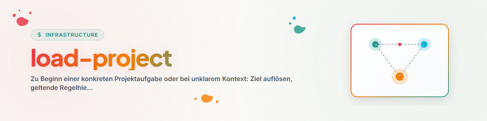

# Load Project (加载项目)

## 目的

在具体项目任务开始时或工作上下文变得不明确时使用此 Skill。目标不是进行全面的代码库审计，而是找到能够安全继续工作所需的最小可靠上下文。

## 配置

此 Skill 不需要固定的目录名称。本地安装可选地在其通用 Agent 规则或项目本地配置中定义以下值：

- 已知的 Workspace 根目录，
- 首选的文件工具，
- 附加 Boot 或 Registry 文件的名称，
- Lock 检查器，
- 项目特定的角色和优先级。

如果缺少此类配置，该 Skill 将仅使用指定的目标和在此处找到的项目规则进行工作。

## 执行流程

### 1. 解析目标

1. 将明确的路径、项目名称或当前工作目录作为起点。
2. 确定实际的项目或代码库根目录 (Root)。
3. 根据任务、根文档和代码库边界缩小模糊匹配范围；当目标存在实质性差异时切勿猜测。

### 2. 加载规则层级

按从通用到具体的上下文顺序读取：

1. 全局 Agent 和安全规则，
2. Workspace 或 Pipeline 规则，
3. 项目和代码库规则，
4. 任务相关的指令。

更具体的规则在其作用域内适用；更高层级的安全和授权边界依然有效。

### 3. 按角色读取根文档

文件名是线索，而非固定标准。专门寻找具备以下角色的文档：

| 角色 | 典型内容 |
|---|---|
| 入口 | 目的、导航、启动说明 |
| 规则 | 工作方式、语言、安全、规范 |
| 架构 | 组件、数据流、边界 |
| 状态 | 当前状态、待解决问题、上次检查 |
| 任务 | 优先处理的下一步工作 |
| 注册表 | 规范项目、检查或发布 |
| 证明 | 测试、检查日志、验证笔记 |
| 交接 | 进行中的工作、第三方修改、下一步 |

仅加载与具体任务相关的角色。

### 4. 跟踪绑定引用

如果读取的规则明确将其他文件列为必读文件，请针对性地进行加载。一旦引用链不再为任务提供额外的绑定上下文，即终止引用链。

### 5. 检查状态与锁 (Locks)

- 根据本地策略对锁的 Owner、Scope、时间戳和有效性标准进行检查；在没有明确 Stale 规则的情况下，切勿擅自宣布锁已过期，
- 版本控制状态和第三方修改，
- 正在运行的进程或检查点（如果相关），
- 注册表、测试和状态详细信息的最新状态。

在做出更改之前，将受影响区域的初始状态保存为状态/Diff 基线。如果无法确切归因现有修改，请预防性地将其视为第三方修改并保持原状。

将快照视为特定时间点的状态，并在执行高风险操作前重新验证。

### 6. 生成现状报告

在实施前简要记录：

```text
Ziel:
Projekt-Root:
Geltende Regeln:
Evidenzquellen:
Snapshot-Zeitpunkt:
Relevanter Ist-Zustand:
Locks oder fremde Änderungen:
Erfolgskriterium:
Nächster sicherer Schritt:
```

引用来源时仅需达到可验证所需的精确程度。对密钥、个人数据和机密内容进行脱敏处理，切勿将其复制到现状报告中。

如果任务据此明确且获得授权，请直接继续工作。

## 边界限制

- 默认情况下不进行广泛、无限制的文件搜索。
- 切勿重新发明缺失的规则或注册表。
- 切勿将旧的状态消息视为当前的证明。
- 切勿覆盖第三方的修改。
- 当仅需加载具体任务的上下文时，切勿执行完整的项目 Onboarding。

## 更新日志 (Changelog)

### 1.1.0 (2026-07-28)
- 移除了固定的用户、Workspace、工具和 Provider 绑定。
- 引入了基于角色的文档识别和可选的本地配置。
- 实现了锁有效性、Dirty-Tree 出处、快照证明和脱敏现状报告的工程化。

### 1.0.0 (2026-06-17)
- 初始本地版本。
