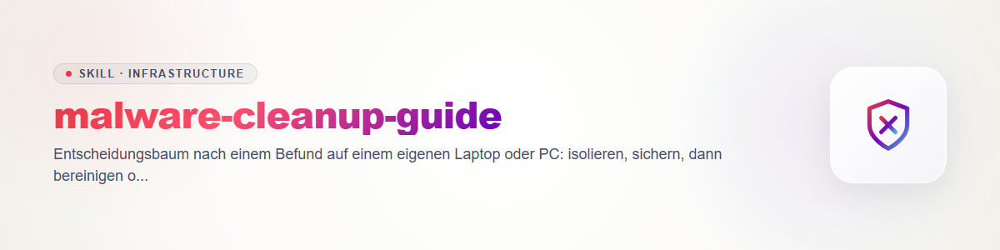

# malware-cleanup-guide (Deutsch)

Nach `rescue-intake` und `endpoint-triage`: Was tun mit dem Befund? Der Skill führt durch
die Entscheidung und die Ausführung. Er ist defensiv und gilt nur für Geräte, deren
Eigentümer eingewilligt hat. Er enthält keine Anleitung gegen fremde Systeme.

**Leitsatz:** Ein Gerät, dessen Umfang der Kompromittierung nicht sicher bekannt ist, gilt
als nicht vertrauenswürdig. Bereinigen ist nur dann verlässlich, wenn man **alles** gefunden
hat; im Zweifel gewinnt das Neuaufsetzen.

**Regeln für jede Änderung:** (1) erst ein Abbild oder Backup, (2) jede einzelne
Änderung vorher benennen und von der Eigentümerin oder dem Eigentümer **einzeln bestätigen**
lassen, (3) lieber deaktivieren oder in Quarantäne verschieben als löschen, (4) jede
Änderung samt Vorher-/Nachher-Zustand in `incident-notes` eintragen.

## Schritt 0: Isolieren

- Netzwerk trennen (WLAN aus, Kabel ziehen). Das stoppt Abfluss und Fernsteuerung.
- Nicht herunterfahren oder neu starten, solange flüchtige Belege noch gebraucht werden
  (laufende Prozesse und Verbindungen); erst nach der Sammlung (`endpoint-triage`).
- Verbundene Wechselmedien und Netzlaufwerke trennen, bevor sie mitinfiziert werden.
- **Von diesem Gerät aus keine Passwörter ändern und sich nirgends anmelden.**

## Schritt 1: Sichern

- Abbild der gesamten Platte (bevorzugt) oder, wenn nicht möglich, ein Backup der
  persönlichen Daten auf ein **separates Medium**, das danach nicht an das Gerät
  zurückgeht, bevor es geprüft wurde.
- Prüfsumme des Abbilds oder Backups notieren (`incident-notes`).
- Gesichert werden **Daten, keine Programme.** Ausführbare Dateien, Skripte und Dokumente
  mit Makros aus dem Backup nur nach Prüfung zurückspielen.
- Ohne bestätigte Sicherung wird nichts gelöscht, entfernt oder neu installiert.

## Schritt 2: Entscheiden

**Neu aufsetzen** (empfohlen, wenn mindestens eines zutrifft):

- Hinweise auf Verschlüsselungs-/Erpressersoftware.
- Verdacht auf Administrator- oder Kernel-Ebene, Rootkit, manipulierten Systemstart oder
  Firmware.
- Mehrere unabhängige Befunde, unklarer Umfang oder Persistenz, die sich nicht vollständig
  erklären lässt.
- Zugangsdaten, Banking oder Fernwartung waren auf dem Gerät aktiv und der Zeitraum ist
  unklar.
- Das Gerät wird beruflich oder für Sensibles genutzt, oder es soll Gewissheit statt
  Wahrscheinlichkeit geben.

**Bereinigen vertretbar** (nur, wenn alles zutrifft):

- Klar abgegrenzter Einzelfund niedrigen Risikos (z. B. unerwünschte Browser-Erweiterung,
  Werbesoftware, Browser-Startseiten-Änderung).
- Herkunft ist verstanden (was wurde wann installiert).
- Die gesamte Persistenz ist identifiziert und erklärt; es gibt keine offenen Fragen.
- Ein aktueller, geprüfter Scan mit einem seriösen Schutzprogramm bestätigt den Befund und
  findet nichts darüber hinaus.

Im Zweifel: **neu aufsetzen.** Die Entscheidung mit Begründung in `incident-notes` festhalten
und der Eigentümerin oder dem Eigentümer in einfachen Worten erklären.

## Schritt 3a: Bereinigen

Je Befund in dieser Reihenfolge, jeweils mit Einzelbestätigung und Nachkontrolle:

1. Persistenz **deaktivieren** (Autostart-Eintrag, geplante Aufgabe, Dienst, Erweiterung),
   nicht löschen.
2. Prozess beenden.
3. Datei in **Quarantäne** verschieben (umbenennen oder in einen Quarantäneordner),
   Hashwert notieren.
4. Erneut sammeln (`endpoint-triage`) und mit dem Vorher-Stand vergleichen: Kommt der
   Eintrag wieder? Gibt es neue Einträge?
5. Mit einem seriösen, aktuellen Schutzprogramm zusätzlich scannen.
6. Erst nach Wochen unauffälligen Verhaltens und bestätigter Entwarnung endgültig löschen.

Kommt etwas zurück oder tauchen neue Auffälligkeiten auf: Bereinigung beenden und auf
Schritt 3b wechseln.

## Schritt 3b: Neu aufsetzen

1. Sicherung aus Schritt 1 geprüft und lesbar.
2. Neu installieren von **offiziellem Medium**, das auf einem sauberen Rechner erstellt
   wurde. Platte dabei vollständig neu partitionieren. Bei Verdacht auf Firmware-Befall den
   Hersteller-Supportweg wählen.
3. Zuerst Betriebssystem und Updates, dann Schutzfunktionen (siehe `os-hardening-baseline`),
   dann die benötigten Programme aus offiziellen Quellen.
4. Daten zurückspielen, vorher scannen; Programme und Makrodateien nicht ungeprüft.

## Schritt 4: Zugangsdaten und Konten (immer, von einem sauberen Gerät aus)

- Passwörter wichtiger Konten ändern (E-Mail zuerst, dann Bank, Cloud, soziale Netzwerke,
  Passwortmanager-Hauptpasswort), **ausschließlich von einem sauberen Gerät.**
- Aktive Sitzungen und Geräteanmeldungen widerrufen, Zwei-Faktor-Verfahren und
  Wiederherstellungsangaben prüfen, App-Passwörter und Zugriffstokens erneuern.
- Kontoverläufe auf Auffälligkeiten ansehen; bei Geldbewegungen die Bank sofort
  informieren, bei Straftat ggf. Anzeige bei der Polizei.
- Erpressung: nicht zahlen und nicht verhandeln; Beratungs- und Meldestellen kontaktieren.

## Schritt 5: Nacharbeit

- Ursache benennen (wie kam es dazu) und abstellen.
- Härtung nach `os-hardening-baseline`.
- Fall in `incident-notes` abschließen, Fallordner nach Absprache aufbewahren oder löschen.
- Wechselmedium, das am Fall beteiligt war, als berührt behandeln.

## Nicht Gegenstand

Gegenangriffe, Zugriff auf fremde Systeme, Entfernen von Schutzfunktionen fremder Geräte,
Beschaffung fremder Zugangsdaten.
