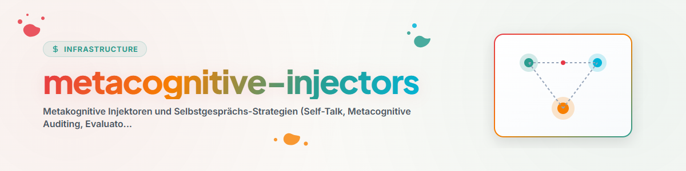

# الحاقنات فوق المعرفية (Metacognitive-Injectors، والاسترجاع النشط والبحث في الذاكرة)

تُرسي المهارة **Metacognitive-Injectors** (والمعروفة أيضاً باسم **`self-talk`**، **`metacognitive-auditing`**، **`evaluator-hook`**، **`preflight-checklist`**، **`inner-speech`**، **`active-retrieval`** و**`rehearsal`**) استراتيجيات للمراقبة الذاتية مستندة إلى علم النفس المعرفي والعلاج النفسي لوكلاء الذكاء الاصطناعي.

---

## 1. البحث النشط عن المعلومات وذاكرة النظام (Gardener وUSMC)

### أ. البحث النشط عن المعلومات في ذاكرات النظام
- قبل الافتراضات أو الادعاءات المتسرعة، **ابحث بنشاط في ذاكرات النظام**:
  1. **Gardener DB (`gardener.py` / `hb_garden_*`):** يبحث في تأثيرات التعلم المرصودة، وقرارات المستخدم، واتفاقيات المسارات (مثل `Gardener().find("companion")`).
  2. **USMC SQLite DB (`usmc_memory.db`):** يستعلم عن الحقائق والدروس وسجلات الجلسات المخزنة.
  3. **ملفات القواعد المركزية (`CLAUDE.md`، `.SYNC`، `AGENTS.md`):** يقرأ الاتفاقيات القائمة وبيانات المسارات.

### ب. التدريب: الاسترجاع النشط والاستعادة (Retrieval Practice)
- **حلقة التكرار دون النطق (الحلقة الصوتية الفونولوجية):**
  لا تكتفِ بقراءة المعلومات بشكل سلبي، بل **استرجعها بنشاط قبل التنفيذ، وأعد بناءها في ذاكرة العمل، وطابقها مع الواقع**.
  - *"هل استرجعتُ المسار الدقيق للسكربت من الذاكرة؟"*
  - *"هل تتطابق صياغة الأمر مع الأمثلة المخزنة في ذاكرة النظام؟"*

---

## 2. الأسس المعرفية والعلاجية

### أ. ذاكرة العمل = الحالة + المحفزات (Baddeley وCowan)
- **الحالة (محتوى الذاكرة):** تحفظ الحالات الوسيطة العابرة بعد كل خطوة فرعية في جداول SQLite (`usmc_memory.db`)، أو `AUTOMATIONS-MEMORY.md`، أو في مخازن الحالة المحلية.
- **المحفزات (آلية التحكم):** مُحمِّل ما قبل التشغيل (Preflight-Bootloader)، ومحفزات الحروف (Letter-Hooks)، ومحفزات المُقيِّم PreToolUse/PostToolUse.

### ب. الوظائف التنفيذية لـ Miyake (القيادة والتحكم)
1. **الكبح (ضبط الاندفاع):** يمنع الاعتماد النهائي المتسرع ورسائل النجاح المُتخيَّلة.
2. **التبديل (المرونة المعرفية):** ينتقل عند الانسداد بشكل ديناميكي إلى توجيه البقاء (Survival-Routing)، أو أنماط الشخصيات، أو مسارات الحل البديلة.
3. **التحديث (تحديث ذاكرة العمل):** يحدّث حالة العمل باستمرار.

### ج. المحفزات العلاجية (CBT وACT والعلاج المركّز على الحلول)
- **إعادة البناء المعرفي في CBT:** إعادة تأطير الأخطاء بوصفها بيانات تشخيصية قيّمة.
- **الانفصال المعرفي والقبول في ACT:** قبول الشك الذاتي بوصفه حالة والإفصاح عنه.
- **التجارب السلوكية:** تنفيذ اختبارات الدخان/التشغيلات الجافة (Smoke-Tests/Dry-Runs) لتوليد أدلة تجريبية حقيقية.

---

## 3. سلسلة التحويل متعددة النماذج وواجهة Codex Companion

| الأولوية | المستشار / المدقق | الواجهة / الأمر | الوظيفة / القاعدة |
| :--- | :--- | :--- | :--- |
| **الأساسي (1)** | **Gemini Subagent** | `invoke_subagent` / `define_subagent` | مدقق داخلي سريع للفحوصات الروتينية. |
| **الثانوي (2)** | **Codex Companion (Native)** | `node "<USER_HOME>\.codex\.tmp\marketplaces\openai-codex\plugins\codex\scripts\codex-companion.mjs" task "..."` | Codex Companion الأصلي للمراجعات و**اعتماد `/goal`**. |
| **الثالث (3)** | **Codex CLI Direct** | `codex exec --skip-git-repo-check` | الاستدعاء المباشر لـ Codex CLI. |
| **الرابع (4)** | **Claude CLI / Swarm** | `claude -p ...` / `hb_swarm_consensus` | رأي ثالث عند بلوغ حدود الرموز (Tokens). |

---

## 4. حقن المطالبات الخاص بكل مجال (Tailored Injection Pattern)

يختار الحاقن (`agy_metacognitive_prompt_injector.py`) الاستراتيجيات المناسبة لكل مجال:

- **الكتلة الأساسية (جميع الـ Sidecars):** منع التنفيذ الفارغ، واعتماد `/goal` من نموذج خارجي، والبحث النشط عن المعلومات (Gardener/USMC)، والتدريب على الاسترجاع (الاسترجاع النشط)، وقائمة التحقق قبل التشغيل (Pre-Flight Checklist).
- **Sidecars البحث (`research-*`):** مع إضافة *البحث القائم على الأدلة (لا مصدر بلا إثبات استعلام)*، و*إعادة تأطير CBT والانفصال المعرفي (النتائج السلبية كنتيجة بحثية)*.
- **Sidecars البرمجيات/Roblox (`software-*`، `roblox-*`):** مع إضافة *حلقة التكرار الصوتي والتدريب*، و*استمرارية حالة ذاكرة العمل*، و*توجيه البقاء (Survival-Routing)*.
- **المشرفون والمختصون العامون (`maintainer-*`، `generalist-*`):** مع إضافة *البحث النشط عن المعلومات*، و*Skill-Finder*، و*محفزات الذاكرة (Memory Hooks)*.
