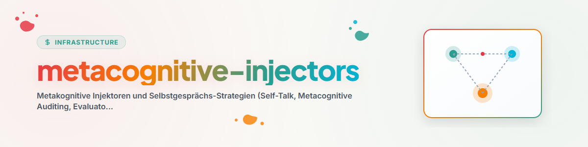

> **Español** — Documentación oficial completa para `metacognitive-injectors`.

# Inyectores Metacognitivos (Metacognitive-Injectors & Self-Talk)

La habilidad **Metacognitive-Injectors** (también conocida como **`self-talk`**, **`metacognitive-auditing`** y **`evaluator-hook`**) establece estrategias de autoevaluación metacognitiva y bucles de auditoría de calidad para agentes de IA.

Previene que los agentes incurran en **declaraciones prematuras de éxito** basadas en métricas superficiales (como la mera creación de archivos) sin verificar el contenido profundo.
