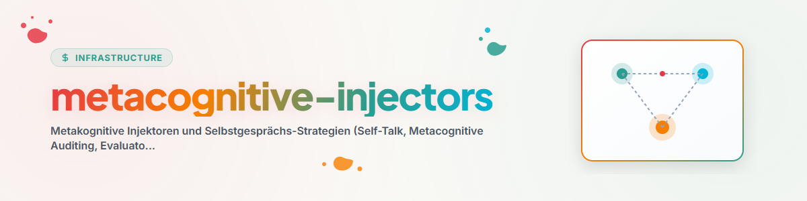

> **Français** — Documentation officielle complète pour `metacognitive-injectors`.

# Injecteurs Métacognitifs (Metacognitive-Injectors & Self-Talk)

La compétence **Metacognitive-Injectors** (également connue sous les noms **`self-talk`**, **`metacognitive-auditing`** et **`evaluator-hook`**) établit des stratégies d'auto-surveillance métacognitive et des boucles d'audit de qualité pour les agents IA.
