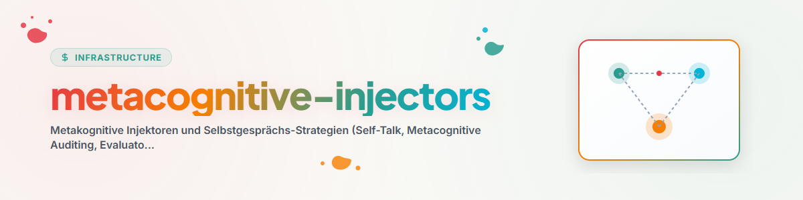

> **Русский** — Официальная русская версия для `metacognitive-injectors`.

# Метакогнитивные Инжекторы (Metacognitive-Injectors & Self-Talk)

Навык **Metacognitive-Injectors** устанавливает стратегии метакогнитивного самоконтроля и циклы проверки качества для AI-агентов.
