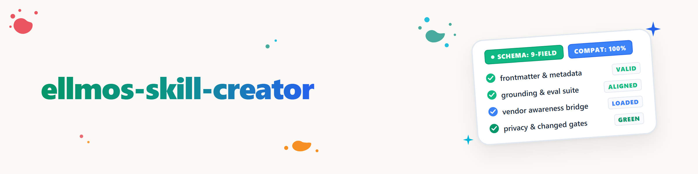

# ocean-skill-creator — Ocean Skill Builder

> **Successor Note (`v0.4.0`):** `ocean-skill-creator` is the canonical successor to `ellmos-skill-creator`. Existing `ellmos.*` schemas, `grounding-seed` docking points, and the transition trigger `/ellmos-skill-creator` remain fully backward-compatible.

## Origin and decision (fork vs. native composition)

**Decision: standalone composition, no fork.** Documented so the rationale stays explicit:

- `skill-creator` (Anthropic, marketplace `claude-plugins-official`) is **Apache-2.0** licensed — a fork would be legally clean, but would duplicate the entire generic eval and benchmark machinery (`agents/`, `eval-viewer/`, 7 helper scripts) that is already directly invocable via `Skill: skill-creator:skill-creator`.
- The real gap solved here consists of **Ocean standards (backward-compatible with ellmos components)** that upstream cannot know about:
  9-field house frontmatter, bilingual DE+EN core parity, strict anti-hardcoding via externalized configuration (`default-config.json` + 5-stage profile cascade), self-healing config loading with `.corrupt.<ts>.bak` preservation, standardized report and template architecture (`html`/`pdf`/`md`/`txt`/`json` + `templates/`), `grounding-seed` docking (`connections.json`), vendor awareness, and the learning/coverage file set.
- This skill contains **no upstream text** and **composes** the original instead of copying it. In addition, it ships [ocean_skill_scaffold.py](scripts/ocean_skill_scaffold.py), a pure Python standard-library CLI and helper module for deterministic scaffolding, self-healing config validation, and read-only skill audits.

## When to activate

- "create a skill for X", "scaffold a new skill", "use skill-creator", `/ocean-skill-creator` (or transition alias `/ellmos-skill-creator`)
- "upgrade this skill to Ocean standards", "retrofit a skill with default-config.json, profile cascade, or report templates"
- "audit this skill for hardcoded settings or missing templates" (`audit-skill`)
- Whenever the target is a skill in our Ocean/ellmos skill catalog — not for ad-hoc one-off prompts outside the ecosystem.

## Procedure

### Step 1 — delegate interview, design, and eval

Invoke the official `Skill: skill-creator:skill-creator` when needed for: intent clarification, workflow drafting, test cases (`evals/evals.json`), eval loops, and trigger refinement. **Do not reinvent** generic authoring steps that upstream already handles well — `ocean-skill-creator` layers the Ocean architecture and quality contract on top.

### Step 1b — description = trigger (mandatory, not optional)

The `description` field alone determines whether a skill is ever selected; the Markdown body is invisible during routing. Verify before completion:

- **Put WHEN first** ("Use when ..."), followed by what the skill delivers. The trigger phrase plus 2–3 representative user phrasings must appear within the **first 250 characters**, because agent runtimes truncate long skill-list entries and drop overflowing descriptions.
- **Include typical phrasings** in single quotes together with the slash command (`/my-skill`).
- **State explicit boundaries** to neighbouring skills ("Do NOT use for ... (use other-skill)").
- **Wrap the YAML value in double quotes**, keep it at or below 1024 characters across every localization.
- Confirm `python testing/skill_frontmatter_gate.py` flags neither a missing trigger nor a trigger starting after character 250.

### Step 2 — create the Ocean house scaffold (mandatory, additive to Anthropic format)

Prefer generating the initial structure with the bundled standard-library CLI:

```bash
python skills/infrastructure/ocean-skill-creator/scripts/ocean_skill_scaffold.py scaffold <name> --category <category> --out skills/<category> --with-reports --with-profiles --json
```

Frontmatter and layout requirements (`docs/CONVENTIONS.md`):

- Include all **nine house required fields** (`name`, `version`, `type`, `author`, `created`, `updated`, `description`, `standalone`, `visibility`) plus `category`, `language`, `status`, `tags`, `dependencies`, and `provenance`.
- **Always start `visibility` at `private-only`** for newly created skills — switching to `public` is a separate, explicitly reviewed user decision.
- **Bilingual core (P-006):** Provide both `SKILL.md` (German primary) and `SKILL.en.md` (English counterpart with identical `name:` and matching structure).
- Every house key is purely additive alongside `name`/`description` (`anthropic_compatible: true`).

### Step 3 — enforce Ocean principles: provider-neutral, user-neutral, Ocean/ellmos-sensitive

Full details and code patterns: [OCEAN-PRINCIPLES.md](references/OCEAN-PRINCIPLES.md). Summary:

- **Viable standalone (`standalone`):** Every skill ships its own `default-config.json`, `templates/`, and pure-stdlib fallbacks so it runs cleanly in isolation.
- **Ecosystem-sensitive at runtime:** When Ocean or backward-compatible ellmos modules (`grounding_seed.detect_ecosystem()`, `source-resolver`) are installed, the skill detects and uses them dynamically via `try/except ImportError` — never hard-wired and without inventing a second discovery mechanism.
- **Strictly user-neutral in version control:** Zero personal names, internal hostnames, local development paths, or private IP addresses in tracked files (`author: Ocean Contributors` or neutral team attribution).

### Step 4 — externalized JSON settings, profile cascade & self-healing (mandatory for configurable behavior)

Full specification, merge semantics, and self-healing protocol: [CONFIG-AND-SELF-HEALING.md](references/CONFIG-AND-SELF-HEALING.md).

1. **Anti-hardcoding rule:** Paths, output formats, thresholds, time windows, languages, visual styles, and delivery channels must **never** be hardcoded inside Python scripts or prompt prose; store them in JSON configuration files.
2. **Mandatory 5-stage configuration cascade (increasing precedence):**
   `default-config.json` (tracked, user-neutral fallback inside the skill) -> `config.json` (local/private override) -> `<channel>.json` (e.g. `profiles/mail.json`) -> `<channel>.<chat>.json` (e.g. `profiles/mail.ops-weekly.json`) -> **CLI override** (`--set key=value` or explicit flags).
   - Templates: [default-config.template.json](templates/default-config.template.json), [skill-config.template.json](templates/skill-config.template.json), and [channel-profile.template.json](templates/channel-profile.template.json).
3. **Self-healing configuration loader (`load_effective_config`):**
   - Missing optional override files (`config.json`, channel/chat profiles) fall back seamlessly to `default-config.json`.
   - Corrupt JSON files (`JSONDecodeError`), non-object roots, or invalid section types never crash the skill; the loader falls back gracefully to `default-config.json` and emits structured diagnostics (`warnings`).
   - With `--repair` (`repair=True`), corrupt files are first preserved verbatim as `<filename>.corrupt.<UTC-timestamp>.bak`, newly introduced default keys are merged additively without clobbering valid user values, and the healed JSON is persisted atomically (temporary file in the same directory + `os.replace`).
4. **Separate `connections.json`:** Resolved external binaries and service bindings stay in `connections.json` ([skill-connections.template.json](templates/skill-connections.template.json), schema `ellmos.source-resolver.user-config.v1` for `grounding-seed`).

### Step 4b — report/output options & replaceable `templates/` as a first-class build step

Full specification and rendering rules: [OUTPUT-AND-TEMPLATES.md](references/OUTPUT-AND-TEMPLATES.md).

**Mandatory check during every skill creation or retrofit:** Does the skill generate reports, audit logs, summaries, schedules, digests, or structured exports? If **yes**, include by default:

- **Replaceable `templates/` folder:** Keep data computation separate from presentation via [report.template.html](templates/output/report.template.html) (self-contained UTF-8 HTML with `@media print` styling), [report.template.md](templates/output/report.template.md), and [report.template.txt](templates/output/report.template.txt). Allow user template overrides via `templates.custom_dir` in config without editing skill code.
- **Five standard output formats (`html`, `pdf`, `md`, `txt`, `json`):**
  - `html` -> print-ready standalone HTML document with zero external CDN dependencies.
  - `pdf` -> optional isolated headless renderer (never touch or close running user browser sessions or profiles!) **plus a mandatory 100% stdlib `%PDF-1.4` fallback** so `--format pdf` works deterministically on headless CI and server hosts without a browser.
  - `md`, `txt`, and `json` -> clean human and machine-readable outputs.
- **Safe delivery defaults (`delivery`):** Configure distribution targets via `default-config.json` / `<channel>.json` and always default to `enabled: false`, `dry_run: true`, `mode: "draft"` (never send externally without explicit opt-in).

### Step 5 — build in provider and vendor awareness

Full text: [VENDOR-AWARENESS.md](references/VENDOR-AWARENESS.md). Summary: Any skill fulfilling a role backed by external tools or services includes a "Providers & alternatives" section listing (a) current state-of-the-art options, (b) at least one local/offline or open alternative, and (c) Ocean/ellmos components as equal-footing candidates (`grounding_seed.scan.scan_resources([...])`). Always propose installations rather than installing autonomously.

### Step 6 — configure self-update

Full text: [SELF-UPDATE.md](references/SELF-UPDATE.md). Summary: Every produced skill includes a "Self-update" section checking `letzter_update_check`, consulting `skill-finder` for better-fitting sibling skills, and recording dated findings in `connections.json` (`gelernt`) or optional ecosystem memory via `try/except`.

### Step 6b — attach learning contract + usecase coverage

Full text: [LEARNING-CONTRACT-AND-COVERAGE.md](references/LEARNING-CONTRACT-AND-COVERAGE.md). Reusable file set without inventing parallel schemas:

- `evals/evals.json` — author-designed test cases (`skill-creator` standard).
- `user-usecases.json` — real user prompts and scenarios ([user-usecases.template.json](templates/user-usecases.template.json)).
- `usecase-gaps.json` — uncovered or untested user scenarios ([usecase-gaps.template.json](templates/usecase-gaps.template.json)).
- `known-providers-and-abilities.json` — role candidate catalog modeled on A2A `AgentSkill` ([known-providers-and-abilities.template.json](templates/known-providers-and-abilities.template.json)).
- `gap-closing-analysis.json` — structural remediation options ([gap-closing-analysis.template.json](templates/gap-closing-analysis.template.json)).
- `default-config.json` / `config.json` `lernvertrag` object — behavioral contract (`user_ist_koenig: true`, `waehle_beste_option: true`, `installiert_nie_selbststaendig: true`).

### Step 7 — validate (`validate-config` & `audit-skill`), register, and commit

1. **Run automated config and skill-conformance checks:**
   ```bash
   python skills/infrastructure/ocean-skill-creator/scripts/ocean_skill_scaffold.py validate-config --default skills/<cat>/<name>/default-config.json --config skills/<cat>/<name>/config.json --json
   python skills/infrastructure/ocean-skill-creator/scripts/ocean_skill_scaffold.py audit-skill skills/<cat>/<name> --json
   ```
2. **Run repository verification gates:** `skill_frontmatter_gate.py`, `language_gate.py`, `privacy_gate.py`, `changed_skill_gate.py`, unit tests (`pytest`), and `ruff check`.
3. **Generate catalog artifacts instead of hand-editing:** On a clean checkout, run `python build_public_registry.py` and `python build_skills_map.py` (and verify with `--check`).

## Compatibility with Anthropic format and ellmos components

All extra YAML frontmatter keys sit cleanly alongside `name` and `description`, so standard Claude Code installations consume produced skills unchanged. Likewise, the self-healing config loader accepts both `ocean.skill-config.v2` and legacy `ellmos.skill-config.v1` files seamlessly.

## Related skills

- `skill-creator:skill-creator` — generic interview, drafting, and eval workflow (Step 1).
- `skill-finder` — checks whether an existing local skill already covers the task before authoring a new one.
- `skill-explorer` — catalog-wide skill inventory and landscape audit.
- `skill-family-care`, `skill-register-care` — family header routing and registry maintenance after creation.
- `dual-use-software-design` — design standard for tools operable by both humans and LLMs.

## Changelog

### 0.4.0 (2026-11-27)
- Renamed `ellmos-skill-creator` to `ocean-skill-creator` (preserving transition alias `/ellmos-skill-creator` and full backward compatibility with `ellmos.*` schemas and `grounding-seed`).
- Expanded Step 4: anti-hardcoding standard with `default-config.json`, 5-stage profile cascade (`default-config.json` -> `config.json` -> `<channel>.json` -> `<channel>.<chat>.json` -> CLI), and self-healing config loader (`.corrupt.<ts>.bak` backup, additive migration, atomic writes); documented in `references/CONFIG-AND-SELF-HEALING.md`.
- Added Step 4b: mandatory report/output check (`html`, `pdf` with stdlib `%PDF-1.4` fallback, `md`, `txt`, `json`), replaceable `templates/` (`report.template.html/md/txt`), and safe dry-run delivery defaults; documented in `references/OUTPUT-AND-TEMPLATES.md`.
- Added pure-stdlib CLI and library `scripts/ocean_skill_scaffold.py` (`scaffold`, `validate-config`, `audit-skill`) and test suite `tests/test_ocean_skill_scaffold.py`.

### 0.3.1 (2026-11-15)
- Step 1b: trigger belongs in the first 250 characters of `description`; gate hint for late triggers.

### 0.3.0 (2026-11-06)
- Step 1b: mandatory trigger-first `description` rule (WHEN first, example phrasings, boundary, gate check).

### 0.2.0 (2026-08-24)
- Added reusable learning contract and usecase-coverage file set (`user-usecases.json`, `usecase-gaps.json`, `known-providers-and-abilities.json`, `gap-closing-analysis.json`, and `lernvertrag` in `config.json`).

### 0.1.0 (2026-08-24)
- Initial version as `ellmos-skill-creator`, composing `skill-creator:skill-creator` with house frontmatter, `grounding-seed` docking, vendor awareness, and self-update.
