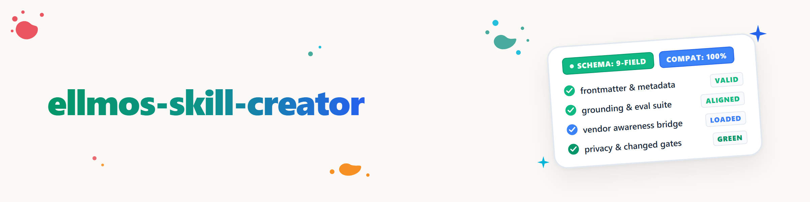

# ocean-skill-creator — Ocean-Skill-Baukasten

> **Nachfolge-Hinweis (`v0.4.1`):** `ocean-skill-creator` ist der kanonische Nachfolger von `ellmos-skill-creator`. Bestehende `ellmos.*`-Schemas, `grounding-seed`-Andockpunkte und der Übergangs-Auslöser `/ellmos-skill-creator` bleiben vollständig abwärtskompatibel.

> **Pragmatismus-Grundsatz („Nur dort, wo sinnvoll“):**
> 1. **Sprechende `.json`-Dateinamen sind ausdrücklich gleichwertig:** `default-config.json` ist eine empfohlene Standard-Konvention, **kein Pflichtname**. Fachlich sprechende Dateinamen wie `models.local.json`, `kalender-profiles.json`, `routing-defaults.json`, `prefs.json` oder `<kanal>.json` werden von Loader und `audit-skill` vollwertig erkannt.
> 2. **Kein künstlicher Boilerplate:** `.json`-Konfigurationen, `templates/` und `scripts/` werden **nur dort angelegt, wo sie echten fachlichen Nutzen stiften**. Reine Leitfaden-, Beratungs-, Therapie-, Denk- oder Router-/Umbrella-Skills brauchen weder Dummy-Templates noch Leerskripte und erreichen allein mit sauberem `SKILL.md` + `SKILL.en.md` volle Konformität (`100/100 conformant`).

## Herkunft und Entscheidung (Fork vs. Eigenbau)

**Entscheidung: Eigenbau, kein Fork.** Begründung, damit sie dauerhaft nachvollziehbar bleibt:

- `skill-creator` (Anthropic, Marketplace `claude-plugins-official`) ist **Apache-2.0** lizenziert — ein Fork wäre rechtlich sauber möglich, hätte aber die gesamte generische Eval-/Benchmark-Maschinerie (`agents/`, `eval-viewer/`, 7 Skripte) unnötig dupliziert, obwohl sie direkt über `Skill: skill-creator:skill-creator` aufrufbar ist.
- Die eigentliche Aufgabe dieses Skills liegt in den **pragmatischen Ocean-Standards (abwärtskompatibel zu ellmos-Komponenten)**, die dem generischen Upstream unbekannt sind:
  9-Felder-Haus-Frontmatter, zweisprachige Kernparität (DE+EN), Anti-Hardcoding über ausgelagerte `.json`-Einstellungen samt selbstheilendem Konfigurations-Loader (sobald ein Skill konfigurierbare Parameter besitzt), austauschbare Berichts-Templates (`html`/`pdf`/`md`/`txt`/`json`, sobald ein Skill Berichte/Dokumente rendert), `grounding-seed`-Andockung (`connections.json`), Anbieter-Bewusstsein sowie Lern- und Usecase-Abdeckung.
- Dieser Skill enthält **keinen Fremdtext** und **komponiert** das Original statt es zu kopieren. Mit [ocean_skill_scaffold.py](scripts/ocean_skill_scaffold.py) liefert er ein reines Python-Stdlib-Werkzeug für bedarfsgerechtes Scaffolding (`init`/`scaffold`), Selbstheilungs-Validierung (`validate-config`) und faire Bestands-Audits (`audit-skill`).

## Wann aktivieren

- „erstelle einen Skill für X“, „neuen Skill anlegen“, „skill-creator nutzen“, `/ocean-skill-creator` (oder Übergangs-Alias `/ellmos-skill-creator`)
- „mach diesen Skill Ocean-konform“, „bestehenden Skill auf Haus-Standard / JSON-Config / Berichts-Templates prüfen oder nachrüsten“
- „prüfe diesen Skill mit `audit-skill` auf Hardcodierungen“
- Immer dann, wenn der Zielort ein Skill unseres Ocean-/ellmos-Skill-Katalogs ist — nicht für lose Einmal-Prompts ohne Ökosystem-Bezug.

## Vorgehen

### Schritt 1 — Interview, Entwurf und Eval delegieren

Rufe bei Bedarf den offiziellen `Skill: skill-creator:skill-creator` auf für: Intent-Klärung, Grundstruktur des Ablaufs, Testfälle (`evals/evals.json`), Eval-Schleife und Auslöser-Schärfung. **Nicht neu erfinden**, was dort generisch gelöst ist — `ocean-skill-creator` legt das Ocean-Qualitäts- und Architektur-Fundament darüber.

### Schritt 1b — Beschreibung = Auslöser (Pflicht, nicht optional)

Die `description` entscheidet allein darüber, ob ein Skill jemals ausgewählt wird; der Markdown-Rumpf ist für den Router unsichtbar. Vor jedem Abschluss prüfen:

- **Das WANN steht ganz vorn** („Verwenden, wenn …“ / „Use when …“), danach was der Skill leistet. Der Auslöser inklusive 2–3 typischer Beispielphrasen muss zwingend innerhalb der **ersten 250 Zeichen** stehen, weil Laufzeitumgebungen lange Einträge in der Skill-Liste abschneiden.
- **Typische Nutzerformulierungen** in einfachen Anführungszeichen plus Slash-Befehl (`/mein-skill`).
- **Klare Abgrenzung** zu Nachbarskills („NICHT verwenden für … (dafür nachbar-skill)“).
- **YAML-Wert in doppelten Anführungszeichen**, maximal 1024 Zeichen, konsistent in allen Sprachfassungen.
- `python testing/skill_frontmatter_gate.py` meldet den Skill weder unter „ohne erkennbaren Auslöser“ noch unter „Auslöser erst nach den ersten 250 Zeichen“.

### Schritt 2 — Bedarfsgerechtes Ocean-Haus-Scaffold aufsetzen (`init` / `scaffold`)

Wähle den Zuschnitt passend zur Natur des Skills — vom schlanken Leitfaden (`--minimal`) bis zum voll ausgestatteten Berichts-Skill (`--with-reports --with-profiles`):

```bash
# A) Schlanker Leitfaden-, Beratungs-, Denk- oder Router-Skill (nur SKILL.md + SKILL.en.md)
python skills/infrastructure/ocean-skill-creator/scripts/ocean_skill_scaffold.py init <name> --category <kategorie> --out skills/<kategorie> --minimal --json

# B) Konfigurierbarer Skill mit sprechendem .json-Dateinamen ohne Berichts-Templates
python skills/infrastructure/ocean-skill-creator/scripts/ocean_skill_scaffold.py init <name> --category <kategorie> --out skills/<kategorie> --config-name <name>-defaults.json --no-templates --json

# C) Vollständiger Berichts-/Export-Skill inkl. Templates (html/pdf/md/txt/json) & Kanalprofilen
python skills/infrastructure/ocean-skill-creator/scripts/ocean_skill_scaffold.py init <name> --category <kategorie> --out skills/<kategorie> --with-reports --with-profiles --json
```

Prüfpunkte für das Frontmatter und die Dateistruktur (`docs/CONVENTIONS.md`):

- Alle **neun Haus-Pflichtfelder** (`name`, `version`, `type`, `author`, `created`, `updated`, `description`, `standalone`, `visibility`) plus `category`, `language`, `status`, `tags`, `dependencies` und `provenance`.
- **`visibility` startet bei jedem neuen Skill zwingend auf `private-only`** — eine Veröffentlichung (`public`) erfolgt erst nach ausdrücklicher Prüfung und Nutzerfreigabe.
- **Zweisprachiger Kern (Core P-006):** `SKILL.md` (Deutsch, Leitfassung) und `SKILL.en.md` (Englisch, strukturell paritätisch mit identischem `name:`).
- Alle Zusatzfelder sind rein additiv neben `name`/`description` (`anthropic_compatible: true`).

### Schritt 3 — Ocean-Prinzipien durchsetzen: anbieterneutral, nutzerneutral, Ocean-/ellmos-sensitiv

Volltext und Codemuster: [OCEAN-PRINCIPLES.md](references/OCEAN-PRINCIPLES.md). Kurzfassung:

- **Eigenständig lauffähig (`standalone`):** Bringt der Skill Konfigurationen, Vorlagen oder Skripte mit, funktionieren sie ohne externe Pflichtpakete mit der Python-Standardbibliothek.
- **Ökosystem-sensitiv zur Laufzeit:** Sind Ocean- oder abwärtskompatible ellmos-Komponenten vorhanden (`grounding_seed.detect_ecosystem()`, `source-resolver`), erkennt und nutzt der Skill sie dynamisch über `try/except ImportError` — niemals hart verdrahtet und ohne zweiten Erkennungsstandard.
- **Strikt nutzerneutral im Repo:** Keine persönlichen Namen, Hostnamen, lokalen Entwicklungspfade oder privaten IP-Adressen in versionierten Dateien (`author: Ocean Contributors` oder neutrale Projektbezeichnung).

### Schritt 4 — Ausgelagerte `.json`-Einstellungen, Profil-Kaskade & Selbstheilung (dort, wo Parameter anfallen)

Volltext, Namensfreiheit und Selbstheilungs-Protokoll: [CONFIG-AND-SELF-HEALING.md](references/CONFIG-AND-SELF-HEALING.md).

1. **Wann eine `.json`-Config sinnvoll ist — und wann nicht:**
   - Besitzt der Skill konfigurierbare Schwellenwerte, Modell-/Routingtabellen, Pfade, Zeitfenster, Ausgabeformate oder Kanalprofile -> **auslagern in `.json` statt im Code oder Prompt fest zu verdrahten**.
   - Ist der Skill ein reiner Denk-, Beratungs-, Therapie- oder Routing-Leitfaden ohne konfigurierbare Parameter -> **keine künstliche `.json`-Datei erzwingen**.
2. **Freie, sprechende Dateinamen + empfohlene Kaskade:**
   - `default-config.json` ist der Standard-Vorschlag, wenn kein fachlicher Name naheliegt; domänenspezifische Dateinamen wie `models.local.json`, `routing-defaults.json`, `kalender-profiles.json` oder `prefs.json` (`--config-name <datei.json>`) sind ausdrücklich gleichwertig.
   - Bei mehrstufigen Überschreibungen gilt die Merge-Kaskade:
     `<basis-config>.json` (versioniertes, nutzerneutrales Fallback) -> `config.json` (lokaler Override) -> `<kanal>.json` (z. B. `profiles/mail.json`) -> `<kanal>.<chat>.json` (z. B. `profiles/mail.team-weekly.json`) -> **CLI-Override** (`--set schluessel=wert`).
   - Vorlagen: [default-config.template.json](templates/default-config.template.json), [skill-config.template.json](templates/skill-config.template.json) und [channel-profile.template.json](templates/channel-profile.template.json).
3. **Selbstheilender Konfigurations-Loader (`load_effective_config`):**
   - Fehlende optionale Override-Dateien fallen nahtlos auf die Basis-JSON zurück.
   - Korrupte JSON-Dateien (`JSONDecodeError`), Nicht-Objekt-Wurzeln oder falsche Abschnittstypen brechen den Skill nicht unkontrolliert ab, sondern fallen kontrolliert zurück und protokollieren strukturierte `warnings`.
   - Mit `--repair` (`repair=True`) sichert der Loader defekte Dateien zuerst verlustfrei als `<datei>.corrupt.<UTC-Zeitstempel>.bak`, ergänzt neue Schlüssel additiv ohne Überschreiben von Nutzerwerten und schreibt atomar (`tmp` + `os.replace`).
4. **Trennung von `connections.json`:** Aufgelöste externe Programme/Dienste liegen bei Bedarf getrennt in `connections.json` ([skill-connections.template.json](templates/skill-connections.template.json), Schema `ellmos.source-resolver.user-config.v1`).

### Schritt 4b — Berichts-, Ausgabeoptionen & austauschbare `templates/` (nur bei Berichts-/Export-Skills)

Volltext und Formatvertrag: [OUTPUT-AND-TEMPLATES.md](references/OUTPUT-AND-TEMPLATES.md).

**Bedarfsprüfung:** Erzeugt der Skill Berichte, Prüfprotokolle, Zusammenfassungen, Kalender-/Statusblätter oder formatierte Dokumentexporte?

- **Nein** (reiner Leitfaden, Konverter, interner Checker, Router): **Kein `templates/`-Ordner nötig** (`--no-templates` bzw. `--minimal`).
- **Ja:** Trenne Fachdaten und Darstellung über einen austauschbaren `templates/`-Ordner ([report.template.html](templates/output/report.template.html) mit `@media print`, [report.template.md](templates/output/report.template.md), [report.template.txt](templates/output/report.template.txt)), unterstütze die passenden Formate (`html`, `pdf` mit zwingendem 100-%-Stdlib-`%PDF-1.4`-Fallback ohne Browserzwang, `md`, `txt`, `json`) und halte Zustellungswege (`delivery`) standardmäßig sicher auf `enabled: false`, `dry_run: true`, `mode: "draft"`.

### Schritt 5 — Anbieter- & Vendor-Bewusstsein einbauen

Volltext: [VENDOR-AWARENESS.md](references/VENDOR-AWARENESS.md). Kurzfassung: Skills mit externem Werkzeug- oder Dienstbedarf erhalten den Abschnitt „Anbieter & Alternativen“ mit (a) aktuellem State-of-the-Art-Anbieter, (b) mindestens einer lokalen/kostenfreien Alternative und (c) vorhandenen Ocean-/ellmos-Komponenten als gleichrangigem Kandidaten (`grounding_seed.scan.scan_resources([...])`). Installationen werden begründet vorgeschlagen, niemals eigenmächtig ausgeführt.

### Schritt 6 — Selbstaktualisierung anlegen

Volltext: [SELF-UPDATE.md](references/SELF-UPDATE.md). Kurzfassung: Jeder produzierte Skill führt einen Abschnitt „Selbstaktualisierung“ mit Verweis auf Nachbarskills (`skill-finder`) und nachvollziehbarer Ablage neuer Erkenntnisse.

### Schritt 6b — Lernvertrag + Usecase-Abdeckung (bei Bedarf wiederverwendbares Muster)

Volltext: [LEARNING-CONTRACT-AND-COVERAGE.md](references/LEARNING-CONTRACT-AND-COVERAGE.md). Wiederverwendbarer Dateisatz ohne Parallelstandard (`evals/evals.json`, [user-usecases.template.json](templates/user-usecases.template.json), [usecase-gaps.template.json](templates/usecase-gaps.template.json), [known-providers-and-abilities.template.json](templates/known-providers-and-abilities.template.json), [gap-closing-analysis.template.json](templates/gap-closing-analysis.template.json) sowie `lernvertrag` in der Skill-JSON).

### Schritt 7 — Prüfen (`audit-skill` & `validate-config`), registrieren und committen

1. **Skill-Qualität pragmatisch auditieren (wertet schlanke Skills ohne Templates/Skripte nicht ab!):**
   ```bash
   python skills/infrastructure/ocean-skill-creator/scripts/ocean_skill_scaffold.py audit-skill skills/<kat>/<name> --json
   # Falls eine JSON-Konfiguration vorhanden ist:
   python skills/infrastructure/ocean-skill-creator/scripts/ocean_skill_scaffold.py validate-config --default skills/<kat>/<name>/<config-datei>.json --json
   ```
2. **Repo-Gates ausführen:** `skill_frontmatter_gate.py`, `language_gate.py`, `privacy_gate.py`, `changed_skill_gate.py` sowie vorhandene Unit-Tests (`pytest`) und `ruff check`.
3. **Katalog-Dateien generieren statt handeditieren:** Bei öffentlichen Skills in einer sauberen Arbeitskopie `python build_public_registry.py` und `python build_skills_map.py` ausführen (`--check` grün).

## Kompatibilität zum Anthropic-Format und zu ellmos-Beständen

Alle Haus-Felder im YAML-Frontmatter sind reine Erweiterungen neben `name` und `description`; jede Standard-Claude-Code-Umgebung liest sie verlustfrei. Ebenso akzeptieren Loader und Auditor sowohl `ocean.skill-config.v2` als auch bestehende `ellmos.skill-config.v1`- und fachspezifische `.json`-Dateien.

## Verwandte Skills

- `skill-creator:skill-creator` — generischer Interview-, Entwurfs- und Eval-Loop (Schritt 1).
- `skill-finder` — prüft vor jedem Neubau, ob bereits ein passender lokaler Skill existiert.
- `skill-explorer` — katalogweiter Landschafts-Audit über alle Skills.
- `skill-family-care`, `skill-register-care` — Familien-Routing und Registerpflege nach dem Anlegen.
- `dual-use-software-design` — Architekturstandard für Anwendungen, die zugleich für Menschen und LLMs bedienbar sind.

## Changelog

### 0.4.1 (2026-11-27)
- Verbindliche Pragmatismus-Nachschärfung („nur dort, wo sinnvoll“):
  - `audit-skill` und Loader akzeptieren neben `default-config.json` jede sprechende skill-spezifische `.json`-Konfigurationsdatei (z. B. `models.local.json`, `routing-defaults.json`, `kalender-profiles.json`, `prefs.json`, `*.example.json`) als gleichwertig (`config_files`, `has_external_config`).
  - Reine Leitfaden-, Beratungs-, Therapie-, Denk- und Router-/Umbrella-Skills ohne Bedarf an `.json`-Configs, `templates/` oder `scripts/` erreichen ohne Boilerplate `100/100 conformant` (`recommendations == []`).
  - CLI um Alias `init` sowie `--config-name <datei.json>`, `--no-templates`, `--no-scripts`, `--no-config` und `--minimal` erweitert.

### 0.4.0 (2026-11-27)
- Umbenennung von `ellmos-skill-creator` zu `ocean-skill-creator` (inkl. Übergangs-Alias `/ellmos-skill-creator`), 5-stufige Konfigurations-Kaskade mit Selbstheilungs-Loader, Berichts-/Template-Standard (`html`/`pdf`/`md`/`txt`/`json`) und Stdlib-Tooling `scripts/ocean_skill_scaffold.py`.

### 0.3.1 (2026-11-15)
- Schritt 1b: Der Auslöser steht in den ersten 250 Zeichen der `description`.

### 0.3.0 (2026-11-06)
- Schritt 1b: Beschreibung = Auslöser ist Pflicht (WANN zuerst, Formulierungen, Abgrenzung).

### 0.2.0 (2026-08-24)
- Wiederverwendbares Lern- und Usecase-Abdeckungs-Muster ergänzt.

### 0.1.0 (2026-08-24)
- Erstfassung unter dem Namen `ellmos-skill-creator`.
