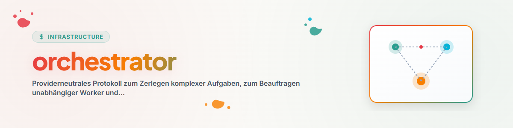

> **Français** — Version française officielle de la compétence `orchestrator`.

# Orchestrator — Protocole d'orchestration

## Vue d'ensemble et Objectif

Utilisez cette compétence lorsqu'une tâche comporte au moins deux lots de travail largement
indépendants et que la délégation apporte un réel gain de temps, de contexte ou de
qualité. Pour des tâches petites et fortement couplées, travaillez directement.

La compétence décrit un protocole. Le lancement, l'interruption et la reprise concrets
des exécutants (workers) s'effectuent via les capacités du runtime concerné.

## Limite d'autorité

La délégation n'élargit aucune permission. Chaque exécutant reçoit au maximum le périmètre
et les droits de modification déjà valables pour la tâche principale. Les actions externes,
irréversibles ou autrement soumises à approbation restent soumises à approbation.

## Régime opérateur : réfléchir et déléguer, ne jamais exécuter soi-même

Ce régime s'applique lorsque l'utilisateur le demande ou que le profil `burst`
(`operating_mode: orchestrator`) est actif. Il s'applique alors à l'opérateur, c'est-à-dire
l'instance qui découpe, missionne et réceptionne :

- **Principe.** L'opérateur est le modèle de réflexion coûteux. Il conçoit, décide,
  vérifie et intègre ; toute exécution part vers un exécutant : éditions de fichiers,
  captures d'écran, rendus, commits, pushes, recherches, séries de mesures, création
  d'assets image ou média, y compris les mini-éditions. L'opérateur n'effectue lui-même
  que la maintenance de sa propre mémoire et de son état de passation, des mesures en un appel
  (heure, liste de processus, existence d'un fichier) et la réouverture d'un fichier pour
  l'utilisateur lorsqu'un exécutant a échoué à le faire.
- **Fixer explicitement le choix du modèle par exécutant.** Un modèle moins coûteux pour
  la mécanique selon des consignes claires (build, commit, relecture, retouche), un modèle
  plus fort pour les gros chantiers de construction et pour les revues par un second modèle.
  Ne jamais lancer sans indication de modèle, sinon l'exécutant hérite du modèle de l'opérateur.
- **Le brief ne contient que ce que les fichiers de règles ne peuvent pas savoir :** valeurs
  initiales mesurées, décisions prises dans la conversation (citer mot pour mot les consignes
  utilisateur), limites de périmètre, conditions d'arrêt, nom du fichier de verrouillage pour le
  sous-domaine (jamais le verrou projet pour des modifications partielles, ne jamais toucher un
  verrou utilisateur), chemins de revue, pied de commit et plafond pour le rapport
  (par ex. 2 à 6 lignes). Fournir les justifications afin que l'exécutant saisisse l'intention
  lorsque la lettre ne suffit pas.
- **Revue avant commit pour tout ce que l'utilisateur évalue** (graphiques, textes,
  mises en page) : l'exécutant dépose le résultat comme fichier de revue (vérifier les chemins
  complets auparavant), l'ouvre dans le programme par défaut de l'utilisateur, signale et attend. Le
  commit n'intervient qu'après l'approbation, que l'opérateur transmet mot pour mot.
  Lors d'itérations, toujours utiliser de nouveaux noms de fichiers (a, b, c …), ne jamais écraser.
- **Les exécutants attendent activement, pas à l'état inactif (idle).** Sur les ressources sérielles
  (un outil n'autorisant qu'une exécution à la fois), attendre en chaîne sur le fichier de sortie du
  prédécesseur ou par sondage au premier plan en appels bornés, jamais en espérant une notification
  qui pourrait manquer. En cas de collision, terminer sa propre exécution et reprendre la file.
- **Ne jamais rejeter des modifications tierces dans le répertoire de travail :** les sauvegarder
  sur une branche de secours (`rescue`), les lire ligne par ligne, puis les certifier ou
  les archiver. Le code critique pour la sécurité n'est pas fusionné par l'exécutant,
  mais signalé ; un autre modèle que l'auteur procède à la vérification.
- **Les résultats ne valent qu'avec une relecture (readback) au lieu de destination,** et non
  au lieu de génération (ex. réponse API avec taille ou somme de contrôle ; pour les animations,
  deux captures décalées dans le temps présentant une différence mesurable ; pour les sources privées,
  une preuve de parseur ou d'API plutôt qu'une capture de navigateur).
- **L'opérateur rassemble les reliquats :** déposer les points ouverts avec contexte et étape
  suivante, mesurer les heures au lieu de les estimer, enregistrer les enseignements dans le système
  de mémoire. Ne signaler à l'utilisateur que les décisions et les résultats ; ne pas relayer les
  confirmations d'inactivité des exécutants.
- **Pourquoi :** le modèle de réflexion est trop coûteux pour l'exécution, et les opérateurs qui
  exécutent oublient les relectures. Un opérateur qui ne fait pas vérifier le lieu de destination
  annonce des succès qui n'y sont pas arrivés.

## Déroulement

### 1. Évaluer la situation

1. Fixer l'objectif, les critères de réussite et les exclusions de la tâche principale.
2. Vérifier les règles du projet, verrous, modifications en cours et budgets disponibles.
3. Avant le dispatch, sauvegarder comme référence (baseline) l'état actuel des verrous, statuts
   et diffs des zones concernées. C'est le seul moyen de distinguer plus tard de façon fiable
   les modifications tierces préexistantes de celles des exécutants.
4. Ne paralléliser que les lots de travail suffisamment indépendants.
5. Séparer les zones d'écriture qui se chevauchent ou les traiter séquentiellement.

### 2. Rédiger le contrat de mission

Avant chaque dispatch, établir un contrat court et vérifiable :

| Champ | Contenu obligatoire |
|---|---|
| Identifiant | ID stable du lot de travail |
| Objectif | exactement un résultat concret |
| Entrées | fichiers, données ou sources de contexte pertinents |
| Périmètre positif | ce qui peut être lu ou modifié |
| Périmètre négatif | ce qui reste explicitement intact |
| Critère de réussite | condition observable pour « terminé » |
| Preuve | justificatif attendu, par ex. test, diff ou emplacement exact |
| Format de retour | message de clôture compact et structuré |

Un exécutant ne reçoit que le contexte nécessaire à ce contrat.

### 3. Exécuter et observer

- Garder le fan-out réduit et ne l'augmenter qu'en cas d'utilité indépendante.
- Si un profil de ressources est actif (voir ci-dessous), le fan-out suit son
  `max_parallel_workers` ; le contrat de lancement mentionne le profil actif.
- Suivre la progression via le statut du runtime ou un checkpoint habituel du projet.
- En cas de conflits, dérive de périmètre ou manque d'autorité, arrêter et escalader.
- Un exécutant en échec ne doit pas bloquer automatiquement des lots indépendants.

### 4. Réceptionner les résultats

Une annonce de fin est d'abord une affirmation. L'orchestrateur vérifie lui-même :

1. L'artefact annoncé ou la modification citée existe-t-il réellement ?
2. Appartient-il au périmètre convenu ?
3. Le test ou justificatif convenu passe-t-il actuellement ?
4. Les modifications tierces, verrous et périmètres négatifs ont-ils été respectés ?
5. Les résultats de différents exécutants se contredisent-ils ?

C'est seulement ensuite qu'un lot de travail est considéré comme achevé.

### 5. Intégrer et sauvegarder

- Résoudre consciemment les conflits ; ne pas concaténer les résultats aveuglément.
- Réexécuter les tests globaux requis après l'intégration.
- Signaler clairement les lots ouverts, échoués ou différés.
- Lors d'exécutions longues, consigner objectif, statut, preuves et étape suivante dans un
  checkpoint retrouvable.

## Profil de ressources

La compétence fonctionne intégralement sans configuration. Sans `profiles.json`
et `config.json` dans le dossier de la compétence, les valeurs par défaut canoniques du schéma
issues d'`orchestrator-defaults.json` s'appliquent (profil économe : au maximum 1–2 exécutants parallèles,
un second créneau uniquement en cas d'utilité indépendante, un modèle plus petit lorsqu'un contrat
de mission est bien préparé). Pour les contrats et passations, [templates/worker-contract.template.md](templates/worker-contract.template.md)
et [templates/handover-report.template.md](templates/handover-report.template.md) sont également disponibles.
Cette règle ne change pas du fait de la présence des fichiers — elle les rend seulement configurables explicitement.

Ces deux fichiers forment une couche d'adaptation OPTIONNELLE propre à l'utilisateur. Les noms de modèles
et seuils qui y figurent sont des exemples de chaque utilisateur, pas une prescription
de la compétence. La compétence elle-même reste neutre vis-à-vis de l'utilisateur, des chemins, des modèles et
des fournisseurs (voir journal des modifications 1.1.0) — les chemins vers des outils personnels
vont exclusivement dans le `config.json` local, jamais dans ce texte.

Les profils limitent le parallélisme ; les quotas temporels pour les modèles coûteux,
réviseurs ou conseillers (par ex. « 2 revues par heure ») avec suivi de compte relèvent de la compétence
`budgetierung`.

### `profiles.json` — profils de ressources nommés

| Champ | Signification |
|---|---|
| `max_parallel_workers` | plafond d'exécutants tournant simultanément |
| `default_worker_model` | indication de modèle pour les missions simples, `null` = aucune consigne |
| `escalate_model_on` | caractéristiques de mission déclenchant un modèle plus fort malgré le profil économe |
| `external_agents_count_as_slot` | indique si les exécutants non natifs (ex. Codex, agy) comptent dans `max_parallel_workers` |
| `operating_mode` | l'un parmi `alleine` / `delegation` / `orchestrator`, voir mode opératoire ci-dessous |
| `mode_label` | libellé lisible du mode opératoire (formulation utilisateur) |
| `teammate_model_whitelist` | liste des identifiants de modèles autorisés pour les coéquipiers dans ce profil ; `[]` = illimité |

Profils fournis : `solo` (1 exécutant), `spar` (2 exécutants, par défaut), `burst`
(4 exécutants). L'utilisateur peut ajouter ses propres profils ou ajuster les existants.

### Mode opératoire (trois modes explicites) et liste blanche de modèles des coéquipiers

Complément au ticket `T-20260824-552689035` : l'axe du profil de ressources
(nombre d'exécutants) repose sur un second axe nommé par l'utilisateur — À QUEL POINT
le modèle principal continue d'implémenter directement au lieu de seulement coordonner.
Les deux axes sont déjà couplés dans les profils fournis afin qu'aucun chemin de
configuration supplémentaire ne soit nécessaire :

| Profil | `operating_mode` | `mode_label` | Signification |
|---|---|---|---|
| `solo` | `alleine` | Gérer seul | Le modèle principal travaille directement, aucune délégation sauf véritable bloqueur |
| `spar` | `delegation` | Petites délégations | Le modèle principal travaille principalement lui-même et délègue des sous-lots clairement délimités et indépendants |
| `burst` | `orchestrator` | Mode orchestrateur pur | Le modèle principal assure en priorité le découpage, le contrat, l'observation et la réception (étapes 1–5) ; l'exécution revient aux exécutants |

Des profils personnalisés peuvent définir librement `operating_mode`/`mode_label` — les trois
valeurs mentionnées sont les catégories définies par l'utilisateur, pas une
limitation technique.

**Liste blanche de modèles des coéquipiers :** `teammate_model_whitelist` restreint quels
identifiants de modèles sont autorisés pour les coéquipiers lancés dans ce profil.
Vide (`[]`, défaut dans tous les profils fournis) signifie illimité —
tout modèle disponible pour l'appelant est permis. Une escalade via
`escalate_model_on` ne doit pas sortir d'une liste blanche définie ; si aucun modèle listé
ne convient à l'escalade, la meilleure alternative listée s'applique
ou — si aucune ne convient — une demande explicite plutôt qu'une violation silencieuse
de la liste blanche. Aucun nouveau chemin de configuration nécessaire : comme tout autre champ
de profil, la liste blanche peut être surchargée ponctuellement via `config.json.overrides`.

**Efficacité en tokens comme critère de sélection :** si `default_worker_model` vaut `null`,
l'appelant choisit par mission le modèle le moins cher issu d'une liste blanche définie
(ou de tous les modèles disponibles sans liste blanche) capable, selon son évaluation, de porter
sûrement la tâche — l'efficacité en tokens prime sur la puissance brute. Détails sur le choix du modèle :
compétence `model-strategy`. Escalade uniquement en cas de correspondance réelle dans `escalate_model_on`,
pas à titre préventif.

**Changement de mode souple selon la phase ou la tâche :** `active_profile` (et donc
`operating_mode`) peut et doit changer au sein d'UNE même session lorsque la nature du travail
évolue — par ex. phase de recherche/planification sous le profil `solo`, phase suivante
d'implémentation avec plusieurs lots indépendants sous le profil `spar` ou `burst`, puis retour
à `solo` pour l'intégration et la réception. Le changement passe par `session_override` (voir ci-dessous)
et est brièvement justifié dans le contrat de lancement ou le checkpoint — aucun changement silencieux
sans motif traçable, mais pas non plus de maintien dans un mauvais mode au seul prétexte qu'il valait en début de session.

### `config.json` — profil actif et automatisation

| Champ | Signification |
|---|---|
| `active_profile` | nom du profil actif issu de `profiles.json` |
| `overrides` | surcharges ponctuelles de champs pour le profil actif |
| `session_override` | consigne manuelle pour la session en cours ; prime sur toute automatisation |
| `token_tracker` | sélection automatique optionnelle du profil selon le crédit de tokens |

#### Sélection automatique du profil selon le crédit de tokens (optionnel)

`config.json.token_tracker` réutilise un outil de suivi de tokens déjà présent chez
l'utilisateur au lieu d'en construire un autre :

| Champ | Signification |
|---|---|
| `enabled` | active/désactive l'automatisation |
| `report_path` | chemin vers un rapport d'état contenant une ligne de pourcentage de crédit |
| `db_path` | alternative : chemin vers une BDD de suivi interrogeable en lecture seule |
| `auto_downgrade` | `{ "to": <profil>, "when_credit_below_pct": <nombre> }` |
| `auto_upgrade` | `{ "to": <profil>, "when_credit_above_pct": <nombre> }` |
| `on_unreadable` | comportement lorsque ni le rapport ni la BDD ne sont lisibles |

Fonctionnement : lors du chargement de la compétence et avant chaque nouveau lancement d'exécutant,
LIRE le niveau de crédit actuel depuis `report_path` ou `db_path` — sans lancer de processus de l'outil
de suivi lui-même. Deux seuils distincts (`auto_downgrade` en bas, `auto_upgrade` en haut) forment
l'hystérésis : dans la bande intermédiaire, le profil actif reste inchangé et n'est réévalué qu'au
franchissement effectif d'un seuil — pas d'oscillation à chaque tick.

`session_override` (par ex. une consigne utilisateur explicite comme « mode économe jusqu'à
14h10 ») prime toujours sur l'automatisation. Si `report_path`/`db_path` sont définis mais
illisibles, `on_unreadable` s'applique : avec `"assume_critical"`, le profil économe est adopté
et l'illisibilité est notée dans le contrat de lancement — jamais de poursuite silencieuse dans un profil coûteux.

`config.json` est un fichier local propre à l'utilisateur (les chemins qu'il contient sont spécifiques à l'hôte).
La bibliothèque canonique de compétences ne contient qu'un modèle neutre avec automatisation désactivée
(`token_tracker.enabled: false`, chemins à `null`) — chacun inscrit ses vrais chemins dans sa copie locale.

Source supplémentaire (ticket `T-20260824-552689035`) : `report_path` peut aussi pointer vers
le pont de barre d'état `~/.claude/state/token_budget.json` (écrit par le hook `token_budget_statusline.py`,
champ `five_hour.used_percentage`) — son format est alors JSON au lieu de prose de rapport, à traiter
en conséquence lors de la lecture. Pour la voie manuelle GARANTIE et indépendante (le hook peut rester muet),
voir les compétences `sparmodus` (niveau 2, à partir d'env. 80 % consommés) et `notaus` (niveau 3, à partir d'env.
90 % consommés) — toutes deux positionnent notamment le `session_override` de cette compétence.

## Prompt minimal d'exécutant

```text
Mission : <Identifiant et objectif>
Entrées : <Sources>
Tu as le droit de : <Périmètre positif>
Tu n'as pas le droit de : <Périmètre négatif>
Terminé quand : <Critère vérifiable>
Justifie avec : <Test, diff ou emplacement exact>
Réponds sous la forme : <Format de retour>
```

## Conditions d'arrêt

N'arrêtez que le lot de travail concerné si son périmètre, son autorité ou sa preuve deviennent flous.
Les lots indépendants et sûrs peuvent continuer à s'exécuter.

Arrêtez toute la délégation lorsque :

- les sous-tâches ne sont plus indépendantes,
- une zone d'écriture partagée ne peut pas être séparée de manière sûre,
- les règles, verrous ou l'autorité sont flous pour tout le périmètre restant,
- les coûts attendus dépassent le bénéfice identifiable,
- la preuve exigée ne peut être ni produite ni vérifiée.

## Journal des modifications

### 1.5.0 (2026-11-27)
- Ajout des valeurs par défaut canoniques de schéma dans `orchestrator-defaults.json`, sans écraser `config.json` ni `profiles.json`.
- Ajout des modèles réutilisables `templates/worker-contract.template.md` et `templates/handover-report.template.md`.

### 1.4.1 (2026-11-22)
- Mention linguistique corrigée.

### 1.4.0 (2026-10-11)
- Ajout de la section « Régime opérateur : réfléchir et déléguer, ne jamais exécuter soi-même » :
  l'opérateur réfléchit, décide, vérifie et intègre ; toute exécution (y compris les mini-éditions)
  revient aux exécutants. Couvre le choix de modèle par exécutant, le contenu du brief (uniquement ce qui
  ne peut être consulté ailleurs), la revue avant commit pour les livrables évalués par l'utilisateur,
  l'attente active sur ressources sérielles, la gestion des modifications tierces, l'obligation de relecture
  au lieu de destination et la collecte des reliquats. S'applique à la demande de l'utilisateur ou sous le profil `burst`.
- Partie générale d'une version locale de même numéro ; les justifications liées aux personnes,
  aux hôtes et aux incidents restent volontairement hors du dépôt public.
- Aucune modification du déroulement 1–5, de la limite d'autorité, du profil de ressources ni des conditions d'arrêt.

### 1.3.1 (2026-10-03)
- Profil de ressources : ajout d'une phrase précisant que les quotas temporels de modèles et leur compte
  relèvent de la compétence `budgetierung` (les profils eux-mêmes ne limitent que le parallélisme).

### 1.3.0 (2026-08-24)
- Delta pour le ticket `T-20260824-552689035` (l'état 1.2.0 disposait déjà des profils de ressources
  avec automatisation par tokens — seul le delta a été construit ici, voir constat préalable dans le ticket) :
  - `profiles.json` : ajout de `operating_mode` + `mode_label` par profil — rend explicites les trois modes
    opératoires nommés par l'utilisateur (« gérer seul » / « petites délégations » / « mode orchestrateur pur »)
    sans remplacer les profils existants `solo`/`spar`/`burst`.
  - `profiles.json` : ajout de `teammate_model_whitelist` par profil (vide = illimité) ; utilise le mécanisme
    `overrides` déjà existant dans `config.json`, aucun nouveau chemin de configuration requis.
  - `SKILL.md` : ajout des sections sur le changement de mode souple selon la phase ou la tâche (changement
    d'`active_profile`/`session_override` au sein d'UNE session selon la phase de travail, avec justification dans
    le checkpoint) et sur l'efficacité en tokens comme critère principal pour `default_worker_model` (au lieu de
    la puissance brute), renvoi vers `model-strategy`.
  - Renvoi croisé ajouté vers les nouvelles compétences `sparmodus`/`notaus` et le pont de barre d'état
    `~/.claude/state/token_budget.json` comme source supplémentaire de `report_path`.
  - Aucune modification du déroulement 1–5, de la limite d'autorité, des conditions d'arrêt ni du comportement
    par défaut documenté sans fichiers de configuration.

### 1.2.0 (2026-08-17)
- Ajout des profils de ressources : fichiers optionnels `profiles.json` (profils nommés `solo`/`spar`/`burst`)
  et `config.json` (profil actif, surcharges, `session_override`) dans le dossier de la compétence.
- Ajout de la sélection automatique de profil selon le crédit de tokens (`config.json.token_tracker`) — réutilise
  un outil de suivi existant de l'utilisateur, lit uniquement, ne démarre aucun processus ; deux seuils forment
  une hystérésis ; fail-closed (`on_unreadable: assume_critical`) en cas d'illisibilité.
- Sans ces deux fichiers, le comportement reste inchangé (valeurs du profil économe documentées par défaut) —
  la neutralité de la version 1.1.0 est préservée ; les vrais chemins vont uniquement dans le `config.json` local, non canonique.

### 1.1.0 (2026-07-28)
- Suppression des liens à l'utilisateur, aux chemins, aux modèles et aux fournisseurs.
- Mise en évidence du contrat de mission, de la limite d'autorité, de la validation par preuves et des checkpoints
  comme mécanique centrale portable.
- Séparation explicite entre ligne de référence des modifications tierces, arrêts locaux à un lot et arrêts globaux.

### 1.0.0 (2026-06-17)
- Version locale initiale.
