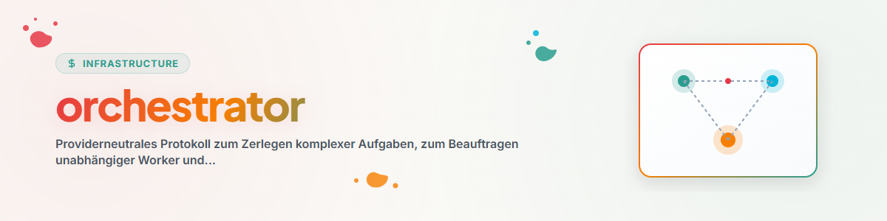

> **Deutsch** — Offizielle Deutsch-Version / Documento Oficial en Deutsch.


> **English Translation** — Official English version of `orchestrator`.


# Orchestrator (Português)

## Visão geral e finalidade

Use esta skill quando uma tarefa for composta por pelo menos dois pacotes de trabalho amplamente independentes e a delegação trouxer uma vantagem real de tempo, contexto ou qualidade. Para tarefas pequenas e fortemente acopladas, trabalhe diretamente.

A skill descreve um protocolo. O início, a interrupção e a retomada concretos dos workers são feitos pelas capacidades do respectivo runtime.

## Limite de autoridade

A delegação não amplia permissões. Cada worker recebe no máximo o escopo e os direitos de alteração já válidos para a tarefa principal. Ações externas, irreversíveis ou que de outra forma exijam aprovação continuam sujeitas à aprovação.

## Regime de operador: pensar e delegar, nunca executar sozinho

Este regime vale quando o usuário o exige ou quando o perfil `burst` (`operating_mode: orchestrator`) está ativo. Nesse caso, vale para o operador, ou seja, a instância que decompõe, delega e aceita os resultados:

- **Princípio.** O operador é o modelo de raciocínio caro. Ele projeta, decide, revisa e integra; toda execução vai para um worker: edições de arquivos, capturas de tela, renderizações, commits, pushes, pesquisas, séries de medições, geração de assets de imagem ou mídia, inclusive microedições. O próprio operador só faz a manutenção da sua memória e do estado de passagem de trabalho, medições de uma única chamada (horário, lista de processos, existência de um arquivo) e reabre um arquivo para o usuário quando um worker falhou nele.
- **Definir explicitamente o modelo de cada worker.** Um modelo mais barato para mecânica com instrução clara (construir, commitar, readback, retrabalho) e um mais forte para tarefas maiores de construção e revisões com segundo modelo. Nunca gerar um worker sem indicar o modelo, senão ele herda o modelo do operador.
- **O briefing contém apenas o que os arquivos de regras não podem saber:** valores iniciais medidos, decisões tomadas na conversa (citando literalmente as instruções do usuário), limites de escopo, condições de aborto, o nome do arquivo de bloqueio do subconjunto (nunca o bloqueio do projeto para alterações parciais, nunca tocar em um bloqueio do usuário), caminhos de revisão, trailers de commit e um limite para o relatório (por exemplo 2 a 6 linhas). Incluir as justificativas, para que o worker atinja a intenção quando a letra não se encaixar.
- **Revisão antes do commit em tudo o que o usuário avalia** (gráficos, textos, layouts): o worker salva o resultado como arquivo de revisão (verificando antes os caminhos completos), abre-o no programa padrão do usuário, informa e aguarda. O commit só ocorre após a aprovação, que o operador repassa literalmente. Nas iterações, sempre usar nomes de arquivo novos (a, b, c …), nunca sobrescrever.
- **Os workers esperam ativamente, não ficam ociosos.** Para recursos seriais (uma ferramenta que aceita apenas uma execução por vez), aguardar em cadeia pelo arquivo de saída do predecessor ou fazer polling em primeiro plano em chamadas limitadas, nunca contar com uma notificação que pode não chegar. Em caso de colisão, encerrar a própria execução e colocá-la no fim da fila.
- **Nunca descartar alterações alheias no diretório de trabalho:** salvá-las em um branch de resgate, lê-las linha por linha e então certificá-las ou arquivá-las. Código relevante para segurança não é mesclado pelo worker, mas reportado; um modelo diferente do autor o revisa.
- **Resultados só valem com readback no destino,** não no local de geração (por exemplo, resposta de API com tamanho ou checksum; em animações, duas capturas em instantes diferentes com diferença mensurável; em fontes privadas, comprovante de parser ou API em vez da imagem do navegador).
- **O operador recolhe os restos:** registrar pontos em aberto com contexto e próximo passo, medir horários em vez de estimar, salvar aprendizados no sistema de memória. Ao usuário, reportar apenas decisões e resultados; não repassar as confirmações de ociosidade dos workers.
- **Motivo:** o modelo de raciocínio é caro demais para executar, e operadores que executam acabam deixando de verificar readbacks. Um operador que não verifica o destino ele mesmo relata sucessos que nunca chegaram lá.

## Fluxo

### 1. Verificar a situação

1. Registrar o objetivo, os critérios de sucesso e as exclusões da tarefa principal.
2. Verificar regras do projeto, bloqueios, alterações em andamento e orçamentos disponíveis.
3. Antes do dispatch, registrar o estado atual de bloqueios, status e diff das áreas afetadas como linha de base. Só assim alterações alheias já existentes podem ser distinguidas de forma confiável das alterações dos workers.
4. Paralelizar apenas pacotes de trabalho suficientemente independentes.
5. Separar áreas de escrita sobrepostas ou processá-las em sequência.

### 2. Escrever o contrato de tarefa

Antes de cada dispatch, criar um contrato curto e verificável:

| Campo | Conteúdo obrigatório |
|---|---|
| Identificador | ID estável do pacote de trabalho |
| Objetivo | exatamente um resultado concreto |
| Entradas | arquivos, dados ou fontes de contexto relevantes |
| Escopo positivo | o que pode ser lido ou alterado |
| Escopo negativo | o que permanece expressamente intocado |
| Critério de sucesso | condição observável de "concluído" |
| Evidência | comprovante esperado, como teste, diff ou localização do trecho |
| Formato de retorno | relatório final compacto e estruturado |

Um worker recebe apenas o contexto de que precisa para esse contrato.

### 3. Executar e observar

- Manter o fan-out pequeno e ampliá-lo apenas quando houver benefício independente.
- Se um perfil de recursos estiver ativo (ver abaixo), o fan-out segue o seu `max_parallel_workers`; o contrato de spawn indica o perfil ativo.
- Acompanhar o progresso pelo status do runtime ou por um checkpoint usual do projeto.
- Em caso de conflito, ampliação de escopo ou falta de autoridade, parar e escalar.
- Um worker que falhou não pode bloquear automaticamente pacotes de trabalho independentes.

### 4. Aceitar os resultados

Uma mensagem de conclusão é, a princípio, uma afirmação. O orquestrador verifica por conta própria:

1. O artefato ou a alteração mencionada realmente existe?
2. Ele pertence ao escopo acordado?
3. O teste ou comprovante acordado está válido agora?
4. Alterações alheias, bloqueios e escopos negativos foram respeitados?
5. Os resultados de diferentes workers se contradizem?

Somente depois disso um pacote de trabalho é considerado concluído.

### 5. Integrar e salvar

- Resolver conflitos de forma deliberada; não concatenar resultados às cegas.
- Executar novamente os testes gerais necessários após a integração.
- Indicar claramente os pacotes abertos, com falha ou adiados.
- Em execuções mais longas, salvar objetivo, status, evidências e próximo passo em um checkpoint facilmente localizável.

## Perfil de recursos

A skill funciona totalmente sem configuração. Sem `profiles.json` e `config.json` na pasta da skill, vale exatamente o perfil de economia documentado aqui: no máximo 1 a 2 workers em paralelo, um segundo slot apenas com benefício independente, um modelo menor quando um contrato de tarefa estiver bem preparado. Essa regra não muda pela presença dos arquivos — ela apenas a torna explicitamente ajustável.

Ambos os arquivos são uma camada de personalização OPCIONAL, própria do usuário. Nomes de modelos e limiares neles são exemplos do respectivo usuário, não uma exigência da skill. A própria skill permanece neutra quanto a usuário, caminhos, modelo e provedor (ver changelog 1.1.0) — caminhos para ferramentas pessoais pertencem exclusivamente ao `config.json` local, nunca a este texto.

Os perfis limitam o paralelismo; cotas temporais para modelos caros, revisores ou advisors (por exemplo "2 revisões por hora") junto com a conta são regidas pela skill `budgetierung`.

### profiles.json — perfis de recursos nomeados

| Campo | Significado |
|---|---|
| `max_parallel_workers` | limite de workers executando simultaneamente |
| `default_worker_model` | indicação de modelo para tarefas simples, `null` = sem indicação |
| `escalate_model_on` | características de tarefa para as quais, apesar do perfil de economia, se escolhe um modelo mais forte |
| `external_agents_count_as_slot` | se workers não nativos (por exemplo Codex, agy) contam em `max_parallel_workers` |
| `operating_mode` | um de `alleine` / `delegation` / `orchestrator`, ver modo de operação abaixo |
| `mode_label` | designação legível do modo de operação (redação do usuário) |
| `teammate_model_whitelist` | lista de identificadores de modelo permitidos para teammates neste perfil; `[]` = sem restrição |

Perfis fornecidos: `solo` (1 worker), `spar` (2 workers, padrão), `burst`
(4 workers). O usuário pode acrescentar perfis próprios ou ajustar os existentes.

### Modo de operação (três modos explícitos) e lista de modelos permitidos para teammates

Complemento ao ticket T-20260824-552689035: ao eixo do perfil de recursos (número de workers) se soma um segundo eixo, nomeado pelo usuário — QUANTO o modelo principal ainda implementa diretamente em vez de apenas coordenar. Os dois eixos já estão acoplados nos perfis fornecidos, para que não seja necessário um caminho de configuração adicional:

| Perfil | `operating_mode` | `mode_label` | Significado |
|---|---|---|---|
| `solo` | `alleine` | Dar conta sozinho | O modelo principal trabalha diretamente, sem delegação exceto em caso de bloqueio real |
| `spar` | `delegation` | Delegações menores | O modelo principal trabalha sobretudo por conta própria, delega subpacotes independentes e bem delimitados |
| `burst` | `orchestrator` | Modo orquestrador puro | O modelo principal assume prioritariamente decomposição, contrato, observação e aceitação (fluxo 1–5); a implementação em si cabe aos workers |

Perfis próprios podem definir livremente `operating_mode`/`mode_label` — os três valores citados são as categorias indicadas pelo usuário, não uma restrição técnica.

**Lista de modelos permitidos para teammates:** `teammate_model_whitelist` restringe quais identificadores de modelo são admissíveis para teammates iniciados neste perfil. Vazio (`[]`, padrão em todos os perfis fornecidos) significa sem restrição — qualquer modelo disponível para o chamador é permitido. Uma escalada via `escalate_model_on` não pode sair de uma lista definida; se nenhum modelo listado servir à escalada, vale a melhor alternativa listada ou — se nenhuma servir — uma consulta deliberada em vez de uma quebra silenciosa da lista. Não é preciso um novo caminho de configuração: a lista, como qualquer outro campo do perfil, pode ser sobrescrita pontualmente via `config.json.overrides`.

**Eficiência de tokens como critério de seleção:** Se `default_worker_model` for `null`, o chamador escolhe para cada tarefa o modelo mais econômico de uma lista definida (ou de todos os modelos disponíveis, sem lista) que, segundo a própria avaliação, suporte a tarefa com segurança — eficiência de tokens vem antes do desempenho bruto. Detalhes sobre a escolha do modelo: skill `model-strategy`. Escalada apenas em acertos reais de `escalate_model_on`, não preventivamente.

**Troca de modo flexível por fase/tarefa:** `active_profile` (e com ele `operating_mode`) pode e deve mudar dentro de UMA sessão quando o tipo de trabalho mudar — por exemplo, fase de pesquisa/planejamento no perfil `solo`, depois fase de implementação com vários pacotes independentes nos perfis `spar` ou `burst`, e depois de volta a `solo` para integração e aceitação. A troca ocorre via `session_override` (ver abaixo) e é brevemente justificada no contrato de spawn ou no checkpoint — sem troca silenciosa e sem motivo rastreável, mas também sem permanecer no modo errado apenas porque ele valia no início da sessão.

### config.json — perfil ativo e automatização

| Campo | Significado |
|---|---|
| `active_profile` | nome do perfil ativo de `profiles.json` |
| `overrides` | sobrescritas pontuais de campos para o perfil ativo |
| `session_override` | indicação manual para a sessão atual; prevalece sobre qualquer automatização |
| `token_tracker` | escolha automática opcional de perfil conforme saldo de tokens |

#### Escolha automática de perfil conforme saldo de tokens (opcional)

`config.json.token_tracker` reaproveita uma ferramenta de acompanhamento de tokens já existente do usuário, em vez de construir uma nova:

| Campo | Significado |
|---|---|
| `enabled` | liga/desliga a automatização |
| `report_path` | caminho para um relatório de status com uma linha de percentual de saldo |
| `db_path` | alternativa: caminho para um banco de dados de acompanhamento consultável somente leitura |
| `auto_downgrade` | `{ "to": <profil>, "when_credit_below_pct": <zahl> }` |
| `auto_upgrade` | `{ "to": <profil>, "when_credit_above_pct": <zahl> }` |
| `on_unreadable` | comportamento quando nem relatório nem banco podem ser lidos |

Fluxo: ao carregar a skill e antes de cada novo spawn de worker, LER o saldo atual de `report_path` ou `db_path` — sem iniciar nenhum processo da própria ferramenta de acompanhamento. Dois limiares separados (`auto_downgrade` abaixo, `auto_upgrade` acima) formam a histerese: na faixa entre eles o perfil ativo permanece inalterado, sendo reavaliado apenas quando um limiar é de fato ultrapassado ou não alcançado — sem oscilação a cada tick.

`session_override` (por exemplo, uma instrução explícita do usuário como "modo de economia até as 2:10") sempre prevalece sobre a automatização. Se `report_path`/`db_path` estiverem definidos, mas não puderem ser lidos, vale `on_unreadable`: com `"assume_critical"` assume-se o perfil de economia e a falha de leitura é registrada no contrato de spawn — nunca continuar silenciosamente no perfil caro.

`config.json` é um arquivo local, próprio do usuário (os caminhos nele são específicos do host). A biblioteca canônica da skill traz apenas um modelo neutro com a automatização desativada (`token_tracker.enabled: false`, caminhos `null`) — cada usuário registra os caminhos reais na sua cópia local.

Fonte adicional (ticket T-20260824-552689035): `report_path` também pode apontar para a ponte da statusline `~/.claude/state/token_budget.json` (escrita pelo hook `token_budget_statusline.py`, campo `five_hour.used_percentage`) — o formato ali é JSON em vez de texto de relatório, devendo ser tratado de acordo na leitura. Para o caminho MANUAL GARANTIDO, independente disso (o hook pode permanecer em silêncio), ver as skills `sparmodus` (nível 2, a partir de aprox. 80 % consumidos) e `notaus` (nível 3, a partir de aprox. 90 % consumidos) — ambas definem, entre outros, `session_override` desta skill.

## Prompt mínimo do worker

```text
Auftrag: <Kennung und Ziel>
Eingaben: <Quellen>
Du darfst: <positiver Scope>
Du darfst nicht: <negativer Scope>
Fertig, wenn: <prüfbares Kriterium>
Belege mit: <Test, Diff oder Fundstelle>
Antworte als: <Rückgabeformat>
```

## Condições de parada

Pare apenas o pacote de trabalho afetado quando seu escopo, sua autoridade ou sua evidência se tornarem incertos. Pacotes independentes e seguros podem continuar.

Pare toda a delegação quando:

- as subtarefas deixarem de ser independentes,
- uma área de escrita compartilhada não puder ser separada com segurança,
- regras, bloqueios ou autoridade para todo o escopo restante estiverem incertos,
- os custos previstos superarem o benefício reconhecível,
- a evidência exigida não puder ser gerada ou verificada.

## Registro de alterações

### 1.4.0 (2026-10-11)
- Seção "Regime de operador: pensar e delegar, nunca executar sozinho"
  acrescentada: o operador pensa, decide, revisa e integra; toda execução
  (inclusive microedições) vai para workers. Cobre escolha de modelo por
  worker, conteúdo do briefing (apenas o que não pode ser consultado), revisão
  antes do commit para resultados avaliados pelo usuário, espera ativa em
  recursos seriais, tratamento de alterações alheias, obrigatoriedade de
  readback no destino e recolhimento de restos. Vale a pedido do usuário ou no
  perfil `burst`.
- Parte de aplicação geral de uma versão local de mesmo número; justificativas
  ligadas a pessoas, hosts e incidentes permanecem deliberadamente fora do
  repositório público.
- Nenhuma alteração no fluxo 1–5, no limite de autoridade, no perfil de
  recursos ou nas condições de parada.

### 1.3.1 (2026-10-03)
- Perfil de recursos: frase acrescentada indicando que cotas temporais de
  modelos, junto com a conta, são reguladas pela skill `budgetierung` (os perfis em si
  limitam apenas o paralelismo).

### 1.3.0 (2026-08-24)
- Delta ao ticket T-20260824-552689035 (o estado da versão 1.2.0 já continha
  perfis de recursos, inclusive automatização por tokens — aqui foi construído
  apenas o delta, ver a análise prévia no ticket):
  - `profiles.json`: `operating_mode` + `mode_label` acrescentados a cada perfil — torna
    nomeáveis explicitamente os três modos de operação indicados pelo usuário
    ("dar conta sozinho" / "delegações menores" / "modo orquestrador puro"),
    sem substituir os perfis existentes `solo`/`spar`/`burst`.
  - `profiles.json`: `teammate_model_whitelist` acrescentado a cada perfil (vazio =
    sem restrição); usa o mecanismo `overrides` já existente em
    `config.json`, sem necessidade de novo caminho de configuração.
  - SKILL.md: seção sobre troca de modo flexível por fase/tarefa (mudança de
    `active_profile`/`session_override` dentro de UMA sessão conforme a fase de trabalho,
    com justificativa no checkpoint) e sobre eficiência de tokens como critério
    principal de seleção de `default_worker_model` (em vez do desempenho bruto), com
    referência à skill `model-strategy`.
  - Referência cruzada às novas skills `sparmodus`/`notaus` e à ponte da
    statusline `~/.claude/state/token_budget.json` como fonte adicional de
    `report_path`.
  - Nenhuma alteração no fluxo 1–5, no limite de autoridade, nas condições de
    parada ou no padrão documentado sem arquivos de configuração.

### 1.2.0 (2026-08-17)
- Perfis de recursos acrescentados: `profiles.json` opcional (perfis nomeados
  `solo`/`spar`/`burst`) e `config.json` (perfil ativo, sobrescritas,
  sobrescrita de sessão) na pasta da skill.
- Escolha automática de perfil conforme saldo de tokens acrescentada
  (`config.json.token_tracker`) — reaproveita uma ferramenta de acompanhamento já existente do
  usuário, apenas lê, não inicia processo; dois limiares formam uma histerese;
  fail-closed (`on_unreadable: assume_critical`) em caso de leitura impossível.
- Sem os dois arquivos, o comportamento permanece inalterado (valores do perfil
  de economia documentado como padrão) — a neutralidade da 1.1.0 é mantida;
  caminhos reais pertencem apenas ao `config.json` local, não canônico.

### 1.1.0 (2026-07-28)
- Vínculos com usuário, caminhos, modelos e provedor removidos.
- Contrato de tarefa, limite de autoridade, aceitação por evidência e
  checkpoints destacados como mecânica central portátil.
- Linha de base para alterações alheias, bem como paradas locais por pacote e
  globais, explicitamente separadas.

### 1.0.0 (2026-06-17)
- Versão local inicial.
