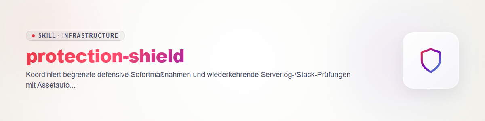

# Protection Shield

Use only for owned or explicitly authorized systems, networks and servers. Before a live change, verify asset ID, owner, authority, locks, impact and rollback. An alert does not itself authorize a production network change. No counterattack, foreign-asset access or unauthorized service scan.

**Immediate defense:** Preserve UTC time, bounded relevant logs and current configuration hashes; redact secrets and retain originals privately. Separate symptoms, confirmed compromise and hypotheses. Read the project runbook, standing decisions and private per-asset action config. With valid scope, use existing native tools for one specified service stop, firewall-rule change, credential rotation through its approved workflow, or `security-tech-stack-check` patch. Bind exact target, expected effect and restore path; do not elevate privileges through this skill. Measure command outcome, functional check, log effect and side effects; on failure follow the runbook rollback and measure it separately. An intended defense is not a verified defense.

**Recurring review:** A private profile lists only authorized log/API readers, assets, lookback, filters, retention, stack snapshot, schedule and escalation route. Attach to the existing scheduler or logging service rather than creating another daemon. Each run reads only named sources within a bounded time window, deduplicates events, compares `tech-detect` stack versions and checks relevant current vendor/CISA advisories through `security-tech-stack-check`. Record source coverage, UTC window, parser/read errors and a compact attention report. A configured schedule is active only after a real scheduler and result readback.

For drift on the **same server**, compare its previous and current complete techshots with the unchanged slot and hostname: `python -X utf8 scripts/techshot.py compare --left <previous.json> --right <current.json> --output <private>/comparison.json` (resolve the script from the `tech-detect` skill directory). Read back `axis=same-host-time`, both capture times and `chronology`. An uncertain version, missing coverage or a capture too old for the specific decision remains open; the comparison time does not refresh measurement. Missing required provenance or a hostname change within one slot means HOLD until asset continuity is established externally; do not rename a slot to bypass the check.

Use bounded native readers such as `Get-WinEvent -FilterHashtable` for an exact log and start time, `journalctl --since ... --until ... -u <owned service>`, or the project's named server-log reader. Avoid broad filesystem log sweeps. Connect to that asset's existing Task Scheduler, systemd timer or launchd job, then read back the registered definition, last run, exit result and output receipt. Without those observations the recurring check is only a plan.

Prioritize confirmed exposure over generic version differences. Unknown stays open. Project incident rules and asset permissions take precedence; this skill creates no global firewall policy or standing grant.

## Changelog

### 1.0.0 (2026-10-25)

- Scoped immediate defense and recurring observation without production activation.
