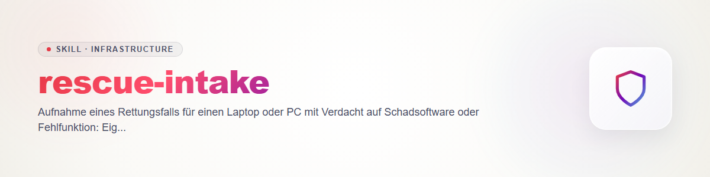

# rescue-intake (English)

The first step of every rescue case. Purely defensive: the aim is to bring a device that is
**your own or expressly released to you** back to a reliable state. The skill permits neither
access to other people's devices nor any attack or circumvention measure. `endpoint-triage`
follows; cleanup and hardening are covered by `malware-cleanup-guide` and
`os-hardening-baseline`, documentation by `incident-notes`.

## 1. Ownership and consent (mandatory before starting)

Ask, and record in writing (answers go into `intake.md`, template below):

- Who owns the device? Is this person reachable and in agreement?
- Is it **private**, or is the device managed by a company, school or authority? Then do not
  touch it until their IT department has agreed; reporting to them is the right path.
- Does it belong to someone else (family, friends)? Only with their explicit consent and
  after it has been explained to them which data will be looked at. For a minor's device
  the guardians' consent counts.
- If there is doubt about ownership or consent (device "found", an ex-partner's device, a
  device with someone else's account): **stop.** The skill does not help examine other
  people's devices.

Explain to the owner before starting: evaluations contain personal data (programs,
connections, account names, file paths). What is collected, where it is stored and when it
is deleted is stated up front.

## 2. Goal and situation

What happened, since when, what was done last (program installed, link opened, attachment,
phone call, remote support)? Is there any sign of leaked credentials or money? If so:
**credentials are changed later from a clean device**, not from the target device (see
`malware-cleanup-guide`). If data is being encrypted with a ransom demand: disconnect the
device from the network, do not pay, do not keep working, hand the case to
`malware-cleanup-guide`.

## 3. Choose the mode

| Mode | What runs where | When |
|---|---|---|
| **A: collect and analyse (default)** | Only a **read-only collection script** runs on the target machine, writing exclusively into a case folder on the removable medium. Agents do the analysis on a **clean machine.** | Suspected infection; device state unclear |
| **B: agent on site** | The agent runs on the target machine, **only from a live system booted from the removable medium**, which mounts the internal disk read-only at most. | Offline inspection of the disk; device no longer boots |

Rules for both modes:

- **No real accounts signed in on the target machine.** Neither agent accounts (Claude,
  Codex, Gemini ...) nor email, cloud, bank, password manager. A possibly compromised device
  sees every keystroke and every session token. If a sign-in is unavoidable, use only a
  purpose-created, narrowly scoped, short-lived access that is revoked afterwards -- mode B
  from a live system is the normal setting for that.
- When in doubt, mode A. An agent "on site" on the running, unclean system is not an
  intended mode.
- The removable medium gets no credentials and is treated as potentially touched afterwards
  (do not simply boot from it on a clean machine; inspect and scan it first).

## 4. Evidence and privacy

- Evidence (collection folder, logs) stays local at first, on the removable medium or the
  clean machine.
- **Anonymise before handing anything to a cloud agent:** replace user names, machine name,
  email addresses, account names, internal and public IP addresses, serial numbers, paths
  containing names, tokens and keys (consistent placeholders, so relationships survive). The
  replacement table stays local. No anonymiser is perfect: read a sample of the result
  before sending.
- Files themselves (suspicious programs) are not uploaded to online services unasked; hash
  values are usually enough for research.
- Retention: keep the case folder until the owner agrees to its deletion. Encrypt or lock
  away the removable medium that holds evaluations.

## 5. Template `intake.md`

```text
Case ID:            <e.g. case-20261031-01>
Date/time UTC:      <measured, not estimated>
Owner:              <name or initials>      Consent: yes / no   (how documented: ...)
Device:             <type, operating system, year>   Managed by third parties: no / yes -> stop
Reason/symptoms:    ...
Last actions:       ...
Suspected leaked credentials/money: no / yes (which services: ...)
Mode:               A / B   Reason: ...
Real accounts signed in on the target device: no (required)
Anonymisation before cloud agents: yes / no / not needed
Next step:          endpoint-triage
```

## Abort

Stop and ask if: ownership or consent is unclear, the device is managed by third parties,
the task asks for obtaining other people's credentials, taking over accounts or bypassing
the protection mechanisms of a device that does not belong to the person. Such tasks are
not covered by this skill.
