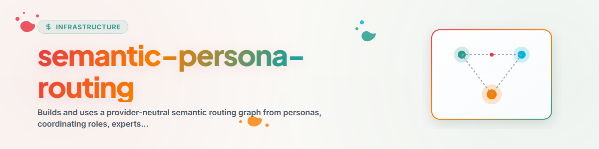

# শব্দার্থিক পার্সোনা রাউটিং

প্রথমে সক্ষমতা অনুযায়ী রাউট করুন, তারপর ব্যক্তিত্ব প্রয়োগ করুন। একটি
বহনযোগ্য ম্যাপ তৈরি করুন, যা শব্দার্থিক ভূমিকা নির্বাচন, নির্ধারণবাদী
এন্ডপয়েন্ট অনুসন্ধান এবং প্রদানকারী-নির্দিষ্ট লোডিংকে আলাদা রাখে।

## রাউটিং মডেল

```text
Anfrage
  -> semantische Domäne oder koordinierende Rolle
  -> Expertenfähigkeit
  -> ausdrücklich angegebener oder live aufgelöster Skill-Endpunkt
  -> optionales Persona-Overlay
  -> Anbieteradapter lädt und führt aus
```

একটি পার্সোনা যোগাযোগের ধরন, অগ্রাধিকার এবং মিথস্ক্রিয়ার প্যাটার্ন নিয়ন্ত্রণ করে। এটি
কোনো টুল, অনুমতি বা পেশাদার সক্ষমতা প্রদান করে না। একটি ভূমিকা সমন্বয় করে, একজন
বিশেষজ্ঞ ডোমেইন সীমাবদ্ধ করে, এবং একটি স্কিল হলো কার্যকর এন্ডপয়েন্ট।

## রাউটিং ম্যাপ তৈরি করা

স্পষ্ট মেটাডেটাকে প্রামাণিক উৎস হিসেবে ব্যবহার করুন এবং শাব্দিক সাদৃশ্য শুধু
প্রার্থী খুঁজতে ব্যবহার করুন:

```bash
python scripts/build_routing_map.py \
  --roles-dir path/to/roles \
  --personas-dir path/to/personas \
  --skills-dir path/to/skills \
  --out routing-map.json
```

বিল্ডার প্রচলিত `SKILL.md` ক্ষেত্রগুলো বোঝে, যেমন `type`,
`orchestrates.experts`, `parent_agents`, `skills`, বিবরণ এবং উৎস।
এটি একটি রানটাইম ম্যাপ তৈরি করে, উৎস সিস্টেম ইনস্টল করা না থাকলেও। ফরম্যাট
বাড়ানোর আগে [routing-map-schema.md](references/routing-map-schema.md) পড়ুন।

প্রতিটি রপ্তানিকৃত স্কিল ID অনন্য। একাধিক উৎস ফাইল একই স্থির ID ঘোষণা করলে বিল্ডার
নির্ধারণবাদীভাবে লেক্সিকোগ্রাফিকভাবে প্রথম আপেক্ষিক উৎস পথ বেছে নেয় এবং একটি
`duplicate-skill-id` ইস্যু নথিভুক্ত করে; সে কখনো একই ID-এর দুটি স্কিল এন্ট্রি আউটপুট দেয় না।
ঘোষিত বিশেষজ্ঞ ও পার্সোনা স্কিল রেফারেন্স কেবল তখনই পরিষ্কৃত ID-তে স্বাভাবিক করা হয়, যদি
সেই ID রপ্তানিকৃত রেজিস্ট্রিতে থাকে। ত্রুটিপূর্ণ, অজানা এবং স্বাভাবিক করা রেফারেন্স
`issues`-এ দৃশ্যমান থাকে; অজানা বা অবৈধ রেফারেন্স কখনো এন্ডপয়েন্ট বা পার্সোনা
সামঞ্জস্য লিংকে পরিণত হয় না।

`candidate_skills` স্তর স্বয়ংক্রিয়ভাবে বাড়াবেন না। প্রথমে একটি সক্রিয় স্কিল রেজলভার
বা উৎস মেটাডেটার মাধ্যমে নিশ্চিত করুন।

## পার্সোনা তৈরি ও সংরক্ষণ

কোর ম্যাপ তৈরি করে, পার্সোনা উদ্ভাবন করে না। নিজের পার্সোনা ব্যবহার করতে চাইলে
সেগুলো **স্কিলের পাশে** রাখুন এবং ম্যাপ পুনর্নির্মাণ করুন:

```text
semantic-persona-routing/
  personas/<persona-id>.md          # eine Datei je Persona
  roles/<rolle>/SKILL.md            # koordinierende Rollen und Experten
  routing-map.json                  # erzeugte Karte
  config.json                       # host-lokal, nie veröffentlicht
```

ভূমিকাগুলো বিল্ডার কেবল `SKILL.md` ফাইল থেকে পড়ে; পার্সোনাগুলো যেকোনো
frontmatter-যুক্ত Markdown ফাইল থেকে। [templates/persona.template.md](templates/persona.template.md)
কপি করে `personas/<persona-id>.md`-এ রাখুন এবং চুক্তিটি পূরণ করুন:

| ক্ষেত্র | অর্থ |
|---|---|
| `name`, `type: persona` | স্থির পার্সোনা ID এবং ধরন |
| `persona.display_name`, `short_name`, `gender`, `role`, `default_prompt` | প্রদর্শন, সংক্ষিপ্ত নাম, সম্বোধন, এক বাক্যে ভূমিকা, প্রদানকারীর আহ্বান বাক্য |
| `parent_agents` | সমন্বয়কারী ভূমিকা যার সাথে পার্সোনা যুক্ত |
| `skills` | **স্কিলের নাম, পথ কখনো নয়** — কেবল এগুলোই এন্ডপয়েন্টে পরিণত হয় |
| `optional_skills` | হোস্ট-সংযুক্ত স্কিল; এগুলো না থাকলে একটি দৃশ্যমান `GAP` থাকে |

একটি পার্সোনা টুল, অনুমতি, অথবা নিরাপত্তা, নিষেধাজ্ঞা বা ব্যবহারকারীর সিদ্ধান্ত
প্রদান করতে বা অগ্রাহ্য/অতিক্রম করতে পারে না; এটি ভূমিকা ও স্কিলের উপরে একটি ওভারলে।

**পথ:** স্কিল কোনো হোস্ট পথ উল্লেখ করে না। `config.example.json` প্যাটার্ন দেখায়
(`ellmos.skill-config.v1`, `einstellungen.paths`, `<HOME>/<ONEDRIVE>/<TOPICS>`-এর মতো প্লেসহোল্ডারসহ);
হোস্ট-স্থানীয় কপি `config.json` নামে থাকে, ডিপ্লয়ের সময় সংরক্ষিত হয় এবং কখনো
রিপোজিটরিতে যায় না।

**ক্যাটালগ পরিষ্কার করা:** আর্কাইভ বা রেফারেন্স কপিসহ একটি স্কিল লাইব্রেরি অনেক
`duplicate-skill-id` ইস্যু তৈরি করে। `--skills-layout catalog` কেবল `<kategorie>/<name>/SKILL.md` নেয় এবং
`_`-উপসর্গযুক্ত ফোল্ডার এড়ায় (`_archive`, `_reference`,
`_templates`):

```bash
python scripts/build_routing_map.py \
  --roles-dir roles --personas-dir personas \
  --skills-dir path/to/skills --skills-layout catalog \
  --out routing-map.json
```

## একটি অনুরোধ রাউট করা

### 0. বিদ্যমান পার্সোনা প্রস্তাব করা

পার্সোনাগুলো স্কিলের পাশে থাকলে (`personas/`), আহ্বানের সময় প্রদর্শন নাম, ভূমিকা
ও স্কিলসহ তালিকাভুক্ত করুন এবং উপযুক্তটিতে রাউট করুন; অনুরোধে পার্সোনার নাম না থাকলে
ধাপ ৪-এ বেছে নিন। রাউটিং প্রমাণের ফরম্যাট অপরিবর্তিত থাকে।

### ১. শব্দার্থিকভাবে সমন্বয়কারী ভূমিকা বেছে নেওয়া

অনুরোধকে ভূমিকার নাম, বিবরণ ও ব্যবহারের ক্ষেত্রের সাথে তুলনা করুন। সবচেয়ে সংকীর্ণ
ভূমিকাকে অগ্রাধিকার দিন, যা পুরো অনুরোধ সমন্বয় করতে পারে। নিশ্চয়তা কম হলে একাধিক
প্রার্থী দৃশ্যমান রাখুন; কেবল তখনই ব্যবহারকারীকে জিজ্ঞাসা করুন যখন পছন্দটি ফলাফলকে
উল্লেখযোগ্যভাবে বদলে দেয়।

### ২. ভূমিকার মধ্যে বিশেষজ্ঞ বেছে নেওয়া

কেবল নির্বাচিত সমন্বয়কারী ভূমিকার সাথে যুক্ত বিশেষজ্ঞদের ব্যবহার করুন, যদি না অনুরোধ
স্পষ্টভাবে একাধিক ভূমিকা জুড়ে থাকে। একটি সরাসরি বিশেষজ্ঞ অনুরোধ কার্যকরকরণের সময়
সমন্বয়কারী ভূমিকা এড়িয়ে যেতে পারে, তবে রাউটিং ব্যাখ্যায় তার সংযোগ ধরে রাখে।

### ৩. কার্যকর এন্ডপয়েন্ট রেজলভ করা

এই ক্রমে রেজলভ করুন:

1. `endpoint_skills` স্পষ্ট উৎস মেটাডেটা বা সঠিক উৎস থেকে;
2. একটি বর্তমান বহিরাগত স্কিল রেজলভার বা স্থানীয় স্কিল ফাইন্ডার;
3. যাচাইকৃত `candidate_skills`;
4. কোনো এন্ডপয়েন্ট না থাকলে একটি দৃশ্যমান `GAP`।

কখনো বিশেষজ্ঞের নামে রাউট করবেন না, যেন সেটি ইনস্টল করা স্কিল। অনুপস্থিত এন্ডপয়েন্ট
একটি পোর্টিং ফাঁক, এন্ডপয়েন্ট উদ্ভাবনের অনুমতি নয়।

একটি সক্রিয় রেজিস্ট্রি, শাব্দিক ফাইন্ডার বা প্রদানকারী-নির্দিষ্ট স্কিল লোডার সংযুক্ত
করার সময় [endpoint-resolution.md](references/endpoint-resolution.md) পড়ুন।

### ৪. পার্সোনা ওভারলে প্রয়োগ

নির্বাচিত ভূমিকা বা বিশেষজ্ঞের সাথে যুক্ত একটি পার্সোনা বেছে নিন। একাধিক পার্সোনা উপযুক্ত
হলে সেটিকে অগ্রাধিকার দিন যার ঘোষিত সীমা ও শৈলী কাজের সাথে মেলে। কোনো পার্সোনা স্পষ্টভাবে
যুক্ত না থাকলে কোনোটি প্রয়োগ করবেন না।

পার্সোনা নির্দেশনা নিরাপত্তা নিয়ম, নিষেধাজ্ঞা, ব্যবহারকারীর সিদ্ধান্ত, পেশাগত সীমা বা
টুল অনুমতি অতিক্রম করতে পারে না।

### ৫. লোড ও কার্যকর করা

প্রদানকারীর নিজস্ব স্কিল বা এজেন্ট লোডিং প্রক্রিয়া ব্যবহার করুন। কার্যকর করার আগে নির্বাচিত
সক্রিয় স্কিলের নির্দেশনা লোড করুন। রাউটারটি হালকা রাখুন; কার্যকরকরণ ওয়ার্কার বা লোড
করা স্কিলসহ বর্তমান এজেন্টের কাজ।

## রাউটিং প্রমাণ

নিম্নলিখিত ফেরত দিন বা রেকর্ড করুন:

```text
ROLE: <koordinierende Rolle oder direct>
EXPERT: <Experte oder n/a>
SKILLS: <verifizierte aktive Endpunkte>
PERSONA: <Overlay oder none>
RESOLUTION: explicit | provenance | live-resolver | verified-candidate | GAP
CONFIDENCE: high | medium | low
WHY: <ein kurzer Grund>
GAPS: <fehlende Endpunkte oder Warnungen vor veralteten Karten>
```

উৎস ভূমিকা বা স্কিল তালিকা বদলালে ম্যাপ পুনরায় তৈরি করুন। একটি সক্রিয় রেজলভার
এন্ডপয়েন্টের প্রাপ্যতার ক্ষেত্রে পুরনো ম্যাপকে ছাড়িয়ে যেতে পারে, তবে শব্দার্থিক ভূমিকা
শ্রেণিবিন্যাস নীরবে পুনর্লিখন করতে পারে না।

## উদাহরণ

অনুরোধ: „আমার রসিদগুলো সাজান এবং কর বছরের সারসংক্ষেপ প্রস্তুত করুন।“

রাউটার একটি অফিস সমন্বয় বেছে নেয়, তারপর কর বিশেষজ্ঞকে, কার্যকর কর স্কিল রেজলভ করে এবং
শেষে একটি স্পষ্টভাবে যুক্ত, যত্নশীল কর পার্সোনা প্রয়োগ করে। কর বিশেষজ্ঞ থাকলে কিন্তু কোনো
বহনযোগ্য কর স্কিল না থাকলে, সে `GAP` জানায় এবং শুধু একটি স্পষ্টভাবে কনফিগার
করা বিকল্প পথে এগোয়।

## পরিবর্তন লগ

### 1.1.0 (2026-09-03)

- পার্সোনা তৈরি ও সংরক্ষণ: স্কিলের পাশে সংরক্ষণের নিয়ম, frontmatter চুক্তি, নিরপেক্ষ
  টেমপ্লেট `templates/persona.template.md`, `config.example.json` সহ পথের নিয়ম, আহ্বান আচরণ (বিদ্যমান
  পার্সোনা প্রস্তাব করা) এবং আর্কাইভ ও রেফারেন্স কপি থেকে নকল স্কিল ID-এর বিরুদ্ধে
  `--skills-layout catalog`।

### 1.0.0 (2026-07-28)

- একটি প্রমাণিত ডোমেইন রাউটার থেকে বিক্রেতা-নিরপেক্ষ ভূমিকা, বিশেষজ্ঞ ও স্কিল শৃঙ্খল
  বের করা হয়েছে এবং দৃশ্যমান এন্ডপয়েন্ট ফাঁকসহ বহনযোগ্য ম্যাপ তৈরি যুক্ত করা হয়েছে।
