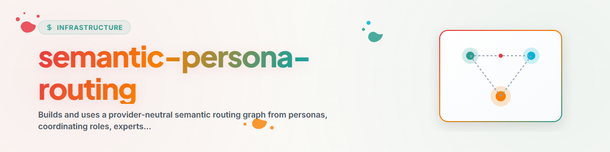

> **Français** — Version française officielle de la compétence `semantic-persona-routing`.

# Routage sémantique des personas

Routez d'abord selon la capacité, puis appliquez la personnalité ensuite. Créez une carte portable qui sépare le choix sémantique de rôle, la recherche déterministe de point de terminaison et le chargement spécifique au fournisseur.

## Modèle de routage

```text
Demande
  -> domaine sémantique ou rôle coordonnateur
  -> capacité d'expert
  -> point de terminaison de compétence explicitement indiqué ou résolu en direct
  -> superposition (overlay) de persona optionnelle
  -> l'adaptateur fournisseur charge et exécute
```

Une persona pilote le style de communication, les priorités et les schémas d'interaction. Elle ne confère ni outils, ni permissions, ni compétences métier. Un rôle coordonne, un expert délimite le domaine et une compétence (skill) est le point de terminaison exécutable.

## Créer la carte de routage

Utilisez les métadonnées explicites comme source faisant autorité et la similarité lexicale uniquement pour la recherche de candidats :

```bash
python scripts/build_routing_map.py \
  --roles-dir path/to/roles \
  --personas-dir path/to/personas \
  --skills-dir path/to/skills \
  --out routing-map.json
```

Le générateur comprend les champs courants de `SKILL.md` tels que `type`, `orchestrates.experts`, `parent_agents`, `skills`, les descriptions et la provenance. Il génère une carte d'exécution sans que le système source doive être installé. Lisez [routing-map-schema.md](references/routing-map-schema.md) avant d'étendre le format.

Chaque identifiant de compétence exporté est unique. Si plusieurs fichiers sources déclarent le même identifiant stable, le générateur choisit de manière déterministe le premier chemin source relatif dans l'ordre lexicographique et consigne une anomalie `duplicate-skill-id` ; il n'émet jamais deux entrées de compétence portant le même identifiant. Les références de compétences déclarées par des experts ou des personas ne sont normalisées vers un identifiant assaini que si cet identifiant existe dans le registre exporté. Les références erronées, inconnues et normalisées restent visibles dans `issues` ; les références inconnues ou invalides ne deviennent jamais des points de terminaison ni des liens de compatibilité de persona.

Ne promouvez pas automatiquement `candidate_skills`. Confirmez-les d'abord via un résolveur actif de compétences ou les métadonnées sources.

## Créer et déposer des personas

Le noyau génère des cartes, il n'invente pas de personas. Quiconque souhaite utiliser ses propres personas les dépose **à côté de la compétence** et reconstruit la carte :

```text
semantic-persona-routing/
  personas/<persona-id>.md          # un fichier par persona
  roles/<role>/SKILL.md             # rôles coordonnateurs et experts
  routing-map.json                  # carte générée
  config.json                       # local à l'hôte, jamais publié
```

Le générateur lit les rôles exclusivement depuis les fichiers `SKILL.md`, et les personas depuis tout fichier Markdown doté d'un frontmatter. Copiez [templates/persona.template.md](templates/persona.template.md) vers `personas/<persona-id>.md` et remplissez le contrat :

| Champ | Signification |
|---|---|
| `name`, `type: persona` | identifiant stable de persona et type |
| `persona.display_name`, `short_name`, `gender`, `role`, `default_prompt` | affichage, nom court, pronom/genre d'adresse, rôle en une phrase, phrase d'invocation du fournisseur |
| `parent_agents` | rôles coordonnateurs auxquels la persona est rattachée |
| `skills` | **noms de compétences, jamais des chemins** — eux seuls sont résolus en points de terminaison |
| `optional_skills` | compétences liées à l'hôte ; si elles manquent, elles restent une `GAP` visible |

Une persona ne doit ni conférer ni outrepasser des outils, des permissions ni des règles de sécurité, de verrouillage ou des décisions de l'utilisateur ; elle est une couche superposée par-dessus le rôle et les compétences.

**Chemins :** La compétence ne mentionne aucun chemin d'hôte. `config.example.json` montre le modèle (`ellmos.skill-config.v1`, `einstellungen.paths` avec des marqueurs tels que `<HOME>/<ONEDRIVE>/<TOPICS>`) ; la copie locale à l'hôte s'appelle `config.json`, est préservée lors du déploiement et n'est jamais intégrée au dépôt.

**Nettoyer le catalogue :** Une bibliothèque de compétences contenant des archives ou des copies de référence produit de nombreuses anomalies `duplicate-skill-id`. `--skills-layout catalog` ne prend que `<categorie>/<nom>/SKILL.md` et ignore les dossiers préfixés par `_` (`_archive`, `_reference`, `_templates`) :

```bash
python scripts/build_routing_map.py \
  --roles-dir roles --personas-dir personas \
  --skills-dir path/to/skills --skills-layout catalog \
  --out routing-map.json
```

## Router une demande

### 0. Proposer les personas existantes

Si des personas se trouvent à côté de la compétence (`personas/`), listez-les à l'appel avec leur nom d'affichage, leur rôle et leurs compétences et routez vers celle qui convient ; si la demande ne mentionne aucune persona, ne la choisissez qu'à l'étape 4. Le format du reçu de routage reste inchangé.

### 1. Choisir sémantiquement le rôle coordonnateur

Comparez la demande avec les noms de rôles, descriptions et cas d'usage. Privilégiez le rôle le plus étroit capable de coordonner l'ensemble de la demande. En cas de faible confiance, gardez plusieurs candidats visibles ; ne sollicitez l'utilisateur que si le choix modifie substantiellement le résultat.

### 2. Choisir l'expert au sein du rôle

N'utilisez que les experts liés au rôle coordonnateur choisi, à moins que la demande ne couvre clairement plusieurs rôles. Une demande directe d'expert peut contourner le rôle coordonnateur lors de l'exécution, mais conserve son lien dans l'explication de route.

### 3. Résoudre les points de terminaison exécutables

Résolvez dans cet ordre :

1. `endpoint_skills` issus des métadonnées sources explicites ou de la provenance exacte ;
2. un résolveur de compétences externe à jour ou un localisateur de compétences local ;
3. des `candidate_skills` vérifiées ;
4. une `GAP` visible si aucun point de terminaison n'existe.

Ne routez jamais vers un nom d'expert comme s'il s'agissait d'une compétence installée. Un point de terminaison manquant constitue une lacune de portage, pas une autorisation d'inventer un point de terminaison.

Lisez [endpoint-resolution.md](references/endpoint-resolution.md) lorsque vous raccordez un registre actif, un chercheur lexical ou un chargeur de compétences spécifique au fournisseur.

### 4. Appliquer la superposition de persona

Choisissez une persona associée au rôle ou à l'expert sélectionné. Si plusieurs personas conviennent, privilégiez celle dont les limites déclarées et le style correspondent à la tâche. N'appliquez aucune persona si aucune n'est explicitement reliée.

Les instructions de persona ne doivent pas outrepasser les règles de sécurité, les verrous, les décisions utilisateur, les limites professionnelles ni les permissions d'outils.

### 5. Charger et exécuter

Utilisez le mécanisme natif de chargement de compétences ou d'agents du fournisseur. Chargez les instructions de la compétence active sélectionnée avant l'exécution. Gardez le routeur léger ; l'exécution appartient au worker ou à l'agent courant muni des compétences chargées.

## Reçu de routage

Renvoyez ou consignez ce qui suit :

```text
ROLE: <rôle coordonnateur ou direct>
EXPERT: <Expert ou n/a>
SKILLS: <points de terminaison actifs vérifiés>
PERSONA: <Overlay ou none>
RESOLUTION: explicit | provenance | live-resolver | verified-candidate | GAP
CONFIDENCE: high | medium | low
WHY: <une brève justification>
GAPS: <points de terminaison manquants ou avertissements de cartes obsolètes>
```

Reconstruisez la carte lorsque les rôles sources ou l'inventaire des compétences changent. Un résolveur actif peut prévaloir sur une carte obsolète concernant la disponibilité des points de terminaison, mais ne doit pas réécrire silencieusement la taxonomie sémantique des rôles.

## Exemple

Demande : « Range mes justificatifs et prépare la vue d'ensemble pour l'année fiscale. »

Le routeur choisit une coordination bureautique, puis l'expert fiscal, résout la compétence fiscale installée et applique enfin une persona fiscale soigneuse explicitement reliée. Si l'expert fiscal existe mais qu'aucune compétence fiscale portable n'est disponible, il signale `GAP` et ne poursuit que par une voie de repli explicitement configurée.

## Journal des modifications

### 1.1.1 (2026-11-22)
- Indication de langue corrigée

### 1.1.0 (2026-09-03)

- Créer et déposer des personas : convention de dépôt à côté de la compétence, contrat frontmatter, modèle neutre `templates/persona.template.md`, convention de chemins avec `config.example.json`, comportement à l'appel (proposer les personas présentes) et `--skills-layout catalog` contre les identifiants en double issus des copies d'archives et de référence.

### 1.0.0 (2026-07-28)

- Extraction de la chaîne indépendante du fournisseur rôle, expert et compétence à partir d'un routeur de domaines éprouvé, avec ajout de la création de cartes portables et des lacunes de points de terminaison visibles.
