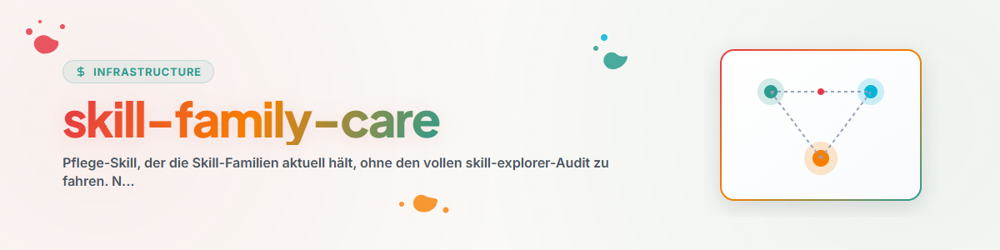

# صيانة عائلات المهارات

## الغرض

تُبقي **عائلات** المهارات محدّثة — دون تشغيل التدقيق الكامل من `skill-explorer`. فُصلت هذه المهارة وفق مبدأ المثبّت (مهارة فرعية خفيفة بدلاً من كتلة واحدة متكاملة). وهي تشير إلى السكربتات الموجودة في `skill-explorer` ولا تنسخها.

## المصادر (لا تكرارها)

- **قائمة العائلات:** `<USER_HOME>\OneDrive\.USR\SKILL-MAP.md` (خريطة العائلات/التوجيه المعتمدة).
- **الجرد (الوضع الحالي):** `skill-explorer/scripts/inventory_skills.py`.
- **تعيين الموجّهات/إزالتها:** `skill-explorer/scripts/inject_family_header.py`.
- **الإعدادات (العائلات المرتبطة):** `~/.claude/skills/skill-explorer/config.json`.

## المهام

### أ — تعيين مهارة جديدة إلى عائلة
1. أعِد تجميع الجرد:
   ```bash
   PYTHONIOENCODING=utf-8 python ~/.claude/skills/skill-explorer/scripts/inventory_skills.py \
       --out ~/.skill-inventory.json --pretty
   ```
2. اختر العائلة المناسبة من `SKILL-MAP.md` (المحاور: المرحلة/النطاق/الصرامة/التأثير/المادة الخام).
3. أضِف المهارة كعضو في `config.json` (`families[<fam>].members`) وفي `SKILL-MAP.md`.

### ب — تحديث موجّه الرأس بعد تغيير العائلة
```bash
PYTHONIOENCODING=utf-8 python ~/.claude/skills/skill-explorer/scripts/inject_family_header.py \
    --family <Familie> --skills s1,s2,s3 --router "<Wegweiser>" --inventory ~/.skill-inventory.json
```
- متماثل القدرة (idempotent): لا يغيّر التكرار النتيجة، إذ تُستبدل الكتلة الموجودة لنفس العائلة.
- تُعدَّل فقط مهارات `editable`/`source=user` (البوابة داخل السكربت).

### ج — إزالة موجّه يتيم
السكربت نفسه مع `--remove` (لا حاجة إلى `--router`).

## القواعد الصارمة

- **المسح ≠ التعديل:** تتلقى رؤوس العائلات المهارات الخاصة بالمستخدم فقط. لا تُمسّ مهارات الإضافات (Plugin) أو المهارات الخارجية أبداً.
- بعد كل تغيير حدّث `config.json` (`families[*].linked`، `updated`).
- لا تنسخ محتويات من خريطة العائلة إلى المهارات الفردية — فقط كتلة الإرشاد.

## سجل التغييرات

### 0.1.0 (2026-06-17)
- النسخة الأولية. أُنشئت من وضع التدقيق (P1).
