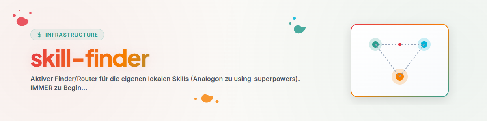

# Skill-Finder

## La règle

Avant toute tâche non triviale, vérifier d'abord si un skill local la résout mieux. Dès un faible
doute, charger le skill correspondant et **suivre ses instructions en direct** (lire le fichier, ne pas
travailler de mémoire). Si aucun skill ne convient, poursuivre normalement.

## Routage par famille

<!-- Generiert/aktualisiert aus SKILL-MAP.md + inventory_skills.py. Thema -> Familie -> Skill.
     Pflege: Subskill skill-family-care oder neuer skill-explorer-Audit-Lauf. Stand: 2026-06-17 -->

| Thème / Intention | Famille | Skill(s) |
|-------------------|---------|----------|
| Réfléchir à un problème / l'analyser | Outils de réflexion | `/structured-thinking` (exécute `/think` → `/brainstorm` → `/decide`) |
| nouvelles idées / créativité | Outils de réflexion | `/brainstorm` (vs `/think` analyse, `/decide` sélection) |
| Pile de décisions | Outils de réflexion | `/decision-briefing` |
| Quelle décision dépend de laquelle / les recommandations se contredisent-elles ? | Outils de réflexion | `decision-path` (`/decision-path` ; graphe de dépendances en ASCII, ne décide rien) |
| Faire valider la variante globale recommandée en UN seul texte de concept/mise en œuvre | Outils de réflexion | `decision-draw` (`/decision-draw` ; validation globale, corrections → décisions individuelles) |
| Constituer ou utiliser un profil utilisateur autorisé | Multi-Agent | `build-your-users-mind` (constitution) · `decision-avatar` (utilisation) |
| Bug / échec de test | Codage & débogage | `/bugfix-protocol` (1 bug), `/bugsweep` (plusieurs, avant publication) |
| projet ou pipeline nouveau/existant | Projet/Pipeline | `/projekt-pipeline-umbrella` (→ bootstrapper/onboarding/optimizer) |
| Jeu Roblox | Développement de jeux | `/rbx-dev` (→ `/rojo`, `/rbx-studio`, `/game-design`) |
| Thérapie / conseil / crise | Thérapie | `/therapie-umbrella` (→ stabilization/guideline/counseling) |
| Présentation / diapositives | Bureautique | `/academic-pptx` (contenu) + `/pptx` (fichier) |
| Limiter ensemble l'orchestration avant un travail multi-agent complexe | Multi-Agent | `choose-your-orchestrator` (`/choose-your-orchestrator`) |
| Exécuter une coordination multi-agent confirmée | Multi-Agent | `orchestrator`, `/swarm-operations`, `/model-strategy` |
| Candidature / auto-gestion | Personnel | `/bewerbungsexperte`, `/selbstmanagement` |
| Comparer / nettoyer / trouver des skills | Système/Méta | `skill-explorer` (audit/exploration), `code-skill-index` (liste) |
| Configurer le système / synchroniser MCP / connecter des agents | Système/Méta | `/system-onboarding`, `/mcp-config-sync`, `/agents-bridge` |
| Outils de fichiers | Utilitaires | `/document-chunker`, `/migrate-rename`, `/plugin-system` |
| Conserver un historique de chat sous forme de skill | Système/Méta | `skill-extractor` (`/skill-extract`) |
| Historique de chat / automatisation tierce → automatisation | Système/Méta | `workflow-extract` (`/automations-extract`) |
| contrôle récurrent sur de nombreux projets | Codage & débogage | `rotation-check` (structure registre/journal) |
| problème bloqué, extraction d'idées | Outils de réflexion | `idea-mining` (vs `/brainstorm` = libre/large) |
| Garder les versions DE/EN des documents synchronisées | Utilitaires | `bilingual-doc-sync` |
| fusion très conflictuelle / branches divergentes (main vs. master) / ancienne PR | Codage & débogage | `reissverschluss-merge` (`/reissverschluss-merge` · `/zipper-merge` ; escalade : reconstruction plutôt que fusion) |
| Traces d'IA / restes de chat dans les textes, mention de l'IA | Utilitaires | `llm-text-hygiene` |
| Condition/moment/ordre dans la consigne (« seulement quand », « à partir de 6 h », « dès que X est terminé ») | Processus | `condition` (`/if` · `/when` · `/if-only` · `/after` · `/and` · `/or`) |
| Rassembler/trier des fichiers d'un dossier selon des règles (« prends toujours Y dans X et range-les dans Z », « trie le dossier automatiquement ») | Utilitaires | `file-collect-sort-action` |
| Tester ensemble avec l'utilisateur une série d'applications/d'interfaces (test en direct, évaluation immédiate des retours + délégation de la réparation) | Codage & débogage | `human-loop-audit` |
| Nettoyer un projet après la fin de séance (résoudre/ranger les registres, mettre la documentation à jour, retirer les éléments orphelins) | Codage & débogage | `tidy-up` (`/tidy-up` ; compte comme source de niveau 1 `work-autonomous`) |
| Raccourcir un fichier de règles/mémoire sans en modifier le contenu (« CLAUDE.md est trop long », « est tronqué ») | Utilitaires | `paveman` (déterministe, sans appel de modèle ; vs. `knappform` = style de parole du LLM) |
| Diagramme Mermaid qui ne s'affiche pas sur GitHub (« Unable to render rich display », « le schéma ne s'affiche pas »), vérifier les blocs Mermaid à l'échelle de l'organisation | Codage & débogage | `mermaid-lint` (analyseur réel sans navigateur + relecture sur la page en ligne) |
| Budget de modèles, quotas, utilisation limitée de reviewers/advisors coûteux | Multi-Agent | `budgetierung` (compte + négociation ; choix du modèle lui-même : `/model-strategy`) |

Liste complète : skill `code-skill-index`.

## Signaux d'alerte (rationalisations qui signifient STOP)

| Pensée | Réalité |
|--------|---------|
| « Ce n'est qu'une petite question. » | Les questions sont des tâches — vérifier d'abord les skills. |
| « Je connais ce concept. » | Connaître le concept ≠ utiliser le skill. Lire le fichier en direct. |
| « Le skill est exagéré. » | Le simple devient complexe — l'utiliser. |
| « Je vais d'abord explorer moi-même. » | Les skills indiquent COMMENT explorer. Vérifier d'abord. |

## Maintenance

Mettre à jour le tableau de routage lors d'un changement de famille (sous-skill `skill-family-care` ou
nouvelle exécution `inventory_skills.py` à partir de `skill-explorer`).

## Journal des modifications

### 0.9.0 (2026-10-03)
- Ligne de routage pour le nouveau skill `budgetierung` (famille Multi-Agent) : négocier, gérer et
  ajuster les quotas de modèles — tenue de comptes en complément de `model-strategy`
  (celui-ci précise *quel* modèle convient ; `budgetierung` règle *combien* en utiliser).

### 0.8.0 (2026-09-20)
- Ligne de routage ajoutée pour le nouveau skill `mermaid-lint` (famille Codage & débogage) :
  diagrammes Mermaid que GitHub refuse avec « Unable to render rich display », ainsi que
  des passes de vérification à l'échelle de l'organisation sur tous les blocs ```mermaid.

### 0.7.0 (2026-08-20)
- `choose-your-orchestrator` ajouté comme dialogue préalable de recommandation et de contrat pour
  un travail multi-agent complexe ; routage d'exécution vers `orchestrator`,
  `swarm-operations` et `model-strategy` séparé de celui-ci.

### 0.6.0 (2026-08-19)
- Ligne de routage pour le nouveau skill paveman (« raccourcir un fichier de règles/mémoire sans en
  modifier le contenu ») : fine enveloppe autour du module de raccourcissement déterministe déjà installé
  `paveman` (T-20260819-213392123) ; délimitation avec `knappform` (style de parole du LLM plutôt que modification de fichier).

### 0.5.0 (2026-08-19)
- Ligne de routage pour le nouveau skill tidy-up (« nettoyer un projet après la fin de séance ») :
  passage unique Tasksolver+Writer+Maintainer pour le dossier de projet actif ; compte comme
  source de niveau 1 `work-autonomous` pour les constructions `/goal`.

### 0.4.0 (2026-08-18)
- Ligne de routage pour le nouveau skill human-loop-audit (« tester ensemble avec l'utilisateur une série
  d'applications/d'interfaces », audit en fermeture éclair avec délégation parallèle de réparation ; distingué
  de reissverschluss-merge, au nom proche mais au contenu différent).

### 0.3.0 (2026-08-18)
- Ligne de routage pour le nouveau skill file-collect-sort-action (« rassembler/trier des fichiers
  selon des règles », reconnaissance des phrases déclencheuses f-csa mises en attente depuis T-20260818-916568570).
- Rattrapage : ligne de routage pour reissverschluss-merge absente de la source du dépôt de skills
  (présente uniquement dans le déploiement `~/.claude/skills/`) — dérive repérée lors de la modification et rétablie
  ici, afin qu'un futur déploiement ne l'écrase pas.
- Champ `version:` aligné sur l'état déjà atteint du journal (0.2.0) et incrémenté à 0.3.0 — il était
  resté à 0.1.0 auparavant.

### 0.2.0 (2026-07-03)
- Lignes de routage pour de nouveaux skills : skill-extractor, workflow-extract, rotation-check,
  idea-mining, bilingual-doc-sync (extraction des automatisations Codex).

### 0.1.0 (2026-06-17)
- Version initiale. Générée par le mode audit ([F]) en tant qu'analogue à using-superpowers. Tableau de routage
  issu de l'audit du 2026-06-17 (10 familles user).
