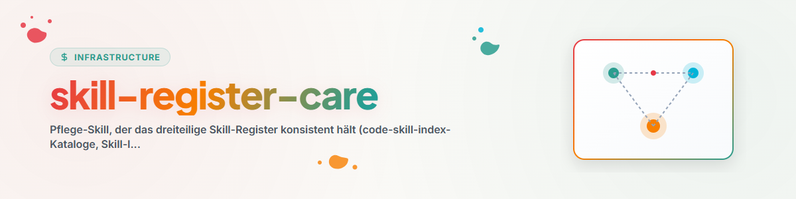

# Skill-Register-Care

## উদ্দেশ্য

রেজিস্টারটিকে ড্রিফট-মুক্ত রাখে। রেজিস্টার তিনটি পরস্পর-সংযুক্ত আর্টিফ্যাক্ট নিয়ে গঠিত — কখনো একটি চতুর্থ আর্টিফ্যাক্ট তৈরি করবেন না, সর্বদা এই তিনটিকেই প্রসারিত করুন:

| আর্টিফ্যাক্ট | ভূমিকা | রক্ষণাবেক্ষণ |
|---|---|---|
| `~/.claude/skills/code-skill-index/references/catalog-*.md` | Kategorie-Kataloge (বিভাগ-ক্যাটালগ) | কিউরেটেড, হাতে-কলমে |
| `<USER_HOME>/OneDrive/.SYNC/CLAUDE-CODE-SKILLS.md` | Cross-System-Index (Claude Desktop-এর একমাত্র স্কিল-দৃষ্টিভঙ্গি) | **স্বয়ংক্রিয়**, নিচে দেখুন |
| `<USER_HOME>/OneDrive/.USR/SKILL-MAP.md` | Family-/Routing-Map (ফ্যামিলি-/রাউটিং-ম্যাপ) | কিউরেটেড, হাতে-কলমে |

## স্বয়ংক্রিয়: Cross-System-Index

ইনডেক্স আর **হাতে** নতুন করে যোগ করা হয় না — এতে এটি তিন মাস স্থির ছিল (21.06.-এর অবস্থা অনুযায়ী 20.09.2026-এর 152টি প্রকৃত স্কিলের বিপরীতে; 81টি অনুপস্থিত ছিল)। এর পরিবর্তে:

```bash
PYTHONIOENCODING=utf-8 python "<USER_HOME>/OneDrive/.SYNC/scripts/skill_index_care.py" --check
PYTHONIOENCODING=utf-8 python "<USER_HOME>/OneDrive/.SYNC/scripts/skill_index_care.py" --apply
```

এটি এমনিতেই দৈনিক `/sync`-এর **ধাপ 2b** হিসেবে চলে; এখানে ম্যানুয়ালি শুধু তখনই চালান, যখন স্কিল তৈরি বা ডিপ্লয় করা হয়েছে এবং ইনডেক্স তৎক্ষণাৎ মিলিয়ে নিতে হবে। এই রানটি অ্যাডিটিভ এবং ইডেম্পোটেন্ট: কিউরেটেড সংক্ষিপ্ত বিবরণ থাকে, অনুপস্থিত স্কিলগুলো Library-Kategorie অনুযায়ী সাজানো হয়, সক্রিয় `SKILL.md` ছাড়া এন্ট্রিগুলো **মুছে না ফেলে চিহ্নিত** করা হয়।

## ড্রিফট-চেক-প্রক্রিয়া (দুটি কিউরেটেড রেজিস্টার)

1. **বর্তমান অবস্থা সংগ্রহ:**
   ```bash
   PYTHONIOENCODING=utf-8 python ~/.claude/skills/skill-explorer/scripts/inventory_skills.py \
       --out ~/.skill-inventory.json --pretty
   ```
   শুধু `source=user`-স্কিলগুলোই রেজিস্টার-প্রাসঙ্গিক (Plugin/বাহ্যিক বাইরে থাকে)।
2. **কাঙ্ক্ষিত অবস্থা পড়া:** তিনটি রেজিস্টার-আর্টিফ্যাক্ট।
3. **পার্থক্য নির্ণয়:**
   - **অনুপস্থিত** (ইনভেন্টরিতে আছে, রেজিস্টারে নেই) → যোগ করুন।
   - **এতিম** (রেজিস্টারে আছে, ইনভেন্টরিতে আর নেই) → **আগে দেখুন, তারপর সিদ্ধান্ত নিন।**
     যে স্কিল-ফোল্ডারের `SKILL.md` `CONTENT.md`-এ নামবদল করা হয়েছে, সেটি *নিবন্ধন-বাতিল* হয়েছে: ইচ্ছাকৃতভাবে আর স্কিল হিসেবে লোড হয় না, তবে বিষয়বস্তু বিদ্যমান এবং `code-skill-index`-এর মাধ্যমে খুঁজে পাওয়া যায়। ইনভেন্টরি এটি গণনা করে না, তবে মুছে ফেলাও উচিত নয় — চিহ্নিত করুন। শুধু ফোল্ডারটি না থাকলেই সরাসরি মুছুন।
   - **গণনার পার্থক্য** (যেমন „18 Skills" আর মেলে না) → সংখ্যাটি সংশোধন করুন।
4. **যোগ করা:** প্রতিটি নতুন স্কিলের জন্য উপযুক্ত `catalog-<kategorie>.md`-এ একটি লাইন, Skill-Index-এ একটি লাইন (+ শিরোনাম-তারিখ) এবং — যদি নতুন/পরিবর্তিত ফ্যামিলি হয় — `SKILL-MAP.md`-এ একটি বিভাগ।
5. **Stand-Datum** সব স্পর্শ-করা ফাইলে বর্তমান তারিখে সেট করুন।

## সহায়ক স্নিপেট (অনুপস্থিত user-স্কিল তালিকাভুক্ত করা)

```bash
PYTHONIOENCODING=utf-8 python -c "
import json
inv=json.load(open('<USER_HOME>/.skill-inventory.json',encoding='utf-8'))
print('\n'.join(s['dir'] for s in inv['skills'] if s['source']=='user'))
"
```
আউটপুটটি রেজিস্টার-আর্টিফ্যাক্টের সাথে মিলিয়ে দেখুন (ম্যানুয়ালি বা grep দিয়ে)।

## লোহার নিয়মাবলি

- **কোনো চতুর্থ রেজিস্টার নয়** — শুধু তিনটিকেই প্রসারিত করুন।
- শুধু user-authored স্কিল রেজিস্টারে যায়; তৃতীয়-পক্ষের স্কিলগুলো বাহ্যিক পথ অনুসরণ করে।
- তারিখ অনুমান করবেন না — বর্তমান তারিখ বসান।
- Cross-System-Index **হাতে** রক্ষণাবেক্ষণ করবেন না; `skill_index_care.py` চালান। যিনি সেখানে ম্যানুয়ালি লাইন যোগ করেন, তিনি পরবর্তী নীরব ড্রিফটের ভিত্তি তৈরি করেন।

## Changelog

### 0.2.0 (2026-09-20)
- Cross-System-Index `CLAUDE-CODE-SKILLS.md`-কে `.SYNC/scripts/skill_index_care.py`-এ রূপান্তরিত করা হয়েছে
  (অ্যাডিটিভ, চিহ্নিতকরণ, ইডেম্পোটেন্ট) এবং দৈনিক `/sync`-এ ধাপ 2b হিসেবে যুক্ত করা হয়েছে। কারণ:
  ইনডেক্সটি 2026-06-21 থেকে স্থির ছিল — 81টি লোকাল স্কিল অনুপস্থিত ছিল, 15টি এন্ট্রি চিহ্ন ছাড়াই নিবন্ধন-বাতিল (deregistered) স্কিলের দিকে নির্দেশ করছিল, এবং একটি এমন ফোল্ডারের দিকে, যার `SKILL.md` নেই।
- „এতিম" সংজ্ঞা স্পষ্ট করা হয়েছে: রেজিস্টার-মুক্ত স্কিলগুলো (`SKILL.md`-এর বদলে `CONTENT.md`) মুছে না ফেলে চিহ্নিত করা হয় — নতুন করে যুক্ত করার সময় অন্যথায় 15টি কিউরেটেড এন্ট্রি মুছে যেত।

### 0.1.0 (2026-06-17)
- প্রাথমিক সংস্করণ। Audit-মোড (P2) থেকে তৈরি। কারণ: 2026-06-17-এর অডিটে SKILL-MAP-এ প্রায় 10টি user-স্কিল অনুপস্থিত ছিল (swarm-operations, model-strategy, agents-bridge, mcp-config-sync, system-onboarding,
  update-cli-docs, migrate-rename, plugin-system এবং Therapie- ও Game-Dev-ফ্যামিলি)।
