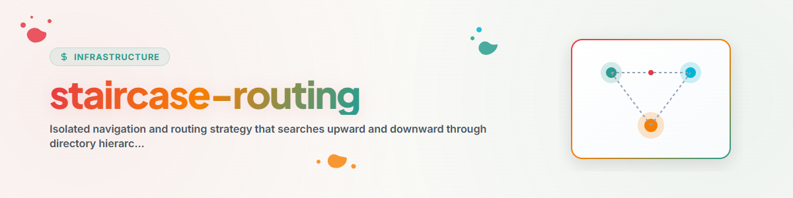

# توجيه Staircase (Up-and-Down / Walking Bass Routing)

تُغلّف مهارة **توجيه Staircase**، والمعروفة أيضًا باسم *Up-and-Down Routing* أو
*Walking Bass Routing*، استراتيجية فحص مستندات المجلدات لوكلاء الذكاء الاصطناعي.

عندما يدخل الوكيل مجلدًا أو يعمل على ملف، فإنه يستخدم هذه الاستراتيجية للعثور على
السياق المعتمد والقواعد ومستندات الإرشاد قبل تعديل الشيفرة أو تنفيذ أي إجراء.

---

## 1. معايير مستندات الإرشاد

يبحث توجيه Staircase افتراضيًا عن مستندات الإرشاد التالية:

- **التحكم العام والخاص بالمشروع:** `CLAUDE.md`، `AGENTS.md`،
  `START.md`، `RULES.md`
- **نظرة عامة على المشروع والمهام:** `README.md`، `TODO.md`، `NOTIZ.md`،
  `BEWEISNOTIZ.md`
- **الكلمات المفتاحية المخصصة:** تُهيَّأ عبر
  `staircase-config.json` أو `config.json`.

---

## 2. خوارزمية الاجتياز

```text
                           [ Root- / Workspace-Ebene ]
                           ┌────────────────────────┐
                           │   CLAUDE.md / RULES.md │ ◄── (Schritt 2: Root-Wegweiser lesen)
                           └───────────▲────────────┘
                                       │ (Treppe aufwärts)
                           ┌───────────┴────────────┐
                           │ Unterordner / Ziel     │ ◄── (Schritt 1: Im CWD beginnen)
                           └───────────┬────────────┘
                                       │ (Treppe abwärts)
                           ┌───────────▼────────────┐
                           │ Kind- / Modulordner    │ ◄── (Schritt 3: Untergeordnete Wegweiser finden)
                           │   module-rules.md      │
                           └────────────────────────┘
```

### الخطوة 1: فحص دليل العمل الحالي (CWD)

- تحقق من مجلد الملف الهدف أو من دليل العمل النشط.
- إذا وُجدت مستندات إرشاد، فاقرأها فورًا.

### الخطوة 2: الاجتياز صعودًا

- إذا **لم** يُعثر على مستند إرشاد في CWD، فانتقل إلى المجلد الأب
  (`..`).
- كرر ذلك خطوة بخطوة نحو الأعلى، حتى يُعثر على مستند إرشاد جذري
  (`CLAUDE.md` أو `AGENTS.md`) أو تُبلغ حدود مساحة العمل.
- اقرأ جميع مستندات الإرشاد الجذرية التي وُجدت لتحديد التوجيهات العامة وقواعد المشروع.

### الخطوة 3: الفحص هبوطًا

- انطلق من الدليل الجذري الذي حُدد نحو المجلدات الفرعية ذات الصلة بالمهمة.
- ابحث عن مستندات الإرشاد المتخصصة على مستوى الوحدات أو قواعد النطاقات أو إعدادات المكونات واقرأها.

---

## 3. الكلمات المفتاحية القابلة للتهيئة من قبل المستخدم (`staircase-config.json`)

يمكن للوكلاء قراءة `staircase-config.json` محلي أو عام لتخصيص أدلة الإرشاد التي يبحثون عنها:

```json
{
  "signpost_filenames": [
    "CLAUDE.md",
    "AGENTS.md",
    "START.md",
    "RULES.md",
    "README.md",
    "TODO.md"
  ],
  "custom_buzzwords": [
    "SECURITY",
    "POLICY",
    "GOVERNANCE",
    "PIPELINE"
  ],
  "max_upward_depth": 10,
  "exclude_directories": [
    "node_modules",
    ".git",
    "__pycache__",
    "dist",
    "build",
    "archive"
  ]
}
```

---

## 4. التكامل مع `letter-hooker` والمهام المجدولة

`staircase-routing` مُدمج بوصفه محمّل الفحص الأولي المركزي في المهارة
**`letter-hooker`** والمهمة المجدولة
**`antigravity-kontext-and-workflow-loader-and-divider`**. وبذلك يعثر الوكلاء على مستندات الإرشاد ويتبعونها
قبل بدء أي تعديلات.
