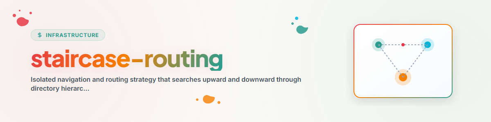

> **English** — Official English version of `staircase-routing`.

# Staircase-Routing (Up-and-Down / Walking Bass Routing)

The **Staircase-Routing** skill (also referred to as *Up-and-Down Routing* or *Walking Bass Routing*) isolates the directory document inspection strategy for AI agents.

When an agent enters a directory or works on a file, it uses this strategy to locate authoritative context, rules, and signpost documents before modifying code or taking action.

---

## 1. Signpost Document Standards

By default, Staircase-Routing looks for standard signpost documents:
- **Global & Project Controls:** `CLAUDE.md`, `AGENTS.md`, `START.md`, `RULES.md`
- **Project Overview & Tasks:** `README.md`, `TODO.md`, `NOTIZ.md`, `BEWEISNOTIZ.md`
- **Custom User Buzzwords:** Configured via `staircase-config.json` or `config.json`.

---

## 2. Traversal Algorithm

```
                           [ Root / Workspace Level ]
                           ┌────────────────────────┐
                           │   CLAUDE.md / RULES.md │ ◄── (Step 2: Read Root Signpost)
                           └───────────▲────────────┘
                                       │ (Staircase Up)
                           ┌───────────┴────────────┐
                           │ Subfolder / Target Dir │ ◄── (Step 1: Start at CWD)
                           └───────────┬────────────┘
                                       │ (Staircase Down)
                           ┌───────────▼────────────┐
                           │ Child / Module Dir     │ ◄── (Step 3: Discover Sub-Signposts)
                           │   module-rules.md      │
                           └────────────────────────┘
```

### Step 1: Current Working Directory (CWD) Inspection
- Inspect the directory of the target file or active working directory.
- If signpost documents exist, read them immediately.

### Step 2: Upward Traversal (Staircase Up)
- If **no** signpost document is found in CWD, move up to the parent directory (`..`).
- Repeat step-by-step upward until a root signpost document (`CLAUDE.md` or `AGENTS.md`) or the workspace boundary is reached.
- Read all discovered root signposts to establish global directives and project rules.

### Step 3: Downward Inspection (Staircase Down)
- From the established root directory, step downward into child directories relevant to the task.
- Discover specialized module-level signposts, domain rules, or component configs. Read them.

---

## 3. User-Configurable Buzzwords (`staircase-config.json`)

Agents can read a local or global `staircase-config.json` to customize target signposts:

```json
{
  "signpost_filenames": [
    "CLAUDE.md",
    "AGENTS.md",
    "START.md",
    "RULES.md",
    "README.md",
    "TODO.md"
  ],
  "custom_buzzwords": [
    "SECURITY",
    "POLICY",
    "GOVERNANCE",
    "PIPELINE"
  ],
  "max_upward_depth": 10,
  "exclude_directories": [
    "node_modules",
    ".git",
    "__pycache__",
    "dist",
    "build",
    "archive"
  ]
}
```

---

## 4. Integration with `letter-hooker` & Scheduled Tasks

`staircase-routing` is embedded as a core preflight bootloader in the **`letter-hooker`** skill and the **`antigravity-kontext-and-workflow-loader-and-divider`** scheduled task, ensuring agents always locate and obey signpost documents before initiating edits.