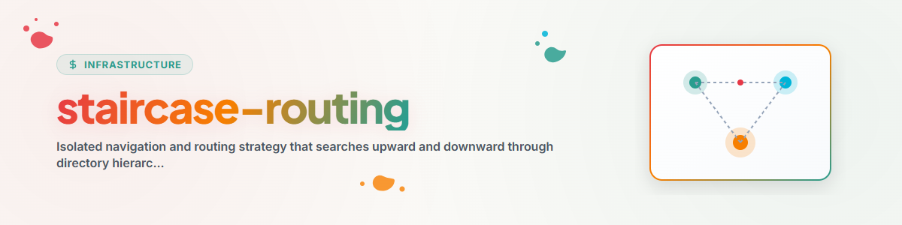

> **Français** — Version française officielle de la compétence `staircase-routing`.

# Staircase-Routing (Routage haut-bas / Walking Bass)

La compétence **Staircase-Routing**, également appelée *Up-and-Down Routing* ou *Walking Bass
Routing*, encapsule la stratégie d'inspection des documents d'orientation dans les répertoires
pour les agents IA.

Lorsqu'un agent entre dans un répertoire ou travaille sur un fichier, il utilise
cette stratégie pour trouver le contexte faisant foi, les règles et les documents repères
avant de modifier du code ou d'exécuter une action.

---

## 1. Standards pour les documents repères

Staircase-Routing recherche par défaut ces documents repères :

- **Pilotage global et lié au projet :** `CLAUDE.md`, `AGENTS.md`,
  `START.md`, `RULES.md`
- **Vue d'ensemble et tâches du projet :** `README.md`, `TODO.md`, `NOTIZ.md`,
  `BEWEISNOTIZ.md`
- **Mots-clés personnalisés :** configurés via
  `staircase-config.json` ou `config.json`.

---

## 2. Algorithme de parcours

```text
                           [ Niveau racine / Workspace ]
                           ┌───────────────────────────┐
                           │   CLAUDE.md / RULES.md    │ ◄── (Étape 2 : lire les repères racine)
                           └─────────────▲─────────────┘
                                         │ (monter l'escalier)
                           ┌─────────────┴─────────────┐
                           │ Sous-dossier / Cible      │ ◄── (Étape 1 : commencer dans le CWD)
                           └─────────────┬─────────────┘
                                         │ (descendre l'escalier)
                           ┌─────────────▼─────────────┐
                           │ Dossier enfant / module   │ ◄── (Étape 3 : trouver les repères subordonnés)
                           │   module-rules.md         │
                           └───────────────────────────┘
```

### Étape 1 : Vérifier le répertoire de travail courant (CWD)

- Contrôler le répertoire du fichier cible ou le répertoire de travail actif.
- Si des documents repères sont présents, les lire immédiatement.

### Étape 2 : Remonter l'arborescence

- Si **aucun** document repère n'est trouvé dans le CWD, passer au
  répertoire parent (`..`).
- Répéter progressivement vers le haut jusqu'à atteindre un document repère racine
  (`CLAUDE.md` ou `AGENTS.md`) ou la limite du workspace.
- Lire tous les repères racine trouvés afin d'établir les directives globales et les règles du projet.

### Étape 3 : Descendre pour vérifier

- Depuis le répertoire racine identifié, redescendre dans les sous-répertoires
  pertinents pour la tâche.
- Repérer les documents repères spécialisés au niveau module, les règles de domaine ou
  les configurations de composants et les lire.

---

## 3. Mots-clés configurables par l'utilisateur (`staircase-config.json`)

Les agents peuvent lire un fichier `staircase-config.json` local ou global pour adapter les
repères recherchés :

```json
{
  "signpost_filenames": [
    "CLAUDE.md",
    "AGENTS.md",
    "START.md",
    "RULES.md",
    "README.md",
    "TODO.md"
  ],
  "custom_buzzwords": [
    "SECURITY",
    "POLICY",
    "GOVERNANCE",
    "PIPELINE"
  ],
  "max_upward_depth": 10,
  "exclude_directories": [
    "node_modules",
    ".git",
    "__pycache__",
    "dist",
    "build",
    "archive"
  ]
}
```

---

## 4. Intégration avec `letter-hooker` et les tâches planifiées

`staircase-routing` est intégré comme chargeur préalable central dans la compétence
**`letter-hooker`** et la tâche planifiée
**`antigravity-kontext-and-workflow-loader-and-divider`**. Ainsi, les agents
trouvent et respectent les documents repères avant d'engager toute modification.

## Journal des modifications

### 1.0.1 (2026-11-22)
- Mention linguistique corrigée.
