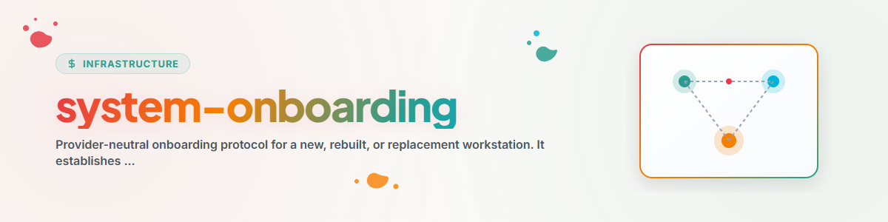

# تهيئة النظام

استخدم هذا البروتوكول لإعداد جهاز عمل جديد أو مُعاد الإعداد لتنفيذ أعمال الوكلاء المحلية أولاً. وهو دليل للترتيب والتحقق، وليس أداة تثبيت، ولا مصدراً لبيانات الاعتماد. حدِّد التعليمات الخاصة بالمنتج استناداً إلى الوثائق الحالية لكل مزوّد قبل تعديل أي نظام حي.

## التفعيل

استخدم المهارة عند تجهيز جهاز عمل جديد، أو تثبيت نظام تشغيل من جديد، أو استبدال جهاز، أو الاستعادة المضبوطة لبيئة تشغيل وكيل واحدة. حدِّد أولاً نظام التشغيل، وبيئة التشغيل المستهدفة، والشخص المسؤول، وسطح القواعد المشترك، وما إذا كان المطلوب إعادة بناء كاملة أم إصلاحاً محدوداً لأحد المكونات. لا تفترض أن إعداداً منسوخاً من مضيف آخر آمن أو مدعوم على جهاز مختلف.

## سير العمل المرتب

1. قم بإعداد تحديثات نظام التشغيل وGit ومستودع الشيفرة المصدرية الموثَّق وPython، وعند الحاجة إصدار Node.js LTS المدعوم حالياً.
2. ثبِّت بيئات تشغيل الوكلاء المطلوبة فقط عبر مثبّتاتها المدعومة. أكمل مسارات تسجيل الدخول الأصلية دون وضع الرموز المميزة في ملفات المشروع.
3. أنشئ جذور الإعداد المحلية وحمّل سطح قواعد معتمداً مُختاراً صراحةً. ادمج القوالب؛ ولا تستبدل الحالة المحلية الموجودة أبداً دون مراجعة.
4. ثبِّت المهارات القابلة للنقل وإعدادات MCP أو الإضافات فقط عبر إجراءات النشر الموثَّقة لكل منها. عامل تنسيقات إعداد المزوّدين على أنها مختلفة فيما بينها.
5. اضبط المزامنة المشتركة بعد أن تعمل بيئة التشغيل المحلية. شارك العقود والأدلة المنقّحة، لا بيانات الاعتماد أو المطالبات الكاملة أو المسارات المحلية الخاصة بالجهاز.
6. استعِد المجدولات أو الأتمتات فقط عبر سطحها الأصلي المدعوم. احتفظ بالحالة السابقة، واترك المهام الجديدة معطّلة إلى أن يوافق الشخص المسؤول على التفعيل.
7. نفّذ فحوص ما بعد التثبيت المناسبة واكتب دليلاً محلياً يميّز بين التثبيت والإعداد وتسجيل المجدول والنتيجة الناجحة.

اقرأ المرجع المناسب للنظام المستهدف فقط:

- [نظرة عامة](references/overview.md) للحدود وتخزين البيانات؛
- [قائمة التحقق لنظام Windows](references/windows-checklist.md) لنظام Windows؛
- [قائمة التحقق لنظام macOS](references/mac-checklist.md) لنظام macOS؛ و
- [الفحص بعد التثبيت](references/post-install.md) للتحقق والاستعادة.

## الحدود

- لا تنشر أبداً بيانات الاعتماد أو رموز الاسترداد أو المطالبات الخاصة أو معرّفات الحسابات أو السجلات الخام في مستودع مشترك أو مجلد مزامنة.
- أبقِ البيئات الافتراضية وذاكرات التخزين المؤقت للتبعيات والمخرجات الكبيرة لبيئة التشغيل خارج مجلدات المشروع المزامنة مع السحابة.
- لا تعتبر الإعداد المنسوخ مصدراً مرجعياً. يجب أن يحدد المضيف المستهدف حالته المدعومة الخاصة به ويؤكدها بقراءة عكسية.
- لا تسجّل جدولاً زمنياً لمجرد وجود ملف مهمة. التسجيل الأصلي ودليل النتيجة متطلبان منفصلان.
- عند إصلاح مضيف قائم، سجِّل حالته الحالية وأقفاله قبل تعديل أي إعداد.

## دليل الإتمام

يحتفظ دليل التهيئة الكامل بنظام التشغيل المستهدف، والبيئات المختارة، والإصدارات المتحقَّق منها، ومراجع القواعد المعتمدة المحمّلة، والمهارات أو الإضافات المنشورة صراحةً، والقدرات غير المدعومة، وقرارات المستخدم المؤجَّلة. ولا يثبت إكمال الأمر بنجاح وحده أن التطبيق حمّل إعداده الجديد، ولا أن المهمة المجدولة حققت نتيجتها المقصودة.

## سجل التغييرات

### 1.2.0 (2026-07-29)

- نُقلت ترتيبات التهيئة القابلة لإعادة الاستخدام ومراجع المنصات إلى كتالوج المهارات العام بعد إزالة المسارات الخاصة بالمضيف وتفاصيل الحسابات والمواد التشغيلية الخاصة.
