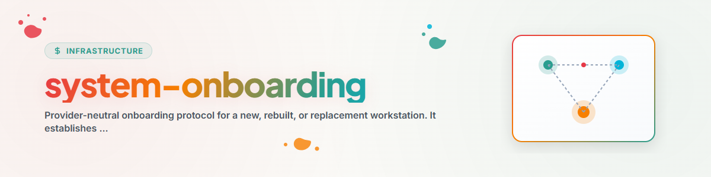

> **Français** — Version française officielle de la compétence `system-onboarding`.

# System-Onboarding — Mise en service d'un poste de travail

Utilisez ce protocole pour préparer un poste de travail neuf ou réinstallé
en vue d'un travail d'agents *local-first*. Il s'agit d'un guide d'ordonnancement
et de vérification, non d'un installateur ni d'une source d'identifiants. Vérifiez
les instructions propres à chaque produit dans la documentation actuelle du fournisseur
concerné avant de modifier un système en production.

## Activation

Utilisez cette compétence pour un nouveau poste de travail, un système d'exploitation
fraîchement installé, un appareil de remplacement ou la restauration contrôlée d'un
runtime d'agent isolé. Déterminez d'abord le système d'exploitation, le runtime cible,
la personne responsable, la surface de règles commune et si une reconstruction complète
ou une réparation ciblée de composants est souhaitée. Ne supposez pas qu'une configuration
copiée depuis un autre hôte soit sûre ou prise en charge sur celui-ci.

## Séquence de travail ordonnée

1. Mettre en place les mises à jour du système d'exploitation, Git, la gestion de code source
   authentifiée, Python et, si besoin, la version Node.js LTS actuellement prise en charge.
2. N'installer que les runtimes d'agents demandés via leurs installateurs pris en charge.
   Achever les parcours de connexion natifs sans déposer de jetons dans des fichiers de projet.
3. Créer les racines de configuration locales et charger une surface de règles canonique
   explicitement sélectionnée. Fusionner les modèles ; ne jamais écraser aveuglément un état
   local existant.
4. N'installer les compétences portables ainsi que la configuration MCP ou de plugins qu'avec
   les procédures de déploiement documentées pour chacun. Traiter les formats de configuration
   des fournisseurs comme distincts les uns des autres.
5. Ne configurer la synchronisation partagée qu'une fois le runtime local opérationnel. Partager
   des contrats et preuves assainis, jamais d'identifiants, de prompts complets ni de chemins
   propres à la machine.
6. Ne restaurer planificateurs ou automatisations que via leur interface native prise en charge.
   Conserver l'état antérieur et laisser les nouvelles tâches désactivées jusqu'à ce que la
   personne responsable valide leur activation.
7. Exécuter les vérifications post-installation appropriées et rédiger une preuve locale
   distinguant installation, configuration, enregistrement dans le planificateur et résultat probant.

Ne lisez que la référence correspondant au système cible :

- [Vue d'ensemble](references/overview.md) pour les limites et le stockage des données ;
- [Check-list Windows](references/windows-checklist.md) pour Windows ;
- [Check-list macOS](references/mac-checklist.md) pour macOS ; et
- [Vérification post-installation](references/post-install.md) pour la vérification
  et la restauration.

## Limites

- Ne publiez jamais d'identifiants, codes de récupération, prompts privés,
  identifiants de compte ou journaux bruts dans un dépôt partagé ou un
  dossier de synchronisation.
- Tenez les environnements virtuels, caches de dépendances et volumineux
  artefacts d'exécution hors des dossiers de projets synchronisés dans le cloud.
- Ne décrivez pas une configuration copiée comme source faisant foi. L'hôte cible
  doit déterminer son propre état pris en charge et le confirmer par relecture (readback).
- N'enregistrez pas une tâche planifiée du seul fait qu'un fichier de tâche existe.
  L'enregistrement natif et la preuve de résultat sont deux exigences distinctes.
- Lors de la réparation d'un hôte existant, inventoriez son état actuel et ses verrous
  avant de modifier toute configuration.

## Preuve de clôture

Une preuve d'onboarding complète consigne le système d'exploitation cible, les runtimes
sélectionnés, les versions vérifiées, les références de règles canoniques chargées,
les compétences ou extensions explicitement déployées, les capacités non prises en charge
et les décisions utilisateur différées. La seule réussite d'une commande ne prouve ni qu'une
application a chargé sa nouvelle configuration, ni qu'une tâche planifiée a atteint son
résultat prévu.

## Journal des modifications

### 1.2.1 (2026-11-22)
- Mention linguistique corrigée.

### 1.2.0 (2026-07-29)
- Portage de l'ordre d'onboarding réutilisable et des références plateformes dans le catalogue
  public de compétences après suppression des chemins spécifiques à l'hôte, détails de compte
  et matériel d'exploitation privé.
