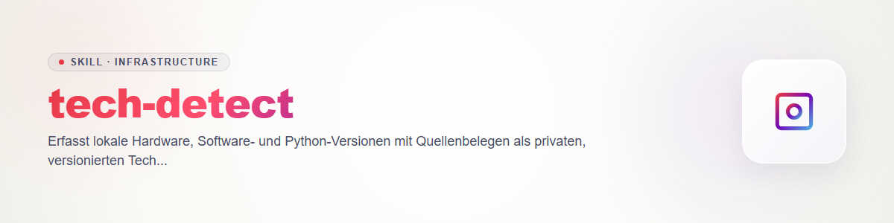

# Tech Detect

Проверяйте только собственный или явно разрешённый хост. Сначала прочитайте правила существующего инвентаря и слотов хостов. В схеме наподобие `<inventory>` файл `systems/<свой-слот>.json` служит входными данными; навык не обновляет его и не меняет чужие слоты.

1. Проверьте права, блокировки, идентичность хоста и приватный каталог вывода. Запустите `python -X utf8 scripts/techshot.py capture --seed <инвентарь>/systems/<свой-слот>.json --slot <свой-слот> --output <приватно>/techshot-<UTC>.json`.
2. Локальный помощник читает данные платформы и реестр удаления Windows, доступный `dpkg-query` или Homebrew. Ни один источник не гарантирует полный перечень программ. Не опрашивайте `Win32_Product`: [Microsoft Learn](https://learn.microsoft.com/en-us/powershell/scripting/samples/working-with-software-installations?view=powershell-7.6) описывает проверку целостности и возможное восстановление MSI.
3. Разделяйте работающий интерпретатор Python, каждый кандидат из PATH и явно заданные через `--python-path` установки и виртуальные среды. По умолчанию точная версия известна только для текущего интерпретатора. Для доверенного пути можно явно выполнить `--probe-python <путь>` с `-I -S --version`; иначе версия остаётся неизвестной.
4. Для установки сохраняйте идентификаторы продукта и установки, версию, источник и качество `observed`, `reported`, `uncertain` либо `unknown`. Аппаратные данные из исходного инвентаря помечайте как заявленные. Отражайте ошибки сбора и охват.
5. Сравните приватные снимки через `python -X utf8 scripts/techshot.py compare --left <a.json> --right <b.json> --output <сравнение.json>`. Различие версий и отсутствие наблюдения на хосте — разные выводы; отсутствие наблюдения не доказывает удаление. Объединяйте псевдонимы только при доказанной идентичности производителя.
6. Подключайте периодический сбор к существующему планировщику лишь после разрешения и отдельно проверяйте реальный запуск. Коммит навыка не устанавливает расписание.

Контракты JSON: `ellmos.techshot.v1` и `ellmos.techshot-comparison.v1`. Снимки дополняют прежний инвентарь, могут содержать приватные пути и не доказывают безопасность или уязвимость при неизвестной версии. Передавайте `security-tech-stack-check` только нужные компоненты и хеши.

## История

### 1.0.0 (2026-10-25)

- Локальный снимок и сравнение хостов с явным качеством доказательств.

Наблюдения оборудования отделены от заявленного инвентаря: ОС, архитектура, CPU, RAM и ёмкость системной файловой системы имеют источник либо unknown. GPU без переносимого считывателя остаётся unknown. В Linux возможны dpkg-query или rpm. При сравнении unknown не означает равенство. Не собирать серийные номера, MAC и полный PATH.

Контракт сравнения: разные slot дают axis=cross-host даже при одинаковом hostname; тот же slot и hostname при разных временах съёмки — axis=same-host-time. Результат сохраняет chronology, оба хеша, времена съёмки, идентичность, привязку seed и покрытие. Одинаковая известная версия при дополнительной неизвестной установке остаётся version-uncertain. При отсутствии обязательной провенансной информации отказать; полные исторические снимки разрешены независимо от возраста. Время сравнения не обновляет измерение.
