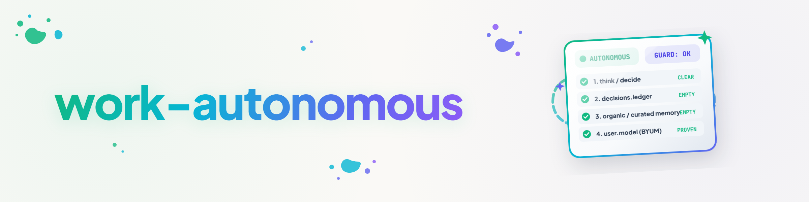

# work-autonomous — 只有在证实不再有可自主执行的任务时才结束循环

## 目的

该技能同时完成两件事：

1. **尽可能自主地继续工作**——完全是常规的会话工作，并无特殊之处。
2. **只有在已证实不存在任何可自主执行的任务时才结束循环**。"我现在找不到任何事情可做"的怀疑**不是**终止理由——它是**触发**一条检查链的条件，该链首先尝试**获取**新任务。只有当这条链完全没有结果时，终止才算得到证实。

**有意不内置 `/goal`：** 该技能可独立使用（例如在普通会话中直接作为 `/work-autonomous` 调用），也可作为上层循环结构的条件使用：照常设置 `/loop`，然后仅将本技能作为目标。该目标的大意是："当不再有可自主执行的任务时结束循环——并在此之前尽可能自主地继续工作。"该技能本身不调用 `/goal` 结构；它只提供明确的终止信号，供此类结构读取（参见下文"终止信号"）。

## 运行模型——两个层级

### 第一层——常规工作（每个 tick）

#### TICKET-MASTER 入口门控（优先于该层的一切）

**仅当上下文中包含工单系统（`_TICKETS/`）时才相关**——没有工单系统的会话将完全跳过此门控，该技能在没有任何工单系统的情况下仍可独立使用（参见上文"目的"）。首先需要检查 `INBOX/`——包括尚未转换为工单格式的非正式条目——是否已全部正式化并完成分诊。如果没有，这本身即计为已发现的可自主工作（正式化/分诊是无需用户决策的文书工作，见下文区分），处理它、tick 结束，不进入第二层，与该层的其他任何来源相同。

**只要 INBOX 仍未清空，`NO_WORK`、穷尽信号（`exhausted`/`blind`）、Guard-STOP 或任何其他终止信号都不得产生。** 只有当入口完全分诊完毕后，才可以检查 `ACTIONABLE`、已解除阻塞的 `BLOCKED` 以及到期的 `WAITING`（见下文）——之后才可能进入第二层。

*实例：* 一个循环在处理完 `ACTIONABLE` 之后开始穷尽检查，而新的 `INBOX` 工单仍在不断到达，其中两个为 P1 优先级。没有这道门控，循环会在入口仍开放时报告 `exhausted`/`blind`——正是门控所防止的情况。

此后照常寻找更多可自主执行的工作（见下文区分）并完成它们：未完成的 `ACTIONABLE` 工单、已解除阻塞的 `BLOCKED` 工单、到期的 `WAITING` 工单、在无用户依赖项目中未完成的 `TODO.md`/`AUFGABEN.txt` 事项、按本地策略到期的例行/卫生检查、上一会话中已开始但未完成的工作（USMC `working`），**当前活动项目的到期 `tidy-up` 运行**（1.3.0 增补，2026-08-19——参见技能 `tidy-up`：针对会话刚刚工作的项目文件夹的 Tasksolver+Writer+Maintainer 运行；到期情况由 `tidy-up` 通过其自身精简的 USMC 日志自行检查，见其"与 work-autonomous 的关系"一节）。

→ **已发现并完成：** 简要报告结果，tick 结束，循环正常继续。**不**进入第二层——只要存在可见工作，四个昂贵的检查步骤都不需要。

### 第二层——穷尽检查（仅在怀疑"没有事情可做"时）

只有当第一层确实找不到任何可自主执行的工作时，怀疑才会产生。仅有这种怀疑并不足够。现在**必须**运行以下检查链，以**获取**新任务。

#### 自我认知（在链之前，而非之后）

在查询任何东西之前：该技能声明它为自己的判断需要哪些来源。四项需求（`grounding_seed.self_knowledge.Need`，若已安装 `grounding-seed`——否则同一列表仅作为无库连接的纯声明）：

| 角色 | 链步骤 | 背后是什么 |
|---|---|---|
| `decisions.ledger` | 2 | 中央决策登记 |
| `memory.organic` | 3 | Gardener（`find()`/`put()`） |
| `memory.curated` | 3 | USMC（`facts`/`lessons`/`working`/`context`） |
| `user.model` | 4 | decision-avatar / BYUM |

**`/think` + `/decide`（步骤 1）有意不作为已声明来源。** 它是模型自身的分析步骤，而非可能可达或不可达的外部系统——在此区分的意义上它始终"可用"。只有步骤 2–4 可能成为 `unavailable`。

用于纯粹定位问题的可选、可测试工具（found/unavailable，尚未检查内容）：该技能文件夹中的 `scripts/exhaustion_check.py`。它使用 `grounding_seed.resolve()` + `status_from_resolution()` 对 `decisions.ledger`/`user.model` 进行检查（那里确实存在一个真正的 `source-resolver` 提供者），而对 `memory.organic`/`memory.curated` 则**始终**直接通过 CLI 可达性检查（PATH 上的 `gardener`/`usmc`）——截至 2026-08-15，这两个角色尚无已注册的 `source-resolver` 提供者；通过解析器查询它们只会报告 `unavailable`，无论 Gardener/USMC 是否确实已安装。无论是否安装 `grounding-seed`，其行为均相同。

**2026-08-25 更新（K3=C，`T-20260825-342866657`）：** 缺口已关闭——`source-resolver` 现在将 `memory.organic`（Gardener）和 `memory.curated`（USMC）都注册为第一级角色，使用相同的 CLI 存在性检查（`shutil.which("gardener")`/`shutil.which("usmc")`），本脚本此前是自行硬编码该检查的。因此 `exhaustion_check.py` 并未立即重构（不存在功能损失，现有检查仍然正确）——在下一次技能维护运行时，步骤 3 可以改为使用 `source_resolver.resolve("memory.organic"/"memory.curated")`，与步骤 2（`decisions.ledger`）类似，而不是双重维护 CLI 检查。

#### 四个链步骤——每个都报告 found | empty | unavailable

每个步骤分两阶段运行：先是**定位**（我是否知道一个可达的位置？），然后——只有在已定位时——才是**内容检查**（模型用自己的工具实际阅读那里是否有新内容）。无法定位的来源**绝不**进行内容检查——它计为 `unavailable`，而非 `empty`。

1. **`/think` + `/decide`**，针对问题："是否真的不再有可自主执行的工作，还是我遗漏了什么？"——结构化分析，而非凭感觉。没有 found/empty/unavailable 状态（见上文，不是来源）。
2. **`decisions.ledger`**——通过 `source_resolver.resolve("decisions.ledger")` / `grounding_seed.resolve(...)` 定位（若已安装）；否则使用已知的回退路径（`_control-center/_CONTROL/_DECISIONS/`、`TO-DECIDE-USER*.txt` 链、主机自有的 `TO-DECIDE-USER-<HOST>.txt`、`DECIDED-AND-DONE.md`）。已定位 → 阅读内容：最近是否做出了某些决定，从而解除之前被阻塞或等待批准的工作？命中 → `found`。已阅读，无新内容 → `empty`。无法定位（解析器缺失**且**回退路径不存在）→ `unavailable`。
3. **`memory.organic`（Gardener）+ `memory.curated`（USMC）**——两个独立来源，一个链步骤。定位：PATH 上的 CLI（`gardener`/`usmc`），见上文自我认知。可达 → 阅读内容（`find()`/`recall()` 或 `usmc facts|lessons|working|context`）：未完成的工作记忆事项、有未完成后续任务的经验教训、暗示有被遗漏但可执行工作的事实（这正是先前会话留下未完成事项的地方——`RESUME:` 字段、未完成的 `note` 条目）。命中 → `found`。已阅读，无新内容 → `empty`。CLI 不在 PATH 上 → `unavailable`。
4. **`user.model`（decision-avatar/BYUM）**——定位方式与 `decisions.ledger` 相同（解析器或回退路径 `_control-center/_CONTROL/_USER-MIND/`）。已定位 → 检查内容：是否存在一种有据可查的模式，表明用户希望在此处由系统自主完成某项特定操作？只有在置信度足够（🟢/🟡）时才计为 `found`——🔴 计为 `empty`，不是作为已获取的任务，而是作为下文"仅用户剩余项"步骤的未决事项。无法定位 → `unavailable`。

**只有当所有四个来源（步骤 2–4，三个步骤、四个角色）都确实可以被查询时——即全部为 `found` 或 `empty`，没有任何一个为 `unavailable`——才能报告"exhausted"。** 这对应 `grounding_seed.self_knowledge.GroundingReport.all_answerable()`。如果至少有一个角色为 `unavailable`，则**不**是"exhausted"，而是自身的信号"blind"（见下文终止信号）——循环仍然结束（毕竟它无法查询任何东西），但不再声称已检查过无法检查的内容。

如果任何步骤发现新的工作 → 返回第一层，完成工作，并将守卫状态（见下文）设为"found"，而非"exhausted"/"blind"。

### 特殊情况：仅用户相关的剩余事项

如果链条**找不到任何可自主执行**的任务，但仍有未完成的 `USER/*` 工单或未决的 `_DECISIONS` 事项，这仍是**自主性的停止点**——但不是"没有事情可做"，而是"没有任何可*自主*完成的事情"。这些事项依据自主循环规则从 `ticket-master` **汇总**提出（一个汇总提案，而非逐条提醒），而不是逐一询问。终止信号明确地将此情况与真正的无事可做区分开来。

## 区分——什么算作"可自主执行"？

参考：`ticket-master` 类别（`.AI/.MODULES/.CONTROL/ticket-master/docs/CATEGORIES.de.md`）。

| 情况 | 可自主？ | 理由 |
|---|---|---|
| `INBOX/`，包括非正式条目，位于 TICKET-MASTER 之下（分诊前） | **是，优先** | 正式化/分诊是无需用户决策的文书工作——优先于 `ACTIONABLE`/`BLOCKED`/`WAITING`，并在此之前阻止任何终止信号（见上文入口门控）。 |
| `ACTIONABLE` 工单 | **是** | 无阻塞，无用户依赖——按定义如此。 |
| `BLOCKED/*`（host-receipt、foreign-state、lock、quota、dependency） | 否，除非阻塞项**经验证**已消失 | 允许定期重新检查（自主循环），"存在"不足以作为证明——需要证据。 |
| `WAITING/*`（scheduled、review-due、marker），在截止时间/标记之前 | 否 | 受时间约束。 |
| `WAITING/*`，截止时间/标记已到 | **是** | 条件满足 → 转入 `ACTIONABLE`。 |
| `USER/*`（decision、data、freigabe、hardware、session） | **从不自主** | 必须用户决策/数据/批准/硬件/会话。按上文汇总提出。 |
| `PARKED/*`（skip、backlog、until-trigger） | 否，除非有明确指令/触发 | 有意搁置，不自动重新检查。 |
| 没有批准/决策标记的未完成 `TODO.md`/`AUFGABEN.txt` 事项 | **是** | 项目登记，正常工作。 |
| 到期的例行/卫生检查（冷却期已过，无锁） | **是** | 按本地策略的常规维护工作。 |
| 被 `LOCK.user.*` 锁定的区域 | **从不** | 用户锁——只有用户可以解除，见 LOCK-SYSTEM。 |
| 无策略批准的不可逆/对外生效步骤（Zenodo 上传、推送到已审查/受保护分支、超出笔记本阈值的服务器支出决定、未经预览的永久删除） | **否** | 需要批准/决策，即使技术上可执行。 |
| 只能通过 GUI/登录启动的会话（例如 Claude Desktop 任务、交互式登录、物理硬件操作） | **从不** | "只能由用户启动的会话"——循环无法接管。 |

经验法则：可自主完成的，是那些**无需**用户决策、批准、数据、硬件或会话即可完成，并且**不**需要在没有有据可查的策略批准的情况下执行不可逆/对外生效操作的事情。

## 防止无限循环的守卫（强制）

**问题：** 没有制动机制，四步链条每次重新检查都会完整运行，即使自上次无结果运行以来没有任何变化——代价高昂且毫无意义，尤其是当该技能被反复调用时（循环、计划任务、短时间内再次手动调用）。

**状态持久化在 USMC 中**（此系统上的进程状态应存放于此，而非 Markdown 文件）：

```bash
# Zustand lesen (nach Tag work-autonomous-guard filtern)
usmc --agent <agent> working --limit 20

# Zustand nach einem Kettendurchlauf schreiben
usmc --agent <agent> note "work-autonomous-guard: result=<exhausted|blind|found> fingerprint=<FP> at=<ISO-Zeit>" \
  --type context --priority 3 --tags "work-autonomous-guard,<projekt-slug>"
```

**指纹由两部分组成——情况与可达性：**

1. **情况部分**（同之前）：未完成 `ACTIONABLE` 工单的数量/ID、`_DECISIONS` 链（`TO-DECIDE-USER*.txt`、`DECIDED-AND-DONE.md`）的 mtime、自上次链运行以来新增的 USMC-`working` 条目数。
2. **可用性部分（新增，1.2.0 起强制）：** 自我认知检查中当前报告为 `unavailable` 的角色的排序元组（`exhaustion_check.availability_fingerprint_component()`），例如 `("memory.organic",)` 或 `()`。

**为什么第二部分是强制的——"否则守卫会继承缺口"：** 没有它，指纹（第一部分）部分依赖于 `_DECISIONS` 链的 mtime。如果某个系统完全缺少该链，这部分指纹将永远保持不变——一旦错误地设置了 `exhausted`/`blind`，即使后来安装了 `source-resolver` 或创建了 `_control-center/_CONTROL/_DECISIONS/`，它也永远不会被重新检查。可用性部分正是针对这一点：如果哪些角色不可用发生变化（一个来源出现或消失），指纹会自动改变——守卫在下次调用时察觉并重新运行链条。这就是基础比喻（T-20260815-371628859）中所说的"移植"：环境变化会触发新的搜索，而无需任何人手动重置守卫。

**每次链运行前的流程：**

```
guard = letzten "work-autonomous-guard"-Eintrag aus USMC lesen
wenn guard existiert
   und guard.result in ("exhausted", "blind")
   und (jetzt - guard.timestamp) < GUARD_INTERVAL   (Default: 15 Minuten)
   und fingerprint(jetzt) == guard.fingerprint:      # Lage- UND Verfügbarkeits-Baustein
       → Kette NICHT erneut fahren.
       → guard.result == "exhausted":
           Melden: "Weiterhin keine autonome Arbeit — unverändert seit {guard.timestamp}.
                    Kein neuer Trigger. STOP (Guard aktiv, exhausted unchanged since …)."
       → guard.result == "blind":
           Melden: "Weiterhin blind (Quellen nicht verfügbar) — unverändert seit {guard.timestamp}.
                    STOP (Guard aktiv, blind unchanged since …)."
sonst:
       → Kette vollständig fahren (Selbstkenntnis-Prüfung + alle vier Kettenschritte).
       → Neuen Guard-Zustand schreiben (timestamp=jetzt, fingerprint=fingerprint(jetzt),
         result=exhausted|blind|found).
       → alle vier Quellen befragbar UND alle empty → exhausted → STOP (belegt).
       → mindestens eine Quelle unavailable → blind → STOP (nicht belegt, nur unerreichbar).
       → mindestens eine Quelle liefert einen Treffer → found → zurück zu Ebene 1, Arbeit erledigen.
```

一次完整执行的链运行，若四个来源都可查询且**都没有**产生命中，即足以证明"不再有可自主执行的任务"（工单要求："只有当一次运行的所有步骤都无结果时"——这里的"无结果"明确指 `empty`，而非 `unavailable`）。守卫并不阻止进行认定本身，而只阻止在紧密的后续调用中**重复、未经变化的重新认定**——并且对 `exhausted` 和 `blind` 分别处理，绝不混为一谈。

`GUARD_INTERVAL` 可配置（默认 15 分钟）——在环境非常平静（很少有新工单/决策）时可以设置得更长，在非常活跃的环境中则应更短。

## 终止信号

每次运行都以**一行**明确、可 grep 的输出结束，以便外层的 `/loop` 或将来的 `/goal` 结构可以据此判断是否继续：

```
WORK-AUTONOMOUS: CONTINUE                                          — Ebene 1 hat Arbeit erledigt, Loop läuft weiter.
WORK-AUTONOMOUS: STOP (exhausted)                                  — alle vier Quellen befragt, alle empty. Belegt: keine Arbeit mehr.
WORK-AUTONOMOUS: STOP (blind, N/4 Quellen nicht verfuegbar: <rollen>) — mind. eine Quelle unavailable. NICHT belegt — nur nicht prüfbar.
WORK-AUTONOMOUS: STOP (guard, exhausted unchanged since …)         — Guard aktiv, weiterhin exhausted, kein neuer Trigger.
WORK-AUTONOMOUS: STOP (guard, blind unchanged since …)             — Guard aktiv, weiterhin blind, keine Quelle neu verfügbar geworden.
WORK-AUTONOMOUS: STOP (user-only)                                  — nur USER/*-Reste offen, gebündelt vorgelegt.
```

`CONTINUE` 是唯一一个外层循环应当触发下一次 tick 的信号。所有 `STOP` 变体都是已证实的终止，包括说明属于哪种情况的理由。

**`exhausted` 与 `blind` 之间的区别对用户而言至关重要，而非表面上的差异：**
`exhausted` 意味着"我已检查了所有需要检查的内容——工作已完成"。`blind` 意味着"我缺少进行检查的基础设施——这不是工作状态，而是一个缺口"。
如果某个 `/loop`/`/goal` 结构对两者的处理相同（无论哪种情况，循环都结束），它就不能直接**向用户报告**它们——否则 T-20260815-205101335 所要求的信息就会消失。

## 与其他技能的关系

- **`think`/`decide`**——在链步骤 1 中提供结构化的分析/决策。这里作为组成部分被调用，而非重新发明。
- **`decision-avatar`**（本技能，用户中立）——提供链步骤 4。在具有具体、已授权配置文件的系统上，这对应于 `user-model` + `build-your-users-mind`。
- **`orchestrator`**——规定如何委派给子代理以及如何检查其完成报告。`work-autonomous` 规定何时完全停止搜索；两者可以组合使用（编排器可以作为第一层已完成工作的一部分出现）。
- **`bugsweep`**——另一种自我限制搜索协议的例子（倍增式升级，而非四步链条）。`work-autonomous` 更通用：它不仅检查代码中的 bug，还检查每一个自主工作来源。
- **工单类别（`ticket-master`）**——提供"可自主执行"的术语（见区分表），并为自主循环（BLOCKED 重新检查、USER 汇总、WAITING 截止时间拉取、PARKED 停滞）提供模板。
- **`tidy-up`**（自 1.3.0 起）——提供一个额外的第一层来源：针对当前所处项目文件夹的一次性 Tasksolver+Writer+Maintainer 运行。它自行检查到期情况（精简的 USMC 日志，没有此处的四步守卫）——`work-autonomous` 仅将其作为多个第一层来源之一调用，而不重复其逻辑。

## 示例流程

```
Tick 1: ACTIONABLE-Ticket T-... gefunden → erledigt. WORK-AUTONOMOUS: CONTINUE
Tick 2: Kein ACTIONABLE-Ticket mehr, kein offener TODO-Punkt.
        → Ebene 2: Selbstkenntnis + Kette 1–4 läuft.
        → Schritt 2 (decisions.ledger): verortet, DECIDED-AND-DONE.md hat einen neuen Eintrag
          seit 10 Min. → found, daraus resultiert eine neue autonome Aufgabe.
        → Guard: result=found geschrieben. Aufgabe erledigt. WORK-AUTONOMOUS: CONTINUE
Tick 3: Wieder nichts sichtbar. Voll ausgestattetes System (Gardener, USMC, _DECISIONS, BYUM alle da).
        → Ebene 2: alle vier Quellen verortet UND befragt, alle vier empty.
        → Guard: result=exhausted, fingerprint=FP1 (Lage + Verfügbarkeit ()), timestamp=T1.
        → WORK-AUTONOMOUS: STOP (exhausted)
Tick 4 (2 Minuten später, z. B. durch erneuten Loop-Trigger):
        → Guard: result=exhausted, fingerprint(jetzt)==FP1, (jetzt-T1) < 15 Min.
        → Kette NICHT erneut gefahren.
        → WORK-AUTONOMOUS: STOP (guard, exhausted unchanged since T1)

Gegenbeispiel — System OHNE Gardener/USMC (der Kernfall aus T-20260815-205101335):
Tick 1: Nichts sichtbar. Selbstkenntnis-Prüfung: decisions.ledger verortet (leer, empty),
        memory.organic/memory.curated NICHT verortet (CLI fehlt) → unavailable,
        user.model verortet (empty).
        → nicht alle vier Quellen befragbar → KEIN exhausted.
        → Guard: result=blind, fingerprint=FP2 (Verfügbarkeit ("memory.curated","memory.organic")).
        → WORK-AUTONOMOUS: STOP (blind, 2/4 Quellen nicht verfuegbar: memory.organic, memory.curated)
Tick 2 (Nutzer installiert grounding-seed + usmc auf diesem System):
        → Selbstkenntnis-Prüfung: memory.curated jetzt verortet (CLI auf PATH) → Verfügbarkeits-
          Baustein ändert sich zu ("memory.organic",) → fingerprint(jetzt) != FP2.
        → Guard erkennt Änderung, Kette läuft neu (Verpflanzung) — ohne dass jemand den Guard
          manuell zurückgesetzt hätte.
```

## 变更日志

### 1.5.1 (2026-09-09)
- T-20260909-282509082：`decisions.ledger` 和 `user.model` 的已记录回退路径遵循已确认的控制中心迁移至 `_CONTROL/_DECISIONS` 和 `_CONTROL/_USER-MIND`。解析器优先级和失败即关闭（fail-closed）行为保持不变。

### 1.5.0 (2026-09-09)
- P-018：新生成并被永久保存的重要工作报告、交接文件和回执以 `session: <session-id> | <agent>@<host> | YYYY-MM-DD` 结尾。来源优先级为：显式运行时/CLI 值优先于权威提供者环境/钩子，再优先于 `unbekannt`；绝不猜测取值，子代理使用父会话。常规聊天、来源、策略、`CLAUDE.md`、README 和旧文件不得被一揽子或追溯性地加盖标记。

### 1.4.0 (2026-09-03)
- 来自工单 T-20260902-729068782 的最小侵入式补充：在第一层新增 **TICKET-MASTER 入口门控**（优先于 `ACTIONABLE`/`BLOCKED`/`WAITING`）——仅在上下文中包含工单系统时相关。只要 `INBOX/`（包括非正式条目）未全部完成分诊，就不得产生 `NO_WORK`/穷尽信号/Guard-STOP。基础案例：一个循环在 `INBOX` 仍有未决条目（包括两个 P1 工单）时开始了穷尽检查。原有的四步穷尽链、守卫以及非 TICKET-MASTER 的可用性保持不变——该门控仅在第一层并且仅在 TICKET-MASTER 下生效。
- 新增经过测试的辅助函数 `scripts/exhaustion_check.py::intake_gate_blocks_stop()`，并在 `tests/test_exhaustion_check.py` 中添加回归测试（基于行为：INBOX 未清空时门控阻止，INBOX 为空时放行）。

### 1.3.0 (2026-08-19)
- 来自工单 T-20260819-461890468 的最小侵入式补充（新技能 `tidy-up`）：第一层新增一个独立的来源——"当前活动项目的到期 `tidy-up` 运行"（Tasksolver+Writer+Maintainer 运行，见技能 `tidy-up`）。不新增链步骤，不改变第二层/守卫/终止信号——`tidy-up` 通过精简的 USMC 日志自行检查到期情况，此处仅作为又一个第一层来源引用，与已有来源（工单、TODO/AUFGABEN、例行检查、USMC `working`）相同。因此 `tidy-up` 事项被视为可自主执行的任务，适用于结合 `/work-autonomous` + `/tidy-up` 的 `/goal` 结构（该工单的核心用例）。不触及四步穷尽链或守卫——第二层保持不变。

### 1.2.0 (2026-08-15)
- 来自工单 T-20260815-205101335 的改进（审查任务："检查该解决方案在与基础比喻结合时是否成立"，对已交付技能的发现：它在三点上成立，但在"已询问且为空"与"根本无法询问"的区分上**不**成立——链条在没有 Gardener/USMC/`_DECISIONS` 的系统上也报告了 `STOP (exhausted)`，却从未检查过。这是 `grounding-seed` 的首个真实应用案例，工单 T-20260815-371628859）。
- **新增自我认知：** 在链之前声明四项需求（`decisions.ledger`、`memory.organic`、`memory.curated`、`user.model`），而不是盲目地在四个固定位置搜索。
- **每个链步骤（2–4）报告 found | empty | unavailable**，而非二元结果——分两阶段：先定位（`grounding-seed`/`source-resolver` 用于 `decisions.ledger`/`user.model`，直接 CLI 检查用于尚无 `source-resolver` 提供者的 `memory.organic`/`memory.curated`），仅在定位成功后进行内容检查。
- **`exhausted` 仅在所有四个来源都确实可查询时才成立**（全部 found/empty，无 unavailable）。对于至少一个来源无法访问的情况，引入了新的、可区分的信号 `STOP (blind, N/4 Quellen nicht
  verfuegbar: …)`——循环仍然结束，但不再声称有经过检查的结果。
- **守卫指纹新增可用性部分**（当前 unavailable 角色的排序元组）。修复了"守卫继承缺口"的后续问题：没有该部分时，如果 `_DECISIONS` 链完全缺失，一旦错误设置的 `exhausted`/`blind` 将永远有效（此时既有的指纹部分保持不变）。有了该部分，一个新变为可用的来源会自动触发重新运行链条（基础比喻中的"移植"）。
- 新增经过测试的辅助脚本 `scripts/exhaustion_check.py`（+ `tests/test_exhaustion_check.py`，11 个测试，在安装与未安装 `grounding-seed` 两种模式下均已验证）——确定性地提供自我认知/定位检查，使技能无需每次运行都重新猜测。它仍是可选的：该技能仍主要是一个供模型使用其自身工具遵循的协议。
- 依赖：`grounding_seed.self_knowledge.assess()`/`status_from_resolution()` 自 `grounding-seed` 0.2.0 起可用——较早的 `grounding-seed` 版本（0.1.0）存在类别错误（`not_found` 被误判为 `empty`），这会重新模糊此处修复的区分。未安装 `grounding-seed` 时，记录的回退路径行为相同。

### 1.1.0 (2026-08-15)
- 来自工单 T-20260815-385400870 的引用改进：步骤 2（决策登记）现在通过角色 `decisions.ledger` 解析其位置（`source_resolver.resolve(...)`，模块 `source-resolver`），而非硬编码，并在解析器未安装时回退到既有路径（已记录）。功能行为不变。

### 1.0.0 (2026-08-15)
- 来自工单 T-20260815-522639345 的首个版本：两层运行模型、四步检查链、按 `ticket-master` 类别的区分表、基于 USMC 的防无限循环守卫，以及用于 `/loop`/`/goal` 结构的明确终止信号。
