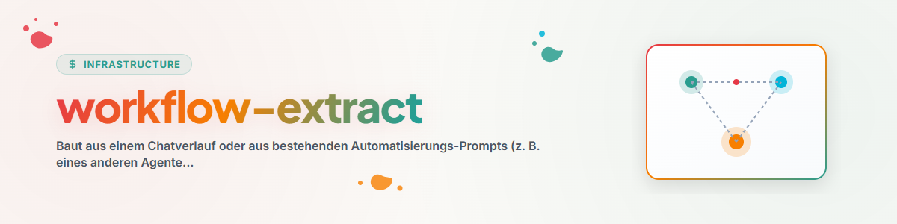

# Workflow-Extract — construire des automatisations à partir d'historiques de chat et d'automatisations tierces

## Objectif

Certains processus n'ont pas leur place dans un skill qu'on charge au besoin, mais dans une
**automatisation qui tourne d'elle-même** : contrôles nocturnes, vérifications tournantes de
projets, passages de maintenance périodiques. Ce skill extrait de tels workflows à partir de
deux types de sources — les historiques de chat (un processus a été développé de façon
interactive et doit désormais tourner sans surveillance) et les prompts d'automatisation
existants d'autres systèmes (par ex. automations Codex, tâches planifiées, flux n8n) — et
en fait des prompts ou skills d'automatisation robustes et indépendants de l'utilisateur.

La différence avec un processus interactif : une automatisation **n'a personne pour corriger**.
Tout ce que l'utilisateur rattrapait dans la session, l'automatisation doit le rattraper
elle-même. C'est précisément le rôle des briques décrites dans `automation-bausteine.md`.

## Déroulement

### 1. Clarifier la source et la forme cible

| Source | cas typique |
| --- | --- |
| Session courante / transcription | Le processus a été développé de façon interactive, doit continuer périodiquement |
| Automatisation tierce (fichier de prompt, tâche cron, flux n8n) | Portage/abstraction vers un autre système ou dans la bibliothèque |

Formes cibles (une ou plusieurs) :

- **Prompt d'automatisation :** texte de prompt autonome, indépendant de l'utilisateur,
  utilisable dans tout planificateur (automations Codex, `/schedule` Claude/Cron,
  tâche planifiée, n8n).
- **Skill de workflow :** skill de la bibliothèque qui décrit le processus ; le prompt
  d'automatisation ne fait alors plus qu'appeler/paramétrer ce skill (à privilégier lorsque
  le même processus doit valoir pour plusieurs pipelines/systèmes — une seule source de vérité).
- **Command :** commande slash légère pour déclencher manuellement le même processus.

### 2. Extraire le noyau du workflow

À dégager de la source :

- **Tâche centrale :** que contrôle-t-on/entretient-t-on/produit-t-on ? (une phrase)
- **Logique de sélection :** à quoi la tâche s'applique-t-elle — une cible fixe ou une
  rotation sur un ensemble (un projet par exécution) ?
- **Préconditions :** que faut-il lire/vérifier avant le travail (documents racine,
  registres, verrous) ?
- **Obligations de documentation :** où écrire le résultat, le journal, les tâches de suivi ?
- **Chemins d'arrêt :** quand l'exécution se termine-t-elle en lecture seule (« rien à faire »
  est un résultat valide) ?

Pour les historiques de chat, évaluer en plus les boucles de correction (voir
`../skill-extractor/transcript-quellen.md`) : chaque correction de l'utilisateur est un candidat pour un garde-fou
dont l'automatisation aura besoin à l'avenir.

### 3. Neutraliser

Selon les règles de `../skill-extractor/neutralisierung.md` : séparer la mécanique de la configuration et
déplacer chemins/hôtes/noms de projets dans un bloc de configuration. Les prompts
d'automatisation ont particulièrement besoin de ce bloc, car ils sont copiés tels quels dans
les planificateurs — les valeurs concrètes doivent figurer à UN seul endroit, en début de prompt.

### 4. Compléter les briques d'automatisation

Confronter le noyau extrait à la checklist de `automation-bausteine.md` et compléter les briques
manquantes — en particulier la sélection par rotation avec registre des contrôles,
l'idempotence, l'hygiène des journaux, le respect des verrous, la sortie en lecture seule et
le rapport final. Un workflow sans ces briques fonctionne en test et dégénère en
fonctionnement continu (doubles contrôles, journaux qui gonflent, collisions avec des agents
parallèles).

### 5. Fixer la cadence et le budget

- **Coupler la fréquence au taux de changement :** un contrôle ne doit pas tourner plus
  souvent que son objet ne change. Expérience issue de parcs d'automatisations ayant grandi :
  de nombreux contrôles initialement horaires ont été ramenés au quotidien ou à l'hebdomadaire — avec une sélection par rotation, une cadence peu fréquente couvre
  malgré tout toute la pipeline.
- **Fenêtre nocturne pour le lourd**, les contrôles courts en lecture seule peuvent être
  plus fréquents.
- **Conscience des coûts :** chaque exécution coûte des tokens/du calcul ; une exécution qui
  se termine le plus souvent en lecture seule doit le constater tôt (lire le registre AVANT
  l'analyse coûteuse).

### 6. Tester et déployer

1. **Essai à blanc :** exécuter une fois le prompt fini de façon interactive (comme si l'on
   était le planificateur) et vérifier : se termine-t-il proprement ? Écrit-il correctement
   le registre et le journal ? Reste-t-il dans son périmètre ?
2. **Test de cas limite :** simuler une exécution où il n'y a rien à faire — elle doit se
   terminer en lecture seule avec une courte entrée de journal, et non « inventer du travail ».
3. **Déployer :** l'inscrire dans le planificateur cible ; en forme de skill, le déposer en
   plus dans la bibliothèque et le déployer.
4. **Observer le chemin d'erreur :** après les 2 à 3 premières exécutions réelles, contrôler
   journal et registre — les automatisations échouent le plus souvent à cause de la dérive
   des chemins (cible déplacée) et de fichiers journaux qui grossissent.

## Mode d'audit de flotte : vérifier une flotte d'automatisations en service

Pour « vérifie mes automatisations » : ne pas extraire, mais aider à faire fonctionner
l'EXISTANT. À partir de la source d'automatisations du système cible (fichiers de prompt/configuration,
planifications, journaux/mémoires d'exécution), vérifier systématiquement :

1. **Détection des échecs silencieux/no-op :** l'automatisation tourne-t-elle sans rien
   faire ? (lire les mémoires/journaux des dernières exécutions : seulement des exécutions
   vides, des erreurs, des chemins morts ?)
2. **Redondance + rendement :** des automatisations se chevauchent-elles dans leur périmètre ?
   Le rendement (sortie, anomalies corrigées) est-il encore proportionné à la consommation
   (tokens, exécutions) ?
3. **Dérive :** les chemins des prompts, les conventions et les planifications correspondent-ils
   encore à la réalité ? (cibles déplacées, politiques modifiées, cadence trop élevée pour le
   taux de changement.)
4. **Comparaison avec le catalogue :** manque-t-il une automatisation qui devrait exister
   (lacunes dans la grille de modèles) ? Ne proposer que sous réserve de validation (brique 12),
   ne jamais l'activer soi-même.
5. **Rapport de constats :** une ligne par automatisation (conserver | ajuster | suspendre |
   fusionner | supprimer) + justification ; ne modifier soi-même qu'après validation.

## Mode bulk : parcourir des parcs d'automatisations ou de nombreuses transcriptions

Pour « vérifie toutes les automatisations du système X à la recherche de workflows
abstraisables » ou « extrais des candidats d'automatisation d'anciens historiques de chat » :

1. **Réduction des données comme dans skill-extractor** (Map-Reduce via des sous-agents,
   modèle de `swarm-operations`) : par lot, un sous-agent qui remonte pour chaque source :
   tâche centrale | modèle (par ex. contrôle en rotation, contrôle de santé, exploration
   d'idées) | éléments uniques | abstractible sans référence à l'utilisateur ? | déjà couvert
   par un skill existant ?
2. **Modèles avant cas isolés :** si de nombreuses sources partagent la même ossature (par ex.
   40 contrôles en rotation), c'est L'OSSATURE qui devient un skill et les cas particuliers
   deviennent des paramétrages — pas 40 skills distincts.
3. **Dédoublonnage par rapport au paysage existant de skills/commandes**, puis liste numérotée
   de candidats soumise à l'utilisateur avant la construction en masse.

## Exemple

```text
User: „Wir haben heute die Zitationsprüfung für ein Paper durchgespielt —
das soll ab jetzt wöchentlich über alle Paper laufen."

1. Zielform: Automations-Prompt für den Scheduler + Verweis auf rotation-check.
2. Kern: Zitate eines Papers gegen Originalquellen prüfen (Web/Datenbank),
   Korrekturen einpflegen, bei Änderungen Folgeaufgabe „Neu-Upload" in TODO.md.
3. Neutralisieren: Pipeline-Root, Registry-/Log-Pfade → Konfigurationsblock.
4. Bausteine ergänzen: Rotations-Auswahl (ein Paper pro Lauf), Registry lesen VOR
   Auswahl, Read-only-Exit („alle Quellen ok"), Log-Hygiene, Abschlussbericht.
5. Takt: wöchentlich reicht (Papers ändern sich langsam); Trockenlauf + Leerlauf-Test,
   dann in den Scheduler.
```

## Signaux d'alerte

| Pensée | Réalité |
| --- | --- |
| « Le processus tournait dans la session, il tournera donc aussi en automatisation » | Sans utilisateur, tous les correctifs manquent — la checklist des briques est obligatoire. |
| « Toutes les heures, ça ne fait pas de mal » | Si : tokens, croissance des journaux, risque de collision. Coupler la cadence au taux de changement. |
| « Je construis une automatisation distincte pour chaque variante » | Une ossature commune en skill, les variantes en paramètres. |
| « Rien trouvé — je cherche alors un autre travail » | Une sortie en lecture seule avec entrée de journal est le résultat correct d'une exécution vide. |

## Skills liés

- `skill-extractor` — même extraction, but : un skill invocable ; partage la neutralisation
  et les sources de transcriptions (documentées là-bas).
- `rotation-check` — l'ossature standard des contrôles de pipeline en rotation (type
  d'automatisation le plus fréquent) ; le référencer comme brique plutôt que le réinventer.
- `swarm-operations` — modèle en essaim pour la revue en masse.

## Journal des modifications

### 1.1.0 (2026-07-03)
- Mode d'audit de flotte (vérifier une flotte d'automatisations en service : échecs silencieux,
  redondance, dérive, lacunes) — intégré plutôt que constitué en skill séparé (décision de dédoublonnage).
- Trois nouvelles briques dans automation-bausteine.md : portail de validation via fichiers
  sentinelles (12), escalade graduée avec artefact de transmission (13), discipline de rapport
  pour les moniteurs (14).

### 1.0.0 (2026-07-03)
- Version initiale. Issue de l'abstraction du parc d'automatisations Codex (77 automatisations,
  modèle dominant de contrôle en rotation) en briques indépendantes de l'utilisateur.
