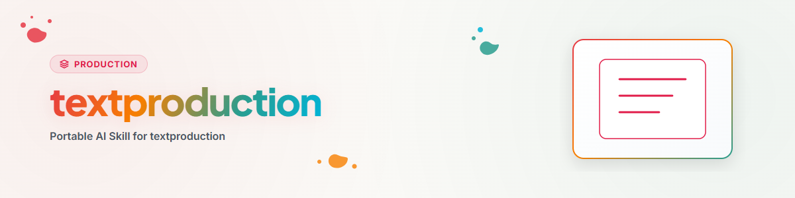

> **Français** — Version française officielle de la compétence `textproduction`.

# Textproduction — Routeur

Cette compétence couvre toutes les formes de production textuelle. Elle redirige vers la sous-compétence adaptée — lisez les instructions détaillées dans le sous-dossier correspondant.

## Table de routage

| Sous-compétence | Exemples de déclencheurs | Guide détaillé |
|---|---|---|
| **text** | « Écris un article de blog », « 5 posts LinkedIn », « Newsletter », « Fiche produit », « E-mail formel », « Résume X » | `text/WORKFLOW.md` |
| **storys** | « Écris un scénario », « Nouvelle », « Créer une aventure JdR », « Fiche de personnage », « Création d'univers » | `storys/WORKFLOW.md` |
| **pr** | « Rédiger un communiqué de presse », « Prise de position », « Kit RP », « Générer un PDF » | `pr/WORKFLOW.md` (+ `pr/press_compiler.py`) |

## Flux de travail et procédure

```
1. Demande utilisateur → Table de routage ci-dessus → déterminer la sous-compétence adaptée.
2. Lire le guide détaillé dans le sous-dossier (WORKFLOW.md).
3. Sélectionner le modèle de prompt, remplir les emplacements réservés, générer le texte.
4. Contrôle qualité (indiqué pour chaque sous-compétence).
```

## Remarques

- **Neutre vis-à-vis de l'utilisateur :** Aucune donnée personnelle, clé API ou donnée de compte dans la compétence. La configuration (tonalité, limites de caractères, coordonnées pour les relations presse) incombe à l'utilisateur.
- **Outil RP :** `pr/press_compiler.py` compile les communiqués de presse et prises de position en PDF via LaTeX (`pdflatex`/`xelatex`). Configuration unique : copier `pr/config.example.json` vers `pr/config.json` et renseigner les coordonnées.
- Optimisation stylistique optionnelle : DeepL Write (gratuit jusqu'à 500 000 caractères/mois).

## Journal des modifications

### 2.0.1 (2026-11-22)
- Indication de langue corrigée

### 2.0.0 (2026-06-22)
- Restructuration selon le modèle de routeur : `SKILL.md` = point d'entrée + table de routage.
- Trois sous-compétences : `text/` (6 types de texte), `storys/` (4 formats narratifs), `pr/` (communiqué de presse + prise de position + compilateur PDF LaTeX).
- Déplacement ici (SSOT) de `press_compiler.py` + modèles LaTeX + `config.example.json` depuis `ai-media-editor/production/pr/`.
- Mise à jour des renvois de compétences apparentées vers les chemins internes des sous-compétences.

### 1.0.0 (2026-06-22)
- Version initiale. Extraite de `ai-media-editor/production/text/WORKFLOW.md`.
- Provenance : BACH `agents/_experts/textproduction/` (MIT).
