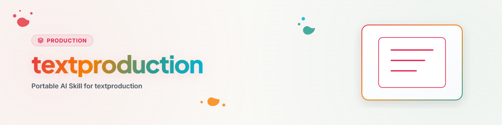

> **Deutsch** — Offizielle Deutsch-Version / Documento Oficial en Deutsch.

> **English Translation** — Official English version of `textproduction`.

# पाठ-निर्माण — राउटर (हिन्दी)

यह कौशल सभी पाठ्य निर्माण रूपों को कवर करता है। यह उपयुक्त उप-कौशल की ओर मार्गदर्शन करता है — उपफ़ोल्डर में विस्तृत मार्गदर्शिका पढ़ें।

## राउटिंग तालिका

| उप-कौशल | ट्रिगर उदाहरण | विस्तृत मार्गदर्शिका |
|---|---|---|
| **text** | „एक ब्लॉगपोस्ट लिखो", „5 LinkedIn-पोस्ट", „न्यूज़लेटर", „उत्पाद विवरण", „औपचारिक ईमेल", „X को सारांशित करो" | `text/WORKFLOW.md` |
| **storys** | „एक पटकथा लिखो", „लघुकथा", „RPG-साहसिक बनाओ", „Character Sheet", „विश्व-निर्माण" | `storys/WORKFLOW.md` |
| **pr** | „प्रेस विज्ञप्ति लिखो", „स्थिति-पत्र", „PR-पैकेज", „PDF बनाओ" | `pr/WORKFLOW.md` (+ `pr/press_compiler.py`) |

## कार्यप्रवाह और कार्यविधि

```
1. Nutzerwunsch → Routing-Tabelle oben → passenden Teilskill bestimmen.
2. Detail-Anleitung im Unterordner lesen (WORKFLOW.md).
3. Prompt-Muster auswaehlen, Platzhalter fuellen, Text generieren.
4. Qualitaetspruefung (je Teilskill angegeben).
```


## टिप्पणियाँ

- **उपयोगकर्ता-तटस्थ:** कौशल में कोई व्यक्तिगत डेटा, API-कुंजी या खाता-विवरण नहीं है। कॉन्फ़िगरेशन (लहजा, वर्ण-सीमाएँ, PR के लिए संपर्क-विवरण) उपयोगकर्ता के अधिकार में है।
- **PR-उपकरण:** `pr/press_compiler.py` प्रेस विज्ञप्तियों और स्थिति-पत्रों को LaTeX (pdflatex/xelatex) के माध्यम से PDF में संकलित करता है। एक बार का सेटअप: `pr/config.example.json` को `pr/config.json` पर कॉपी करें और संपर्क-विवरण भरें।
- वैकल्पिक शैली-अनुकूलन: DeepL Write (500.000 वर्ण/माह तक निःशुल्क)।

## परिवर्तन-लॉग

### 2.0.0 (2026-06-22)
- राउटर-पैटर्न में पुनर्गठन: SKILL.md = प्रवेश-बिंदु + राउटिंग तालिका।
- तीन उप-कौशल: text/ (6 पाठ-प्रकार), storys/ (4 कथात्मक प्रारूप), pr/ (प्रेस विज्ञप्ति + स्थिति-पत्र + LaTeX-PDF कंपाइलर)।
- press_compiler.py + LaTeX-टेम्पलेट + config.example.json को ai-media-editor/production/pr/ से यहाँ स्थानांतरित किया गया (SSOT)।
- संबंधित-कौशल संदर्भों को आंतरिक उप-कौशल पथों के अनुसार अद्यतन किया गया।

### 1.0.0 (2026-06-22)
- प्रारंभिक संस्करण। ai-media-editor/production/text/WORKFLOW.md से अलग किया गया।
- उत्पत्ति: BACH agents/_experts/textproduction/ (MIT)।
