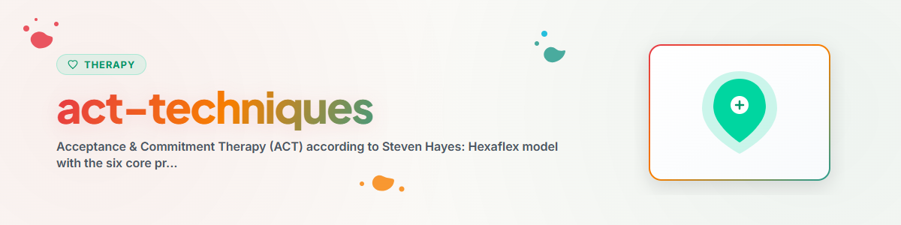

> **Français** — Version française officielle de la compétence `act-techniques`.

> Thérapie d'acceptation et d'engagement (ACT) : modèle Hexaflex et les six processus fondamentaux de la flexibilité psychologique selon Steven Hayes

# Techniques ACT — Thérapie d'acceptation et d'engagement

## Fondements

La thérapie d'acceptation et d'engagement (ACT, prononcé comme le mot anglais « act ») a été développée par **Steven C. Hayes** et appartient à la troisième vague des thérapies comportementales. L'ACT ne vise pas la réduction des symptômes, mais la **flexibilité psychologique** — la capacité d'agir de manière ouverte et consciente dans l'instant présent, guidé par ses valeurs personnelles.

Message central : **Ce n'est pas la douleur qui est le problème, mais la lutte contre la douleur.**

---

## Le modèle Hexaflex

L'Hexaflex est le modèle central de l'ACT. Six processus fondamentaux forment ensemble la flexibilité psychologique. Chaque processus est le pendant d'un processus pathologique (l'inflexibilité psychologique).

```
                    Moment présent
                         /    \
                        /      \
             Acceptation        Soi-comme-contexte
                |    \          /    |
                |    FLEXIBILITÉ    |
                |   PSYCHOLOGIQUE   |
                |    /          \   |
              Défusion          Valeurs
                        \      /
                         \    /
                    Action engagée
```

### Flexibilité vs inflexibilité

| Processus fondamental (flexible) | Pôle opposé (inflexible) |
|---|---|
| Acceptation | Évitement expérientiel |
| Défusion cognitive | Fusion cognitive |
| Moment présent | Centration sur le passé/futur |
| Soi-comme-contexte | Soi conceptualisé |
| Valeurs | Manque de clarification des valeurs |
| Action engagée | Inaction / impulsivité |

---

## Les six processus fondamentaux

### 1. Acceptation

**Définition :** Disposition à accueillir les expériences intérieures (émotions, pensées, sensations corporelles) sans chercher à les modifier, les éviter ou les contrôler.

**Important :** L'acceptation n'est PAS la résignation. C'est un choix actif et conscient de faire de la place à l'expérience vécue.

#### Techniques

- **Échelle de disposition (0-10) :** « À quel point es-tu prêt(e) en ce moment à simplement laisser cette émotion être là ? »
- **Expansion :** Localiser la sensation dans le corps, lui donner une forme/couleur/texture, la « laisser respirer ».
- **Métaphore de l'interrupteur de lutte :** Nous avons en nous un interrupteur — non pas pour la douleur, mais pour la lutte contre la douleur. Accepter signifie basculer cet interrupteur.

#### Métaphore : Les sables mouvants

> Lorsque tu es pris dans des sables mouvants, l'instinct naturel est de te débattre, de résister, de gesticuler. Mais c'est précisément cela qui t'enfonce plus profondément. La seule chose utile : s'allonger à plat, augmenter la surface de contact, accepter le contact avec les sables mouvants. Non pas parce que les sables mouvants sont agréables — mais parce que la lutte contre eux est le véritable problème.

---

### 2. Défusion cognitive

**Définition :** Se détacher de ses pensées — les voir pour ce qu'elles sont : des événements mentaux, pas la réalité elle-même. Au lieu de « Je suis nul(le) » → « J'ai la pensée que je suis nul(le). »

#### Techniques

- **« J'ai la pensée que… »** — Mettre les pensées à distance par le langage
- **« Merci, mon esprit ! »** — Reconnaître le mental comme un conseiller hyperactif, sans lui obéir
- **Chanter la pensée :** Chanter la pensée pesante sur l'air de « Joyeux anniversaire » (réduit sa crédibilité)
- **Pensées sur des feuilles :** Imaginer un ruisseau. Poser chaque pensée sur une feuille et la laisser dériver
- **Nommer le passager :** Donner un nom au critique intérieur (« Ah, revoilà Pierre-le-Perfectionniste »)
- **Exercice de répétition :** Répéter rapidement un mot pesant pendant 30 secondes — il perd sa charge émotionnelle

#### Métaphore : L'invité indésirable

> Imagine que tu organises une fête et qu'un invité indésirable arrive. Tu as trois options : (1) Tu le mets dehors — mais il revient sans cesse et fait du vacarme. (2) Tu le laisses entrer et tu passes toute la soirée à le surveiller — alors tu rates ta propre fête. (3) Tu le laisses entrer, tu prends acte de sa présence et tu continues de profiter de ta fête. L'option 3, c'est la défusion.

---

### 3. Moment présent (Contact avec l'instant présent)

**Définition :** Attention consciente et sans jugement portée sur l'ici et maintenant. Ni en train de ruminer le passé, ni de s'inquiéter pour l'avenir.

#### Techniques

- **Exercice 5-4-3-2-1 :** 5 choses à voir, 4 à entendre, 3 à toucher, 2 à sentir, 1 à goûter
- **Pleine conscience du souffle :** 3 respirations conscientes — uniquement observer, sans diriger
- **Ancrage sensoriel :** Explorer un objet avec une attention totale (texture, poids, température)
- **Questions de check-in :** « Que se passe-t-il en ce moment dans mon corps ? Quelles pensées sont présentes ? Quelles émotions sont là ? »

---

### 4. Soi-comme-contexte (Soi observateur)

**Définition :** Distinction entre le soi-comme-contenu (« Je SUIS anxieux ») et le soi-comme-contexte (« J'OBSERVE de l'anxiété »). Le soi observateur est l'espace dans lequel se déroulent toutes les expériences — mais il n'est pas ces expériences.

#### Techniques

- **Métaphore du ciel :** « Tu es le ciel, pas la météo. Nuages, tempêtes, soleil — tout passe. Mais le ciel est toujours là. »
- **Métaphore de l'échiquier :** « Tu n'es ni les pièces blanches ni les pièces noires. Tu es l'échiquier sur lequel la partie se joue. »
- **Exercice de l'observateur :** Fermer les yeux. Observer les pensées. Observer les émotions. Observer les sensations corporelles. Puis : « Qui est celui qui observe tout cela ? »
- **Exercices de perspective :** « Si ton moi de 80 ans se retournait sur cette situation — que dirait-il ? »

---

### 5. Valeurs

**Définition :** Directions de vie librement choisies. Les valeurs ne sont pas des objectifs (que l'on peut atteindre), mais des directions de boussole (que l'on suit). On n'« atteint » jamais la valeur « être un partenaire aimant » — on l'incarne, instant après instant.

#### Clarification des valeurs — Domaines de vie

| Domaine de vie | Question directrice |
|---|---|
| Relations | Quel genre de partenaire / ami(e) / membre de la famille veux-je être ? |
| Travail / Profession | Qu'est-ce qui rend le travail porteur de sens pour moi ? |
| Développement personnel | Dans quelle direction est-ce que je souhaite évoluer ? |
| Santé | Comment est-ce que je souhaite traiter mon corps ? |
| Loisirs / Détente | Qu'est-ce qui me nourrit vraiment ? |
| Spiritualité | Qu'est-ce qui donne un sens profond à ma vie ? |
| Communauté | Qu'est-ce que je souhaite apporter au monde ? |

#### Techniques

- **Exercice de l'épitaphe :** « Que voudrais-tu voir inscrit sur ta pierre tombale ? Non pas ce que tu as accompli, mais ce que tu as incarné. »
- **Exercice de la boussole :** Définir une direction pour chaque domaine de vie et évaluer sur une échelle de 1 à 10 : « Quelle importance cela a-t-il pour moi ? » et « À quel point est-ce que je le vis actuellement ? »
- **Le point sensible de la douleur :** « Derrière chaque douleur se cache une valeur. Celui qui n'aime pas ne peut pas être blessé. Le fait que cela fasse mal montre que quelque chose compte pour toi. »

---

### 6. Action engagée

**Définition :** Des actions concrètes en accord avec ses propres valeurs. Pas parfaites, pas « quand je serai prêt(e) », mais MAINTENANT, avec toutes les difficultés présentes.

#### Techniques

- **Objectifs de valeurs SMART :** Spécifiques, Mesurables, Attractifs, Réalistes, Temporellement définis — mais toujours reliés à une valeur
- **Plus petit pas possible :** « Quel est le plus petit pas que tu pourrais faire AUJOURD'HUI dans la direction de cette valeur ? »
- **Vérification de disposition :** « Es-tu prêt(e) à emmener [émotion désagréable] avec toi si elle apparaît pendant que tu fais ce pas ? »
- **Prévoir les obstacles :** « Quelles barrières intérieures pourraient surgir ? Comment veux-tu y faire face ? » (et non : « Comment les éliminer ? »)

#### Métaphore : Les passagers du bus

> Tu es le conducteur du bus de ta vie. Dans le bus sont assis des passagers — ce sont tes pensées, émotions, souvenirs, sensations corporelles. Certains sont bruyants, menaçants, laids. Ils crient : « Tourne à droite ! Tourne à gauche ! Arrête-toi ! » Tu as trois options :
>
> 1. **S'arrêter et se battre :** Tu cesses de conduire et tu essaies de jeter les passagers dehors. Mais tu n'avances plus.
> 2. **Négocier :** Tu conduis là où les passagers veulent aller. Mais ce n'est pas TA direction.
> 3. **Continuer de rouler :** Tu laisses les passagers crier, tu les emmènes avec toi — et tu continues malgré tout dans TA direction. Les passagers ont le droit d'être là. Mais CE NE SONT PAS EUX qui décident de l'itinéraire.
>
> L'action engagée signifie : conduire le bus dans la direction de tes valeurs, quels que soient les passagers à bord.

---

## Domaines d'application

L'ACT dispose d'une efficacité fondée sur les preuves dans les domaines suivants :

- **Dépression et troubles anxieux**
- **Douleurs chroniques**
- **Addictions**
- **Troubles du comportement alimentaire**
- **Burn-out et stress professionnel**
- **Traumatisme et TSPT** (en complément)
- **Troubles psychotiques** (en complément)

---

## Quand solliciter quel processus ?

| Situation de l'utilisateur | Processus ACT prioritaire |
|---|---|
| Évite certaines émotions ou situations | Acceptation |
| Est piégé dans la rumination / les inquiétudes | Défusion |
| Vit en pilote automatique, dissocié | Moment présent |
| Se définit par ses problèmes (« Je SUIS… ») | Soi-comme-contexte |
| Se sent désorienté, sans sens | Valeurs |
| Sait ce qui compte, mais n'agit pas | Action engagée |

---

## Lignes directrices éthiques

Un assistant IA peut expliquer les techniques ACT de manière psychoéducative et guider des exercices.

Un assistant IA ne doit PAS :
- Poser de diagnostics
- Simuler une relation thérapeutique
- Agir seul en cas de suicidalité aiguë — orienter vers une aide professionnelle
- Présenter l'ACT comme un substitut à une psychothérapie

Voir : [ETHICS.md](../ETHICS.md)

---

## Références bibliographiques

- Hayes, S. C., Strosahl, K. D., & Wilson, K. G. (2012). *Acceptance and Commitment Therapy: The Process and Practice of Mindful Change.* 2nd Edition.
- Harris, R. (2009). *ACT Made Simple.*
- Hayes, S. C. (2005). *Get Out of Your Mind and Into Your Life.*

---

*Porté depuis BACH v3.8.0 | Version autonome*

## Journal des modifications

### 1.0.1 (2026-11-22)
- Indication de langue corrigée
