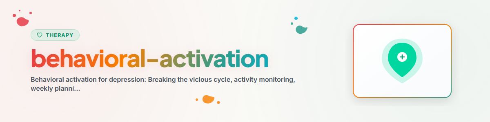

# تفعيل السلوك

> تخطيط الأنشطة، ويوميات المزاج والنشاط، واختيار الأنشطة القائمة على القيم: مواجهة الحلقة المفرغة من الخمول والكآبة

انظر: [ETHICS.md](../ETHICS.md)

---

## السياق

تفعيل السلوك (Behavioral Activation, BA) هو تدخل مستند إلى الأدلة من العلاج السلوكي لعلاج الاكتئاب. يرتكز على الملاحظة بأن الاكتئاب يؤدي إلى الانسحاب والخمول، مما يزيد من تدهور المزاج (الحلقة المفرغة). ومن خلال بناء أنشطة إيجابية بشكل مقصود، تُكسر هذه الدائرة.

الأدلة: تفعيل السلوك فعّال كشكل علاجي مستقل ويضاهي العلاج المعرفي (Dimidjian et al. 2006, Richards et al. 2016 دراسة COBRA). يُوصى به في حالات الاكتئاب الخفيف إلى المتوسط كتدخل أول (إرشادات NICE).

**ملاحظة:** هذا دعم وليس بديلاً عن العلاج المهني.
في حالات الاكتئاب الشديد أو الأفكار الانتحارية يجب دائمًا التوصية بالحصول على مساعدة مهنية.
**لا تُطبَّق مطلقًا:** EMDR، والتعرض المطوَّل (Prolonged Exposure, PE)، والعلاج بالتعرض السردي (Narrative Exposure Therapy, NET)

---

## 1. نموذج الاكتئاب في تفعيل السلوك

### الحلقة المفرغة

```
Auslösende Situation (Verlust, Stress, Veränderung)
        |
        v
Niedergeschlagenheit, Energielosigkeit
        |
        v
Rückzug, Vermeidung, Inaktivität
        |
        v
Weniger positive Erfahrungen, Isolation
        |
        v
Noch tiefere Niedergeschlagenheit
        |
        v
Noch mehr Rückzug ... (Spirale)
```

### المبدأ المعاكس

```
Gezielte Aktivität (auch bei geringer Motivation)
        |
        v
Positive Erfahrung / Erfolgserlebnis / Kontakt
        |
        v
Leichte Stimmungsverbesserung
        |
        v
Etwas mehr Energie und Motivation
        |
        v
Weitere Aktivität ... (Aufwärtsspirale)
```

**المبدأ الأساسي:** لا تنتظر حتى تأتي الدافعية — الفعل هو ما يولّد الدافعية.
"تصرّف أولًا، ثم اشعر." (لا: "اشعر أولًا، ثم تصرّف.")

---

## 2. يومية المزاج والنشاط

### الهدف
إظهار العلاقات بين الأنشطة والمزاج.
معرفة أي الأنشطة تحسّن المزاج وأيها يسيء إليه.

### تنسيق اليومية

```
STIMMUNGS-AKTIVITÄTS-TAGEBUCH

Datum: [...]

| Uhrzeit | Aktivität | Stimmung (0-10) | Freude (0-10) | Wichtigkeit (0-10) |
|---------|-----------|-----------------|---------------|---------------------|
| 07:00   | Aufgestanden, gefrühstückt | 3 | 2 | 5 |
| 08:00   | Arbeit: E-Mails | 4 | 1 | 6 |
| 10:00   | Spaziergang | 6 | 5 | 4 |
| 12:00   | Mittagessen mit Kollegin | 7 | 6 | 7 |
| 14:00   | Arbeit: Projekt | 5 | 3 | 7 |
| 18:00   | Fernsehen (allein) | 3 | 2 | 1 |
| 20:00   | Telefonat mit Freund | 6 | 5 | 8 |

Tagesdurchschnitt Stimmung: [...]
Beste Aktivität heute: [...]
Erkenntnis: [...]
```

### التقييم بعد أسبوع

**أسئلة توجيهية:**
- أي الأنشطة ترفع المزاج بانتظام؟
- أي الأنشطة تخفض المزاج؟
- هل هناك أوقات تكون صعبة بشكل خاص؟
- كم من الوقت أقضيه في أنشطة ممتعة مقابل أنشطة غير ممتعة؟
- أي الأنشطة تجنبتها؟

---

## 3. تخطيط الأنشطة

### الخطوة 1: إعداد قائمة الأنشطة

جمع ثلاث فئات من الأنشطة:

**أ) الأنشطة الممتعة (الفرح، والاستمتاع)**
- الطبيعة: نزهة، حديقة، غابة
- الاجتماعية: لقاء الأصدقاء، الاتصال الهاتفي، الطبخ معًا
- الإبداعية: الموسيقى، الرسم، الكتابة، الأشغال اليدوية
- الجسدية: الرياضة، اليوغا، الرقص، السباحة
- المتعة: طهي الطبق المفضل، قراءة كتاب، الاستماع إلى الموسيقى
- الاسترخاء: أخذ حمام، التأمل، تمرين التنفس

**ب) الأنشطة الضرورية (البنية، والعناية بالذات)**
- المنزل: ترتيب المكان، الطبخ، التسوق
- العناية الشخصية: الاستحمام، ارتداء الملابس، تنظيف الأسنان
- الإدارة: الفواتير، المواعيد، الأوراق الرسمية
- الصحة: مواعيد الطبيب، الأدوية، التغذية

**ج) الأنشطة القائمة على القيم (المعنى، والأهمية)**
- انظر القسم 4 أدناه

### الخطوة 2: إعداد الخطة الأسبوعية

```
WOCHENPLAN

| Tag | Morgens | Mittags | Nachmittags | Abends |
|-----|---------|---------|-------------|--------|
| Mo  | [...]   | [...]   | [...]       | [...]  |
| Di  | [...]   | [...]   | [...]       | [...]  |
| Mi  | [...]   | [...]   | [...]       | [...]  |
| Do  | [...]   | [...]   | [...]       | [...]  |
| Fr  | [...]   | [...]   | [...]       | [...]  |
| Sa  | [...]   | [...]   | [...]       | [...]  |
| So  | [...]   | [...]   | [...]       | [...]  |
```

### قواعد التخطيط
1. **ابدأ صغيرًا:** لا تُخطط اليوم كله، بل نشاطًا أو نشاطين يوميًا
2. **التنوع:** ممتع + ضروري + قائم على القيم
3. **محدد:** "الثلاثاء الساعة 15:00 نزهة في الحديقة" بدلًا من "تحرّك أكثر"
4. **واقعي:** قابل للتنفيذ حتى مع قلة الطاقة
5. **مرن:** الخطة إرشاد وليست إلزامًا
6. **متدرج:** عند انخفاض الطاقة جدًا: خطوات صغيرة (5 دقائق تكفي)

### التعامل مع العقبات

| العقبة | الاستراتيجية |
|--------|--------------|
| "ليست لدي طاقة" | تقليص النشاط إلى 5 دقائق |
| "ليست لدي رغبة" | تذكير: الدافعية تأتي من الفعل |
| "لن يفيد على أي حال" | تجربة: جرّب ثم قِس المزاج بعدها |
| "لا أستطيع بمفردي" | إشراك شخص آخر (الموعد = الالتزام) |
| "ليس لدي وقت" | إدراج أنشطة صغيرة (صعود الدرج، استراحة 5 دقائق في الخارج) |

---

## 4. اختيار الأنشطة القائمة على القيم

### المبدأ
الأنشطة المتوافقة مع القيم الشخصية تولّد رفاهًا مستدامًا — بخلاف المتعة البحتة التي تتلاشى بسرعة.

### مجالات الحياة والقيم

```
WERTE-KOMPASS

Beziehungen:     Was für ein Partner/Freund/Familienmitglied möchte ich sein?
Arbeit/Bildung:  Was ist mir bei meiner Arbeit wichtig?
Freizeit:        Wie möchte ich meine freie Zeit verbringen?
Gesundheit:      Wie möchte ich mit meinem Körper umgehen?
Gemeinschaft:    Welchen Beitrag möchte ich leisten?
Persönliches:   Welcher Mensch möchte ich sein?
```

### ربط القيم بالأنشطة

**مثال:**

| القيمة | النشاط | التكرار |
|--------|--------|---------|
| الترابط | الاتصال بصديق | مرتين أسبوعيًا |
| الصحة | المشي 20 دقيقة | يوميًا |
| الإبداع | العزف على الغيتار | مرة أسبوعيًا |
| مساعدة الآخرين | مساعدة الجارة في التسوق | مرة أسبوعيًا |
| التعلم | قراءة كتاب متخصص 15 دقيقة | 3 مرات أسبوعيًا |

### القيم مقابل الأهداف
- **القيمة:** اتجاه يرغب المرء في السير نحوه (مثلاً "أن أكون شريكًا محبًا")
- **الهدف:** نقطة نهاية قابلة للتحقيق (مثلاً "التخطيط لذكرى الزواج")
- لا يمكن "إنجاز" القيم أبدًا — إنها توفّر توجيهًا دائمًا

---

## 5. قياس التقدم

### مراجعة أسبوعية

```
WOCHEN-REVIEW

Woche: [Datum]
Geplante Aktivitäten: [Anzahl]
Umgesetzte Aktivitäten: [Anzahl]
Durchschnittliche Stimmung: [0-10]

Was lief gut: [...]
Was war schwierig: [...]
Erkenntnis der Woche: [...]
Plan für nächste Woche: [...]
```

### المتابعة على المدى الطويل
- مراقبة تطور المزاج عبر الأسابيع
- ملاحظة العلاقة بين مستوى النشاط والمزاج
- إبراز الإنجازات (حتى الصغيرة منها)

---

## الأخلاقيات والحدود

**يحق لمساعد الذكاء الاصطناعي:**
- الإرشاد عبر اليومية وتخطيط الأنشطة
- اقتراح الأنشطة (لا فرضها أبدًا)
- توثيق بيانات المزاج وإعادة عرض الأنماط
- مرافقة التأمل في القيم
- تقدير التقدم الصغير

**لا يحق لمساعد الذكاء الاصطناعي:**
- أن يكون الدعم الوحيد في حالات الاكتئاب الشديد
- تقديم توصيات متعلقة بالأدوية
- تقييم الميل الانتحاري
- وضع التشخيصات
- ضمان أن تفعيل السلوك كافٍ

**مهم:** في حالات الاكتئاب الشديد (فقدان الدافعية المستمر، الأفكار الانتحارية، العجز عن إدارة الحياة اليومية) تكون المساعدة المهنية ضرورية لا غنى عنها.
تفعيل السلوك إضافة وليس بديلاً.

**عند ظهور علامات أزمة حادة أحِل دائمًا إلى:**
- Telefonseelsorge (خط الدعم الهاتفي): 0800 111 0 111 / 0800 111 0 222
- خدمة الطوارئ النفسية: 112
- Krisenchat: krisenchat.de

---

*منقول من BACH v3.8.0 | النسخة المستقلة*
*المصادر: Martell et al. (2010)، Dimidjian et al. (2006)، Richards et al. (2016) — ليس علاجًا مهنيًا*
