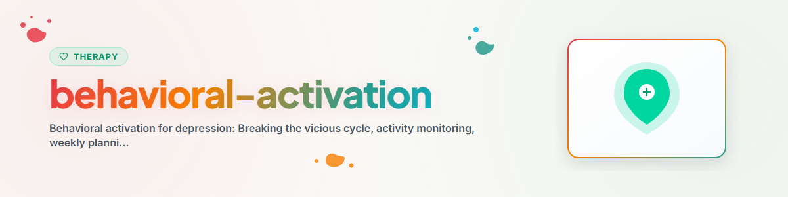

> **Français** — Version française officielle de la compétence `behavioral-activation`.

# Activation comportementale (Behavioral Activation)

> Planification d'activités, journal humeur-activité et choix d'activités guidé par les valeurs : contrecarrer le cercle vicieux de l'inactivité et de l'abattement

Voir : [ETHICS.md](../ETHICS.md)

---

## Contexte

L'activation comportementale (*Behavioral Activation*, BA) est une intervention fondée sur des preuves
issue de la thérapie comportementale pour le traitement de la dépression. Elle repose sur le constat
que la dépression entraîne repli et inactivité, ce qui dégrade encore davantage l'humeur
(cercle vicieux). La mise en place ciblée d'activités positives permet de rompre ce cycle.

Données probantes : l'activation comportementale est efficace en tant que thérapie autonome et
équivalente à la thérapie cognitive (Dimidjian et al. 2006, étude COBRA de Richards et al. 2016).
Recommandée en première intention dans la dépression légère à modérée (recommandations NICE).

**Remarque :** Ceci est un accompagnement, pas un substitut à une thérapie professionnelle.
En cas de dépression sévère ou d'idées suicidaires, TOUJOURS orienter vers une aide professionnelle.
**Ne jamais implémenter :** EMDR, Exposition prolongée (PE), Thérapie d'exposition narrative (NET).

---

## 1. Le modèle de la dépression dans l'activation comportementale

### Le cercle vicieux

```
Situation déclenchante (perte, stress, changement)
        |
        v
Abattement, manque d'énergie
        |
        v
Retrait, évitement, inactivité
        |
        v
Moins d'expériences positives, isolement
        |
        v
Abattement encore plus profond
        |
        v
Retrait encore plus fort ... (spirale descendante)
```

### Le principe inverse

```
Activité ciblée (même avec une motivation faible)
        |
        v
Expérience positive / sentiment de réussite / contact
        |
        v
Légère amélioration de l'humeur
        |
        v
Un peu plus d'énergie et de motivation
        |
        v
Nouvelles activités ... (spirale ascendante)
```

**Principe clé :** ne pas attendre que la motivation vienne — l'action génère la motivation.
« Agir d'abord, ressentir ensuite » (*Act first, feel second*, plutôt que l'inverse).

---

## 2. Journal humeur-activité

### Objectif
Rendre visibles les liens entre activités et humeur.
Identifier quelles activités améliorent l'humeur et lesquelles l'alourdissent.

### Format du journal

```
JOURNAL HUMEUR-ACTIVITÉ

Date : [...]

| Heure | Activité | Humeur (0-10) | Plaisir (0-10) | Importance (0-10) |
|-------|----------|---------------|----------------|-------------------|
| 07:00 | Lever, petit-déjeuner | 3 | 2 | 5 |
| 08:00 | Travail : e-mails | 4 | 1 | 6 |
| 10:00 | Promenade | 6 | 5 | 4 |
| 12:00 | Déjeuner avec une collègue | 7 | 6 | 7 |
| 14:00 | Travail : projet | 5 | 3 | 7 |
| 18:00 | Télévision (seul) | 3 | 2 | 1 |
| 20:00 | Appel téléphonique avec un ami | 6 | 5 | 8 |

Moyenne d'humeur du jour : [...]
Meilleure activité aujourd'hui : [...]
Prise de conscience : [...]
```

### Bilan après une semaine

**Questions directrices :**
- Quelles activités relèvent régulièrement l'humeur ?
- Quelles activités font baisser l'humeur ?
- Y a-t-il des moments de la journée particulièrement difficiles ?
- Combien de temps est consacré aux activités agréables par rapport aux activités pénibles ?
- Quelles activités ai-je évitées ?

---

## 3. Planification des activités

### Étape 1 : Établir une liste d'activités

Recueillir trois catégories d'activités :

**A) Activités agréables (plaisir, détente)**
- Nature : promenade, parc, forêt
- Social : retrouver des amis, téléphoner, cuisiner ensemble
- Créatif : musique, dessin, écriture, bricolage
- Physique : sport, yoga, danse, natation
- Plaisir quotidien : cuisiner son plat préféré, lire un livre, écouter de la musique
- Relaxation : prendre un bain, méditation, exercice de respiration

**B) Activités nécessaires (structure, soin de soi)**
- Ménage : ranger, cuisiner, faire les courses
- Hygiène corporelle : se doucher, s'habiller, se brosser les dents
- Administratif : factures, rendez-vous, paperasse
- Santé : rendez-vous médicaux, médicaments, alimentation

**C) Activités fondées sur les valeurs (sens, importance)**
- Voir section 4 ci-dessous

### Étape 2 : Créer le planning hebdomadaire

```
PLANNING HEBDOMADAIRE

| Jour | Matin | Midi  | Après-midi | Soir  |
|------|-------|-------|------------|-------|
| Lun  | [...] | [...] | [...]      | [...] |
| Mar  | [...] | [...] | [...]      | [...] |
| Mer  | [...] | [...] | [...]      | [...] |
| Jeu  | [...] | [...] | [...]      | [...] |
| Ven  | [...] | [...] | [...]      | [...] |
| Sam  | [...] | [...] | [...]      | [...] |
| Dim  | [...] | [...] | [...]      | [...] |
```

### Règles de planification
1. **Commencer petit :** ne pas surcharger toute la journée, prévoir 1–2 activités par jour
2. **Mélange :** agréable + nécessaire + guidé par les valeurs
3. **Concret :** « Mardi 15h00 promenade au parc » plutôt que « Bouger plus »
4. **Réaliste :** faisable même avec peu d'énergie
5. **Souple :** le plan sert de repère, pas de contrainte rigide
6. **Gradué :** en cas de très faible énergie, micro-étapes (5 minutes suffisent)

### Gérer les obstacles

| Obstacle | Stratégie |
|----------|-----------|
| « Je n'ai aucune énergie » | Réduire l'activité à 5 minutes |
| « Je n'en ai pas envie » | Rappel : la motivation vient en agissant |
| « Ça ne sert à rien de toute façon » | Expérience : essayer et mesurer l'humeur après coup |
| « Je n'y arrive pas seul » | Impliquer quelqu'un (rendez-vous = engagement) |
| « Je n'ai pas le temps » | Intégrer de petites activités (monter les escaliers, 5 min de pause dehors) |

---

## 4. Choix d'activités fondé sur les valeurs

### Principe
Les activités alignées avec les valeurs personnelles génèrent un bien-être durable —
à la différence du pur divertissement qui s'estompe vite.

### Domaines de vie et valeurs

```
BOUSSOLE DES VALEURS

Relations :       Quel partenaire/ami/membre de famille ai-je envie d'être ?
Travail/Études :  Qu'est-ce qui compte pour moi dans mon travail ?
Loisirs :         Comment ai-je envie d'occuper mon temps libre ?
Santé :           Comment ai-je envie de prendre soin de mon corps ?
Communauté :      Quelle contribution ai-je envie d'apporter ?
Personnel :       Quel être humain ai-je envie d'être ?
```

### Correspondance valeurs-activités

**Exemple :**

| Valeur | Activité | Fréquence |
|--------|----------|-----------|
| Lien social | Appeler un ami | 2x par semaine |
| Santé | Marcher 20 min | Quotidien |
| Créativité | Jouer de la guitare | 1x par semaine |
| Entraide | Aider la voisine pour ses courses | 1x par semaine |
| Apprentissage | Lire 15 min un livre spécialisé | 3x par semaine |

### Valeurs vs objectifs
- **Valeur :** une direction vers laquelle on souhaite avancer (ex. « être un partenaire attentif »)
- **Objectif :** un point d'arrivée atteignable (ex. « organiser l'anniversaire de mariage »)
- Les valeurs ne se « cochent » jamais — elles offrent une orientation permanente

---

## 5. Mesurer la progression

### Bilan hebdomadaire

```
BILAN HEBDOMADAIRE

Semaine : [Date]
Activités planifiées : [Nombre]
Activités réalisées : [Nombre]
Humeur moyenne : [0-10]

Ce qui a bien fonctionné : [...]
Ce qui a été difficile : [...]
Enseignement de la semaine : [...]
Plan pour la semaine prochaine : [...]
```

### Suivi à long terme
- Observer l'évolution de l'humeur sur plusieurs semaines
- Identifier le lien entre niveau d'activité et humeur
- Rendre les réussites visibles (même les petites)

---

## Éthique et limites

**Un assistant IA peut :**
- Guider à travers le journal et la planification d'activités
- Suggérer des activités (jamais les prescrire)
- Documenter les données d'humeur et restituer les tendances
- Accompagner la réflexion sur les valeurs
- Valoriser les petits progrès

**Un assistant IA ne doit PAS :**
- Être l'unique soutien en cas de dépression sévère
- Donner des recommandations liées aux médicaments
- Évaluer le risque suicidaire
- Poser des diagnostics
- Garantir que l'activation comportementale suffira

**Important :** en cas de dépression sévère (apathie persistante, idées suicidaires,
incapacité à gérer le quotidien), une aide professionnelle est indispensable.
L'activation comportementale est un complément, pas un substitut.

**En cas de signes de crise aiguë, TOUJOURS orienter vers :**
- Telefonseelsorge (DE) : 0800 111 0 111 / 0800 111 0 222
- Urgences psychiatriques : 112
- Chat de crise (DE) : krisenchat.de

---

*Porté depuis BACH v3.8.0 | Version autonome*
*Sources : Martell et al. (2010), Dimidjian et al. (2006), Richards et al. (2016) — Ne remplace pas une thérapie professionnelle*

## Journal des modifications

### 1.0.1 (2026-11-22)
- Mention linguistique corrigée.
