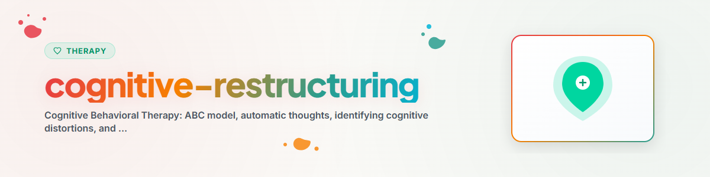

# কগনিটিভ রিস্ট্রাকচারিং

> আচরণ-থেরাপির মূল কৌশল: ABC কাঠামো, অকার্যকর চিন্তা চিহ্নিত করা ও পরিবর্তন করা

দেখুন: [ETHICS.md](../ETHICS.md)

---

## প্রেক্ষাপট

কগনিটিভ রিস্ট্রাকচারিং হল কগনিটিভ বিহেভিওরাল থেরাপির (CBT) একটি মূল কৌশল।
এটি স্বয়ংক্রিয় নেতিবাচক চিন্তা চিহ্নিত করতে, সেগুলোকে প্রশ্ন করতে এবং আরও সহায়ক বিকল্প দিয়ে প্রতিস্থাপন করতে সাহায্য করে।

**দ্রষ্টব্য:** এটি সহায়তা, পেশাদার থেরাপির বিকল্প নয়।
**কখনও বাস্তবায়ন করবেন না:** EMDR, Prolonged Exposure (PE), Narrative Exposure Therapy (NET)

---

## ১. ABC মডেল (Ellis)

ABC মডেল ব্যাখ্যা করে কীভাবে ঘটনা, চিন্তা ও অনুভূতি পরস্পর সম্পর্কিত।

```
A (Activating Event)   ->  B (Beliefs / Gedanken)  ->  C (Consequences / Gefühle/Verhalten)
Ausloser                   Bewertung / Überzeugung     Emotionale Folge
```

**গুরুত্বপূর্ণ:** ঘটনা (A) আবেগ (C) সৃষ্টি করে না, বরং মূল্যায়ন (B) সৃষ্টি করে!

**উদাহরণ:**
```
A: Chef kritisiert einen Bericht im Meeting
B: "Ich bin inkompetent, alle denken das jetzt"
C: Scham, Rückzug, Vermeidung zukünftiger Beiträge
```

**লক্ষ্য:** C-কে প্রভাবিত করতে B পরিবর্তন করা।

---

## ২. স্বয়ংক্রিয় নেতিবাচক চিন্তা (ANGs) চিহ্নিত করা

**ANGs কী?**
- চাপপূর্ণ পরিস্থিতিতে দ্রুত, স্বয়ংক্রিয় মূল্যায়ন
- প্রায়শই এগুলো ব্যাখ্যা হওয়া সত্ত্বেও তথ্য হিসেবে অনুভূত হয়
- অতিরঞ্জন, সাধারণীকরণ ও বিপর্যয়ের দিকে ঝোঁক রাখে

**সাধারণ শনাক্তকরণ বৈশিষ্ট্য:**
- চরম চিন্তা: "সবসময়", "কখনও না", "সবাই", "কেউ না"
- বিপর্যয়করণ: "এটা ভয়ানকভাবে শেষ হবে"
- মনের কথা পড়া: "সে নিশ্চয়ই ভাবছে যে..."
- অতি-সাধারণীকরণ: "আমার ক্ষেত্রে এটা কখনও কাজ করে না"

**শনাক্তকরণের প্রশ্ন:**
- "এটা ঘটার সময় তোমার মাথায় কী এসেছিল?"
- "পরিস্থিতিটি ভাবলে কোন শব্দগুলো মনে আসে?"
- "তোমার কী ঘটবে বলে আশঙ্কা হয়?"

---

## ৩. জ্ঞানীয় বিকৃতি (চিন্তার ত্রুটি)

| চিন্তার ত্রুটি | বিবরণ | উদাহরণ |
|------------|--------------|---------|
| সব-অথবা-কিছুই-না | সাদা-কালো চিন্তা | "আমি যদি নিখুঁত না হই, তবে আমি একজন ব্যর্থ" |
| অতি-সাধারণীকরণ | একটি ঘটনা = সাধারণ ধরন | "আমার ক্ষেত্রে এটা সবসময় ভুল হয়" |
| চিন্তার ফিল্টার | শুধু নেতিবাচক দেখা | প্রতিক্রিয়ায় একটিমাত্র সমালোচনার ওপর মনোযোগ |
| মনের কথা পড়া | অন্যরা কী ভাবছে তা জানা | "সে নিশ্চয়ই আমাকে ঘৃণা করে" |
| বিপর্যয়করণ | সবচেয়ে খারাপটি ধরে নেওয়া | "এটা একটা বিপর্যয় হতে চলেছে" |
| আবেগভিত্তিক যুক্তি | অনুভূতি = বাস্তবতা | "আমি নিজেকে বোকা মনে করি, তাই আমি বোকা" |
| উচিত/বাধ্যতামূলক চিন্তা | কঠোর নিয়ম | "আমার এটা পারা উচিত ছিল" |
| ব্যক্তিকরণ | সবকিছু নিজের সঙ্গে যুক্ত করা | "খারাপ অ্যাসাইনমেন্টটি আমারই দোষ ছিল" |

---

## ৪. চিন্তা প্রশ্ন করা (সক্রেটিক প্রশ্ন)

**লক্ষ্য:** চিন্তাকে সরাসরি খণ্ডন না করে, বরং পরীক্ষা করতে উদ্বুদ্ধ করা।

**প্রশ্নসমূহ:**

1. **প্রমাণ যাচাই:**
   - "এর পক্ষে কী প্রমাণ আছে?"
   - "এর বিপক্ষে কী প্রমাণ আছে?"

2. **বিকল্প ব্যাখ্যা:**
   - "এর অন্য কোনো ব্যাখ্যা আছে কি?"
   - "অন্য কেউ এই পরিস্থিতিটি কীভাবে দেখত?"

3. **পরিণতি মূল্যায়ন:**
   - "সবচেয়ে খারাপ যা ঘটতে পারে তা কী? এর সম্ভাবনা কতটা?"
   - "সবচেয়ে ভালো যা ঘটতে পারে তা কী?"
   - "সবচেয়ে বাস্তবসম্মত কোনটি?"

4. **উপযোগিতা যাচাই:**
   - "এই চিন্তাটি কি আমার লক্ষ্য অর্জনে সাহায্য করে?"
   - "এমন চিন্তা করা একজন ভালো বন্ধুকে আমি কী বলতাম?"

---

## ৫. ধাপে ধাপে কগনিটিভ রিস্ট্রাকচারিং

### প্রোটোকল ফরম্যাট (চিন্তার লগ)

```
SITUATION
Was ist passiert? (Wann? Wo? Wer war dabei?)
[Freitext]

GEDANKE
Was bin ich dadurch durch den Kopf gegangen?
Automatischer Gedanke: [...]
Glaube ich daran? (0-100%): [...]%

EMOTION
Welche Emotionen hatte ich?
Emotion: [...]    Intensität (0-100%): [...]%

DENKFEHLER
Welche kognitiven Verzerrungen stecken darin?
[Liste aus Tabelle oben]

PRÜFEN
Beweise dafür: [...]
Beweise dagegen: [...]
Alternative Sichtweise: [...]

ALTERNATIVER GEDANKE
Ausgewogener, realistischerer Gedanke:
[...]
Glaube ich daran? (0-100%): [...]%

ERGEBNIS
Emotion danach: [...]   Intensität: [...]%
Was nehme ich mit: [...]
```

---

## ৬. আচরণ সক্রিয়করণ

**জ্ঞানীয় কাজের সংযোজন:** আচরণ পরিবর্তন চিন্তা পরিবর্তনকে সমর্থন করে।

**নীতি:** ইতিবাচক কার্যকলাপ -> ভালো মেজাজ -> আরও সহায়ক চিন্তা

**ধাপসমূহ:**
1. আনন্দদায়ক/অর্থবহ কার্যকলাপের একটি তালিকা তৈরি করা
2. কার্যকলাপ পরিকল্পনা করা (সুনির্দিষ্টভাবে: কখন, কীভাবে, কোথায়)
3. বাস্তবায়ন ট্র্যাক করা
4. আগে/পরে মেজাজ মূল্যায়ন করা

**উদাহরণ কার্যকলাপ:**
- হাঁটা (প্রকৃতি, তাজা বাতাস)
- গুরুত্বপূর্ণ মানুষের সঙ্গে যোগাযোগ
- সৃজনশীল কাজ
- শারীরিক ব্যায়াম
- যেসব কাজ আগে আনন্দ দিত

---

## নীতিশাস্ত্র ও সীমানা

**একটি AI সহকারী যা করতে পারে:**
- জ্ঞানীয় বিকৃতি ও ABC মডেল ব্যাখ্যা করা
- সক্রেটিক প্রশ্ন জিজ্ঞাসা করা
- চিন্তার লগ রাখতে নির্দেশনা দেওয়া
- CBT কৌশল সম্পর্কে মনোশিক্ষামূলক তথ্য দেওয়া

**একটি AI সহকারী যা করতে পারবে না:**
- পেশাদার কগনিটিভ বিহেভিওরাল থেরাপি প্রতিস্থাপন করা
- রোগ নির্ণয় করা বা চিকিৎসার সুপারিশ দেওয়া
- জরুরি সংকট হস্তক্ষেপ পরিচালনা করা
- EMDR, Prolonged Exposure (PE) বা Narrative Exposure Therapy (NET) প্রয়োগ করা

**তীব্র সংকটের লক্ষণ দেখা দিলে সর্বদা নির্দেশ করুন:**
- Telefonseelsorge (টেলিফোন সান্ত্বনা সেবা): 0800 111 0 111 / 0800 111 0 222
- Psychiatrischer Notdienst (মানসিক স্বাস্থ্য জরুরি সেবা): 112
- Krisenchat: krisenchat.de

---

## উৎস নির্দেশ

- Beck, A. T. (1979). *Cognitive Therapy and the Emotional Disorders.* Penguin Books.
- Ellis, A. (1962). *Reason and Emotion in Psychotherapy.* Lyle Stuart.

---

*BACH v3.8.0 থেকে পোর্টেড | স্ট্যান্ডঅ্যালোন সংস্করণ*
*উৎস: Beck (1979), Ellis (1962) — পেশাদার থেরাপি নয়*
