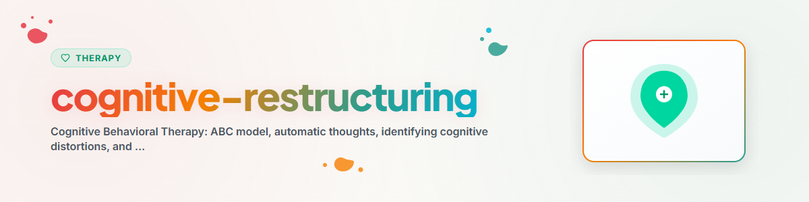

> **Français** — Version française officielle de la compétence `cognitive-restructuring`.

# Restructuration cognitive

> Technique centrale de thérapie cognitivo-comportementale : schéma ABC, identifier et modifier les pensées dysfonctionnelles

Voir : [ETHICS.md](../ETHICS.md)

---

## Contexte

La restructuration cognitive est une technique fondamentale de la thérapie cognitivo-comportementale (TCC). Elle aide à repérer les pensées automatiques négatives, à les questionner et à les remplacer par des alternatives plus constructives.

**Remarque :** Il s'agit d'un soutien, pas d'un substitut à une thérapie professionnelle.
**Ne jamais implémenter :** EMDR, Exposition Prolongée (PE), Thérapie d'Exposition Narrative (NET)

---

## 1. Modèle ABC (Ellis)

Le modèle ABC explique comment les événements, les pensées et les émotions sont liés.

```
A (Activating Event)   ->  B (Beliefs / Pensées)       ->  C (Consequences / Émotions/Comportement)
Déclencheur                Évaluation / Croyance           Conséquence émotionnelle
```

**Important :** Ce n'est pas l'événement (A) qui produit l'émotion (C), mais son évaluation (B) !

**Exemple :**
```
A : Le responsable critique un rapport en réunion
B : « Je suis incompétent(e), tout le monde le pense maintenant »
C : Honte, repli sur soi, évitement des futures prises de parole
```

**Objectif :** Modifier B pour influencer C.

---

## 2. Repérer les pensées automatiques négatives (PAN)

**Que sont les PAN ?**
- Des évaluations rapides et automatiques dans des situations stressantes
- Souvent perçues comme des faits, alors qu'elles sont des interprétations
- Tendance à l'exagération, la généralisation et la catastrophisation

**Signes caractéristiques :**
- Pensée absolue : « toujours », « jamais », « tous », « personne »
- Catastrophisation : « Cela va finir terriblement mal »
- Lecture de pensée : « Il pense sûrement que… »
- Surgénéralisation : « Ça ne marche jamais pour moi »

**Questions d'identification :**
- « Qu'est-ce qui t'a traversé l'esprit lorsque cela s'est produit ? »
- « Quand tu penses à la situation, quels mots viennent ? »
- « Que crains-tu qu'il puisse arriver ? »

---

## 3. Distorsions cognitives (erreurs de raisonnement)

| Distorsion | Description | Exemple |
|------------|-------------|---------|
| Tout ou rien | Pensée en noir et blanc | « Si je ne suis pas parfait, je suis un raté » |
| Surgénéralisation | Un cas = motif général | « Chez moi, ça rate toujours » |
| Filtre mental | Ne percevoir que le négatif | Se focaliser sur l'unique critique dans un retour |
| Lecture de pensée | Prêter aux autres ce qu'ils pensent | « Il me déteste sûrement » |
| Catastrophisation | Supposer le pire scénario | « Ce sera une catastrophe » |
| Raisonnement émotionnel | Émotion = réalité | « Je me sens stupide, donc je suis stupide » |
| Pensée en « il faut / je dois » | Règles rigides | « Je devrais savoir faire ça » |
| Personnalisation | Tout rapporter à soi | « Ce mauvais dossier était entièrement ma faute » |

---

## 4. Questionner les pensées (questionnement socratique)

**Objectif :** Ne pas réfuter directement la pensée, mais stimuler sa mise à l'épreuve.

**Jeu de questions :**

1. **Vérifier les preuves :**
   - « Quelles preuves soutiennent cette pensée ? »
   - « Quelles preuves la contredisent ? »

2. **Explications alternatives :**
   - « Existe-t-il d'autres explications ? »
   - « Comment quelqu'un d'autre verrait-il cette situation ? »

3. **Évaluer les conséquences :**
   - « Quel est le pire qui puisse arriver ? Quelle en est la probabilité ? »
   - « Quel est le meilleur qui puisse arriver ? »
   - « Quel est le scénario le plus réaliste ? »

4. **Évaluer l'utilité :**
   - « Cette pensée m'aide-t-elle à atteindre mes objectifs ? »
   - « Que dirais-je à un bon ami qui penserait ainsi ? »

---

## 5. Restructuration cognitive étape par étape

### Format de journal (Journal des pensées)

```
SITUATION
Que s'est-il passé ? (Quand ? Où ? Qui était présent ?)
[Texte libre]

PENSÉE
Qu'est-ce qui m'a traversé l'esprit ?
Pensée automatique : [...]
À quel point y crois-je ? (0-100%) : [...]%

ÉMOTION
Quelles émotions ai-je ressenties ?
Émotion : [...]    Intensité (0-100%) : [...]%

DISTORSIONS COGNITIVES
Quelles distorsions cognitives s'y trouvent ?
[Liste tirée du tableau ci-dessus]

MISE À L'ÉPREUVE
Preuves pour : [...]
Preuves contre : [...]
Point de vue alternatif : [...]

PENSÉE ALTERNATIVE
Pensée équilibrée et plus réaliste :
[...]
À quel point y crois-je ? (0-100%) : [...]%

RÉSULTAT
Émotion après : [...]   Intensité : [...]%
Ce que j'en retiens : [...]
```

---

## 6. Activation comportementale

**Complément au travail cognitif :** Modifier le comportement soutient le changement des pensées.

**Principe :** Activités positives → Meilleure humeur → Pensées plus constructives

**Étapes :**
1. Dresser une liste d'activités agréables ou porteuses de sens
2. Planifier les activités (concrètement : quand, comment, où)
3. Suivre la mise en œuvre
4. Évaluer l'humeur avant et après

**Exemples d'activités :**
- Promenade (nature, grand air)
- Contact avec des personnes importantes
- Activités créatives
- Activité physique
- Choses qui procuraient du plaisir autrefois

---

## Éthique et limites

**Un assistant IA peut :**
- Expliquer les distorsions cognitives et le modèle ABC
- Poser des questions socratiques
- Guider la tenue de journaux de pensées
- Informer de manière psychoéducative sur les techniques de TCC

**Un assistant IA ne doit PAS :**
- Remplacer une thérapie cognitivo-comportementale professionnelle
- Poser des diagnostics ou formuler des recommandations de traitement
- Mener une intervention de crise
- Appliquer l'EMDR, l'Exposition Prolongée (PE) ou la Thérapie d'Exposition Narrative (NET)

**En cas de signe de crise aiguë, TOUJOURS orienter vers :**
- Telefonseelsorge : 0800 111 0 111 / 0800 111 0 222
- Urgences psychiatriques / secours : 112
- Krisenchat : krisenchat.de

---

## Références bibliographiques

- Beck, A. T. (1979). *Cognitive Therapy and the Emotional Disorders.* Penguin Books.
- Ellis, A. (1962). *Reason and Emotion in Psychotherapy.* Lyle Stuart.

---

*Porté depuis BACH v3.8.0 | Version autonome*
*Sources : Beck (1979), Ellis (1962) — Pas de thérapie professionnelle*

## Journal des modifications

### 1.0.1 (2026-11-22)
- Indication de langue corrigée
