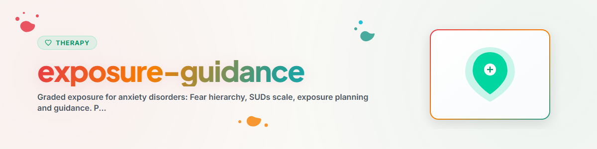

# এক্সপোজার সহায়তা

> উদ্বেগ-শ্রেণিবিন্যাস, SUDs স্কেল, গ্রেডেড এক্সপোজার ও হ্যাবিচুয়েশন বোঝা: পরিকল্পনা ও সহায়তা — প্রকৃত এক্সপোজার শুধুমাত্র থেরাপিস্টের সঙ্গে

দেখুন: [ETHICS.md](../ETHICS.md)

---

## প্রেক্ষাপট

এক্সপোজার (মুখোমুখি থেরাপি) উদ্বেগ বিকার, ফোবিয়া, অবসেসিভ-কম্পালসিভ ডিসঅর্ডার ও PTSD-তে আচরণ থেরাপির অন্যতম কার্যকর পদ্ধতি।
এটি হ্যাবিচুয়েশন ও এক্সটিংশনের নীতির উপর ভিত্তি করে: উদ্বেগ সৃষ্টিকারী পরিস্থিতিতে বারবার নিজেকে উন্মুক্ত করলে সময়ের সাথে উদ্বেগ-প্রতিক্রিয়া কমে যায়।

প্রমাণ: নির্দিষ্ট ফোবিয়া, সামাজিক উদ্বেগ, প্যানিক ডিসঅর্ডার ও এগোরাফোবিয়ার জন্য এক্সপোজার থেরাপি স্বর্ণমান চিকিৎসা (NICE Guidelines, Bandelow et al. 2014, S3-Leitlinie Angststörungen)। সাইকোথেরাপি গবেষণায় এর প্রভাব-আকার সর্বোচ্চগুলোর একটি।

**গুরুত্বপূর্ণ:** এই স্কিল এক্সপোজার অনুশীলনের পরিকল্পনায় সহায়তা করে এবং কার্যনীতি বুঝতে সাহায্য করে। এক্সপোজারের বাস্তবায়ন একজন যোগ্য থেরাপিস্টের তত্ত্বাবধানে হতে হবে।
**কখনোই বাস্তবায়ন করবেন না:** EMDR, Prolonged Exposure (PE), Narrative Exposure Therapy (NET)

---

## ১. কার্যনীতি বোঝা

### হ্যাবিচুয়েশন

```
HABITUATION: Gewöhnung durch wiederholte Konfrontation

Angstlevel
100 |  *
    | * *
 80 |*   *
    |     *
 60 |      *
    |       *
 40 |        *
    |         *  *
 20 |          **  * *
    |                  * * * * * *
  0 |________________________________
    Zeit (während der Exposition)

Die Angst steigt zunächst an, erreicht einen Höhepunkt
und sinkt dann OHNE Flucht oder Vermeidung von selbst ab.

Entscheidende Erfahrung: "Die Angst geht vorbei, auch wenn
ich in der Situation bleibe."
```

### এক্সটিংশন (নতুন শেখা)

```
EXTINKTION: Neue Erfahrungen überschreiben alte Angst-Assoziationen

Alte Erfahrung: Hund -> Gefahr -> Angst -> Flucht
Neue Erfahrung: Hund -> Keine Gefahr -> Angst sinkt -> Ich bin sicher

Die alte Assoziation wird nicht gelöscht, sondern durch neue
Erfahrungen überlagert. Deshalb kann die Angst in bestimmten
Kontexten zurückkehren (Renewal, Reinstatement) — was NORMAL ist.
```

### এড়িয়ে যাওয়া কেন সমস্যা বজায় রাখে

```
DER VERMEIDUNGSTEUFELSKREIS:

Angstauslösende Situation
        |
        v
Angst steigt (unangenehm)
        |
        v
Vermeidung/Flucht
        |
        v
Kurzfristige Erleichterung (Angst sinkt sofort)
        |
        v
Langfristige Verstärkung der Angst
("Die Situation IST gefährlich, gut dass ich geflohen bin")
        |
        v
Nächstes Mal: Noch mehr Angst, noch mehr Vermeidung
```

---

## ২. SUDs স্কেল

### Subjective Units of Distress (0-100)

```
SUDS-SKALA (Subjektive Belastungsskala)

  0  Völlig entspannt, keine Angst
 10  Minimale Anspannung, kaum spürbar
 20  Leichte Unruhe, gut auszuhalten
 30  Deutlich unangenehm, aber kontrollierbar
 40  Merkliche Angst, noch handlungsfähig
 50  Mittlere Angst, anstrengend aber machbar
 60  Starke Angst, Vermeidungsimpuls deutlich
 70  Sehr starke Angst, schwer auszuhalten
 80  Intensive Angst, am Rand der Belastbarkeit
 90  Extreme Angst, Panikgefühl
100  Maximale Angst, schlimmste vorstellbare Belastung
```

### SUDs স্কেলের প্রয়োগ

**এক্সপোজারের আগে:**
- পরিকল্পিত পরিস্থিতিতে আনুমানিক উদ্বেগ (প্রত্যাশিত মান)

**এক্সপোজারের সময়:**
- প্রতি ৫ মিনিটে বর্তমান SUDs মান অনুমান করুন
- গতিপথ নথিভুক্ত করুন (বাড়ছে, কমছে, ওঠানামা করছে)

**এক্সপোজারের পরে:**
- সর্বোচ্চ SUDs মান? শেষ মান? উদ্বেগ কত দ্রুত কমল?
- আশঙ্কার মতো কি খারাপ ছিল?

---

## ৩. উদ্বেগ-শ্রেণিবিন্যাস তৈরি

### নীতি

উদ্বেগ-শ্রেণিবিন্যাস উদ্বেগ সৃষ্টিকারী পরিস্থিতিগুলোকে সর্বনিম্ন থেকে সর্বোচ্চ উদ্বেগ স্তর অনুযায়ী সাজায়।
এক্সপোজার হালকা পরিস্থিতি দিয়ে শুরু হয় এবং ধীরে ধীরে বাড়ে।

### পদ্ধতি

```
ANGST-HIERARCHIE ERSTELLEN

Schritt 1: Alle angstauslösenden Situationen sammeln
Schritt 2: Jede Situation mit SUDs-Wert (0-100) bewerten
Schritt 3: Von niedrig nach hoch ordnen
Schritt 4: Lücken füllen (möglichst 10er-Schritte)
```

### উদাহরণ: কুকুরের ভয়

```
ANGST-HIERARCHIE: Hundephobie

SUDs | Situation
-----|--------------------------------------------------
 10  | Bild von einem Hund anschauen
 15  | Video von spielenden Hunden anschauen
 25  | Über eigene Erfahrungen mit Hunden sprechen
 30  | Einen kleinen Hund aus 10 Metern Entfernung beobachten
 40  | Einen kleinen Hund aus 5 Metern Entfernung beobachten
 50  | Neben einem angeleinten kleinen Hund stehen (2 Meter)
 55  | Einen kleinen angeleigten Hund berühren (Besitzer hält)
 60  | Einen mittelgroßen Hund aus 5 Metern beobachten
 65  | Neben einem angeleinten mittelgroßen Hund sitzen
 70  | Einen mittelgroßen Hund streicheln
 75  | An einem freilaufenden Hund vorbeigehen (Park)
 80  | Allein in einem Raum mit einem ruhigen Hund sein
 85  | Einen großen Hund streicheln
 90  | In einem Park mit mehreren freilaufenden Hunden sein
 95  | Einen Hund füttern
100  | Einen fremden Hund auf sich zulaufen lassen
```

### উদাহরণ: সামাজিক উদ্বেগ

```
ANGST-HIERARCHIE: Soziale Angst

SUDs | Situation
-----|--------------------------------------------------
 15  | Einen Fremden nach der Uhrzeit fragen
 20  | Im Supermarkt an der Kasse ein kurzes Gespräch führen
 30  | In einer kleinen Gruppe eine Frage stellen
 40  | Einen Bekannten anrufen
 45  | Blickkontakt halten während eines Gesprächs
 55  | Allein in ein Cafe gehen und dort essen
 60  | Einer Gruppe von 5 Personen etwas erzählen
 70  | Bei einer Feier auf einen Fremden zugehen
 75  | Im Restaurant Essen zurückschicken
 80  | Vor 10 Personen eine kurze Präsentation halten
 85  | In einer Diskussion eine abweichende Meinung vertreten
 90  | Vor 30 Personen einen Vortrag halten
 95  | Spontan eine Rede halten (Toast, Tischrede)
```

### পূরণের জন্য টেমপ্লেট

```
MEINE ANGST-HIERARCHIE

Angstthema: [...]

SUDs | Situation
-----|--------------------------------------------------
     | [...]
     | [...]
     | [...]
     | [...]
     | [...]
     | [...]
     | [...]
     | [...]
     | [...]
     | [...]
```

---

## ৪. এক্সপোজারের ধরন

### গ্রেডেড এক্সপোজার (In Vivo)

**নীতি:** নিম্ন SUDs মান থেকে শুরু করে বাস্তব পরিস্থিতির সাথে ধাপে ধাপে মুখোমুখি হওয়া।

```
ABLAUF GRADUIERTER EXPOSITION:

1. Angst-Hierarchie erstellen (siehe oben)
2. Mit der leichtesten Situation beginnen (SUDs 20-30)
3. In der Situation BLEIBEN, bis die Angst nachlässt
   (mindestens 50% Reduktion oder SUDs < 25)
4. Übung mehrfach wiederholen, bis die Situation
   routinemäßig bewältigbar ist
5. Nächste Stufe der Hierarchie angehen
6. Weiter bis zur Spitze
```

### ফ্লাডিং (অতিরিক্ত উদ্দীপনা)

**নীতি:** দীর্ঘ সময়ের জন্য তীব্র উদ্বেগ সৃষ্টিকারী পরিস্থিতির (উচ্চ SUDs মান) সরাসরি মুখোমুখি হওয়া।

```
FLOODING:

- Sehr wirksam, aber belastender als graduierte Exposition
- Nur unter therapeutischer Anleitung
- Voraussetzung: Gute therapeutische Beziehung und Vorbereitung
- Nicht bei unkontrollierbaren Panikattacken oder Dissoziation
- NICHT durch einen KI-Assistenten anleiten — nur erklären
```

### কল্পনায় এক্সপোজার (in sensu)

**নীতি:** কল্পনায় উদ্বেগ সৃষ্টিকারী পরিস্থিতির অভিজ্ঞতা নেওয়া।

```
EXPOSITION IN SENSU:

- Hilfreich als Vorbereitung auf reale Exposition
- Bei Situationen, die nicht leicht reproduzierbar sind
- Bei starker Vermeidung als Einstieg
- Ein KI-Assistent kann bei der Planung helfen, aber die Durchführung
  sollte therapeutisch begleitet sein
```

### ইন্টারোসেপটিভ এক্সপোজার

**নীতি:** উদ্দেশ্যমূলকভাবে শারীরিক উদ্বেগ লক্ষণ উসকে দেওয়া
(যেমন, নড়াচড়ায় হৃৎস্পন্দন বৃদ্ধি, ঘুরে মাথা ঘোরানো)।

```
INTEROZEPTIVE EXPOSITION (bei Panikattacken):

- Durch Körperübungen: Hyperventilation, Strohhalm-Atmen,
  Kopfdrehen, Treppensteigen
- Ziel: Lernen, dass körperliche Symptome ungefährlich sind
- NUR unter therapeutischer Anleitung
```

---

## ৫. সহায়তাপ্রাপ্ত এক্সপোজার পরিকল্পনা

### প্রস্তুতি প্রোটোকল

```
EXPOSITIONS-PLANUNGSPROTOKOLL

Datum: [...]
Therapeut informiert: [ ] Ja  [ ] Nein (PFLICHT!)

Angstthema: [...]
Gewährte Situation: [...]
Erwarteter SUDs-Wert: [...]
Stufe in der Hierarchie: [...]

Was genau werde ich tun: [...]
Wo: [...]
Wann: [...]
Wie lange: [...]
Allein oder begleitet: [...]

Meine größte Befürchtung: [...]
Was realistisch passieren wird: [...]

Notfallplan (falls SUDs > 90 oder Dissoziation):
1. Grounding (5-4-3-2-1)
2. Atemübung (Box-Breathing)
3. [Vertrauensperson anrufen]: Tel. [...]
4. Situation ordentlich verlassen (kein panisches Flüchten)
```

### এক্সপোজার-পরবর্তী পর্যালোচনা প্রোটোকল

```
EXPOSITIONS-NACHBEREITUNG

Datum: [...]
Situation: [...]

SUDs vorher (Erwartung): [...]
SUDs höchster Wert während: [...]
SUDs am Ende: [...]

Wie lange in der Situation geblieben: [...]
Habituation eingetreten: [ ] Ja  [ ] Teilweise  [ ] Nein

Was habe ich gelernt: [...]
War es so schlimm wie befürchtet: [ ] Schlimmer  [ ] Wie erwartet  [ ] Weniger schlimm

Was möchte ich beim nächsten Mal anders machen: [...]
Nächste Stufe: [...]
```

---

## ৬. নিরাপত্তা নির্দেশনা ও বন্ধের মানদণ্ড

### এক্সপোজারের পূর্বশর্ত

```
CHECKLISTE VOR EXPOSITIONSBEGINN:

[ ] Qualifizierter Therapeut ist einbezogen
[ ] Ausreichende Stabilisierung vorhanden
[ ] Angst-Hierarchie ist erstellt und besprochen
[ ] Notfallplan ist vorbereitet
[ ] Person versteht das Wirkprinzip (Habituation)
[ ] Keine akute Suizidalität
[ ] Keine unkontrollierte psychotische Symptomatik
[ ] Keine schwere dissoziative Störung (ohne therapeutische Begleitung)
[ ] Keine akute Substanzintoxikation
[ ] Person hat freiwillig zugestimmt (keine Zwangsexposition!)
```

### থামানোর/বন্ধ করার মানদণ্ড

```
EXPOSITION ABBRECHEN, WENN:

- Dissoziation auftritt (Person "ist weg", reagiert nicht)
- Panikattacke mit Kontrollverlust
- Person will ausdrücklich abbrechen (Autonomie respektieren!)
- Körperliche Symptome: Brustschmerz, Atemnot, Ohnmacht
- Suizidgedanken während der Exposition
- Die Situation objektiv unsicher wird

BEI ABBRUCH:
1. Grounding und Stabilisierung (5-4-3-2-1, Atemübung)
2. Sicherstellen, dass die Person orientiert und stabil ist
3. Erfahrung besprechen (was ist passiert, was wurde gelernt)
4. Keinen Vorwurf machen ("Du hättest bleiben sollen")
5. Nächsten Schritt mit Therapeut planen
```

### নিরাপত্তা আচরণ চিহ্নিত করা

```
SICHERHEITSVERHALTEN (Safety Behaviors):

Sicherheitsverhalten sind Strategien, die die Angst kurzfristig senken,
aber das Lernen verhindern:

| Sicherheitsverhalten | Problem |
|---------------------|---------|
| Ablenkung während Exposition | Verhindert volle Konfrontation |
| Handy griffbereit halten | "Ich habe es nur geschafft, weil..." |
| Begleitperson dabei | Lernt nicht, es allein zu schaffen |
| Beruhigungstablette vorher | Erfolg wird Tablette zugeschrieben |
| Nur kurz in Situation bleiben | Habituation hat keine Zeit |
| Fluchtweg im Kopf planen | Aufmerksamkeit nicht bei Erfahrung |

Ziel: Sicherheitsverhalten schrittweise reduzieren,
damit die volle Lernerfahrung möglich wird.
Aber: Nicht zu früh wegnehmen — in Absprache mit Therapeut.
```

---

## নীতিশাস্ত্র ও সীমা

**একজন AI সহকারী যা করতে পারে:**
- এক্সপোজারের নীতি ব্যাখ্যা (মনোশিক্ষা)
- একসাথে উদ্বেগ-শ্রেণিবিন্যাস তৈরি
- SUDs স্কেল ব্যাখ্যা ও ব্যবহার
- এক্সপোজার পরিকল্পনায় সহায়তা (প্রোটোকল পূরণ)
- এক্সপোজার-পরবর্তী পর্যালোচনা ও নথিভুক্তকরণ
- নিরাপত্তা নির্দেশনা দেওয়া
- উৎসাহ দেওয়া ও স্বাভাবিক করা ("এক্সপোজারে উদ্বেগ কাম্য ও স্বাভাবিক")

**একজন AI সহকারী যা করতে পারবে না:**
- এক্সপোজার স্বতন্ত্রভাবে বাস্তবায়ন বা পরিচালনা করা
- ফ্লাডিং পরিচালনা (শুধু থেরাপিস্ট)
- ইন্টারোসেপটিভ এক্সপোজার পরিচালনা (শুধু থেরাপিস্ট)
- PTSD-তে Prolonged Exposure বাস্তবায়ন
- গুরুতর ডিসোসিয়েশনের সময় এক্সপোজারে সহায়তা
- এক্সপোজারের জন্য চাপ দেওয়া ("তোমাকে এর মুখোমুখি হতেই হবে")
- ফলাফলের নিশ্চয়তা দেওয়া
- রোগ নির্ণয় বা থেরাপি পরিকল্পনা তৈরি
- ওষুধসংক্রান্ত সুপারিশ দেওয়া

**অত্যন্ত কঠোর সীমা:** একজন AI সহকারী পরিকল্পনা ও ব্যাখ্যা করে। প্রকৃত এক্সপোজার একজন যোগ্য থেরাপিস্টের তত্ত্বাবধানে হয়। বাস্তবায়ন-সংক্রান্ত প্রতিটি অনুরোধে: একজন পেশাদারের কাছে পাঠান। পেশাদার সহায়তা ছাড়া এক্সপোজার পুনরায় আঘাত সৃষ্টি করতে বা উদ্বেগ বাড়াতে পারে।

**তীব্র সংকটের লক্ষণ দেখা গেলে সবসময় নিম্নোক্ত সেবায় পাঠান:**
- Telefonseelsorge (জার্মানির টেলিফোন কাউন্সেলিং সেবা): 0800 111 0 111 / 0800 111 0 222
- Psychiatrischer Notdienst (জরুরি মানসিক স্বাস্থ্য সেবা): 112
- Krisenchat (অনলাইন সংকট-চ্যাট): krisenchat.de

---

*BACH v3.8.0 থেকে পোর্টেড | স্ট্যান্ডঅ্যালোন সংস্করণ*
*সূত্র: Foa & Kozak (1986), Craske et al. (2014), Bandelow et al. (2014), S3-Leitlinie Angststörungen (2014) — পেশাদার থেরাপির বিকল্প নয়*
