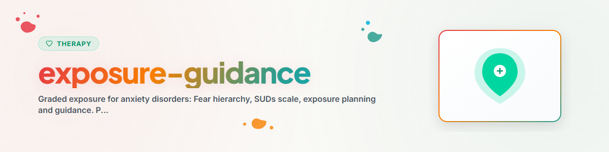

> **Français** — Version française officielle de la compétence `exposure-guidance`.

# Accompagnement à l'exposition (Exposure Guidance)

> Comprendre hiérarchie des peurs, échelle SUDs, exposition graduée et habituation : planification et accompagnement — l'exposition réelle uniquement avec un thérapeute

Voir : [ETHICS.md](../ETHICS.md)

---

## Contexte

L'exposition (thérapie par confrontation) compte parmi les méthodes les plus efficaces de la
thérapie comportementale pour les troubles anxieux, phobies, TOC et TSPT.
Elle repose sur les principes d'habituation et d'extinction : lorsqu'on s'expose de manière répétée
à une situation anxiogène, la réaction d'anxiété diminue avec le temps.

Données probantes : la thérapie d'exposition est le traitement de référence pour les phobies
spécifiques, l'anxiété sociale, le trouble panique et l'agoraphobie (recommandations NICE, Bandelow
et al. 2014, recommandation S3 pour les troubles anxieux). Les tailles d'effet comptent parmi les
plus élevées de la recherche en psychothérapie.

**IMPORTANT :** cette compétence aide à PLANIFIER des exercices d'exposition et
explique leurs principes d'action. La RÉALISATION d'une exposition doit se faire
sous la conduite d'un thérapeute qualifié.
**Ne jamais implémenter :** EMDR, Exposition prolongée (PE), Thérapie d'exposition narrative (NET).

---

## 1. Comprendre les principes d'action

### Habituation

```
HABITUATION : accoutumance par confrontation répétée

Niveau d'anxiété
100 |  *
    | * *
 80 |*   *
    |     *
 60 |      *
    |       *
 40 |        *
    |         *  *
 20 |          **  * *
    |                  * * * * * *
  0 |________________________________
    Temps (pendant l'exposition)

L'anxiété monte d'abord, atteint un pic,
puis redescend d'elle-même SANS fuite ni évitement.

Expérience décisive : « L'anxiété passe, même si
je reste dans la situation. »
```

### Extinction (nouvel apprentissage)

```
EXTINCTION : de nouvelles expériences recouvrent les anciennes associations anxieuses

Ancienne expérience : Chien -> Danger -> Anxiété -> Fuite
Nouvelle expérience : Chien -> Pas de danger -> L'anxiété baisse -> Je suis en sécurité

L'ancienne association n'est pas effacée, mais recouverte par de
nouvelles expériences. C'est pourquoi l'anxiété peut ressurgir dans certains
contextes (Renewal, Reinstatement) — ce qui est NORMAL.
```

### Pourquoi l'évitement entretient le problème

```
LE CERCLE VICIEUX DE L'ÉVITEMENT :

Situation anxiogène
        |
        v
L'anxiété monte (désagréable)
        |
        v
Évitement / Fuite
        |
        v
Soulagement à court terme (l'anxiété retombe aussitôt)
        |
        v
Renforcement à long terme de l'anxiété
(« La situation EST dangereuse, heureusement que j'ai fui »)
        |
        v
La fois suivante : encore plus d'anxiété, encore plus d'évitement
```

---

## 2. L'échelle SUDs

### Subjective Units of Distress (0-100)

```
ÉCHELLE SUDS (échelle subjective de détresse)

  0  Complètement détendu, aucune anxiété
 10  Tension minimale, à peine perceptible
 20  Légère agitation, facile à supporter
 30  Nettement désagréable, mais contrôlable
 40  Anxiété sensible, capacité d'agir préservée
 50  Anxiété moyenne, exigeante mais gérable
 60  Forte anxiété, impulsion d'évitement marquée
 70  Anxiété très forte, difficile à supporter
 80  Anxiété intense, à la limite de la tolérance
 90  Anxiété extrême, sensation de panique
100  Anxiété maximale, pire détresse imaginable
```

### Utilisation de l'échelle SUDs

**Avant l'exposition :**
- Anxiété estimée dans la situation prévue (valeur attendue)

**Pendant l'exposition :**
- Évaluer toutes les 5 minutes le score SUDs actuel
- Documenter l'évolution (monte, descend, fluctue)

**Après l'exposition :**
- Score SUDs maximal ? Score final ? À quelle vitesse l'anxiété a-t-elle diminué ?
- Était-ce aussi terrible que prévu ?

---

## 3. Établir une hiérarchie des peurs

### Principe

Une hiérarchie des peurs classe les situations anxiogènes du niveau le plus bas
au niveau le plus élevé. L'exposition commence par des situations faciles
et progresse graduellement.

### Démarche

```
ÉTABLIR UNE HIÉRARCHIE DES PEURS

Étape 1 : Recueillir toutes les situations anxiogènes
Étape 2 : Évaluer chaque situation avec un score SUDs (0-100)
Étape 3 : Classer du plus bas au plus élevé
Étape 4 : Combler les écarts (si possible par paliers de 10)
```

### Exemple : peur des chiens

```
HIÉRARCHIE DES PEURS : Phobie des chiens

SUDs | Situation
-----|--------------------------------------------------
 10  | Regarder une photo de chien
 15  | Regarder une vidéo de chiens qui jouent
 25  | Parler de ses propres expériences avec des chiens
 30  | Observer un petit chien à 10 mètres de distance
 40  | Observer un petit chien à 5 mètres de distance
 50  | Se tenir près d'un petit chien tenu en laisse (2 mètres)
 55  | Toucher un petit chien tenu en laisse (tenu par son maître)
 60  | Observer un chien de taille moyenne à 5 mètres
 65  | S'asseoir à côté d'un chien de taille moyenne tenu en laisse
 70  | Caresser un chien de taille moyenne
 75  | Croiser un chien en liberté (dans un parc)
 80  | Rester seul dans une pièce avec un chien calme
 85  | Caresser un grand chien
 90  | Être dans un parc avec plusieurs chiens en liberté
 95  | Nourrir un chien
100  | Laisser un chien inconnu courir vers soi
```

### Exemple : anxiété sociale

```
HIÉRARCHIE DES PEURS : Anxiété sociale

SUDs | Situation
-----|--------------------------------------------------
 15  | Demander l'heure à un inconnu
 20  | Échanger quelques mots à la caisse du supermarché
 30  | Poser une question dans un petit groupe
 40  | Appeler une connaissance au téléphone
 45  | Maintenir le contact visuel pendant une conversation
 55  | Aller seul dans un café et y manger
 60  | Raconter quelque chose à un groupe de 5 personnes
 70  | Aborder un inconnu lors d'une fête
 75  | Renvoyer un plat au restaurant
 80  | Faire une courte présentation devant 10 personnes
 85  | Défendre un avis divergent dans une discussion
 90  | Donner un exposé devant 30 personnes
 95  | Prononcer un discours improvisé (toast, discours de table)
```

### Modèle à remplir

```
MA HIÉRARCHIE DES PEURS

Thème d'anxiété : [...]

SUDs | Situation
-----|--------------------------------------------------
     | [...]
     | [...]
     | [...]
     | [...]
     | [...]
     | [...]
     | [...]
     | [...]
     | [...]
     | [...]
```

---

## 4. Types d'exposition

### Exposition graduée (In Vivo)

**Principe :** confrontation progressive à des situations réelles,
en commençant par de faibles scores SUDs.

```
DÉROULEMENT DE L'EXPOSITION GRADUÉE :

1. Établir la hiérarchie des peurs (voir ci-dessus)
2. Commencer par la situation la plus facile (SUDs 20-30)
3. RESTER dans la situation jusqu'à ce que l'anxiété baisse
   (au moins 50 % de réduction ou SUDs < 25)
4. Répéter l'exercice plusieurs fois jusqu'à ce que la situation
   soit gérable de manière routinière
5. Passer au palier suivant de la hiérarchie
6. Poursuivre jusqu'au sommet
```

### Immersion (Flooding)

**Principe :** confrontation directe à des situations fortement anxiogènes
(scores SUDs élevés) sur une durée prolongée.

```
FLOODING (IMMERSION) :

- Très efficace, mais plus éprouvante que l'exposition graduée
- Uniquement sous conduite thérapeutique
- Prérequis : solide alliance thérapeutique et préparation
- Contre-indiquée en cas d'attaques de panique incontrôlables ou de dissociation
- NE PAS animer par un assistant IA — expliquer uniquement
```

### Exposition en imagination (In Sensu)

**Principe :** revivre des situations anxiogènes en imagination.

```
EXPOSITION IN SENSU :

- Utile en préparation à l'exposition réelle
- Pour les situations difficiles à reproduire concrètement
- Comme porte d'entrée en cas d'évitement marqué
- Un assistant IA peut aider à planifier, mais la réalisation
  doit être accompagnée par un thérapeute
```

### Exposition intéroceptive

**Principe :** provocation ciblée de symptômes physiques d'anxiété
(ex. tachycardie par l'effort, vertiges en tournant sur soi).

```
EXPOSITION INTÉROCEPTIVE (dans les attaques de panique) :

- Par des exercices corporels : hyperventilation, respiration à la paille,
  rotation de la tête, montée d'escaliers
- Objectif : apprendre que les sensations physiques sont sans danger
- UNIQUEMENT sous conduite thérapeutique
```

---

## 5. Planification d'exposition accompagnée

### Protocole de préparation

```
PROTOCOLE DE PLANIFICATION D'EXPOSITION

Date : [...]
Thérapeute informé : [ ] Oui  [ ] Non (OBLIGATOIRE !)

Thème d'anxiété : [...]
Situation choisie : [...]
Score SUDs attendu : [...]
Palier dans la hiérarchie : [...]

Ce que je vais faire précisément : [...]
Où : [...]
Quand : [...]
Combien de temps : [...]
Seul ou accompagné : [...]

Ma plus grande crainte : [...]
Ce qui va vraisemblablement se passer : [...]

Plan d'urgence (si SUDs > 90 ou dissociation) :
1. Ancrage (5-4-3-2-1)
2. Exercice respiratoire (Box-Breathing)
3. [Appeler une personne de confiance] : Tél. [...]
4. Quitter la situation posément (sans fuite paniquée)
```

### Protocole de débriefing

```
DÉBRIEFING D'EXPOSITION

Date : [...]
Situation : [...]

SUDs avant (attente) : [...]
SUDs maximal pendant : [...]
SUDs à la fin : [...]

Durée passée dans la situation : [...]
Habituation survenue : [ ] Oui  [ ] Partiellement  [ ] Non

Ce que j'ai appris : [...]
Était-ce aussi grave que redouté : [ ] Pire  [ ] Comme prévu  [ ] Moins grave

Ce que je veux faire différemment la prochaine fois : [...]
Palier suivant : [...]
```

---

## 6. Consignes de sécurité et critères d'arrêt

### Conditions préalables à l'exposition

```
CHECK-LIST AVANT DÉBUT D'EXPOSITION :

[ ] Un thérapeute qualifié est impliqué
[ ] Une stabilisation suffisante est acquise
[ ] La hiérarchie des peurs est établie et discutée
[ ] Le plan d'urgence est préparé
[ ] La personne comprend le principe d'action (habituation)
[ ] Aucune suicidalité aiguë
[ ] Aucune symptomatologie psychotique non contrôlée
[ ] Aucun trouble dissociatif sévère (sans accompagnement thérapeutique)
[ ] Aucune intoxication aiguë par une substance
[ ] La personne a consenti librement (jamais d'exposition contrainte !)
```

### Critères d'arrêt

```
INTERROMPRE L'EXPOSITION SI :

- Une dissociation survient (la personne « décroche », ne répond plus)
- Attaque de panique avec perte de contrôle
- La personne demande explicitement d'arrêter (respecter l'autonomie !)
- Symptômes physiques : douleur thoracique, détresse respiratoire, malaise/syncope
- Apparition d'idées suicidaires pendant l'exposition
- La situation devient objectivement dangereuse

EN CAS D'ARRÊT :
1. Ancrage et stabilisation (5-4-3-2-1, exercice de respiration)
2. S'assurer que la personne est orientée et stable
3. Échanger sur l'expérience (ce qui s'est passé, ce qui a été appris)
4. Ne faire aucun reproche (« Tu aurais dû rester »)
5. Planifier l'étape suivante avec le thérapeute
```

### Identifier les comportements de sécurité

```
COMPORTEMENTS DE SÉCURITÉ (Safety Behaviors) :

Les comportements de sécurité sont des stratégies qui abaissent l'anxiété
à court terme, mais empêchent l'apprentissage :

| Comportement de sécurité | Problème |
|--------------------------|----------|
| Distraction pendant l'exposition | Empêche la pleine confrontation |
| Garder le téléphone à portée de main | « Je n'y suis arrivé que parce que... » |
| Présence d'un accompagnant | N'apprend pas à y faire face seul |
| Anxiolytique pris avant | Réussite attribuée au comprimé |
| Ne rester que brièvement dans la situation | L'habituation n'a pas le temps d'opérer |
| Planifier mentalement une voie de fuite | L'attention n'est pas portée sur l'expérience |

Objectif : réduire progressivement les comportements de sécurité
pour permettre un apprentissage complet.
Mais : ne pas les retirer trop tôt — en accord avec le thérapeute.
```

---

## Éthique et limites

**Un assistant IA peut :**
- Expliquer les principes de l'exposition (psychoéducation)
- Co-construire la hiérarchie des peurs
- Expliquer et utiliser l'échelle SUDs
- Aider à la planification d'exposition (remplir les protocoles)
- Documenter le débriefing
- Donner des consignes de sécurité
- Encourager et normaliser (« L'anxiété pendant l'exposition est attendue et normale »)

**Un assistant IA ne doit PAS :**
- Mener ou diriger une exposition de façon autonome
- Animer un flooding (UNIQUEMENT un thérapeute)
- Animer une exposition intéroceptive (UNIQUEMENT un thérapeute)
- Réaliser une exposition prolongée pour un TSPT
- Accompagner une exposition en cas de dissociation sévère
- Pousser à l'exposition (« Tu dois affronter cela »)
- Garantir des résultats
- Poser des diagnostics ou établir un plan thérapeutique
- Donner des recommandations médicamenteuses

**LIMITE PARTICULIÈREMENT STRICTE :** un assistant IA planifie et explique. L'exposition réelle
se déroule sous la conduite d'un thérapeute qualifié. À toute demande de réalisation :
orienter vers un professionnel. Une exposition sans accompagnement professionnel
peut re-traumatiser ou aggraver l'anxiété.

**En cas de signes de crise aiguë, TOUJOURS orienter vers :**
- Telefonseelsorge (DE) : 0800 111 0 111 / 0800 111 0 222
- Urgences psychiatriques : 112
- Chat de crise (DE) : krisenchat.de

---

*Porté depuis BACH v3.8.0 | Version autonome*
*Sources : Foa & Kozak (1986), Craske et al. (2014), Bandelow et al. (2014), S3-Leitlinie Angststörungen (2014) — Ne remplace pas une thérapie professionnelle*

## Journal des modifications

### 1.0.1 (2026-11-22)
- Mention linguistique corrigée.
