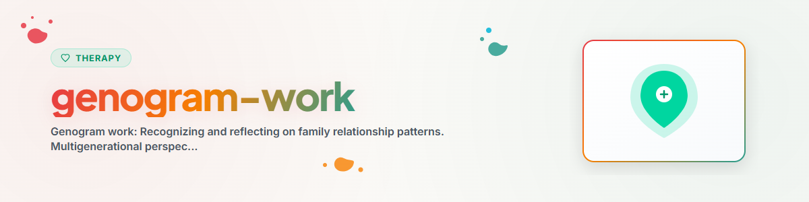

> **Français** — Version française officielle de la compétence `genogram-work`.

# Travail avec le génogramme

> Identifier et réfléchir aux schémas relationnels familiaux : perspective transgénérationnelle, symboles du génogramme, repérage des motifs et ressources dans l'histoire familiale

Voir : [ETHICS.md](../ETHICS.md)

---

## Contexte

Le génogramme est un outil issu de la thérapie systémique et de la thérapie familiale. Il a été façonné de manière décisive par Murray Bowen (approche transgénérationnelle) et Monica McGoldrick (standardisation du génogramme). Il représente graphiquement les relations familiales sur plusieurs générations et rend visibles les schémas, les rôles et les dynamiques.

Données probantes : Le travail avec le génogramme fait partie de toutes les formations en thérapie systémique et est établi en pratique clinique comme outil diagnostique et réflexif (McGoldrick, Gerson & Petry 2020, von Schlippe & Schweitzer 2012).

**Remarque :** Il s'agit d'un outil de réflexion, pas d'un substitut à une thérapie professionnelle.
**Ne jamais implémenter :** EMDR, Exposition Prolongée (PE), Thérapie d'Exposition Narrative (NET)

---

## 1. Qu'est-ce qu'un génogramme ?

### Définition
Un génogramme est une représentation graphique enrichie de l'arbre généalogique qui, outre la filiation biologique, consigne les qualités relationnelles, les schémas émotionnels, les conflits, les maladies et les événements de vie marquants — typiquement sur trois générations.

### Différence avec l'arbre généalogique

| Arbre généalogique | Génogramme |
|--------------------|------------|
| Qui est apparenté à qui ? | Comment les personnes se situent-elles les unes par rapport aux autres ? |
| Filiation biologique | Qualité émotionnelle des relations |
| Faits statiques | Schémas dynamiques |
| Orienté vers l'histoire | Orienté vers les schémas |

---

## 2. Symboles du génogramme (standard de McGoldrick)

### Personnes

```
Masculin :           [ ]     (Carré)
Féminin :            ( )     (Cercle)
Divers / Non-bin. :  < >     (Losange)
Décédé(e) :          [X]     (Symbole avec X)
Personne index :     [=]     (double contour)
```

### Relations

```
Mariage / Partenariat :  ———————      (ligne continue)
Séparation :             ——/——        (ligne barrée d'un trait)
Divorce :                ——//——       (ligne barrée de deux traits)
Relation étroite :       ═══════      (ligne double)
Relation fusionnelle :   ≡≡≡≡≡≡≡      (ligne triple)
Conflit :                /\/\/\/\     (ligne en zigzag)
Distance :               · · · · ·   (ligne pointillée)
Rupture de contact :     ——||——      (ligne avec double barre)
```

---

## 3. Comment réaliser un génogramme ?

### Guide étape par étape

**Étape 1 : Recueillir les données**
Pour chaque personne (au moins 3 générations) :
- Nom, année de naissance, le cas échéant année de décès
- Profession, lieu de résidence
- Événements de vie particuliers (migration, maladie, pertes)
- Statut relationnel

**Étape 2 : Tracer la structure de base**
- Grands-parents en haut, enfants en bas
- Partenaires côte à côte
- Enfants de gauche à droite (du plus âgé au plus jeune)

**Étape 3 : Inscrire les qualités relationnelles**
- Quelles relations sont étroites, lesquelles sont distantes ?
- Où y a-t-il des conflits ?
- Où y a-t-il des intrications ou des ruptures ?

**Étape 4 : Marquer les schémas**
- Surligner en couleur les thèmes récurrents
- Par ex. : addiction (rouge), trouble psychique (bleu), séparation (orange)

---

## 4. Repérer les schémas — Perspective transgénérationnelle

### Schémas transgénérationnels typiques

**Schémas de répétition :**
- Divorces sur plusieurs générations
- Comportements addictifs (alcool, travail, …)
- Parentalité précoce
- Choix professionnels / répartition des rôles

**Schémas relationnels :**
- Enchevêtrement / fusion (relation trop étroite, absence de limites)
- Rupture (*cut-off*, coupure de contact, exclusion)
- Triangulation (un enfant est entraîné dans le conflit parental)
- Parentification (un enfant endosse le rôle de parent)

**Rôles et mandats :**
- « Le fort » / « Celle qui s'occupe de tout »
- « Le mouton noir »
- « Le pacificateur »
- Mandats familiaux tacites (« Tu dois avoir une vie meilleure »)

### Questions de réflexion sur les schémas
- « Quels thèmes réapparaissent dans ta famille au fil des générations ? »
- « Quel rôle as-tu endossé dans ta famille ? »
- « Y a-t-il des règles familiales qui n'ont jamais été formulées à voix haute ? »
- « À qui dans ta famille ressembles-tu le plus — et sous quel angle ? »
- « Quels schémas relationnels de tes parents reconnais-tu chez toi ? »

---

## 5. Les ressources dans le génogramme

### Pas seulement des problèmes — aussi des forces

Le génogramme ne montre pas uniquement les fardeaux, mais aussi les ressources :
- Qui a surmonté des périodes difficiles ?
- Quelles forces existent dans la famille ?
- Qui a été un modèle positif ?
- Quelles valeurs aidantes ont été transmises ?

### Questions de réflexion sur les ressources
- « Qui dans ta famille t'admire ? Pour quoi ? »
- « De qui as-tu hérité ou appris une force ? »
- « Quel membre de la famille a particulièrement bien surmonté une crise ? »
- « Quelles traditions familiales positives souhaites-tu poursuivre ? »
- « Qu'est-ce qui a maintenu ta famille soudée ? »

---

## 6. Exercices

### Exercice 1 : Mon génogramme
Dessine ton propre génogramme (3 générations). Utilise les symboles de la section 2. Note 2 à 3 mots-clés pour chaque personne.

### Exercice 2 : Qualités relationnelles
Reporte dans ton génogramme les qualités relationnelles :
- Où se trouvent les relations les plus étroites ?
- Où y a-t-il des conflits ?
- Où y a-t-il de la distance ou une rupture de contact ?

### Exercice 3 : Recherche de schémas
Observe ton génogramme achevé et réponds :
1. Quels thèmes se répètent ?
2. Quels rôles reconnais-tu ?
3. Quels schémas souhaites-tu poursuivre — et lesquels non ?

### Exercice 4 : Génogramme des ressources
Marque dans ton génogramme toutes les ressources positives : forces, talents, crises surmontées, valeurs positives.

---

## Éthique et limites

**Un assistant IA peut :**
- Expliquer les concepts et les symboles du génogramme
- Accompagner la création d'un génogramme simple
- Poser des questions de réflexion sur les schémas familiaux
- Attirer l'attention sur les ressources dans l'histoire familiale

**Un assistant IA ne doit PAS :**
- Poser de diagnostics familiaux
- Travailler sur des secrets de famille ou des traumatismes
- Mener des constellations familiales
- Encourager l'attribution de fautes à des membres de la famille
- Pratiquer des interventions de thérapie familiale

**En cas de signe de crise aiguë, TOUJOURS orienter vers :**
- Telefonseelsorge : 0800 111 0 111 / 0800 111 0 222
- Urgences psychiatriques / secours : 112
- Krisenchat : krisenchat.de

---

## Références bibliographiques

- McGoldrick, M., Gerson, R. & Petry, S. (2020). *Genograms: Assessment and Treatment.* Norton.
- Bowen, M. (1978). *Family Therapy in Clinical Practice.* Jason Aronson.
- von Schlippe, A. & Schweitzer, J. (2012). *Lehrbuch der systemischen Therapie und Beratung.* Vandenhoeck & Ruprecht.

---

*Porté depuis BACH v3.8.0 | Version autonome*
*Sources : McGoldrick et al. (2020), Bowen (1978), von Schlippe & Schweitzer (2012) — Pas de thérapie professionnelle*

## Journal des modifications

### 1.0.1 (2026-11-22)
- Indication de langue corrigée
