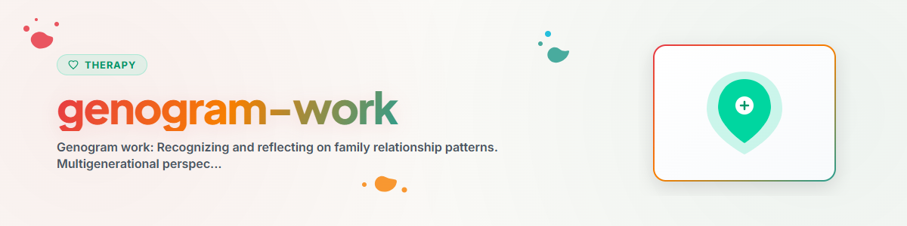

# Trabalho com Genogramas

> Reconhecer e refletir sobre padrões de relacionamento familiar: perspectiva de múltiplas gerações, símbolos do genograma, reconhecimento de padrões e recursos na história familiar

Veja: [ETHICS.md](../ETHICS.md)

---

## Contexto

O genograma é uma ferramenta da terapia sistêmica e da terapia familiar.
Foi moldado de forma decisiva por Murray Bowen (abordagem de múltiplas gerações) e Monica McGoldrick
(padronização do genograma). Ele representa graficamente os relacionamentos familiares ao longo de várias
gerações e torna visíveis padrões, papéis e dinâmicas.

Evidência: O trabalho com genogramas faz parte de todas as formações em terapia sistêmica e está
estabelecido na prática clínica como ferramenta diagnóstica e reflexiva
(McGoldrick, Gerson & Petry 2020, von Schlippe & Schweitzer 2012).

**Observação:** Esta é uma ferramenta de reflexão, não um substituto para a psicoterapia profissional.
**Nunca implementar:** EMDR, Prolonged Exposure (PE), Narrative Exposure Therapy (NET)

---

## 1. O que é um genograma?

### Definição
Um genograma é uma representação gráfica ampliada da árvore genealógica que, além da
descendência biológica, registra qualidades de relacionamento, padrões emocionais, conflitos,
doenças e eventos de vida importantes — tipicamente ao longo de três gerações.

### Diferença em relação à árvore genealógica

| Árvore genealógica | Genograma |
|--------------------|-----------|
| Quem é parente de quem? | Como as pessoas se relacionam entre si? |
| Descendência biológica | Qualidade emocional do relacionamento |
| Fatos estáticos | Padrões dinâmicos |
| Orientada à história | Orientado a padrões |

---

## 2. Símbolos do genograma (padrão segundo McGoldrick)

### Pessoas

```
Männlich:    [ ]     (Quadrat)
Weiblich:     ( )     (Kreis)
Divers:       < >     (Raute)
Verstorben:   [X]     (Symbol mit X)
Indexperson:  [=]     (doppelte Umrandung)
```

### Relacionamentos

```
Ehe/Partnerschaft:     ———————      (durchgezogene Linie)
Trennung:              ——/——        (Linie mit einem Strich)
Scheidung:             ——//——       (Linie mit zwei Strichen)
Enge Beziehung:        ═══════      (Doppellinie)
Verstrickte Beziehung: ≡≡≡≡≡≡≡      (Dreifachlinie)
Konflikt:              /\/\/\/\     (Zickzack-Linie)
Distanz:               · · · · ·   (gepunktete Linie)
Abbruch:               ——||——      (Linie mit Doppelstrich)
```

---

## 3. Como criar um genograma?

### Passo a passo

**Passo 1: Reunir dados**
Para cada pessoa (no mínimo 3 gerações):
- Nome, ano de nascimento, eventualmente ano de falecimento
- Profissão, local de residência
- Eventos de vida especiais (migração, doença, perdas)
- Estado do relacionamento

**Passo 2: Desenhar a estrutura básica**
- Avós em cima, filhos embaixo
- Parceiros lado a lado
- Filhos da esquerda para a direita (o mais velho primeiro)

**Passo 3: Registrar as qualidades dos relacionamentos**
- Quais relacionamentos são próximos e quais são distantes?
- Onde há conflitos?
- Onde há enredamentos ou rupturas?

**Passo 4: Marcar padrões**
- Destacar temas recorrentes com cores
- Ex.: dependência (vermelho), doença psíquica (azul), separação (laranja)

---

## 4. Reconhecer padrões: perspectiva de múltiplas gerações

### Padrões típicos de múltiplas gerações

**Padrões de repetição:**
- Divórcios ao longo de várias gerações
- Comportamento de dependência (álcool, trabalho, ...)
- Parentalidade precoce
- Escolha profissional / distribuição de papéis

**Padrões de relacionamento:**
- Enredamento (relação excessivamente próxima, sem limites)
- Cut-off (rompimento de contato, exclusão)
- Triangulação (a criança é envolvida no conflito dos pais)
- Parentalização (a criança assume o papel de pai ou mãe)

**Papéis e mandatos:**
- "O forte" / "A cuidadora"
- "A ovelha negra"
- "O pacificador"
- Mandatos familiares não expressos ("Você deve ter uma vida melhor")

### Perguntas de reflexão sobre padrões
- "Quais temas aparecem na sua família ao longo das gerações?"
- "Que papel você assumiu na sua família?"
- "Existem regras familiares que nunca foram expressas em voz alta?"
- "Quem na família você mais se parece — e em que aspecto?"
- "Quais padrões de relacionamento dos seus pais você reconhece em você?"

---

## 5. Recursos no genograma

### Não apenas problemas, também forças

O genograma mostra não apenas sobrecargas, mas também recursos:
- Quem superou tempos difíceis?
- Quais forças existem na família?
- Quem foi um exemplo positivo?
- Quais valores foram transmitidos e são úteis?

### Perguntas de reflexão sobre recursos
- "Quem na sua família admira você? Por quê?"
- "De quem você herdou ou aprendeu uma força?"
- "Qual membro da família lidou especialmente bem com uma crise?"
- "Quais tradições familiares positivas você gostaria de manter?"
- "O que manteve sua família unida?"

---

## 6. Exercícios

### Exercício 1: Meu genograma
Desenhe o seu próprio genograma (3 gerações).
Use os símbolos da seção 2.
Anote para cada pessoa 2 a 3 palavras-chave.

### Exercício 2: Qualidades dos relacionamentos
Registre no seu genograma as qualidades dos relacionamentos:
- Onde estão os relacionamentos mais próximos?
- Onde há conflitos?
- Onde há distância ou rompimento de contato?

### Exercício 3: Busca de padrões
Observe o seu genograma pronto e responda:
1. Quais temas se repetem?
2. Quais papéis você reconhece?
3. Quais padrões você gostaria de manter — e quais não?

### Exercício 4: Genograma de recursos
Marque no seu genograma todos os recursos positivos:
forças, talentos, crises superadas, valores positivos.

---

## Ética e limites

**Um assistente de IA pode:**
- Explicar conceitos e símbolos do genograma
- Apoiar na criação de um genograma simples
- Fazer perguntas de reflexão sobre padrões familiares
- Apontar recursos na história familiar

**Um assistente de IA NÃO pode:**
- Fazer diagnósticos familiares
- Trabalhar segredos familiares ou traumas
- Realizar constelações familiares
- Promover atribuições de culpa a membros da família
- Realizar intervenções de terapia familiar

**Em caso de sinais de crise aguda, SEMPRE encaminhar para:**
- Telefonseelsorge: 0800 111 0 111 / 0800 111 0 222
- Serviço psiquiátrico de emergência: 112
- Krisenchat: krisenchat.de

---

## Referências

- McGoldrick, M., Gerson, R. & Petry, S. (2020). *Genograms: Assessment and Treatment.* Norton.
- Bowen, M. (1978). *Family Therapy in Clinical Practice.* Jason Aronson.
- von Schlippe, A. & Schweitzer, J. (2012). *Lehrbuch der systemischen Therapie und Beratung.* Vandenhoeck & Ruprecht.

---

*Portado a partir do BACH v3.8.0 | Versão standalone*
*Fontes: McGoldrick et al. (2020), Bowen (1978), von Schlippe & Schweitzer (2012) — Não é psicoterapia profissional*
