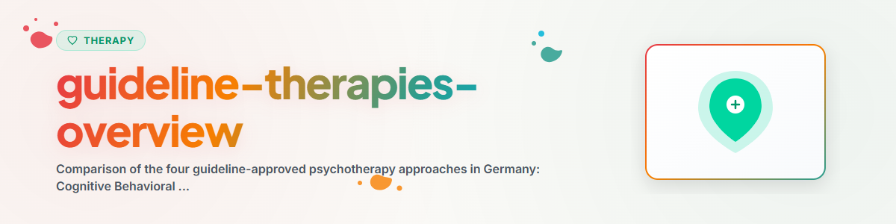

> **Français** — Version française officielle de la compétence `guideline-therapies-overview`.

# Aperçu des psychothérapies conventionnées (Richtlinienverfahren)

> Comparaison des quatre approches psychothérapeutiques reconnues en Allemagne : TCC, thérapie psychodynamique, psychanalyse, thérapie systémique — Guide d'orientation

Voir : [ETHICS.md](../ETHICS.md)

---

## Contexte

En Allemagne, il existe quatre approches psychothérapeutiques reconnues par les directives officielles dont les coûts sont pris en charge par l'assurance maladie obligatoire. Beaucoup de personnes ne savent pas quelle approche pourrait leur convenir. Cette compétence offre un aperçu psychoéducatif à visée d'orientation.

Base légale : Les thérapies conventionnées sont approuvées par le Comité fédéral commun (G-BA) sur la base de preuves scientifiques :
- Thérapie cognitivo-comportementale (TCC / CBT) : thérapie conventionnée depuis 1987
- Psychothérapie psychodynamique (PDT / TP) : depuis 1967
- Psychothérapie analytique (psychanalyse, AP) : depuis 1967
- Thérapie systémique (TS / ST) : depuis 2019 (adultes) / 2024 (enfants et adolescents)

**Remarque :** Il s'agit d'un guide d'orientation, pas d'une recommandation thérapeutique.
**Ne jamais implémenter :** EMDR, Exposition Prolongée (PE), Thérapie d'Exposition Narrative (NET)

---

## 1. Les quatre psychothérapies conventionnées en un coup d'œil

| Caractéristique | TCC | Psychodynamique (PDT) | Psychanalyse (AP) | Systémique (ST) |
|---|---|---|---|---|
| **Idée centrale** | Modifier les comportements et schémas de pensée | Comprendre les conflits inconscients | Transformation profonde de la personnalité | Modifier les relations et les systèmes |
| **Focalisation temporelle** | Présent et futur | Passé et présent | Passé (enfance) | Présent et relations |
| **Séances** | 12-80 h | 12-100 h | 80-300 h | 12-48 h |
| **Fréquence** | 1×/semaine | 1×/semaine | 2-3×/semaine | 1×/semaine ou moins |
| **Cadre** | Surtout individuel | Surtout individuel | Individuel (divan) | Individuel, couple, famille |

---

## 2. Thérapie cognitivo-comportementale (TCC)

### Hypothèses fondamentales
- Le comportement est appris et peut être désappris
- Les schémas de pensée influencent les émotions et le comportement (révolution cognitive, Beck)
- Le changement s'opère par la pratique active et de nouvelles expériences

### Quand est-elle particulièrement adaptée ?
- Troubles anxieux, phobies, attaques de panique
- Dépression
- TOC, TSPT, troubles du comportement alimentaire

---

## 3. Psychothérapie psychodynamique (PDT)

### Hypothèses fondamentales
- Des conflits inconscients influencent notre vécu et notre comportement
- Les expériences relationnelles précoces façonnent les schémas actuels
- La prise de conscience des liens inconscients favorise le changement

### Quand est-elle particulièrement adaptée ?
- Dépression (en particulier chronique)
- Problèmes relationnels avec schémas récurrents
- Troubles de la personnalité, plaintes psychosomatiques

---

## 4. Psychothérapie analytique (Psychanalyse, AP)

### Hypothèses fondamentales
- Des conflits inconscients profondément enracinés dès la petite enfance influencent l'ensemble du vécu
- Une transformation globale de la personnalité est possible par une compréhension approfondie

### Quand est-elle particulièrement adaptée ?
- Problèmes de personnalité profondément ancrés
- Problèmes chroniques et récurrents
- Lorsque des approches plus brèves n'ont pas suffi

---

## 5. Thérapie systémique (ST)

### Hypothèses fondamentales
- Les problèmes naissent et persistent au sein des systèmes relationnels
- Un changement chez un membre modifie l'ensemble du système
- Chaque personne possède des ressources et des compétences de solution

### Quand est-elle particulièrement adaptée ?
- Conflits familiaux et de couple
- Problèmes d'enfants et d'adolescents (au sein du système familial)
- Lorsqu'une thérapie plus courte est souhaitée

---

## 6. Orientation pratique

### Aide à la décision (PAS une recommandation, uniquement une orientation)

| Je souhaite… | Approche potentiellement adaptée |
|---|---|
| Obtenir des outils concrets contre l'anxiété | TCC |
| Comprendre pourquoi je retombe toujours dans les mêmes schémas | Psychodynamique (PDT) |
| Apprendre à me connaître en profondeur | Psychanalyse (AP) |
| Comprendre les problèmes relationnels dans leur contexte systémique | Systémique (ST) |
| Obtenir une aide pratique rapide | TCC ou Systémique |

### Relation thérapeutique

La recherche montre de façon constante que le facteur thérapeutique le plus important est la relation thérapeutique (Wampold 2015). La « bonne » approche compte moins que le « bon » thérapeute.

---

## 7. Informations pratiques

### Trouver un thérapeute
- Aux États-Unis : annuaire Psychology Today, répertoires des assureurs
- Au Royaume-Uni : NHS psychological therapies, annuaire des thérapeutes BACP
- En Allemagne : service de prise de rendez-vous 116 117, Association des médecins conventionnés (Kassenärztliche Vereinigung)

---

## Éthique et limites

**Un assistant IA peut :**
- Présenter et comparer objectivement les quatre psychothérapies conventionnées
- Fournir une orientation (pas de recommandations)
- Donner des informations pratiques pour trouver un thérapeute
- Poser des questions de réflexion pour clarifier sa propre situation

**Un assistant IA ne doit PAS :**
- Recommander une approche spécifique
- Déconseiller une approche
- Poser des diagnostics ou déduire des indications
- Évaluer ou recommander des thérapeutes
- Commenter ou remettre en question des thérapies en cours

**En cas de crise aiguë, TOUJOURS orienter vers :**
- 988 Suicide & Crisis Lifeline (US) : 988
- Crisis Text Line (US) : envoyer HOME par SMS au 741741
- Samaritans (UK) : 116 123
- Telefonseelsorge (DE) : 0800 111 0 111 / 0800 111 0 222
- Services d'urgence : 911 (US) / 112 (UE)

---

## Références bibliographiques

- Wampold, B. E. (2015). *The Great Psychotherapy Debate.* Routledge.
- Leichsenring, F. & Rabung, S. (2011). Long-term psychodynamic psychotherapy in complex mental disorders. *British Journal of Psychiatry*, 199(1), 15-22.
- von Sydow, K. et al. (2010). *Die Wirksamkeit der Systemischen Therapie/Familientherapie.* Hogrefe.
- Directive psychothérapie du G-BA (G-BA Psychotherapy Guideline)

---

*Porté depuis BACH v3.8.0 | Version autonome*
*Sources : Directives G-BA, Wampold (2015), Leichsenring & Rabung (2011), von Sydow et al. (2010) — Pas de thérapie professionnelle*

## Journal des modifications

### 1.0.1 (2026-11-22)
- Indication de langue corrigée
