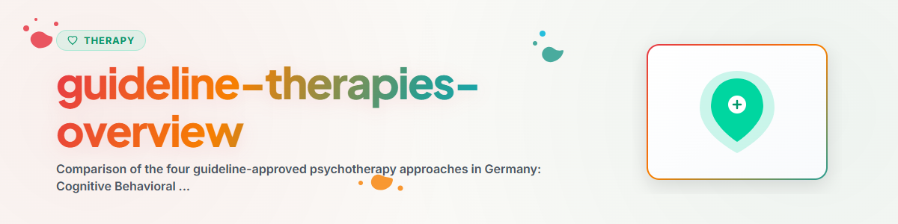

> **Deutsch** — Offizielle Deutsch-Version / Documento Oficial en Deutsch.

# दिशानिर्देश चिकित्सा पद्धतियों का अवलोकन (Deutsch)

> जर्मनी में चार स्वीकृत दिशानिर्देश मनोचिकित्सा पद्धतियों की तुलना: CBT, मनोगतिक चिकित्सा, मनोविश्लेषण, सिस्टमिक चिकित्सा — अभिमुखीकरण मार्गदर्शिका

देखें: [ETHICS.md](../ETHICS.md)

---

## संदर्भ

जर्मनी में चार मान्यता प्राप्त दिशानिर्देश मनोचिकित्सा पद्धतियाँ हैं जिनका खर्च वैधानिक स्वास्थ्य बीमा द्वारा वहन किया जाता है। कई लोग नहीं जानते कि उनके लिए कौन-सी पद्धति उपयुक्त हो सकती है। यह कौशल अभिमुखीकरण के लिए एक मनोशिक्षात्मक अवलोकन प्रदान करता है।

कानूनी आधार: दिशानिर्देश चिकित्सा पद्धतियों को वैज्ञानिक साक्ष्य के आधार पर संघीय संयुक्त समिति (G-BA) द्वारा अनुमोदित किया जाता है।
- संज्ञानात्मक व्यवहार चिकित्सा (CBT): 1987 से दिशानिर्देश चिकित्सा
- मनोगतिक मनोचिकित्सा (PDT): 1967 से
- मनोविश्लेषणात्मक मनोचिकित्सा (AP): 1967 से
- सिस्टमिक चिकित्सा (ST): 2019 से (वयस्क) / 2024 से (बच्चे और किशोर)

**नोट:** यह एक अभिमुखीकरण मार्गदर्शिका है, चिकित्सा की सिफारिश नहीं।
**कभी लागू न करें:** EMDR, दीर्घकालिक एक्सपोज़र (PE), नैरेटिव एक्सपोज़र थेरेपी (NET)

---

## 1. चार दिशानिर्देश चिकित्सा पद्धतियाँ एक नज़र में

| विशेषता | CBT | PDT | AP | ST |
|---------|-----|-----|----|----|
| **मूल विचार** | व्यवहार और विचार-पैटर्न बदलना | अचेतन संघर्षों को समझना | गहन व्यक्तित्व परिवर्तन | संबंधों और प्रणालियों को बदलना |
| **समय पर ध्यान** | वर्तमान और भविष्य | अतीत और वर्तमान | अतीत (बचपन) | वर्तमान और संबंध |
| **सत्र** | 12-80 घंटे | 12-100 घंटे | 80-300 घंटे | 12-48 घंटे |
| **आवृत्ति** | सप्ताह में 1 बार | सप्ताह में 1 बार | सप्ताह में 2-3 बार | सप्ताह में 1 बार या कम |
| **सेटिंग** | अधिकतर व्यक्तिगत | अधिकतर व्यक्तिगत | व्यक्तिगत (काउच) | व्यक्तिगत, युगल, परिवार |

---

## 2. संज्ञानात्मक व्यवहार चिकित्सा (CBT)

### मूल मान्यताएँ
- व्यवहार सीखा जाता है और उसे अनसीखा किया जा सकता है
- विचार-पैटर्न भावनाओं और व्यवहार को प्रभावित करते हैं (संज्ञानात्मक क्रांति, बेक)
- परिवर्तन सक्रिय अभ्यास और नए अनुभवों से होता है

### कब विशेष रूप से उपयुक्त?
- चिंता विकार, फोबिया, पैनिक अटैक
- अवसाद
- OCD, PTSD, खान-पान विकार

---

## 3. मनोगतिक मनोचिकित्सा (PDT)

### मूल मान्यताएँ
- अचेतन संघर्ष हमारे अनुभव और व्यवहार को प्रभावित करते हैं
- पहले के संबंधात्मक अनुभव वर्तमान पैटर्न को आकार देते हैं
- अचेतन संबंधों की समझ परिवर्तन को बढ़ावा देती है

### कब विशेष रूप से उपयुक्त?
- अवसाद (विशेषकर दीर्घकालिक)
- आवर्ती पैटर्न वाली संबंध समस्याएँ
- व्यक्तित्व विकार, मनोदैहिक शिकायतें

---

## 4. मनोविश्लेषणात्मक मनोचिकित्सा (मनोविश्लेषण, AP)

### मूल मान्यताएँ
- प्रारंभिक बचपन से गहरे जमे अचेतन संघर्ष सभी अनुभवों को प्रभावित करते हैं
- गहन समझ के माध्यम से व्यापक व्यक्तित्व परिवर्तन संभव है

### कब विशेष रूप से उपयुक्त?
- गहरे जमे व्यक्तित्व की समस्याएँ
- दीर्घकालिक, आवर्ती समस्याएँ
- जब छोटी पद्धतियाँ पर्याप्त नहीं रहीं

---

## 5. सिस्टमिक चिकित्सा (ST)

### मूल मान्यताएँ
- समस्याएँ संबंध प्रणालियों में उत्पन्न होती हैं और बनी रहती हैं
- एक सदस्य में परिवर्तन पूरी प्रणाली को बदल देता है
- हर व्यक्ति के पास संसाधन और समाधान क्षमताएँ होती हैं

### कब विशेष रूप से उपयुक्त?
- पारिवारिक और युगल संघर्ष
- बच्चों और किशोरों की समस्याएँ (पारिवारिक प्रणाली के भीतर)
- जब छोटी चिकित्सा वांछित हो

---

## 6. व्यावहारिक अभिमुखीकरण

### निर्णय सहायता (सिफारिश नहीं, केवल अभिमुखीकरण)

| मैं... चाहता/चाहती हूँ | संभावित रूप से उपयुक्त पद्धति |
|--------------|------------------------------|
| चिंता के विरुद्ध ठोस उपकरण पाना | CBT |
| समझना कि मैं बार-बार एक ही पैटर्न में क्यों फँसता/फँसती हूँ | PDT |
| मूल रूप से स्वयं को बेहतर जानना | AP |
| संबंध समस्याओं को उनके सिस्टमिक संदर्भ में समझना | ST |
| त्वरित व्यावहारिक सहायता पाना | CBT या ST |

### चिकित्सीय संबंध

शोध लगातार दिखाता है: सबसे महत्वपूर्ण चिकित्सीय कारक चिकित्सीय संबंध है (Wampold 2015)। "सही" पद्धति "सही" चिकित्सक जितनी महत्वपूर्ण नहीं है।

---

## 7. व्यावहारिक जानकारी

### चिकित्सक खोजना
- अमेरिका में: Psychology Today चिकित्सक खोजक, बीमा प्रदाता निर्देशिकाएँ
- यूके में: NHS मनोचिकित्सीय सेवाएँ, BACP चिकित्सक निर्देशिका
- जर्मनी में: अपॉइंटमेंट सेवा: 116 117, वैधानिक स्वास्थ्य बीमा चिकित्सकों का संघ

---

## नैतिकता और सीमाएँ

**एक AI सहायक यह कर सकता है:**
- चार दिशानिर्देश चिकित्सा पद्धतियों को वस्तुनिष्ठ रूप से प्रस्तुत और तुलना करना
- अभिमुखीकरण प्रदान करना (सिफारिशें नहीं)
- चिकित्सक खोजने के बारे में व्यावहारिक जानकारी देना
- स्व-स्पष्टता के लिए चिंतन प्रश्न पूछना

**एक AI सहायक को यह बिल्कुल नहीं करना चाहिए:**
- किसी विशेष पद्धति की सिफारिश करना
- किसी पद्धति के विरुद्ध सलाह देना
- निदान करना या संकेत निकालना
- चिकित्सकों का मूल्यांकन या सिफारिश करना
- चल रही चिकित्साओं पर टिप्पणी करना या उन पर प्रश्न उठाना

**तीव्र संकट की स्थिति में, हमेशा इनसे संपर्क करने के लिए कहें:**
- 988 Suicide & Crisis Lifeline (US): 988
- Crisis Text Line (US): 741741 पर HOME टेक्स्ट करें
- Samaritans (UK): 116 123
- Telefonseelsorge (DE): 0800 111 0 111 / 0800 111 0 222
- आपातकालीन सेवाएँ: 911 (US) / 112 (EU)

---

## संदर्भ

- Wampold, B. E. (2015). *The Great Psychotherapy Debate.* Routledge.
- Leichsenring, F. & Rabung, S. (2011). Long-term psychodynamic psychotherapy in complex mental disorders. *British Journal of Psychiatry*, 199(1), 15-22.
- von Sydow, K. et al. (2010). *Die Wirksamkeit der Systemischen Therapie/Familientherapie.* Hogrefe.
- G-BA Psychotherapy Guideline

---

*BACH v3.8.0 से पोर्ट किया गया | स्वतंत्र संस्करण*
*स्रोत: G-BA दिशानिर्देश, Wampold (2015), Leichsenring & Rabung (2011), von Sydow et al. (2010) — व्यावसायिक चिकित्सा नहीं*
