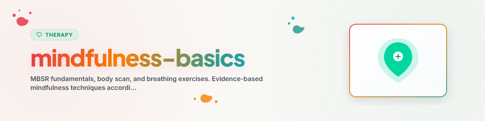

> **Français** — Version française officielle de la compétence `mindfulness-basics`.

# Bases de la pleine conscience

> Fondements MBSR, scan corporel (bodyscan) et exercices respiratoires pour le quotidien

Voir : [ETHICS.md](../ETHICS.md)

---

## Contexte

La pleine conscience (*Mindfulness*) est l'attention intentionnelle et sans jugement portée sur l'instant présent. Le programme MBSR (*Mindfulness-Based Stress Reduction*, Kabat-Zinn 1979) est le programme de pleine conscience fondé sur les preuves le plus connu.

**Remarque :** Il s'agit d'un soutien, pas d'un substitut à une thérapie professionnelle.
**Ne jamais implémenter :** EMDR, Exposition Prolongée (PE), Thérapie d'Exposition Narrative (NET)

---

## 1. Attitudes fondamentales de la pleine conscience (Kabat-Zinn)

| Attitude | Description | Contraire à éviter |
|----------|-------------|--------------------|
| Non-jugement | Observer sans évaluer | « C'est bien / mauvais » |
| Patience | Les choses se déploient à leur propre rythme | Se presser, forcer |
| Esprit du débutant | Rester ouvert, comme si c'était la première fois | Suppositions, posture d'expert |
| Confiance | En sa propre expérience et son intuition | Se reposer uniquement sur les autres |
| Non-effort | Simplement être, sans devoir performer | Recherche de performance |
| Acceptation | Voir les choses telles qu'elles sont | Lutter contre la réalité |
| Lâcher-prise | Laisser passer les expériences | S'accrocher, retenir |

---

## 2. Exercices de respiration

### 2.1 Conscience simple du souffle (5 minutes)

**Objectif :** S'ancrer dans l'instant présent, apaiser le système nerveux.

**Instructions :**
1. Prendre une posture assise confortable (chaise, sol, coussin)
2. Fermer les yeux ou abaisser doucement le regard
3. Porter l'attention sur la respiration
4. Observer : Où est-ce que je sens le souffle ? (bout du nez, cage thoracique, ventre)
5. Des pensées arrivent ? → Les remarquer avec bienveillance, revenir au souffle
6. Aucun autre but que : être avec le souffle

**Prise de conscience :** Les pensées vont et viennent comme des nuages — tu es le ciel derrière.

---

### 2.2 Technique respiratoire 4-7-8 (Apaisement)

**Objectif :** Activation du système parasympathique, réduction du stress.

**Déroulement :**
1. Inspirer : 4 secondes
2. Retenir : 7 secondes
3. Expirer : 8 secondes (plus long que l'inspiration !)
4. Répéter : 3 à 4 cycles

**Quand l'utiliser :** Avant de dormir, en cas de stress aigu, avant des situations difficiles.

---

### 2.3 Respiration carrée (Box Breathing)

**Objectif :** Équilibre, concentration (utilisée aussi par les Navy SEALs et les sportifs de haut niveau).

**Déroulement :**
1. Inspirer : 4 secondes
2. Retenir : 4 secondes
3. Expirer : 4 secondes
4. Retenir : 4 secondes
5. Répéter : 4 cycles

---

## 3. Scan corporel (Bodyscan)

**Objectif :** Développer la conscience corporelle, repérer et relâcher les tensions.
**Durée :** 10 à 30 minutes (variante courte : 5 minutes possible)

**Instructions (version courte) :**

```
1. Position allongée sur le dos ou assise confortable
2. Fermer les yeux, 3 respirations profondes
3. Porter l'attention sur la plante des pieds
   - Percevoir : température, pression, contact avec le sol
   - Ne rien modifier, juste observer
4. Remonter lentement :
   Pieds -> Mollets -> Genoux -> Cuisses
   -> Bassin -> Ventre -> Poitrine -> Épaules
   -> Bras -> Mains -> Cou -> Visage -> Tête
5. En cas de tension : inspirer dans la zone, relâcher à l'expiration
6. À la fin : percevoir l'ensemble du corps comme un tout
7. Revenir doucement dans la pièce
```

**Note de suivi après l'exercice :**
- Qu'ai-je remarqué ?
- Où y avait-il de la tension ?
- Comment est-ce que je me sens maintenant par rapport à avant ?

---

## 4. Technique STOP (mini pleine conscience au quotidien)

**S** — **Stop :** Faire une pause, quoi que tu sois en train de faire
**T** — **Take a breath :** Prendre une respiration profonde
**O** — **Observe :** Observer : pensées, émotions, sensations corporelles
**P** — **Proceed :** Continuer consciemment (ou décider de la suite)

**Usage :** Courte pause à tout moment, en particulier lors d'un pic de stress ou d'une décision.

---

## 5. Pleine conscience au quotidien (Pratique informelle)

Pas le temps pour des exercices formels ? Pratiquer la pleine conscience dans les activités du quotidien :

| Activité | Point d'attention de pleine conscience |
|----------|----------------------------------------|
| Manger | Percevoir consciemment le goût, la texture, l'odeur |
| Marcher | Sentir chaque pas (contact au sol, transfert de poids) |
| Se brosser les dents | Faire uniquement cela, sans penser à autre chose |
| Faire la vaisselle | Température de l'eau, sons, mouvements |
| Conduire | Être pleinement présent (pas de radio, pas de rumination) |
| Temps d'attente | Au lieu du téléphone : observer l'environnement, respirer |

---

## 6. Aperçu du programme MBSR (8 semaines)

Le programme MBSR complet comme référence :

| Semaine | Thème principal |
|---------|-----------------|
| 1 | Pilote automatique vs pleine conscience |
| 2 | Faire face aux obstacles |
| 3 | Pleine conscience dans le corps (yoga) |
| 4 | Reconnaître les réactions de stress |
| 5 | Facteurs de stress et réagir vs répondre |
| 6 | Communication consciente |
| 7 | Prendre soin de soi |
| 8 | La pleine conscience dans la vie quotidienne |

---

## Éthique et limites

**Un assistant IA peut :**
- Expliquer et guider des exercices de pleine conscience
- Transmettre les contenus MBSR (psychoéducation)
- Guider des exercices respiratoires et le bodyscan
- Expliquer la technique STOP et encourager sa pratique

**Un assistant IA ne doit PAS :**
- Remplacer des cours formels de MBSR
- Guider la pleine conscience chez des patients traumatisés sans accompagnement professionnel
- Traiter thérapeutiquement une dissociation ou des flashbacks
- Donner des recommandations relatives aux médicaments

**Suivi d'évolution :**
- Humeur avant/après l'exercice (échelle 0-10)
- Suivre la régularité (ai-je pratiqué aujourd'hui ?)
- Points notables : où l'attention a-t-elle été difficile à maintenir ?

---

## Références bibliographiques

- Kabat-Zinn, J. (1990). *Full Catastrophe Living: Using the Wisdom of Your Body and Mind to Face Stress, Pain, and Illness.* Delacorte Press.

---

*Porté depuis BACH v3.8.0 | Version autonome*
*Sources : Kabat-Zinn (1990), programme MBSR — Pas de thérapie professionnelle*

## Journal des modifications

### 1.0.1 (2026-11-22)
- Indication de langue corrigée
