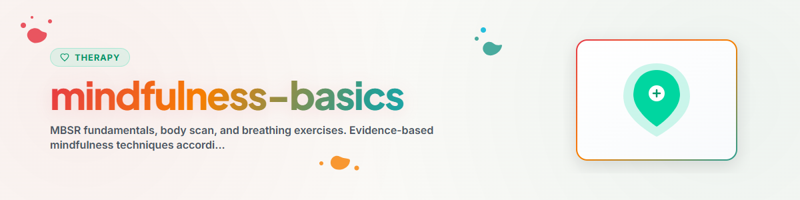

# Atenção Plena Básica

> Fundamentos do MBSR, varredura corporal e exercícios de respiração para o dia a dia

Veja: [ETHICS.md](../ETHICS.md)

---

## Contexto

Atenção plena (Mindfulness) é a atenção intencional e sem julgamento ao momento presente. O MBSR (Mindfulness-Based Stress Reduction, Kabat-Zinn 1979) é o programa de atenção plena baseado em evidências mais conhecido.

**Nota:** Isto é apoio, não um substituto para a terapia profissional.
**Nunca implementar:** EMDR, Prolonged Exposure (PE), Narrative Exposure Therapy (NET)

---

## 1. Atitudes Fundamentais da Atenção Plena (Kabat-Zinn)

| Atitude | Descrição | Evitar o oposto |
|---------|-------------|---------------------|
| Não julgar | Observar sem avaliar | "Isso é bom/ruim" |
| Paciência | As coisas se desdobram no seu próprio tempo | Apressar, forçar |
| Mente de principiante | Estar aberto, como se fosse a primeira vez | Suposições, status de especialista |
| Confiança | Na própria experiência e intuição | Depender dos outros |
| Não se esforçar | Simplesmente ser, não precisar | Orientação ao desempenho |
| Aceitação | Ver as coisas como elas são | Lutar contra a realidade |
| Deixar ir | Deixar as experiências passarem | Apegar-se, agarrar-se |

---

## 2. Exercícios de Respiração

### 2.1 Consciência Simples da Respiração (5 minutos)

**Objetivo:** Ancorar-se no momento presente, acalmar o sistema nervoso.

**Instruções:**
1. Assumir uma posição sentada confortável (cadeira, chão, almofada)
2. Fechar os olhos ou direcionar o olhar suavemente para baixo
3. Direcionar a atenção para a respiração
4. Perceber: Onde sinto a respiração? (ponta do nariz, tórax, abdômen)
5. Surgiram pensamentos? -> Notar gentilmente e voltar à respiração
6. Nenhum objetivo além de: estar com a respiração

**Compreensão:** Os pensamentos surgem e passam como nuvens — você é o céu por trás delas.

---

### 2.2 Técnica de Respiração 4-7-8 (Acalmar)

**Objetivo:** Ativação do parassimpático, redução do estresse.

**Sequência:**
1. Inspirar: 4 segundos
2. Reter: 7 segundos
3. Expirar: 8 segundos (mais longo que a inspiração!)
4. Repetir: 3-4 ciclos

**Quando usar:** Antes de dormir, em estresse agudo, antes de situações difíceis.

---

### 2.3 Respiração Quadrada (Box Breathing)

**Objetivo:** Equilíbrio, concentração (também usada por Navy SEALs e atletas de alto rendimento).

**Sequência:**
1. Inspirar: 4 segundos
2. Reter: 4 segundos
3. Expirar: 4 segundos
4. Reter: 4 segundos
5. Repetir: 4 ciclos

---

## 3. Varredura Corporal (Bodyscan)

**Objetivo:** Desenvolver a consciência corporal, perceber e soltar tensões.
**Duração:** 10-30 minutos (versão curta: 5 minutos são possíveis)

**Instruções (versão resumida):**

```
1. Rückenlage oder bequemes Sitzen
2. Augen schließen, 3 tiefe Atemzüge
3. Aufmerksamkeit zu den Fußsohlen bringen
   - Wahrnehmen: Temperatur, Druck, Kontakt zum Boden
   - Kein Verändern, nur beobachten
4. Langsam hinaufwandern:
   Füße -> Unterschenkel -> Knie -> Oberschenkel
   -> Becken -> Bauch -> Brust -> Schultern
   -> Arme -> Hände -> Hals -> Gesicht -> Kopf
5. Bei Anspannung: Einatmen in den Bereich, beim Ausatmen loslassen
6. Am Ende: Gesamten Körper als Ganzes wahrnehmen
7. Sanft zurück in den Raum kommen
```

**Registro depois:**
- O que eu notei?
- Onde havia tensão?
- Como me sinto agora em comparação com antes?

---

## 4. Técnica STOP (Mini Atenção Plena no Dia a Dia)

**S** — **Stop (Pare):** Interromper o que quer que esteja fazendo
**T** — **Take a breath (Respire):** Fazer uma respiração profunda
**O** — **Observe (Observe):** Observar: pensamentos, sentimentos, sensações corporais
**P** — **Proceed (Prossiga):** Continuar conscientemente (ou decidir o próximo passo)

**Uso:** Uma pausa curta a qualquer momento, especialmente em situações de estresse ou decisões.

---

## 5. Atenção Plena no Cotidiano (Prática Informal)

Sem tempo para exercícios formais? Torne atividades cotidianas conscientes:

| Atividade | Foco da Atenção Plena |
|------------|-------------------|
| Comer | Perceber conscientemente sabor, textura, aroma |
| Caminhar | Sentir cada passo (contato com o chão, transferência de peso) |
| Escovar os dentes | Fazer apenas isso, sem pensar em outras coisas |
| Lavar louça | Temperatura da água, sons, movimentos |
| Dirigir | Estar totalmente presente (sem rádio, sem ruminação) |
| Tempos de espera | Em vez do celular: observar o ambiente, respirar |

---

## 6. Visão Geral do Programa MBSR (8 Semanas)

O programa MBSR completo como referência:

| Semana | Foco |
|-------|-------|
| 1 | Piloto automático vs. atenção plena |
| 2 | Lidar com obstáculos |
| 3 | Atenção plena no corpo (Yoga) |
| 4 | Reconhecer reações de estresse |
| 5 | Fatores de estresse e reagir vs. responder |
| 6 | Comunicação consciente |
| 7 | Autocuidado |
| 8 | Atenção plena na vida cotidiana |

---

## Ética e Limites

**Um assistente de IA pode:**
- Explicar e orientar exercícios de atenção plena
- Transmitir conteúdos do MBSR (psicoeducação)
- Orientar exercícios de respiração e varredura corporal
- Explicar a técnica STOP e encorajar seu uso

**Um assistente de IA NÃO pode:**
- Substituir cursos formais de MBSR
- Orientar atenção plena para pacientes com trauma sem acompanhamento profissional
- Trabalhar terapeuticamente dissociação ou flashbacks
- Dar recomendações relacionadas a medicamentos

**Acompanhamento da evolução:**
- Humor antes/depois do exercício (escala de 0 a 10)
- Acompanhar a regularidade (pratiquei hoje?)
- Particularidades: Onde a atenção foi difícil de manter?

---

## Referências

- Kabat-Zinn, J. (1990). *Full Catastrophe Living: Using the Wisdom of Your Body and Mind to Face Stress, Pain, and Illness.* Delacorte Press.

---

*Adaptado do BACH v3.8.0 | Versão standalone*
*Fontes: Kabat-Zinn (1990), programa MBSR — Não é terapia profissional*
