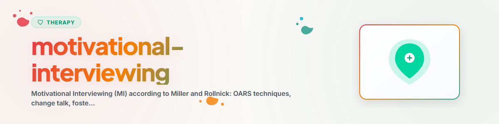

> **Français** — Version française officielle de la compétence `motivational-interviewing`.

# Entretien motivationnel (Motivational Interviewing)

> Techniques OARS, stades de disposition au changement et discours-changement (Change Talk) : encourager la motivation au changement sans pression ni manipulation

Voir : [ETHICS.md](../ETHICS.md)

---

## Contexte

L'entretien motivationnel (*Motivational Interviewing*, MI) a été développé par William R. Miller et Stephen Rollnick.
Il s'agit d'une approche d'accompagnement centrée sur le client et directive visant à stimuler
la motivation intrinsèque au changement. Le MI est utilisé sur la base de preuves dans le traitement
des addictions, les comportements de santé, l'observance thérapeutique et le changement comportemental.

Données probantes : plus de 200 essais contrôlés randomisés attestent de l'efficacité du MI,
notamment dans les conduites addictives (Lundahl et al. 2010, revue Cochrane), les comportements
de santé et l'observance des soins.

**Remarque :** ceci est un soutien, pas un substitut à une thérapie professionnelle.
**Ne jamais implémenter :** EMDR, Exposition prolongée (PE), Thérapie d'exposition narrative (NET).

---

## 1. Posture fondamentale du MI

### Les quatre principes de base

1. **Partenariat :** collaboration d'égal à égal, pas de posture d'expert supérieur
2. **Acceptation :** respecter l'autonomie, reconnaître les forces, valeur absolue de la personne
3. **Compassion :** le bien-être de la personne passe avant tout
4. **Évocation :** la motivation est déjà présente chez la personne — elle est suscitée, pas implantée de force

### L'esprit du MI
Le MI n'est pas une simple boîte à outils technique, mais une posture. Les techniques ne fonctionnent
que dans le cadre de cette attitude de base. Sans elle, le MI devient de la manipulation.

---

## 2. Techniques OARS

OARS désigne les quatre compétences clés de l'entretien motivationnel.

### O — Open Questions (Questions ouvertes)

**Principe :** poser des questions qui invitent à réfléchir et à raconter, impossibles à résoudre par Oui/Non.

**Exemples :**
- « Qu'aimeriez-vous voir changer ? »
- « À quoi ressemblerait votre vie si vous aviez réussi ce changement ? »
- « Qu'est-ce qui vous a amené à y réfléchir ? »
- « Qu'est-ce qui compte pour vous concernant votre santé ? »
- « Que gagneriez-vous en changeant cela ? »

**À éviter :**
- Questions fermées : « Voulez-vous arrêter de fumer ? »
- Questions suggestives : « Vous savez pourtant que c'est nocif ? »
- Questions en « Pourquoi » : « Pourquoi avez-vous fait ça ? » (sonne accusateur)

---

### A — Affirming (Valoriser / Encourager)

**Principe :** reconnaître les forces, les efforts et les pas positifs de l'interlocuteur.
Ne pas flatter (« Tu es formidable »), mais nommer concrètement ce qui a été observé.

**Exemples :**
- « Il faut du courage pour en parler ouvertement. »
- « Vous avez réussi à tenir trois jours — cela montre que vous prenez cela au sérieux. »
- « Malgré une situation difficile, vous êtes venu aujourd'hui — cela témoigne de votre engagement. »
- « Vous y avez manifestement beaucoup réfléchi. »

**Quand l'utiliser :**
- Lorsque la personne décrit des pas vers le changement
- Lorsqu'elle persévère malgré des revers
- Pour renforcer le sentiment d'auto-efficacité

---

### R — Reflecting (Refléter)

**Principe :** restituer ce qui a été dit avec ses propres mots — pour montrer sa compréhension
et inviter la personne à poursuivre sa réflexion.

**Types de reflets :**

| Type | Description | Exemple |
|------|-------------|---------|
| Simple | Répéter/paraphraser le contenu | « Vous dites que c'est difficile pour vous. » |
| Complexe (approfondi) | Saisir le sous-entendu | « On dirait que vous êtes tiraillé(e). » |
| Double face | Refléter les deux pôles de l'ambivalence | « D'un côté vous voulez arrêter, de l'autre cela vous apporte quelque chose. » |
| Amplifié | Accentuer légèrement (avec prudence !) | « Il n'y a donc absolument aucune raison de changer quoi que ce soit ? » |

**Reflet double face (ambivalence) :**
```
« D'un côté, vous dites vouloir boire moins d'alcool.
De l'autre, l'aspect convivial du verre après le travail compte pour vous.
Les deux se comprennent. »
```

---

### S — Summarizing (Résumer)

**Principe :** rassembler les éléments de l'entretien — en mettant particulièrement en valeur le discours-changement.

**Types :**
- **Collectif :** synthétiser plusieurs points
- **De liaison :** relier l'ancien au présent
- **De transition :** en fin d'entretien, introduit les prochaines étapes

**Exemple :**
```
« Laissez-moi résumer ce que j'ai entendu jusqu'ici :
Vous avez remarqué que votre sommeil s'est dégradé et que cela affecte
votre travail. Vous avez déjà essayé de boire moins de caféine, et cela
a partiellement aidé. Il est important pour vous d'être en forme et performant.
En même temps, le plaisir du café le matin compte pour vous.
Est-ce exact ? Que souhaitez-vous ajouter ? »
```

---

## 3. Stades de disposition au changement (Modèle transthéorique)

### Les stades (Prochaska & DiClemente)

| Stade | Description | Stratégie MI |
|-------|-------------|--------------|
| Précontemplation (sans intention) | Pas de conscience du problème, pas d'intention de changer | Informer, éveiller la curiosité, ne pas pousser |
| Contemplation (formation d'intention) | Ambivalence : « Je devrais peut-être... » | Explorer l'ambivalence, favoriser le discours-changement |
| Préparation | Décision prise, un plan est élaboré | Soutenir la planification, renforcer la confiance |
| Action | Mise en œuvre active du changement | Valoriser, travailler les obstacles |
| Maintien | Stabiliser le changement | Prévention des rechutes, célébrer les réussites |
| Rechute | Retour à l'ancien comportement | Normaliser, remotiver, tirer parti de l'expérience |

**Important :** une rechute n'est pas un échec, mais une étape du processus de changement.

### Identifier le stade

**Questions directrices :**
- « Avez-vous déjà songé à changer quelque chose ? » (Précontemplation vs Contemplation)
- « Qu'est-ce qui plaide pour, qu'est-ce qui plaide contre ? » (Explorer l'ambivalence)
- « Avez-vous déjà des idées concrètes sur la manière de procéder ? » (Préparation)
- « Qu'avez-vous déjà essayé ? » (Expérience d'action)

---

## 4. Repérer et renforcer le discours-changement (Change Talk)

### Qu'est-ce que le Change Talk ?

Le Change Talk regroupe les propos de la personne orientés vers le changement.
Le MI vise à amplifier le Change Talk et à ne pas renforcer le Sustain Talk (maintien du statu quo).

### Cadre DARN-CAT

**Change Talk préparatoire (DARN) :**
- **D**esire (Désir) : « J'aimerais bien... »
- **A**bility (Capacité) : « Je pourrais... »
- **R**easons (Raisons) : « Ce serait mieux parce que... »
- **N**eed (Besoin) : « Il faut que je change quelque chose... »

**Change Talk mobilisateur (CAT) :**
- **C**ommitment (Engagement) : « Je vais... »
- **A**ctivation (Activation) : « Je suis prêt(e)... »
- **T**aking Steps (Passage à l'acte) : « J'ai déjà... »

### Susciter le Change Talk

**Stratégies :**
1. **Poser des questions ouvertes :**
   - « Que gagneriez-vous si quelque chose changeait ? »
   - « Qu'est-ce qui vous donne confiance en votre capacité d'y arriver ? »

2. **Échelle d'importance et de confiance :**
   - « À quel point ce changement est-il important pour vous sur une échelle de 0 à 10 ? »
   - « À quel point êtes-vous confiant(e) de pouvoir y parvenir ? »
   - « Pourquoi un 5 et pas un 2 ? » (renforce la motivation existante)

3. **Explorer les extrêmes :**
   - « Quel serait le pire scénario si rien ne changeait ? »
   - « Quel serait le meilleur scénario possible si vous changez cela ? »

4. **Regarder en arrière et se projeter :**
   - « Comment était-ce avant que ce sujet n'apparaisse ? »
   - « Où vous voyez-vous dans cinq ans si tout reste identique ? »

---

## 5. Gérer la résistance

### La résistance comme signal

Dans le MI, la « résistance » est interprétée comme le signe que l'accompagnant va trop vite
ou ne respecte pas suffisamment l'autonomie de la personne.

### Stratégies

| Situation | Réaction |
|-----------|----------|
| « Je n'ai aucun problème » | Accepter, ne pas argumenter, montrer de la curiosité |
| « Vous ne me comprenez pas » | Refléter : « Il est important pour vous d'être compris(e) » |
| « Ça ne marchera pas de toute façon » | Explorer les réussites passées, renforcer la confiance |
| La personne se met en colère | Ralentir le rythme, réaffirmer l'autonomie, refléter avec empathie |

**Règle d'or :** ne jamais argumenter contre la résistance. Accompagner la résistance
(*Rolling with Resistance*), ne pas s'y opposer frontalement.

---

## Éthique et limites

**Un assistant IA peut :**
- Appliquer les techniques OARS pour stimuler la réflexion
- Repérer et refléter le discours-changement
- Donner des informations sur les processus de changement
- Explorer l'ambivalence avec respect

**Un assistant IA ne doit PAS :**
- Forcer ou manipuler le changement
- Prendre des décisions à la place de la personne
- Conduire une thérapie des addictions ou un accompagnement de sevrage
- Recourir aux menaces ou aux appels à la peur
- Saper l'autonomie de la personne

**Principe clé :** c'est la personne qui décide. Un assistant IA soutient le processus de réflexion.

**En cas de signes de crise aiguë, TOUJOURS orienter vers :**
- Telefonseelsorge (DE) : 0800 111 0 111 / 0800 111 0 222
- Urgences psychiatriques : 112
- Chat de crise (DE) : krisenchat.de

---

*Porté depuis BACH v3.8.0 | Version autonome*
*Sources : Miller & Rollnick (2013), Prochaska & DiClemente (1983), Lundahl et al. (2010) — Ne remplace pas une thérapie professionnelle*

## Journal des modifications

### 1.0.1 (2026-11-22)
- Mention linguistique corrigée.
