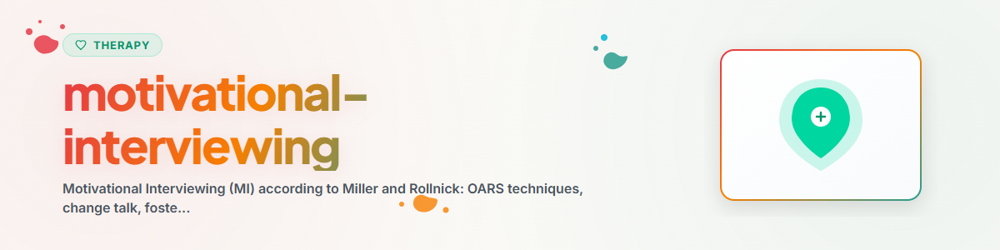

# प्रेरक परामर्श (Motivational Interviewing)

> OARS-तकनीकें, परिवर्तन की तत्परता के चरण और परिवर्तन-वार्ता: दबाव या हेरफेर के बिना परिवर्तन की प्रेरणा बढ़ाना

देखें: [ETHICS.md](../ETHICS.md)

---

## संदर्भ

Motivational Interviewing (MI) को William R. Miller और Stephen Rollnick ने विकसित किया था।
यह एक क्लाइंट-केंद्रित, निर्देशात्मक परामर्श दृष्टिकोण है, जो आंतरिक परिवर्तन-प्रेरणा को बढ़ावा देता है।
MI का प्रमाण-आधारित रूप से उपयोग लत उपचार, स्वास्थ्य-व्यवहार, थेरेपी-अनुपालन (Adherence) और व्यवहार-परिवर्तन में किया जाता है।

प्रमाण: 200 से अधिक RCTs MI की प्रभावशीलता की पुष्टि करते हैं, विशेषकर लत-व्यवहार में (Lundahl et al. 2010, Cochrane Review),
स्वास्थ्य-व्यवहार और थेरेपी-निष्ठा में।

**सूचना:** यह सहायता है, पेशेवर थेरेपी का विकल्प नहीं।
**कभी लागू न करें:** EMDR, Prolonged Exposure (PE), Narrative Exposure Therapy (NET)

---

## 1. MI का मूल दृष्टिकोण

### चार मूल सिद्धांत

1. **साझेदारी:** बराबरी के स्तर पर सहयोग, विशेषज्ञता का दिखावा नहीं
2. **स्वीकृति:** स्वायत्तता का सम्मान करना, शक्तियों को स्वीकारना, व्यक्ति के पूर्ण मूल्य को मानना
3. **सहानुभूति:** व्यक्ति की भलाई सर्वोपरि है
4. **उभारना (Evokation):** प्रेरणा व्यक्ति के भीतर पहले से मौजूद है — उसे बाहर लाया जाता है, भीतर डाला नहीं जाता

### MI की भावना
MI तकनीकों का संग्रह नहीं, बल्कि एक दृष्टिकोण है। तकनीकें केवल इसी दृष्टिकोण के संदर्भ में कार्य करती हैं।
इसके बिना MI हेरफेर बन जाता है।

---

## 2. OARS-तकनीकें

OARS प्रेरक परामर्श की चार मुख्य दक्षताएँ हैं।

### O — Open Questions (खुले प्रश्न)

**सिद्धांत:** ऐसे प्रश्न पूछना जो सोचने और बताने के लिए आमंत्रित करें, जिनका उत्तर हाँ/नहीं में न दिया जा सके।

**उदाहरण:**
- "तुम क्या बदलते देखना चाहोगे?"
- "अगर तुमने यह परिवर्तन कर लिया होता, तो तुम्हारा जीवन कैसा दिखता?"
- "किस बात ने तुम्हें इस पर सोचने के लिए प्रेरित किया?"
- "तुम्हारे लिए अपने स्वास्थ्य में क्या मायने रखता है?"
- "अगर तुम यह बदलते, तो तुम्हें क्या मिलता?"

**बचें:**
- बंद प्रश्न: "क्या तुम धूम्रपान छोड़ना चाहते हो?"
- सुझावात्मक प्रश्न: "तुम्हें पता है न कि यह हानिकारक है?"
- क्यों-प्रश्न: "तुमने ऐसा क्यों किया?" (आरोप जैसा लगता है)

---

### A — Affirming (सराहना / सशक्त करना)

**सिद्धांत:** सामने वाले की शक्तियों, प्रयासों और सकारात्मक कदमों को स्वीकार करना।
सामान्य प्रशंसा ("तुम बहुत अच्छे हो") नहीं, बल्कि जो देखा गया उसे ठोस रूप से बताना।

**उदाहरण:**
- "इस बारे में खुलकर बात करने के लिए साहस चाहिए।"
- "तुमने तीन दिन तक टिके रहने में सफलता पाई — यह दिखाता है कि तुम इसे गंभीरता से ले रहे हो।"
- "कठिन परिस्थिति के बावजूद तुम आज आए — यह प्रतिबद्धता दिखाता है।"
- "तुमने स्पष्ट रूप से इस पर काफी सोचा है।"

**कब प्रयोग करें:**
- जब व्यक्ति परिवर्तन की दिशा में उठाए गए कदमों का वर्णन करे
- जब वह असफलताओं के बावजूद हार न माने
- आत्म-प्रभावकारिता को मज़बूत करने के लिए

---

### R — Reflecting (परावर्तन / प्रतिबिंबित करना)

**सिद्धांत:** कही गई बात को अपने शब्दों में लौटाना — समझ दिखाने और व्यक्ति को आगे सोचने के लिए प्रेरित करने के लिए।

**परावर्तन के प्रकार:**

| प्रकार | विवरण | उदाहरण |
|-----|-------------|---------|
| सरल | सामग्री दोहराना/पैराफ्रेज़ करना | "तुम कह रहे हो कि यह तुम्हारे लिए कठिन है।" |
| गहरा | अनकहे को उठाना | "लगता है तुम दुविधा में हो।" |
| द्विपक्षीय | द्विधा के दोनों पक्ष प्रतिबिंबित करना | "एक ओर तुम रुकना चाहते हो, दूसरी ओर इससे तुम्हें कुछ मिलता है।" |
| अतिशयोक्ति | हल्का बढ़ा-चढ़ाकर कहना (सावधानी से!) | "तो क्या बदलने का कोई कारण ही नहीं है?" |

**द्विपक्षीय परावर्तन (द्विधा):**
```
"Einerseits sagst du, dass du gerne weniger Alkohol trinken würdest.
Andererseits ist dir der soziale Aspekt beim Feierabendbier wichtig.
Beides macht Sinn."
```

---

### S — Summarizing (सारांश)

**सिद्धांत:** बातचीत को समेटना — विशेष रूप से परिवर्तन-वार्ता (Change Talk) को उभारना।

**प्रकार:**
- **संग्राहक:** कई बिंदुओं को एक साथ समेटना
- **जोड़ने वाला:** पहले की बात को वर्तमान से जोड़ना
- **आगे बढ़ाने वाला:** बातचीत के अंत में, अगले कदमों की भूमिका बाँधना

**उदाहरण:**
```
"Lass mich zusammenfassen, was ich bisher gehört habe:
Du hast bemerkt, dass dein Schlaf sich verschlechtert hat und das
deine Arbeit beeinflusst. Du hast schon mal versucht, weniger Koffein
zu trinken, und das hat teilweise geholfen. Dir ist wichtig, fit und
leistungsfähig zu sein. Gleichzeitig ist dir der Kaffee-Genuss am Morgen
wichtig. Stimmt das so? Was möchtest du ergänzen?"
```

---

## 3. परिवर्तन की तत्परता के चरण (ट्रांसथियोरेटिकल मॉडल)

### चरण (Prochaska & DiClemente)

| चरण | विवरण | MI-रणनीति |
|---------|-------------|-------------|
| इरादाहीनता | समस्या की जागरूकता नहीं, परिवर्तन का इरादा नहीं | सूचना देना, जिज्ञासा जगाना, दबाव न डालना |
| इरादा बनना | द्विधा: "शायद मुझे ... करना चाहिए" | द्विधा को खोजना, परिवर्तन-वार्ता को बढ़ावा देना |
| तैयारी | निर्णय लिया गया, योजना बन रही है | योजना में सहायता, आत्मविश्वास मज़बूत करना |
| कार्य | परिवर्तन का सक्रिय क्रियान्वयन | सशक्त करना, बाधाओं पर काम करना |
| बनाए रखना | परिवर्तन को स्थिर करना | पुनरावृत्ति-रोकथाम, सफलताओं को सराहना |
| पुनरावृत्ति | पुराने व्यवहार में वापसी | सामान्यीकरण करना, फिर से प्रेरित करना, अनुभव से सीखना |

**महत्वपूर्ण:** पुनरावृत्ति विफलता नहीं, बल्कि परिवर्तन-प्रक्रिया का हिस्सा है।

### चरण पहचानना

**मार्गदर्शक प्रश्न:**
- "क्या तुमने कभी कुछ बदलने के बारे में सोचा है?" (इरादाहीनता बनाम इरादा बनना)
- "इसके पक्ष में क्या है, विपक्ष में क्या है?" (द्विधा खोजना)
- "क्या तुम्हारे पास इसे करने के ठोस विचार हैं?" (तैयारी)
- "तुमने पहले क्या-क्या आज़माया है?" (कार्य का अनुभव)

---

## 4. परिवर्तन-वार्ता पहचानना और सशक्त करना

### परिवर्तन-वार्ता क्या है?

परिवर्तन-वार्ता व्यक्ति के वे कथन हैं जो परिवर्तन की दिशा में संकेत करते हैं।
MI का लक्ष्य परिवर्तन-वार्ता को बढ़ाना और यथास्थिति-वार्ता (Sustain Talk, वर्तमान स्थिति बनाए रखने की बात) को बढ़ावा न देना है।

### DARN-CAT ढाँचा

**तैयारी-परक परिवर्तन-वार्ता (DARN):**
- **D**esire (इच्छा): "मैं चाहूँगा/चाहूँगी कि..."
- **A**bility (क्षमता): "मैं कर सकता/सकती हूँ..."
- **R**easons (कारण): "यह बेहतर होगा, क्योंकि..."
- **N**eed (आवश्यकता): "मुझे कुछ बदलना ही होगा..."

**सक्रियकारी परिवर्तन-वार्ता (CAT):**
- **C**ommitment (प्रतिबद्धता): "मैं करूँगा/करूँगी..."
- **A**ctivation (सक्रियता): "मैं तैयार हूँ..."
- **T**aking Steps (कदम उठाना): "मैंने पहले ही ... किया है..."

### परिवर्तन-वार्ता को बढ़ावा देना

**रणनीतियाँ:**
1. **खुले प्रश्न पूछना:**
   - "अगर कुछ बदले, तो तुम्हें क्या मिलेगा?"
   - "किस बात से तुम्हें भरोसा मिलता है कि तुम यह कर सकते हो?"

2. **महत्व और आत्मविश्वास का पैमाना:**
   - "0 से 10 के पैमाने पर यह परिवर्तन तुम्हारे लिए कितना महत्वपूर्ण है?"
   - "तुम्हें कितना भरोसा है कि तुम यह कर पाओगे?"
   - "5 क्यों, 2 क्यों नहीं?" (मौजूदा प्रेरणा को मज़बूत करता है)

3. **चरम स्थितियों की खोज:**
   - "अगर कुछ नहीं बदला, तो सबसे बुरे स्थिति में क्या हो सकता है?"
   - "अगर तुम इसे बदल दो, तो सबसे अच्छा क्या हो सकता है?"

4. **पीछे और आगे देखना:**
   - "यह विषय सामने आने से पहले तब स्थिति कैसी थी?"
   - "अगर सब ऐसा ही रहा, तो तुम पाँच साल बाद स्वयं को कहाँ देखते हो?"

---

## 5. प्रतिरोध से निपटना

### प्रतिरोध एक संकेत के रूप में

MI में "प्रतिरोध" को इस संकेत के रूप में देखा जाता है कि परामर्शदाता बहुत तेज़ी से आगे बढ़ रहा है या व्यक्ति की स्वायत्तता का पर्याप्त सम्मान नहीं कर रहा।

### रणनीतियाँ

| स्थिति | प्रतिक्रिया |
|-----------|----------|
| "मुझे कोई समस्या नहीं है" | स्वीकारना, तर्क न करना, जिज्ञासा दिखाना |
| "तुम मुझे समझते नहीं" | परावर्तन: "तुम्हारे लिए यह महत्वपूर्ण है कि तुम्हें समझा जाए" |
| "यह वैसे भी नहीं चलेगा" | पिछली सफलताएँ खोजना, आत्मविश्वास मज़बूत करना |
| व्यक्ति क्रोधित हो जाता है | गति कम करना, स्वायत्तता पर ज़ोर देना, सहानुभूति से प्रतिबिंबित करना |

**सुनहरा नियम:** प्रतिरोध के विरुद्ध कभी तर्क न करें। प्रतिरोध के साथ चलें (Rolling with Resistance), उसके विरुद्ध नहीं।

---

## नैतिकता और सीमाएँ

**एक AI सहायक यह कर सकता है:**
- चिंतन को बढ़ावा देने के लिए OARS-तकनीकें लागू करना
- परिवर्तन-वार्ता को पहचानना और वापस प्रतिबिंबित करना
- परिवर्तन-प्रक्रियाओं के बारे में जानकारी देना
- द्विधा का सम्मानपूर्वक अन्वेषण करना

**एक AI सहायक यह नहीं कर सकता:**
- परिवर्तन को थोपना या हेरफेर करना
- व्यक्ति के लिए निर्णय लेना
- लत-थेरेपी या नशा-मुक्ति (विथड्रॉल) में सहायता करना
- धमकियाँ या भय-आधारित अपीलें इस्तेमाल करना
- व्यक्ति की स्वायत्तता को कमज़ोर करना

**मूल सिद्धांत:** निर्णय व्यक्ति का है। एक AI सहायक चिंतन-प्रक्रिया में सहयोग देता है।

**तीव्र संकट के संकेत मिलने पर हमेशा इन की ओर निर्देशित करें:**
- टेलीफ़ोनज़ेलज़ॉर्ग (Telefonseelsorge, जर्मनी की हेल्पलाइन): 0800 111 0 111 / 0800 111 0 222
- मनोचिकित्सीय आपातकालीन सेवा: 112
- Krisenchat: krisenchat.de

---

*BACH v3.8.0 से पोर्ट किया गया | स्टैंडअलोन संस्करण*
*स्रोत: Miller & Rollnick (2013), Prochaska & DiClemente (1983), Lundahl et al. (2010) — पेशेवर थेरेपी नहीं*
