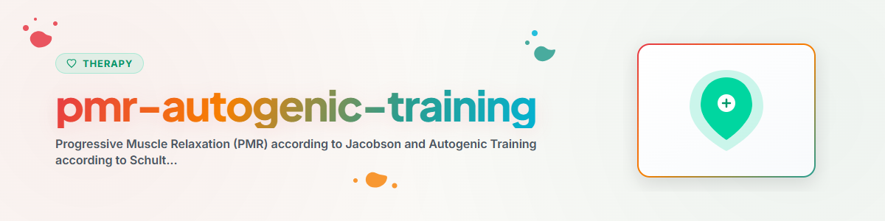

# প্রগতিশীল পেশি শিথিলকরণ ও অটোজেনিক প্রশিক্ষণ

> জ্যাকবসন ও শুল্টস অনুসারে দেহ-ভিত্তিক শিথিলকরণ পদ্ধতি

দেখুন: [ETHICS.md](../ETHICS.md)

---

## প্রেক্ষাপট

প্রগতিশীল পেশি শিথিলকরণ (PMR, Jacobson 1929) এবং অটোজেনিক প্রশিক্ষণ (AT, Schultz 1932)
সবচেয়ে ভালোভাবে গবেষিত দুটি শিথিলকরণ পদ্ধতি। উভয়ই স্বয়ংক্রিয় স্নায়ুতন্ত্রের সচেতন প্রভাবের মাধ্যমে কাজ করে এবং
কোনো থেরাপিউটিক তত্ত্বাবধান ছাড়াই স্ব-সহায়তা পদ্ধতি হিসেবে নিজে নিজে শেখা যায়।

**দ্রষ্টব্য:** এটি সহায়তা, পেশাদার থেরাপির বিকল্প নয়।
**কখনও বাস্তবায়ন করবেন না:** EMDR, Prolonged Exposure (PE), Narrative Exposure Therapy (NET)

---

## ১. জ্যাকবসন অনুসারে প্রগতিশীল পেশি শিথিলকরণ (PMR)

### মূল নীতি

পেশি গোষ্ঠীগুলোকে পদ্ধতিগতভাবে টান দেওয়া ও শিথিল করা। টান ও ছাড়ার মধ্যকার বৈপরীত্যের মাধ্যমে
দেহ স্বাভাবিক অবস্থার চেয়ে গভীরতর শিথিলতা শেখে।

**প্রভাবের পথ:** পেশি টান -> সচেতন ছেড়ে দেওয়া -> প্যারাসিম্প্যাথেটিক সক্রিয়করণ
-> হৃদস্পন্দন, রক্তচাপ, পেশি টোনাস হ্রাস

### ১.১ দীর্ঘ রূপ: ১৬ পেশি গোষ্ঠী

| নং | পেশি গোষ্ঠী | টান |
|----|-------------|------------|
| 1 | ডান হাত/নিচের বাহু | মুষ্টি বাঁধা |
| 2 | ডান উপরের বাহু | বাইসেপ টান দেওয়া |
| 3 | বাম হাত/নিচের বাহু | মুষ্টি বাঁধা |
| 4 | বাম উপরের বাহু | বাইসেপ টান দেওয়া |
| 5 | কপাল | ভ্রু উপরে তোলা |
| 6 | মধ্য মুখমণ্ডল | চোখ কুঁচকানো, নাক কোঁচকানো |
| 7 | নিচের মুখমণ্ডল | দাঁত চেপে ধরা, মুখের কোণ চওড়া করা |
| 8 | ঘাড় | চিবুক বুকের দিকে চাপ দেওয়া (প্রতিরোধ) |
| 9 | বুক/কাঁধ | কাঁধ উপরে তোলা, গভীর শ্বাস নেওয়া |
| 10 | পেট | পেটের পেশি/উদরপ্রাচীর টান দেওয়া |
| 11 | নিচের পিঠ | হালকা পিঠ বাঁকানো |
| 12 | ডান উরু | পা সামান্য তোলা |
| 13 | ডান নিচের পা | পায়ের পাতা শিনের দিকে টানা |
| 14 | ডান পা | আঙুল গুটিয়ে আনা |
| 15 | বাম উরু | পা সামান্য তোলা |
| 16 | বাম নিচের পা/পা | পা টানা, আঙুল গুটিয়ে আনা |

**প্রতি পেশি গোষ্ঠীর ধাপ:**
1. পেশি গোষ্ঠীতে মনোযোগ দেওয়া
2. টান দেওয়া: ৫-৭ সেকেন্ড (সর্বোচ্চ শক্তির প্রায় ৭০%)
3. ছেড়ে দেওয়া: হঠাৎ শিথিল হওয়া
4. অনুভব করা: ২০-৩০ সেকেন্ড শিথিলতা লক্ষ্য করা
5. পরবর্তী পেশি গোষ্ঠী

### ১.২ সংক্ষিপ্ত রূপ: ৭ পেশি গোষ্ঠী

অভিজ্ঞদের জন্য বা সময় কম থাকলে:

| নং | সমন্বয় | টান |
|----|------------|------------|
| 1 | দুই বাহু | মুষ্টি বাঁধা, বাহু বাঁকানো |
| 2 | সম্পূর্ণ মুখমণ্ডল | মুখভঙ্গি: কপাল কুঁচকানো, চোখ বন্ধ, মুখ চওড়া |
| 3 | ঘাড়/কাঁধ | কাঁধ কানের দিকে তোলা |
| 4 | বুক/পেট | শ্বাস নেওয়া, পেট টান দেওয়া |
| 5 | পিঠ | কাঁধের ব্লেড একত্র, হালকা পিঠ বাঁকানো |
| 6 | দুই উরু | পা সামান্য তোলা |
| 7 | দুই নিচের পা/পায়ের পাতা | পায়ের পাতা টানা |

### ১.৩ কল্পনা-কৌশল (উন্নত)

কয়েক সপ্তাহ অনুশীলনের পর: প্রকৃত টান ছাড়াই শুধু কল্পনার মাধ্যমে পেশি গোষ্ঠীর শিথিলকরণ। দেহ শিথিলতার
প্রতিক্রিয়া অভ্যস্ত করে ফেলেছে।

---

## ২. শুল্টস অনুসারে অটোজেনিক প্রশিক্ষণ (AT)

### মূল নীতি

সূত্রবদ্ধ স্বয়ং-পরামর্শের মাধ্যমে মনোযোগমূলক স্ব-শিথিলকরণ। অনুশীলনকারী বারবার নির্দেশবাক্যের মাধ্যমে
গভীর শিথিলতার অবস্থায় প্রবেশ করে (স্বয়ংক্রিয় স্নায়ুতন্ত্রের পরিবর্তন)।

**প্রভাবের পথ:** সূত্রে মনোযোগ -> ইডিওমোটর প্রতিক্রিয়া -> প্রকৃত শারীরিক পরিবর্তন (রক্তপ্রবাহ, উষ্ণতা, প্রশান্তি)

### ২.১ ৬টি মূল অনুশীলন (প্রাথমিক স্তর)

| অনুশীলন | সূত্র | লক্ষ্য |
|--------|--------|------|
| ১. ভারিত্ব | "আমার ডান বাহু সম্পূর্ণ ভারী" | পেশি শিথিলতা |
| ২. উষ্ণতা | "আমার ডান বাহু সম্পূর্ণ উষ্ণ" | রক্তনালী প্রসারণ, রক্তপ্রবাহ |
| ৩. হৃদয় | "আমার হৃদয় শান্ত ও সমানভাবে স্পন্দিত হচ্ছে" | হৃদস্পন্দন নিয়ন্ত্রণ |
| ৪. শ্বাস | "আমার শ্বাস শান্ত ও সমানভাবে চলছে" | শ্বাস নিয়ন্ত্রণ |
| ৫. সৌর জালিকা | "আমার সৌর জালিকা প্রবাহিতভাবে উষ্ণ" | পেটের অঙ্গের শিথিলতা |
| ৬. কপাল | "আমার কপাল আরামদায়কভাবে শীতল" | মাথার স্বচ্ছতা |

**গঠন:** ৬-৮ সপ্তাহে ধাপে ধাপে। প্রতি সপ্তাহে একটি নতুন অনুশীলন যোগ করুন।

### ২.২ একটি সেশনের ধাপ

```
1. Grundhaltung: Kutschersitz, Lehnstuhlhaltung oder Liegen
2. Einstimmung: Augen schliessen, "Ich bin ganz ruhig"
3. Formeln innerlich sprechen (je 6x langsam wiederholen):
   - "Mein rechter Arm ist ganz schwer" (6x)
   - "Mein rechter Arm ist ganz warm" (6x)
   - [weitere Formeln je nach Uebungsstand]
4. Ruheformel dazwischen: "Ich bin ganz ruhig"
5. Ruecknahme: Arme fest anspannen, tief einatmen, Augen oeffnen
   WICHTIG: Ruecknahme nie weglassen (ausser vor dem Einschlafen)
```

### ২.৩ শিক্ষা পরিকল্পনা

| সপ্তাহ | অনুশীলন | সময়কাল |
|-------|--------|---------|
| ১-২ | ভারিত্ব-অনুশীলন | ৫ মিনিট |
| ৩-৪ | ভারিত্ব + উষ্ণতা | ৮ মিনিট |
| ৫-৬ | ভারিত্ব + উষ্ণতা + হৃদয় + শ্বাস | ১২ মিনিট |
| ৭-৮ | সব ৬টি মূল অনুশীলন | ১৫ মিনিট |

---

## ৩. PMR বনাম AT: সিদ্ধান্ত সহায়তা

| মানদণ্ড | PMR | AT |
|-----------|-----|-----|
| শেখার সহজতা | সহজ, সঙ্গে সঙ্গে কার্যকর | অনুশীলন প্রয়োজন (৪-৮ সপ্তাহ) |
| শারীরিক কার্যকলাপ | হ্যাঁ (টান দেওয়া) | না (শুধু কল্পনা) |
| পেশি টানটানতায় | অত্যন্ত উপযুক্ত | মাঝারি উপযুক্ত |
| অভ্যন্তরীণ অস্থিরতায় | ভালো | অত্যন্ত ভালো |
| ঘুমের সমস্যায় | ভালো | অত্যন্ত ভালো |
| সর্বত্র প্রয়োগযোগ্য | সীমিত (নড়াচড়া প্রয়োজন) | হ্যাঁ (অলক্ষিতে) |
| শিশুদের জন্য | প্রায় ৮ বছর থেকে | প্রায় ১০ বছর থেকে |

---

## ৪. প্রতিনির্দেশনা

**PMR:**
- তীব্র পেশি আঘাত বা প্রদাহ
- তীব্র স্প্যাসটিসিটি
- এপিলেপসি (টান দেওয়া খিঁচুনি ঘটাতে পারে — বিরল)

**AT:**
- তীব্র সাইকোসিস
- গুরুতর বিষণ্নতা (আত্ম-অন্তর্দর্শনজনিত ঝুঁকি)
- হৃদস্পন্দনের ব্যাধি (হৃদয় অনুশীলন বাদ দিন)
- বিচ্ছিন্নতামূলক ব্যাধি
- তীব্র হাইপোটেনশন (রক্তসঞ্চালনের সমস্যা সম্ভব)

**উভয় পদ্ধতি:**
- ট্রমা-ফ্ল্যাশব্যাকে অবিলম্বে বন্ধ করুন
- চিকিৎসা/মনোচিকিৎসার বিকল্প হিসেবে ব্যবহার করবেন না

---

## অগ্রগতি পরিমাপ

- অনুশীলনের আগে/পরে টানটানতার স্তর (০-১০ স্কেল)
- কোন পেশি গোষ্ঠী বিশেষভাবে টানটান ছিল?
- AT: কোন সূত্রগুলো ইতিমধ্যে কাজ করছে, কোনগুলো এখনও করছে না?
- নিয়মিততা: লক্ষ্য দিনে ১ বার, সপ্তাহে কমপক্ষে ৪ বার

---

*BACH v3.8.0 থেকে স্থানান্তরিত | স্বতন্ত্র সংস্করণ*
*সূত্র: Jacobson (1929), Schultz (1932) — পেশাদার থেরাপি নয়*
