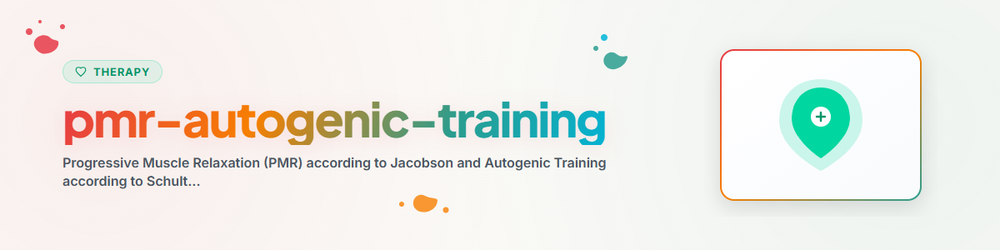

> **Français** — Version française officielle de la compétence `pmr-autogenic-training`.

# Relaxation musculaire progressive et training autogène

> Techniques de relaxation corporelle selon Jacobson et Schultz

Voir : [ETHICS.md](../ETHICS.md)

---

## Contexte

La relaxation musculaire progressive (RMP / PMR, Jacobson 1929) et le training autogène (TA, Schultz 1932) sont les deux techniques de relaxation les mieux étudiées. Toutes deux agissent par une influence consciente sur le système nerveux végétatif et peuvent être apprises comme méthodes d'auto-assistance sans accompagnement thérapeutique.

**Remarque :** Il s'agit d'un soutien, pas d'un substitut à une thérapie professionnelle.
**Ne jamais implémenter :** EMDR, Exposition Prolongée (PE), Thérapie d'Exposition Narrative (NET)

---

## 1. Relaxation musculaire progressive (RMP) selon Jacobson

### Principe fondamental

Contraction et relâchement systématiques de groupes musculaires. Grâce au contraste entre tension et relâchement, le corps apprend une détente plus profonde que celle possible à l'état normal.

**Mécanisme d'action :** Contraction musculaire → relâchement conscient → activation parasympathique → baisse de la fréquence cardiaque, de la pression artérielle et du tonus musculaire

### 1.1 Forme longue : 16 groupes musculaires

| N° | Groupe musculaire | Contraction |
|----|-------------------|-------------|
| 1 | Main/avant-bras droit | Serrer le poing |
| 2 | Bras supérieur droit | Contracter le biceps |
| 3 | Main/avant-bras gauche | Serrer le poing |
| 4 | Bras supérieur gauche | Contracter le biceps |
| 5 | Front | Hausser les sourcils |
| 6 | Milieu du visage | Plisser fortement les yeux et le nez |
| 7 | Bas du visage | Serrer les dents, étirer les commissures des lèvres |
| 8 | Nuque | Pousser le menton vers la poitrine (contre-pression) |
| 9 | Poitrine/épaules | Hausser les épaules, inspirer profondément |
| 10 | Ventre | Contracter la paroi abdominale |
| 11 | Bas du dos | Léger creux lombaire |
| 12 | Cuisse droite | Soulever légèrement la jambe |
| 13 | Jambe inférieure droite | Ramener le pied vers le tibia |
| 14 | Pied droit | Replier les orteils |
| 15 | Cuisse gauche | Soulever légèrement la jambe |
| 16 | Jambe inférieure/pied gauche | Ramener le pied, replier les orteils |

**Déroulement par groupe musculaire :**
1. Porter l'attention sur le groupe musculaire
2. Contracter : 5 à 7 secondes (env. 70 % de la force maximale)
3. Relâcher : détendre d'un coup
4. Ressentir : percevoir la détente pendant 20 à 30 secondes
5. Groupe musculaire suivant

### 1.2 Forme courte : 7 groupes musculaires

Pour les pratiquants expérimentés ou en cas de manque de temps :

| N° | Combinaison | Contraction |
|----|-------------|-------------|
| 1 | Les deux bras | Serrer les poings, plier les bras |
| 2 | Visage complet | Grimace : froncer le front, fermer les yeux, étirer la bouche |
| 3 | Nuque/épaules | Monter les épaules vers les oreilles |
| 4 | Poitrine/ventre | Inspirer, contracter le ventre |
| 5 | Dos | Rapprocher les omoplates, léger creux lombaire |
| 6 | Les deux cuisses | Soulever légèrement les jambes |
| 7 | Les deux mollets/pieds | Ramener les pieds vers soi |

### 1.3 Technique de présentification (niveau avancé)

Après plusieurs semaines de pratique : détente des groupes musculaires UNIQUEMENT par représentation mentale (sans contraction réelle). Le corps a conditionné la réponse de relaxation.

---

## 2. Training autogène (TA) selon Schultz

### Principe fondamental

Auto-détente concentrative par autosuggestions formulées. Le pratiquant se place par des formules répétées dans un état de détente profonde (bascule végétative).

**Mécanisme d'action :** Concentration sur les formules → réaction idéomotrice → modification physique réelle (irrigation sanguine, chaleur, calme)

### 2.1 Les 6 exercices de base (cycle inférieur)

| Exercice | Formule | Objectif |
|----------|---------|----------|
| 1. Pesanteur | « Mon bras droit est tout lourd » | Détente musculaire |
| 2. Chaleur | « Mon bras droit est tout chaud » | Vasodilatation, circulation |
| 3. Cœur | « Mon cœur bat calme et régulier » | Régulation cardiaque |
| 4. Respiration | « Ma respiration est calme et régulière » | Régulation respiratoire |
| 5. Plexus solaire | « Mon plexus solaire est rayonnant de chaleur » | Détente des organes abdominaux |
| 6. Front | « Mon front est agréablement frais » | Clarté mentale |

**Progression :** Étape par étape sur 6 à 8 semaines. Ajouter un nouvel exercice chaque semaine.

### 2.2 Déroulement d'une séance

```
1. Posture de base : posture du cocher, fauteuil ou allongé
2. Mise en condition : fermer les yeux, « Je suis tout à fait calme »
3. Répéter intérieurement les formules (6× lentement chacune) :
   - « Mon bras droit est tout lourd » (6×)
   - « Mon bras droit est tout chaud » (6×)
   - [autres formules selon le niveau de pratique]
4. Formule de calme entre chaque : « Je suis tout à fait calme »
5. Reprise (Rücknahme) : contracter fermement les bras, inspirer profondément, ouvrir les yeux
   IMPORTANT : ne jamais omettre la reprise (sauf avant de s'endormir)
```

### 2.3 Plan d'apprentissage

| Semaine | Exercice | Durée |
|---------|----------|-------|
| 1-2 | Exercice de pesanteur | 5 min |
| 3-4 | Pesanteur + chaleur | 8 min |
| 5-6 | Pesanteur + chaleur + cœur + respiration | 12 min |
| 7-8 | Les 6 exercices de base | 15 min |

---

## 3. RMP vs TA : Aide au choix

| Critère | RMP | TA |
|---------|-----|----|
| Facilité d'apprentissage | Facile, effet immédiat | Demande de l'entraînement (4-8 semaines) |
| Activité physique | Oui (contraction) | Non (uniquement représentation) |
| En cas de tensions musculaires | Très adapté | Moyennement adapté |
| En cas d'agitation intérieure | Bon | Très bon |
| En cas de troubles d'endormissement | Bon | Très bon |
| Utilisable partout | Limité (mouvement nécessaire) | Oui (discret) |
| Pour les enfants | À partir d'env. 8 ans | À partir d'env. 10 ans |

---

## 4. Contre-indications

**RMP :**
- Lésions ou inflammations musculaires aiguës
- Spasticité importante
- Épilepsie (la contraction peut déclencher des crises — rare)

**TA :**
- Psychoses aiguës
- Dépressions sévères (risque lié à l'introspection)
- Troubles du rythme cardiaque (omettre l'exercice du cœur)
- Troubles dissociatifs
- Hypotension sévère (troubles circulatoires possibles)

**Les deux méthodes :**
- Interrompre immédiatement en cas de flashbacks traumatiques
- Ne pas utiliser comme substitut à un traitement médical ou psychothérapeutique

---

## Suivi d'évolution

- Niveau de tension avant/après l'exercice (échelle 0-10)
- Quels groupes musculaires étaient particulièrement tendus ?
- TA : quelles formules agissent déjà, lesquelles pas encore ?
- Régularité : objectif 1× par jour, au moins 4× par semaine

---

*Porté depuis BACH v3.8.0 | Version autonome*
*Sources : Jacobson (1929), Schultz (1932) — Pas de thérapie professionnelle*

## Journal des modifications

### 1.0.1 (2026-11-22)
- Indication de langue corrigée
