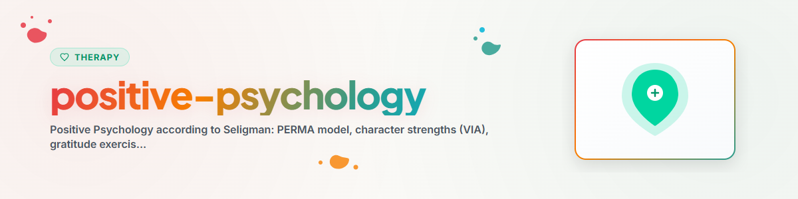

> **Français** — Version française officielle de la compétence `positive-psychology`.

# Psychologie positive

> Centration sur les forces, gratitude, Flow et modèle PERMA selon Seligman et Csikszentmihalyi

Voir : [ETHICS.md](../ETHICS.md)

---

## Contexte

La psychologie positive est l'étude scientifique de ce qui rend la vie
digne d'être vécue (Seligman & Csikszentmihalyi, 2000). À la différence de la psychologie
clinique (qu'est-ce qui rend malade ?), elle demande : qu'est-ce qui rend sain, heureux, résilient ?

Fondateurs : Martin Seligman (président de l'APA en 1998) a lancé le mouvement.
Autres pionniers : Mihaly Csikszentmihalyi (Flow), Christopher Peterson (forces de caractère),
Barbara Fredrickson (Broaden-and-Build), Ed Diener (bien-être subjectif).

**Remarque :** ceci est un soutien, pas un substitut à une thérapie professionnelle.
**Ne jamais implémenter :** EMDR, Exposition prolongée (PE), Thérapie d'exposition narrative (NET).

---

## 1. Modèle PERMA (Seligman, 2011)

Cinq piliers du bien-être selon Seligman (*Flourish*) :

### P — Positive Emotions (Émotions positives)
- Joie, gratitude, sérénité, intérêt, espoir, fierté, amour
- Fredrickson : ratio d'au moins 3:1 entre émotions positives et négatives
- Exercice : « Three Good Things » (voir ci-dessous)

### E — Engagement
- Être totalement absorbé dans une activité (état de Flow)
- Mobiliser ses propres forces au quotidien
- Équilibre entre défi et compétence

### R — Relationships (Relations positives)
- Le lien social comme meilleur prédicteur du bien-être
- Réagir de façon active et constructive aux bonnes nouvelles des autres
- Petites attentions (*Random Acts of Kindness*)

### M — Meaning (Sens)
- Appartenance et contribution à quelque chose de plus grand que soi
- Sens trouvé dans le travail, la famille, la communauté, la spiritualité
- Frankl : « Celui qui a un pourquoi peut supporter presque n'importe quel comment »

### A — Achievement (Accomplissement)
- Vivre l'expérience de la maîtrise et de la compétence
- Fixer des objectifs réalistes et les atteindre
- Grit : persévérance + passion pour des objectifs à long terme (Duckworth, 2016)

---

## 2. Forces de caractère (Classification VIA)

Peterson et Seligman (2004) ont identifié 24 forces de caractère universelles
réparties en 6 catégories de vertus :

| Vertu | Forces |
|-------|--------|
| Sagesse | Créativité, curiosité, discernement, amour de l'apprentissage, perspective |
| Courage | Bravoure, persévérance, honnêteté, enthousiasme |
| Humanité | Amour, gentillesse, intelligence sociale |
| Justice | Travail d'équipe, équité, leadership |
| Tempérance | Pardon, modestie, prudence, autorégulation |
| Transcendance | Appréciation de la beauté, gratitude, espoir, humour, spiritualité |

**Forces signatures :** les 3 à 5 forces qui paraissent les plus authentiques.
Ceux qui utilisent quotidiennement leurs forces signatures sont durablement plus satisfaits et
moins déprimés (Seligman et al. 2005).

**Test VIA :** gratuit sur `viacharacter.org` (validé scientifiquement).

---

## 3. Exercices de gratitude

### 3.1 Three Good Things (Seligman et al. 2005)

**Déroulement :**
1. Chaque soir, noter 3 bonnes choses de la journée
2. Pour chacune, préciser : pourquoi est-ce arrivé ?
3. Durée : au moins 1 semaine, idéalement en continu

**Données probantes :** bien-être nettement accru et symptômes dépressifs réduits
sur 6 mois (Seligman et al. 2005).

### 3.2 Journal de gratitude

Extension de *Three Good Things* :
- Le matin : de quoi suis-je reconnaissant(e) aujourd'hui ? (3 points)
- Le soir : qu'y avait-il de bien aujourd'hui ? Quelle a été ma contribution ?
- Varier les perspectives : personnes, expériences, capacités, petits détails du quotidien

### 3.3 Lettre de gratitude (Gratitude Visit)

**Déroulement :**
1. Identifier une personne que l'on n'a jamais vraiment remerciée
2. Rédiger une lettre concrète (300 mots, précise)
3. Rendre visite à la personne et lui lire la lettre

**Données probantes :** effet à court terme le plus puissant de toutes les interventions de psychologie
positive (Seligman et al. 2005). L'effet dure environ 1 mois.

---

## 4. Théorie du Flow (Csikszentmihalyi, 1990)

### Définition
Le Flow est un état d'absorption totale dans une activité, où l'action
s'écoule sans effort et où le temps et la conscience de soi passent au second plan.

### Conditions du Flow

| Condition | Description |
|-----------|-------------|
| Équilibre | Le défi correspond aux compétences |
| Objectifs clairs | On sait exactement ce qu'il y a à faire |
| Retour direct | Rétroaction immédiate sur la progression |
| Concentration | Pleine attention portée sur la tâche |
| Maîtrise | Sentiment de pouvoir relever la situation |
| Motivation intrinsèque | L'activité est gratifiante en elle-même |

### Canal du Flow

```
Défi
     élevé  |  Anxiété   |  FLOW
            |            |
     faible |  Apathie   |  Ennui
            +------------|----------
              faible       élevée
                    Compétence
```

### Favoriser le Flow
- Éliminer les distractions (téléphone rangé, porte fermée)
- Découper les tâches en unités gérables
- Ajuster le niveau de difficulté (ni trop facile, ni trop ardu)
- Instaurer des plages de pratique régulières

---

## 5. Facteurs de résilience

Résilience = capacité de résistance psychique face aux épreuves.

### Les 7 piliers de la résilience (d'après Reivich & Shatte, 2002)

1. **Régulation émotionnelle :** percevoir et réguler ses propres émotions
2. **Contrôle des impulsions :** piloter consciemment ses actes au lieu de réagir à chaud
3. **Analyse causale :** évaluer les causes de manière réaliste
4. **Auto-efficacité :** confiance en sa propre compétence
5. **Empathie :** reconnaître et comprendre les émotions d'autrui
6. **Optimisme :** anticipation réaliste et positive de l'avenir
7. **Orientation vers les objectifs :** se fixer des objectifs porteurs de sens et les poursuivre

### Entraîner la résilience
- Mobiliser consciemment ses forces (forces VIA)
- Entretenir son réseau social (les relations comme facteur de protection n° 1)
- Prendre soin de soi : sommeil, mouvement, alimentation, récupération
- Flexibilité cognitive : rechercher d'autres points de vue
- Trouver du sens (y compris dans les situations difficiles)

---

## Éthique et limites

**Un assistant IA peut :**
- Expliquer le modèle PERMA et les forces de caractère (psychoéducation)
- Guider et accompagner les exercices de gratitude
- Aborder les conditions du Flow
- Transmettre les facteurs de résilience
- Soutenir la réflexion sur les forces signatures

**Un assistant IA ne doit PAS :**
- Traiter une dépression clinique uniquement par la psychologie positive
- Interpréter cliniquement les résultats du test VIA
- Recommander la psychologie positive comme substitut à une thérapie
- Encourager la positivité toxique (« Sois simplement reconnaissant »)

**Suivi d'évolution :**
- Bien-être avant/après l'exercice (échelle 0-10)
- Série de gratitude : combien de jours consécutifs ?
- Journal de Flow : quand et dans quelle activité ai-je vécu le Flow ?
- Forces signatures : combien de fois mobilisées cette semaine ?

---

*Porté depuis BACH v3.8.0 | Version autonome*
*Sources : Seligman (2011), Csikszentmihalyi (1990), Peterson & Seligman (2004) — Ne remplace pas une thérapie professionnelle*

## Journal des modifications

### 1.0.1 (2026-11-22)
- Mention linguistique corrigée.
