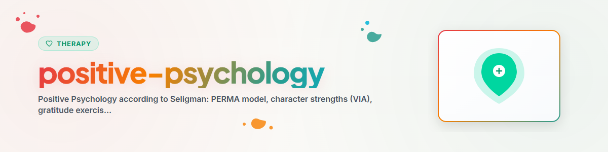

# सकारात्मक मनोविज्ञान

> शक्तियों पर केंद्रित दृष्टिकोण, कृतज्ञता, Flow और सेलिगमैन तथा सिक्सेंटमिहाई के अनुसार PERMA

देखें: [ETHICS.md](../ETHICS.md)

---

## संदर्भ

सकारात्मक मनोविज्ञान उस वैज्ञानिक अध्ययन का नाम है जो जीवन को जीने योग्य बनाने वाली बातों की पड़ताल करता है (Seligman & Csikszentmihalyi, 2000)। नैदानिक मनोविज्ञान के विपरीत (क्या बीमार करता है?), यह पूछता है: क्या स्वस्थ, प्रसन्न और लचीला बनाता है?

संस्थापक: Martin Seligman (APA अध्यक्ष 1998) ने इस आंदोलन की शुरुआत की।
अन्य अग्रणी: Mihaly Csikszentmihalyi (Flow), Christopher Peterson (चरित्र शक्तियाँ), Barbara Fredrickson (Broaden-and-Build), Ed Diener (व्यक्तिपरक कल्याण)।

**नोट:** यह सहायता है, पेशेवर थेरेपी का विकल्प नहीं।
**कभी लागू न करें:** EMDR, Prolonged Exposure (PE), Narrative Exposure Therapy (NET)

---

## 1. PERMA मॉडल (Seligman, 2011)

Seligman ("Flourish") के अनुसार कल्याण के पाँच स्तंभ:

### P — Positive Emotions (सकारात्मक भावनाएँ)
- आनंद, कृतज्ञता, शांति, रुचि, आशा, गर्व, प्रेम
- Fredrickson: सकारात्मक और नकारात्मक भावनाओं का कम से कम 3:1 अनुपात
- अभ्यास: "Three Good Things" (नीचे देखें)

### E — Engagement (संलग्नता)
- किसी कार्य में पूरी तरह डूब जाना (Flow अवस्था)
- दैनिक जीवन में अपनी शक्तियों का उपयोग
- चुनौती और क्षमता के बीच संतुलन

### R — Relationships (सकारात्मक संबंध)
- सामाजिक जुड़ाव कल्याण का सबसे शक्तिशाली पूर्वसूचक है
- दूसरों की अच्छी खबर पर सक्रिय-रचनात्मक प्रतिक्रिया
- छोटी दयालुताएँ (Random Acts of Kindness)

### M — Meaning (अर्थ)
- स्वयं से बड़ी किसी चीज़ से जुड़ाव और उसकी सेवा
- कार्य, परिवार, समुदाय और आध्यात्मिकता से अर्थ
- Frankl: "जिसके पास क्यों है, वह लगभग किसी भी कैसे को सह लेता है"

### A — Achievement (लक्ष्य-प्राप्ति)
- निपुणता और सक्षमता का अनुभव
- यथार्थवादी लक्ष्य तय करना और उन्हें प्राप्त करना
- Grit: दीर्घकालिक लक्ष्यों के लिए दृढ़ता + जुनून (Duckworth, 2016)

---

## 2. चरित्र शक्तियाँ (VIA वर्गीकरण)

Peterson और Seligman (2004) ने 6 गुण-श्रेणियों में 24 सार्वभौमिक चरित्र शक्तियों की पहचान की:

| गुण | शक्तियाँ |
|-----|---------|
| ज्ञान | रचनात्मकता, जिज्ञासा, विवेक, सीखने का प्रेम, दूरदृष्टि |
| साहस | वीरता, दृढ़ता, ईमानदारी, उत्साह |
| मानवता | प्रेम, दयालुता, सामाजिक बुद्धिमत्ता |
| न्याय | टीमवर्क, निष्पक्षता, नेतृत्व क्षमता |
| संयम | क्षमा, विनम्रता, सावधानी, आत्म-नियमन |
| पारलौकिकता | सौंदर्य-बोध, कृतज्ञता, आशा, हास्य, आध्यात्मिकता |

**मुख्य चरित्र शक्तियाँ (Signaturstärken):** वे 3-5 शक्तियाँ जो सबसे प्रामाणिक लगती हैं। जो व्यक्ति अपनी हस्ताक्षर शक्तियों का प्रतिदिन उपयोग करता है, वह प्रमाणित रूप से अधिक संतुष्ट और कम अवसादग्रस्त होता है (Seligman et al. 2005)।

**VIA परीक्षण:** viacharacter.org पर निःशुल्क उपलब्ध (वैज्ञानिक रूप से सत्यापित)

---

## 3. कृतज्ञता अभ्यास

### 3.1 Three Good Things (Seligman et al. 2005)

**प्रक्रिया:**
1. हर शाम दिन की 3 अच्छी बातें लिखें
2. हर एक के लिए लिखें: यह क्यों हुआ?
3. अवधि: कम से कम 1 सप्ताह, आदर्श रूप से स्थायी रूप से

**प्रमाण:** 6 महीनों तक कल्याण में उल्लेखनीय वृद्धि और अवसादग्रस्त लक्षणों में कमी (Seligman et al. 2005)

### 3.2 कृतज्ञता डायरी

Three Good Things का विस्तार:
- सुबह: आज मैं किसके लिए आभारी हूँ? (3 बिंदु)
- शाम: आज क्या अच्छा रहा? मैंने क्या योगदान दिया?
- दृष्टिकोण बदलना: लोग, अनुभव, क्षमताएँ, रोज़मर्रा की बातें

### 3.3 कृतज्ञता पत्र (Gratitude Visit)

**प्रक्रिया:**
1. ऐसे व्यक्ति की पहचान करें जिसका आपने कभी ठीक से धन्यवाद नहीं किया
2. एक ठोस पत्र लिखें (300 शब्द, विशिष्ट)
3. उस व्यक्ति से मिलें और पत्र पढ़कर सुनाएँ

**प्रमाण:** सभी सकारात्मक-मनोविज्ञान हस्तक्षेपों में सबसे मजबूत अल्पकालिक प्रभाव (Seligman et al. 2005)। यह प्रभाव लगभग 1 महीने तक बना रहता है।

---

## 4. Flow सिद्धांत (Csikszentmihalyi, 1990)

### परिभाषा
Flow किसी कार्य में पूर्ण तल्लीनता की अवस्था है, जिसमें क्रिया सहजता से बहती है और समय तथा आत्म-चेतना पृष्ठभूमि में चले जाते हैं।

### Flow की शर्तें

| शर्त | विवरण |
|------|-------|
| संतुलन | चुनौती क्षमताओं के अनुरूप हो |
| स्पष्ट लक्ष्य | स्पष्ट पता हो कि क्या करना है |
| प्रत्यक्ष प्रतिक्रिया | प्रगति पर तत्काल फीडबैक |
| एकाग्रता | कार्य पर पूरा ध्यान |
| नियंत्रण | परिस्थिति को संभाल पाने का भाव |
| आंतरिक प्रेरणा | कार्य अपने आप में पुरस्कृत करने वाला हो |

### Flow चैनल

```
Herausforderung
     hoch   |  Angst    |  FLOW
            |           |
     niedrig|  Apathie  |  Langeweile
            +-----------|----------
              niedrig      hoch
                    Faehigkeit
```

### Flow को बढ़ावा देना
- व्यवधान हटाएँ (फ़ोन दूर रखें, दरवाज़ा बंद करें)
- कार्यों को प्रबंधनीय इकाइयों में बाँटें
- कठिनाई स्तर समायोजित करें (न बहुत आसान, न बहुत कठिन)
- नियमित अभ्यास समय तय करें

---

## 5. लचीलापन (Resilience) कारक

लचीलापन = तनाव के प्रति मानसिक प्रतिरोध क्षमता।

### लचीलापन के 7 स्तंभ (Reivich & Shatte, 2002 के अनुसार)

1. **भावना-नियमन:** अपनी भावनाओं को पहचानना और उन्हें नियंत्रित करना
2. **आवेग-नियंत्रण:** प्रतिक्रिया देने के बजाय सोच-समझकर कार्य करना
3. **कारण-विश्लेषण:** कारणों का यथार्थवादी आकलन
4. **आत्म-प्रभावकारिता:** अपनी क्षमता पर विश्वास
5. **सहानुभूति:** दूसरों की भावनाओं को पहचानना और समझना
6. **आशावाद:** यथार्थवादी, सकारात्मक भविष्य-अपेक्षा
7. **लक्ष्य-उन्मुखता:** सार्थक लक्ष्य तय करना और उनका पीछा करना

### लचीलापन का प्रशिक्षण
- शक्तियों का सचेत उपयोग (VIA शक्तियाँ)
- सामाजिक नेटवर्क का पोषण (संबंध सबसे प्रमुख सुरक्षात्मक कारक)
- आत्म-देखभाल: नींद, व्यायाम, पोषण, विश्राम
- संज्ञानात्मक लचीलापन: वैकल्पिक दृष्टिकोण खोजना
- कठिन परिस्थितियों में भी अर्थ और उद्देश्य खोजना

---

## नैतिकता और सीमाएँ

**एक AI सहायक यह कर सकता है:**
- PERMA मॉडल और चरित्र शक्तियाँ समझाना (मनोशिक्षा)
- कृतज्ञता अभ्यासों का मार्गदर्शन और साथ देना
- Flow की शर्तों पर चर्चा करना
- लचीलापन कारक सिखाना
- हस्ताक्षर शक्तियों के आत्म-चिंतन में सहायता करना

**एक AI सहायक यह बिल्कुल नहीं कर सकता:**
- केवल सकारात्मक मनोविज्ञान से नैदानिक अवसाद का इलाज करना
- VIA परीक्षण के परिणामों की नैदानिक व्याख्या करना
- सकारात्मक मनोविज्ञान को थेरेपी के विकल्प के रूप में सुझाना
- विषाक्त सकारात्मकता को बढ़ावा देना ("बस कृतज्ञ रहो")

**प्रगति मापन:**
- अभ्यास से पहले/बाद कल्याण (0-10 पैमाना)
- कृतज्ञता स्ट्रीक: लगातार कितने दिन?
- Flow लॉग: Flow का अनुभव कब और किस कार्य में होता है?
- हस्ताक्षर शक्तियाँ: इस सप्ताह कितनी बार उपयोग कीं?

---

*BACH v3.8.0 से पोर्ट किया गया | स्टैंडअलोन संस्करण*
*स्रोत: Seligman (2011), Csikszentmihalyi (1990), Peterson & Seligman (2004) — पेशेवर थेरेपी नहीं*
