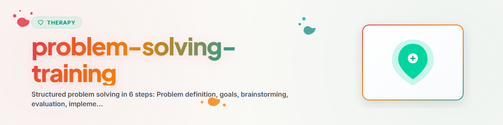

> **Français** — Version française officielle de la compétence `problem-solving-training`.

# Entraînement à la résolution de problèmes

> Résolution structurée de problèmes en 6 étapes selon D'Zurilla et Goldfried : aborder les problèmes méthodiquement plutôt que de tourner en rond dans les ruminations

Voir : [ETHICS.md](../ETHICS.md)

**Voir aussi :** [decide](../../utilities/decide/SKILL.md) (scoring pondéré, matrice d'Eisenhower pour décisions complexes multicritères) | [behavioral-activation](../behavioral-activation/SKILL.md) (planification d'activités en cas de dépression)

---

## Contexte

L'entraînement à la résolution de problèmes (*Social Problem-Solving*, SPS) est une intervention fondée sur les preuves issue de la thérapie cognitivo-comportementale. Il aide à aborder les problèmes de manière systématique et orientée vers les solutions au lieu de se perdre dans la rumination, l'évitement ou l'action impulsive.

Données probantes : Les méta-analyses montrent des effets significatifs dans la dépression (d=0,83), les troubles anxieux et la charge de stress (Malouff et al. 2007, Bell & D'Zurilla 2009).

**Remarque :** Il s'agit d'un soutien, pas d'un substitut à une thérapie professionnelle.
**Ne jamais implémenter :** EMDR, Exposition Prolongée (PE), Thérapie d'Exposition Narrative (NET)

---

## 1. Orientation face aux problèmes

Avant même de commencer les étapes proprement dites, l'attitude intérieure est déterminante.

### Attitude aidante
- « Les problèmes font partie de la vie — ils sont solubles »
- « Je peux avancer étape par étape »
- « Il existe rarement une seule bonne solution »
- « Ne pas agir est aussi une décision — rarement une bonne »

### Attitude bloquante
- « Tout cela n'a aucun sens »
- « Je n'y arriverai de toute façon pas »
- « Il n'y a aucune solution »
- Agir impulsivement sans réfléchir
- Évitement et procrastination

**Première étape :** Réfléchir à sa propre attitude face aux problèmes.

---

## 2. Le modèle en 6 étapes

### Étape 1 : Définir le problème

**Objectif :** Formuler le problème de manière claire, concrète et traitable.

**Questions directrices :**
- Quel est exactement le problème ? (des faits, pas des interprétations)
- Qui est impliqué ?
- Quand et où survient-il ?
- Pourquoi est-ce un problème pour moi ?

**Feuille de travail :**

```
DÉFINITION DU PROBLÈME

Situation : [Que se passe-t-il concrètement ?]
Personnes impliquées : [Qui est impliqué ?]
Fréquence : [À quelle fréquence ? Quand ?]
Impact : [Qu'est-ce qui en fait un problème ?]

Formulation concrète du problème :
[...]
```

**Erreurs typiques :**
- Problème trop vague (« Tout va mal »)
- Mélanger plusieurs problèmes
- Glisser déjà la solution dans la formulation

---

### Étape 2 : Fixer les objectifs

**Objectif :** Qu'est-ce qui doit être différent une fois le problème résolu ?

**Critères SMART :**
- Spécifique : quoi exactement ?
- Mesurable : à quoi vais-je reconnaître le succès ?
- Attractif : pourquoi est-ce que je le veux ?
- Réaliste : est-ce faisable ?
- Temporellement défini : pour quand ?

**Feuille de travail :**

```
FIXATION D'OBJECTIF

Mon objectif : [...]
À quoi vais-je reconnaître que je l'ai atteint ? [...]
Pour quand ? [...]
Réaliste (0-10) ? [...]
Important pour moi (0-10) ? [...]
```

---

### Étape 3 : Recueillir des alternatives (Brainstorming)

**Objectif :** Générer autant d'idées de solutions que possible — sans évaluation immédiate.

**Règles du brainstorming :**
1. La quantité avant la qualité — plus il y a d'idées, mieux c'est
2. Aucune critique pendant la collecte
3. Les idées créatives et inhabituelles sont permises
4. Combiner et varier les idées existantes

**Feuille de travail :**

```
BRAINSTORMING

Idées de solutions (au moins 5 à 8) :
1. [...]
2. [...]
3. [...]
4. [...]
5. [...]
6. [...]
7. [...]
8. [...]
```

**Questions d'aide :**
- « Que ferait quelqu'un qui n'a pas ce problème ? »
- « Qu'ai-je fait par le passé dans des situations similaires ? »
- « Que conseillerais-je à un ami ? »
- « Quelle serait la solution la plus courageuse ? »
- « Quelle serait la solution la plus simple ? »

---

### Étape 4 : Évaluer les alternatives

**Objectif :** Peser systématiquement les avantages et inconvénients de chaque alternative.

**Critères d'évaluation :**
- Efficacité : résout-elle le problème ?
- Faisabilité : puis-je la mettre en œuvre ?
- Temps requis : combien de temps cela prend-il ?
- Conséquences : sur moi ? sur les autres ?
- Risques : qu'est-ce qui pourrait mal tourner ?

**Feuille de travail :**

```
MATRICE D'ÉVALUATION

| Alternative | Efficacité (0-10) | Faisabilité (0-10) | Effort (0-10) | Risque (0-10) | Total |
|-------------|-------------------|--------------------|---------------|---------------|-------|
| 1. [...]    |                   |                    |               |               |       |
| 2. [...]    |                   |                    |               |               |       |
| 3. [...]    |                   |                    |               |               |       |

Solution retenue : [...]
Justification : [...]
```

---

### Étape 5 : Mettre en œuvre

**Objectif :** Planifier concrètement et exécuter la solution retenue.

**Plan de mise en œuvre :**

```
PLAN D'ACTION

Solution retenue : [...]

Étapes concrètes :
1. [Quoi ?] — [Quand ?] — [Où ?]
2. [Quoi ?] — [Quand ?] — [Où ?]
3. [Quoi ?] — [Quand ?] — [Où ?]

Obstacles possibles : [...]
Plan B : [...]
Soutien dont j'ai besoin : [...]
Premier pas (aujourd'hui/demain) : [...]
```

---

### Étape 6 : Évaluer

**Objectif :** Vérifier le résultat et ajuster si nécessaire.

**Questions d'évaluation :**
- Le problème a-t-il été résolu ? (Entièrement / partiellement / pas du tout)
- Suis-je satisfait(e) du résultat ? (0-10)
- Qu'est-ce qui a bien fonctionné ?
- Que ferais-je différemment la prochaine fois ?
- Ai-je besoin d'un nouvel essai avec une autre alternative ?

**Feuille de travail :**

```
ÉVALUATION

Résultat : [Résolu / Partiellement / Non résolu]
Satisfaction (0-10) : [...]
Ce qui a fonctionné : [...]
Ce qui n'a pas fonctionné : [...]
Prochaine étape : [Clôture / Nouvel essai / Autre approche]
```

---

## 3. Difficultés fréquentes lors de la résolution de problèmes

| Difficulté | Remède |
|------------|--------|
| « Je ne sais pas par où commencer » | Revenir à l'étape 1, formuler le problème plus petit |
| « Aucune solution n'est assez bonne » | Questionner le perfectionnisme, accepter « assez bon » |
| « Je n'ose pas » | Identifier le plus petit pas possible |
| « Ça ne marche pas » | Évaluation : qu'est-ce qui coince exactement ? Nouvel essai |
| Le problème est trop vaste | Découper en sous-problèmes, traiter l'un après l'autre |
| Les émotions bloquent | D'abord régulation émotionnelle (respiration, RMP), puis résolution |

---

## Éthique et limites

**Un assistant IA peut :**
- Guider à travers les 6 étapes et fournir la structure des feuilles de travail
- Poser des questions de brainstorming
- Soutenir lors de l'évaluation des alternatives
- Documenter la progression

**Un assistant IA ne doit PAS :**
- Imposer des solutions ou suggérer « la bonne réponse »
- Mener un conseil conjugal ou de vie au sens thérapeutique
- Constituer l'unique soutien en cas de détresse psychique sévère
- Poser des diagnostics

**En cas de signe de crise aiguë, TOUJOURS orienter vers :**
- Telefonseelsorge : 0800 111 0 111 / 0800 111 0 222
- Urgences psychiatriques / secours : 112
- Krisenchat : krisenchat.de

---

*Porté depuis BACH v3.8.0 | Version autonome*
*Sources : D'Zurilla & Goldfried (1971), Nezu et al. (2013), Malouff et al. (2007) — Pas de thérapie professionnelle*

## Journal des modifications

### 1.0.1 (2026-11-22)
- Indication de langue corrigée
