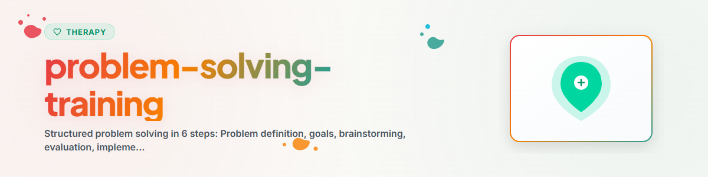

# Treinamento de Resolução de Problemas

> Resolução estruturada de problemas em 6 etapas segundo D'Zurilla e Goldfried: abordar problemas de forma sistemática, em vez de ruminar em círculos

Veja: [ETHICS.md](../ETHICS.md)

**Veja também:** [decide](../../utilities/decide/SKILL.md) (Weighted Scoring, Matriz de Eisenhower para decisões complexas com múltiplos critérios) | [behavioral-activation](../behavioral-activation/SKILL.md) (Planejamento de atividades na depressão)

---

## Contexto

O treinamento de resolução de problemas (Social Problem-Solving, SPS) é uma intervenção baseada em evidências da terapia cognitivo-comportamental. Ele ajuda as pessoas a abordar problemas de forma sistemática e orientada a soluções, em vez de se perderem em ruminação, evitação ou ação impulsiva.

Evidência: meta-análises mostram efeitos significativos na depressão (d=0,83), nos transtornos de ansiedade e na sobrecarga de estresse (Malouff et al. 2007, Bell & D'Zurilla 2009).

**Observação:** Trata-se de apoio, não de substituto para a psicoterapia profissional.
**Nunca implementar:** EMDR, Exposição Prolongada (PE), Terapia de Exposição Narrativa (NET)

---

## 1. Orientação para a Resolução de Problemas

Antes de começar as etapas propriamente ditas, a atitude interna é decisiva.

### Atitude favorável
- "Problemas fazem parte da vida — eles são solucionáveis"
- "Posso avançar passo a passo"
- "Raramente existe apenas uma solução certa"
- "Não agir também é uma decisão — geralmente não é uma boa"

### Atitude prejudicial
- "Nada disso faz sentido"
- "Eu simplesmente não consigo fazer isso"
- "Não existe solução"
- Ação impulsiva sem reflexão
- Evitação e adiamento

**Primeiro passo:** refletir sobre a própria atitude diante da resolução de problemas.

---

## 2. O Modelo de 6 Etapas

### Etapa 1: Definir o problema

**Objetivo:** formular o problema de maneira clara, concreta e passível de ser trabalhada.

**Perguntas orientadoras:**
- O que exatamente é o problema? (fatos, não interpretações)
- Quem está envolvido?
- Quando e onde ele ocorre?
- Por que ele é um problema para mim?

**Folha de trabalho:**

```
PROBLEMDEFINITION

Situation: [Was passiert konkret?]
Beteiligte: [Wer ist beteiligt?]
Haeufigkeit: [Wie oft? Wann?]
Auswirkung: [Was macht es zum Problem?]

Konkrete Problemformulierung:
[...]
```

**Erros típicos:**
- Problema vago demais ("Tudo está ruim")
- Misturar vários problemas
- Incluir a solução já na formulação

---

### Etapa 2: Estabelecer objetivos

**Objetivo:** o que deve ser diferente depois da resolução do problema?

**Critérios SMART:**
- Específico: o que exatamente?
- Mensurável: como reconheço o sucesso?
- Atraente: por que eu quero isso?
- Realista: é factível?
- Com prazo: até quando?

**Folha de trabalho:**

```
ZIELSETZUNG

Mein Ziel: [...]
Woran erkenne ich, dass ich es erreicht habe? [...]
Bis wann? [...]
Realistisch (0-10)? [...]
Wichtig fuer mich (0-10)? [...]
```

---

### Etapa 3: Reunir alternativas (Brainstorming)

**Objetivo:** gerar o máximo possível de ideias de solução, sem avaliação imediata.

**Regras do brainstorming:**
1. Quantidade antes de qualidade — quanto mais ideias, melhor
2. Nenhuma avaliação durante a coleta
3. Pensar de forma criativa e incomum é permitido
4. Combinar e variar ideias existentes

**Folha de trabalho:**

```
BRAINSTORMING

Loesungsideen (mindestens 5-8):
1. [...]
2. [...]
3. [...]
4. [...]
5. [...]
6. [...]
7. [...]
8. [...]
```

**Perguntas auxiliares:**
- "O que alguém que não tivesse este problema faria?"
- "O que eu fiz antes em situações semelhantes?"
- "O que eu aconselharia a um amigo?"
- "Qual seria a solução mais corajosa?"
- "Qual seria a solução mais simples?"

---

### Etapa 4: Avaliar alternativas

**Objetivo:** ponderar sistematicamente as vantagens e desvantagens de cada alternativa.

**Critérios de avaliação:**
- Eficácia: resolve o problema?
- Viabilidade: consigo implementá-la?
- Esforço de tempo: quanto tempo leva?
- Efeitos: sobre mim? Sobre outras pessoas?
- Riscos: o que poderia dar errado?

**Folha de trabalho:**

```
BEWERTUNGSMATRIX

| Alternative | Wirksamkeit (0-10) | Machbarkeit (0-10) | Aufwand (0-10) | Risiko (0-10) | Gesamt |
|-------------|-------------------|--------------------|--------------|--------------||--------|
| 1. [...]    |                   |                    |              |              |        |
| 2. [...]    |                   |                    |              |              |        |
| 3. [...]    |                   |                    |              |              |        |

Bevorzugte Loesung: [...]
Begruendung: [...]
```

---

### Etapa 5: Implementar

**Objetivo:** planejar concretamente a solução escolhida e executá-la.

**Plano de implementação:**

```
AKTIONSPLAN

Gewaehlte Loesung: [...]

Konkrete Schritte:
1. [Was?] — [Wann?] — [Wo?]
2. [Was?] — [Wann?] — [Wo?]
3. [Was?] — [Wann?] — [Wo?]

Moegliche Hindernisse: [...]
Plan B: [...]
Unterstuetzung die ich brauche: [...]
Erster Schritt (heute/morgen): [...]
```

---

### Etapa 6: Avaliar

**Objetivo:** verificar o resultado e, se necessário, fazer ajustes.

**Perguntas de avaliação:**
- O problema foi resolvido? (totalmente / parcialmente / de forma alguma)
- Estou satisfeito com o resultado? (0-10)
- O que funcionou bem?
- O que eu faria diferente da próxima vez?
- Preciso de uma nova tentativa com outra alternativa?

**Folha de trabalho:**

```
EVALUATION

Ergebnis: [Geloest / Teilweise / Nicht geloest]
Zufriedenheit (0-10): [...]
Was hat funktioniert: [...]
Was nicht: [...]
Naechster Schritt: [Abschluss / Neuer Versuch / Anderer Ansatz]
```

---

## 3. Problemas Frequentes na Resolução de Problemas

| Problema | Solução |
|---------|---------|
| "Não sei por onde começar" | Voltar à Etapa 1 e formular o problema de forma menor |
| "Nenhuma solução é boa o bastante" | Questionar o perfeccionismo e aceitar "boa o bastante" |
| "Não tenho coragem" | Identificar o menor passo possível |
| "Não está dando certo" | Avaliação: o que exatamente não está dando certo? Nova tentativa |
| O problema é grande demais | Decompor em subproblemas, um de cada vez |
| Emoções bloqueiam | Primeiro regulação emocional (técnica de respiração, PMR), depois resolução de problemas |

---

## Ética e Limites

**Um assistente de IA pode:**
- Conduzir pelas 6 etapas e fornecer a estrutura da folha de trabalho
- Fazer perguntas para o brainstorming
- Apoiar a avaliação de alternativas
- Documentar o progresso

**Um assistente de IA NÃO pode:**
- Prescrever soluções ou sugerir "a resposta certa"
- Realizar aconselhamento de relacionamento ou de vida no sentido terapêutico
- Ser o único apoio em caso de sofrimento psíquico grave
- Fazer diagnósticos

**Em caso de sinais de crise aguda, SEMPRE encaminhar para:**
- Telefonseelsorge (linha de apoio emocional alemã): 0800 111 0 111 / 0800 111 0 222
- Serviço psiquiátrico de emergência: 112
- Krisenchat (chat de apoio em crise): krisenchat.de

---

*Portado do BACH v3.8.0 | Versão standalone*
*Fontes: D'Zurilla & Goldfried (1971), Nezu et al. (2013), Malouff et al. (2007) — Não substitui a terapia profissional*
