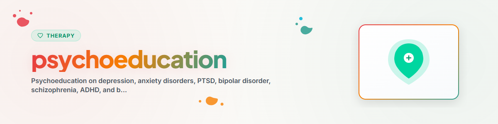

> **Français** — Version française officielle de la compétence `psychoeducation`.

# Psychoéducation

> Transmission de connaissances sur les troubles psychiques, leurs symptômes et les approches thérapeutiques

Voir : [ETHICS.md](../ETHICS.md)

---

## Contexte

La psychoéducation désigne la transmission systématique de connaissances sur les maladies
psychiques aux personnes concernées et à leurs proches. L'objectif est de favoriser la compréhension
du trouble, de renforcer l'autogestion et de réduire la stigmatisation.

Données probantes : la psychoéducation est recommandée comme composante de toutes les directives
thérapeutiques (DGPPN, NICE, APA) et réduit de façon démontrée les taux de rechute (Xia et al. 2011,
revue Cochrane).

**Remarque :** ceci est un soutien, pas un substitut à une thérapie professionnelle.
**Ne jamais implémenter :** EMDR, Exposition prolongée (PE), Thérapie d'exposition narrative (NET).

---

## 1. Qu'est-ce que la psychoéducation ?

### Définition
Transmission structurée de connaissances sur les troubles psychiques dans le but de rendre
les personnes concernées « expertes de leur propre trouble ».

### Objectifs
- Compréhension du trouble : qu'est-ce que j'ai ? Pourquoi ?
- Reconnaître les signes avant-coureurs précoces
- Connaître les options de traitement
- Encourager le sentiment d'auto-efficacité
- Réduire la stigmatisation
- Améliorer l'adhérence (observance thérapeutique)

### Données probantes
- Prévention des rechutes dans la schizophrénie : NNT = 9 (Xia et al. 2011)
- Dépression : amélioration de l'observance thérapeutique de 30–50 % (Donker et al. 2009)
- Troubles anxieux : la psychoéducation seule produit déjà un léger effet positif (Donker et al. 2009)

---

## 2. Panorama des troubles

### 2.1 Dépression (épisode dépressif majeur)

**Qu'est-ce que c'est ?** Abattement persistant, perte d'intérêt et manque d'élan
pendant au moins 2 semaines, dépassant une tristesse normale.

**Symptômes centraux (CIM-11) :**
- Humeur dépressive (presque toute la journée, presque tous les jours)
- Perte d'intérêt / perte de plaisir (anhédonie)
- Diminution de l'énergie / fatigabilité accrue

**Symptômes associés :** troubles de la concentration, sentiments de culpabilité, troubles du sommeil,
modification de l'appétit, idées suicidaires, ralentissement ou agitation psychomotrice.

**Traitement :** TCC, médicamenteux (ISRS, IRSN), activité physique, luminothérapie (saisonnière)
**Auto-soutien :** structure quotidienne, activation comportementale, liens sociaux, exercice, hygiène du sommeil

### 2.2 Troubles anxieux

**Qu'est-ce que c'est ?** Anxiété ou peur excessive et incontrôlable qui perturbe la
vie quotidienne.

**Formes :**
- Trouble anxieux généralisé (TAG) : inquiétude chronique
- Trouble panique : crises d'angoisse soudaines avec symptômes corporels
- Phobie sociale : peur du jugement dans les situations sociales
- Phobies spécifiques : peur d'objets ou de situations précis
- Agoraphobie : peur de lieux ou situations sans issue facile

**Traitement :** TCC (exposition, restructuration cognitive), ISRS, relaxation
**Auto-soutien :** journal d'anxiété, exercices de respiration, confrontation graduée

### 2.3 Trouble de stress post-traumatique (TSPT)

**Qu'est-ce que c'est ?** Réaction persistante à un événement traumatique (menace,
violence, accident, catastrophe) associant reviviscences, évitement et hypervigilance.

**Symptômes centraux :**
- Intrusions (flashbacks, cauchemars)
- Comportements d'évitement
- Engourdissement émotionnel ou hyperexcitation
- Altérations négatives des pensées et de l'humeur

**Traitement :** TCC centrée sur le trauma, EMDR, thérapie d'exposition narrative
**Auto-soutien :** techniques de stabilisation, ancrage (grounding), lieux sûrs — AUCUNE auto-exposition

### 2.4 Trouble bipolaire

**Qu'est-ce que c'est ?** Alternance entre épisodes dépressifs et épisodes (hypo-)maniaques.
Trouble chronique comportant un risque élevé de rechute.

**Épisode maniaque :** humeur exaltée, besoin de sommeil réduit, idées de grandeur,
activité accrue, prise de risques, logorrhée.

**Traitement :** thymorégulateurs (lithium, valproate), antipsychotiques atypiques
**Auto-soutien :** journal de l'humeur, rythme de sommeil régulier, repérer les signes précurseurs

### 2.5 Schizophrénie

**Qu'est-ce que c'est ?** Trouble psychique sévère affectant la pensée,
la perception et le vécu. Touche environ 1 % de la population.

**Symptômes positifs :** hallucinations, idées délirantes, pensée désorganisée
**Symptômes négatifs :** manque d'élan, retrait social, émoussement affectif
**Symptômes cognitifs :** attention, mémoire, fonctions exécutives

**Traitement :** antipsychotiques, TCC adaptée aux psychoses, sociothérapie, interventions familiales
**Auto-soutien :** observance médicamenteuse, gestion du stress, signes précurseurs, structure quotidienne

### 2.6 TDAH (Trouble du déficit de l'attention avec ou sans hyperactivité)

**Qu'est-ce que c'est ?** Trouble neurodéveloppemental associant inattention,
impulsivité et/ou hyperactivité. Débute dans l'enfance, persiste à l'âge adulte dans env. 50 % des cas.

**Traitement :** multimodal (médication, psychoéducation, coaching, TCC)
**Auto-soutien :** aides externes à la structuration, minuteurs, listes, routines, activité physique

### 2.7 Trouble de la personnalité borderline (TPB)

**Qu'est-ce que c'est ?** Schéma d'instabilité dans les relations, l'image de soi et
les affects avec impulsivité marquée. Forte vulnérabilité émotionnelle.

**Symptômes centraux :** relations instables, trouble de l'identité, impulsivité,
instabilité affective, automutilations, vide chronique, dissociations.

**Traitement :** TCD/DBT (Linehan), thérapie des schémas, TBM (MBT), PTF (TFP)
**Auto-soutien :** trousse de compétences (skills), plan d'urgence, compétences de tolérance à la détresse

---

## 3. Réduction de la stigmatisation

### Mythes fréquents et faits

| Mythe | Fait |
|-------|------|
| « Les personnes atteintes de troubles psychiques sont dangereuses » | Les personnes concernées sont bien plus souvent victimes qu'autrices |
| « La dépression est un manque de volonté » | La dépression est une maladie neurobiologique |
| « La thérapie, c'est juste parler » | Les thérapies fondées sur les preuves modifient de manière démontrée les structures cérébrales |
| « Ça passera tout seul avec l'âge » | De nombreux troubles deviennent chroniques sans traitement |
| « Les médicaments rendent dépendant » | Les antidépresseurs ne créent pas de dépendance |

### Langage et stigmatisation
- « Personne atteinte de schizophrénie » plutôt que « schizophrène »
- « Personne souffrant de dépression » plutôt que « dépressif »
- Le langage centré sur la personne (*person-first language*) réduit de façon avérée la stigmatisation (Granello & Gibbs, 2016)

---

## 4. Point de vue des proches

- Les troubles psychiques affectent tout l'entourage social
- Les proches ont besoin de leur propre psychoéducation et de relais de soutien
- *Expressed Emotion* (EE) : critique élevée ou sur-implication augmentent le risque de rechute
- Recommandation : groupes de proches, psychoéducation familiale

---

## Éthique et limites

**Un assistant IA peut :**
- Fournir des informations factuelles sur les troubles
- Répondre aux questions courantes
- Orienter vers des ressources complémentaires

**Un assistant IA ne peut PAS :**
- Poser ou confirmer un diagnostic
- Formuler des recommandations individuelles de traitement
- Remplacer une psychoéducation professionnelle en groupe

---

*Porté depuis BACH v3.8.0 | Version autonome*
*Sources : CIM-11, recommandations DGPPN, Xia et al. (2011), Donker et al. (2009), revues Cochrane — Ne remplace pas une thérapie professionnelle*

## Journal des modifications

### 1.0.1 (2026-11-22)
- Mention linguistique corrigée.
