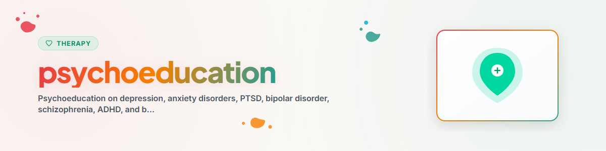

# मनोशिक्षा

> मानसिक बीमारियों, लक्षणों और उपचार दृष्टिकोणों के बारे में ज्ञान का प्रसार

देखें: [ETHICS.md](../ETHICS.md)

---

## संदर्भ

मनोशिक्षा से तात्पर्य प्रभावित व्यक्तियों और उनके परिजनों को मानसिक बीमारियों के बारे में व्यवस्थित रूप से ज्ञान देने से है। इसका उद्देश्य बीमारी की समझ को बढ़ावा देना, स्व-प्रबंधन को सशक्त करना और कलंक को कम करना है।

साक्ष्य: मनोशिक्षा को सभी चिकित्सा दिशानिर्देशों (DGPPN, NICE, APA) में एक घटक के रूप में अनुशंसित किया गया है और यह पुनरावृत्ति दरों को प्रमाणित रूप से कम करती है (Xia et al. 2011, Cochrane Review)।

**नोट:** यह सहायता है, पेशेवर चिकित्सा का विकल्प नहीं।
**कभी लागू न करें:** EMDR, Prolonged Exposure (PE), Narrative Exposure Therapy (NET)

---

## 1. मनोशिक्षा क्या है?

### परिभाषा
मानसिक बीमारियों के बारे में संरचित ज्ञान का संचार, जिसका लक्ष्य प्रभावित व्यक्तियों को उनकी अपनी बीमारी का "विशेषज्ञ" बनाना है।

### लक्ष्य
- बीमारी की समझ: मुझे क्या है? क्यों?
- प्रारंभिक चेतावनी संकेतों को पहचानना
- उपचार विकल्पों को जानना
- स्व-प्रभावकारिता को बढ़ावा देना
- कलंक को कम करना
- Adherence (उपचार के प्रति निष्ठा) में सुधार

### साक्ष्य
- सिज़ोफ्रेनिया में पुनरावृत्ति रोकथाम: NNT = 9 (Xia et al. 2011)
- अवसाद: उपचार के प्रति निष्ठा में 30-50% सुधार (Donker et al. 2009)
- चिंता विकार: अकेले मनोशिक्षा भी हल्के रूप में प्रभावी (Donker et al. 2009)

---

## 2. बीमारी के स्वरूपों का अवलोकन

### 2.1 अवसाद (Major Depression)

**यह क्या है?** कम से कम 2 सप्ताह तक बने रहने वाली उदासी, रुचि की हानि और सुस्ती, जो सामान्य दुःख से परे हो।

**मुख्य लक्षण (ICD-11):**
- अवसादग्रस्त मनोदशा (लगभग पूरे दिन, लगभग हर दिन)
- रुचि की हानि / आनंद महसूस करने की क्षमता में कमी (Anhedonie)
- घटी हुई प्रेरणा / बढ़ी हुई थकान

**अतिरिक्त लक्षण:** एकाग्रता की समस्याएँ, अपराधबोध, नींद की समस्याएँ, भूख में बदलाव, आत्महत्या के विचार, मनोगत्यात्मक मंदता/उत्तेजना

**उपचार:** CBT (KVT), दवाइयाँ (SSRI, SNRI), व्यायाम, प्रकाश चिकित्सा (मौसमी)
**स्व-सहायता:** दैनिक दिनचर्या, गतिविधियों का निर्माण, सामाजिक संपर्क, व्यायाम, नींद की स्वच्छता

### 2.2 चिंता विकार

**यह क्या है?** अत्यधिक, अनियंत्रित चिंता या भय, जो दैनिक जीवन को प्रभावित करता है।

**प्रकार:**
- सामान्यीकृत चिंता विकार (GAS): दीर्घकालिक चिंता करना
- पैनिक डिसऑर्डर: शारीरिक लक्षणों के साथ अचानक घबराहट के दौरे
- सामाजिक फोबिया: सामाजिक स्थितियों में मूल्यांकन का भय
- विशिष्ट फोबिया: ठोस वस्तुओं/स्थितियों का भय
- एगोराफोबिया: ऐसे स्थानों/स्थितियों का भय जहाँ से बच निकलने का कोई रास्ता न हो

**उपचार:** CBT (एक्सपोज़र, संज्ञानात्मक पुनर्संरचना), SSRI, विश्रांति
**स्व-सहायता:** चिंता डायरी, श्वास अभ्यास, क्रमिक सामना

### 2.3 पोस्ट-ट्रॉमैटिक स्ट्रेस डिसऑर्डर (PTSD)

**यह क्या है?** किसी दर्दनाक अनुभव (खतरा, हिंसा, दुर्घटना, आपदा) पर दीर्घकालिक प्रतिक्रिया, जिसमें पुनः-अनुभव, परहेज़ और अतिउत्तेजना शामिल हैं।

**मुख्य लक्षण:**
- घुसपैठी स्मृतियाँ (Flashbacks, बुरे सपने)
- परहेज़ का व्यवहार
- भावनात्मक सुन्नता या अतिउत्तेजना
- विचारों और मनोदशा में नकारात्मक बदलाव

**उपचार:** आघात-केंद्रित CBT, EMDR, नैरेटिव एक्सपोज़र थेरेपी
**स्व-सहायता:** स्थिरीकरण तकनीकें, Grounding, सुरक्षित स्थान — स्वयं-एक्सपोज़र बिल्कुल नहीं

### 2.4 द्विध्रुवीय विकार

**यह क्या है?** अवसादग्रस्त और (हाइपो-)मैनिक एपिसोड के बीच परिवर्तन। उच्च पुनरावृत्ति जोखिम वाली दीर्घकालिक बीमारी।

**मैनिक एपिसोड:** उन्नत मनोदशा, नींद की कम आवश्यकता, भव्यता के विचार, बढ़ी हुई गतिविधि, जोखिम लेने की प्रवृत्ति, तेज़ बोलना

**उपचार:** मूड स्टेबलाइज़र (लिथियम, वैल्प्रोएट), एटिपिकल एंटीसाइकोटिक्स
**स्व-सहायता:** मूड डायरी, नियमित नींद का चक्र, प्रारंभिक चेतावनी संकेतों को जानना

### 2.5 सिज़ोफ्रेनिया

**यह क्या है?** सोच, धारणा और अनुभव में गड़बड़ी वाली गंभीर मानसिक बीमारी। लगभग 1% आबादी को प्रभावित करती है।

**सकारात्मक लक्षण:** मतिभ्रम, भ्रम, अव्यवस्थित सोच
**नकारात्मक लक्षण:** सुस्ती, सामाजिक अलगाव, भावना का सपाट होना
**संज्ञानात्मक लक्षण:** ध्यान, स्मृति, कार्यकारी कार्य

**उपचार:** एंटीसाइकोटिक्स, मनोविकारों के लिए CBT, सोशियोथेरेपी, पारिवारिक हस्तक्षेप
**स्व-सहायता:** दवा का पालन (Adherence), तनाव से बचाव, प्रारंभिक चेतावनी संकेत, दैनिक दिनचर्या

### 2.6 ADHD (अटेंशन डेफिसिट हाइपरएक्टिविटी डिसऑर्डर)

**यह क्या है?** ध्यान की कमी / असावधानी, आवेग और/या अति-सक्रियता के साथ एक न्यूरोबायोलॉजिकल विकास संबंधी विकार। बचपन में शुरू होता है और लगभग 50% मामलों में वयस्कता तक बना रहता है।

**उपचार:** बहुआयामी (दवा, मनोशिक्षा, कोचिंग, CBT)
**स्व-सहायता:** बाहरी संरचनात्मक सहायता, टाइमर, सूचियाँ, दिनचर्या, व्यायाम

### 2.7 बॉर्डरलाइन व्यक्तित्व विकार (BPS)

**यह क्या है?** रिश्तों, आत्म-छवि और भावनाओं में अस्थिरता का स्वरूप, जिसमें स्पष्ट आवेगशीलता होती है। भावनात्मक संवेदनशीलता उच्च होती है।

**मुख्य लक्षण:** अस्थिर संबंध, पहचान संबंधी गड़बड़ी, आवेगशीलता, भावात्मक अस्थिरता, आत्म-क्षति, दीर्घकालिक खालीपन, विच्छेदन (Dissoziationen)

**उपचार:** DBT (Linehan), Schematherapie, MBT, TFP
**स्व-सहायता:** स्किल्स-किट, आपातकालीन योजना, तनाव सहनशीलता कौशल

---

## 3. कलंक में कमी

### सामान्य मिथक और तथ्य

| मिथक | तथ्य |
|--------|------|
| "मानसिक रोगी खतरनाक होते हैं" | प्रभावित व्यक्ति अपराधी से अधिक बार पीड़ित होते हैं |
| "अवसाद इच्छाशक्ति की कमजोरी है" | अवसाद एक न्यूरोबायोलॉजिकल बीमारी है |
| "थेरेपी केवल बात करना है" | साक्ष्य-आधारित थेरेपी प्रमाणित रूप से मस्तिष्क संरचनाओं को बदलती है |
| "यह अपने-आप ठीक हो जाता है" | कई बीमारियाँ बिना उपचार के दीर्घकालिक हो जाती हैं |
| "दवाइयाँ आदी बनाती हैं" | एंटीडिप्रेसेंट्स से कोई लत नहीं लगती |

### भाषा और कलंक
- "सिज़ोफ्रेनिक" के बजाय "सिज़ोफ्रेनिया से ग्रस्त"
- "अवसादग्रस्त" के बजाय "अवसाद से पीड़ित व्यक्ति"
- व्यक्ति-प्रथम भाषा कलंक को प्रमाणित रूप से कम करती है (Granello & Gibbs, 2016)

---

## 4. परिजनों का दृष्टिकोण

- मानसिक बीमारियाँ पूरे सामाजिक परिवेश को प्रभावित करती हैं
- परिजनों को अपनी मनोशिक्षा और राहत की आवश्यकता है
- अभिव्यक्त भावना (Expressed Emotion, EE): उच्च आलोचना/अति-संलग्नता पुनरावृत्ति जोखिम बढ़ाती है
- सिफारिश: परिजन समूह, पारिवारिक मनोशिक्षा

---

## नैतिकता और सीमाएँ

**एक AI सहायक कर सकता है:**
- बीमारी के स्वरूपों के बारे में तथ्यात्मक जानकारी देना
- सामान्य प्रश्नों के उत्तर देना
- आगे के संसाधनों की ओर संकेत करना

**एक AI सहायक नहीं कर सकता:**
- निदान करना या उसकी पुष्टि करना
- व्यक्तिगत उपचार सिफारिशें देना
- समूह प्रारूप में पेशेवर मनोशिक्षा का स्थान लेना

---

*BACH v3.8.0 से पोर्ट किया गया | स्टैंडअलोन संस्करण*
*स्रोत: ICD-11, DGPPN-दिशानिर्देश, Xia et al. (2011), Donker et al. (2009), Cochrane Reviews — पेशेवर चिकित्सा नहीं*
